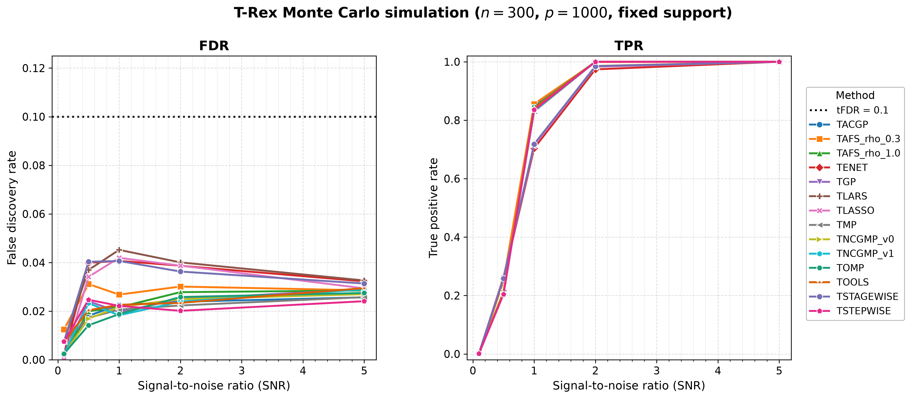
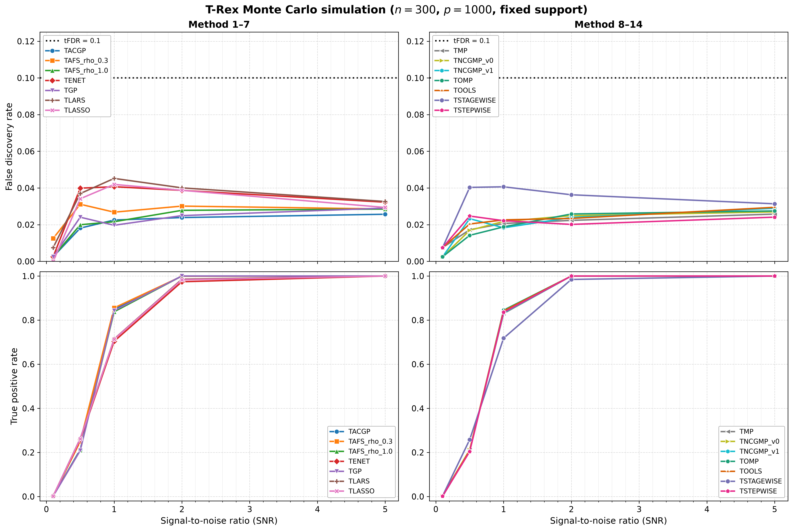

# Demo 02: Monte Carlo Simulation with Fixed Support (Python)

## Purpose

Evaluate the Terminating Random Experiments (T-Rex) selector performance,
measured by the false discovery rate (FDR) and the true positive rate (TPR),
across a range of **Signal-to-Noise Ratios (SNR)** with a **fixed** true
support, comparing all default base solvers. This is the foundational empirical
validation demo for the classical T-Rex algorithm. Python port of
[cpp/trex_selector_methods/ad/trex_core/demo_trex_02_mc_sim_fixed_support](../../../../../cpp/trex_selector_methods/ad/trex_core/demo_trex_02_mc_sim_fixed_support/),
using `trexselector`.

---

## Data Generation Parameters

The shared Gaussian data-generating process (DGP) `dgp_gauss_snr` draws an
independent and identically distributed (i.i.d.) standard-normal design
$\boldsymbol{X}$ (independent columns), so the design carries **no correlation
structure** — the empirical column-correlation matrix is essentially the
identity:

```math
\boldsymbol{y} = \boldsymbol{X}\boldsymbol{\beta} + \boldsymbol{\epsilon},
\qquad \boldsymbol{\epsilon} \sim \mathcal{N}(\boldsymbol{0}, \sigma^2 \boldsymbol{I}_n).
```


- **Sample size**: $n = 300$, **features**: $p = 1{,}000$ (high-dimensional), $s = 10$
- **True support**: drawn **once** via `make_support_random(s, p, seed=24)` and
  shared across every solver, SNR level, and Monte Carlo (MC) trial — it is
  **not** the first 10 features
- **True coefficients**: fixed $\beta_j = 1$ (`rnd_coef = False`)
- **SNR grid**: $\lbrace0.1, 0.5, 1.0, 2.0, 5.0\rbrace$
- **Monte Carlo repetitions**: `num_MC = 200` trials per solver × SNR
  (`_NUM_MC = 200`, which mirrors the C++ reference exactly)

`main()` runs the high-dimensional configuration only.

---

## Control Parameters

```text
K                     = 20         # Random experiments per T-loop iteration
max_dummy_multiplier  = 10         # Max dummies L = 10p
use_max_T_stop        = True       # Cap T <= ceil(n/2)
dummy_distribution    = Normal     # Dummy predictors drawn from N(0,1)
lloop_strategy        = STANDARD   # Fresh i.i.d. dummy matrix per L-loop iteration
tloop_stagnation_stop = True       # Early exit when R_mat stagnates
tloop_max_stagnant_steps = 7       # Stagnation window (-> "stagnation_window_7")
opt_threshold         = 0.75       # Optimization grid point
use_memory_mapping    = False      # In-memory data
tFDR                  = 0.1        # Target FDR control level
```

---

## Solvers Compared

The shared `SOLVERS_DEFAULT` list provides the **14** terminating base solvers.
Their selections are **not** identical — each drives a different underlying
path/pursuit algorithm, so FDR/TPR differ across solvers:

- **TLARS** (least-angle regression), **TLASSO** (lasso),
  **TENET** (elastic net, $\lambda_2 = 0.1$), **TSTAGEWISE** (forward stagewise),
  **TSTEPWISE** (forward stepwise), **TOMP** (orthogonal matching pursuit),
  **TGP** (gradient pursuit), **TACGP** (adaptive-conjugate gradient pursuit),
  **TMP** (matching pursuit), **TAFS_rho_0.3** / **TAFS_rho_1.0** (adaptive
  forward selection), **TNCGMP_v1** / **TNCGMP_v0** (norm-corrected generalized
  matching pursuit), **TOOLS** (orthogonal least-squares).

---

## Output Files

Written to `simulation_results/data/` via `save_mc_results`, stem
`demo_trex_02_mc_sim_fixed_support_trex_results_n300_p1000_stagnation_window_7`:

- **`..._stagnation_window_7.txt`** — aligned FDR/TPR table, one metric-row pair
  per solver across the SNR columns.
- **`..._stagnation_window_7.csv`** — tidy `solver,metric,snr,value` schema
  (metric before snr), matching the C++ result files, so the C++ suite's
  [`trex_plt_utils.py`](../../../../../cpp/trex_selector_methods/ad/trex_core/trex_plt_utils.py)
  renders the same FDR/TPR-vs-SNR figures from these comma-separated values
  (CSV) files.

The figures themselves live in `simulation_results/plots/` (overview + grouped
figures as Portable Network Graphics (PNG) and Portable Document Format (PDF)
files, plus an interactive Plotly `.html` page on request) — see **Results Visualization** below.

---

## Results Visualization

The shared plotting module [`../trex_plt_utils.py`](../trex_plt_utils.py) renders
the tidy CSV three ways (all written to `simulation_results/plots/`).

### Overview (all 14 solvers)

FDR and TPR versus SNR (log-scaled x-axis), all solvers on one pair of panels:



*Left:* FDR stays comfortably below the target `tFDR = 0.1` (black dotted line)
across all SNR levels for every solver — the maximum over the whole run is only
$\approx 0.045$. *Right:* TPR rises from near-zero at SNR 0.1 to full recovery
(TPR $= 1.0$) by SNR 5.0 for every solver. The greedy solvers
(TSTEPWISE/TOMP/TGP/…) already hit $1.0$ at SNR 2.0, while the solvers on the
least-angle regression (LARS) path (TLARS/TLASSO/TENET/TSTAGEWISE) reach
$0.97\text{–}0.99$ there.

### Grouped 2×2 view (de-cluttered)

The same data with the solvers split into two halves (columns) and FDR/TPR on the
two rows, so each panel carries only ~7 curves — easier to read where they bunch
up. Both FDR panels share a y-scale for comparison:



### Interactive (Plotly HTML, on request)

`..._fdr_tpr_vs_snr.html` is a self-contained interactive figure — hover for exact
values and **click a solver in the legend to isolate its curve** in both panels.
Open it directly in a browser (it is not rendered inline on GitHub).
The `.html` figures are off by default and never committed, since each embeds a full copy
of plotly.js (about 5 MB). Run `./generate_plots.sh --plotly` to produce them locally.

```bash
open simulation_results/plots/demo_trex_02_mc_sim_fixed_support_trex_results_n300_p1000_stagnation_window_7_fdr_tpr_vs_snr.html
```

Vector `.pdf` copies of both static figures sit alongside the `.png` files.

### Regenerating the figures

The wrapper picks up the repo's local `.venv` automatically, so no manual path or
`activate` is needed. By default it produces the two static views (overview +
grouped), and `--plotly` adds the interactive `.html` page:

```bash
# From this demo folder:
./generate_plots.sh                 # overview + grouped (png+pdf)
./generate_plots.sh --plotly        # plus the interactive html (not committed)
./generate_plots.sh --plotly-cdn    # tiny html that loads plotly.js from a CDN
./generate_plots.sh --tfdr 0.05     # e.g. a different target-FDR line
```

The underlying `../trex_plt_utils.py` is shared by every demo in this suite whose
results use the tidy `solver,metric,snr,value` schema — it infers the row colours
from the data and writes the figures into the `simulation_results/plots/` sibling
of a `data/` CSV. As a one-time setup, the plotter needs `matplotlib`, plus `plotly`
for `--plotly` (the repo `.venv` already ships `pandas`) — `pip install matplotlib plotly`.

---

## Running

```bash
python Python/trex_selector_methods/ad/trex_core/demo_trex_02_mc_sim_fixed_support/demo_trex_02_mc_sim_fixed_support.py
```

The MC loop is parallelized with `ProcessPoolExecutor`, with `TREX_NUM_WORKERS`
worker processes (default 8, see `resolve_workers()` in
[`../trex_sim_common.py`](../trex_sim_common.py)).
