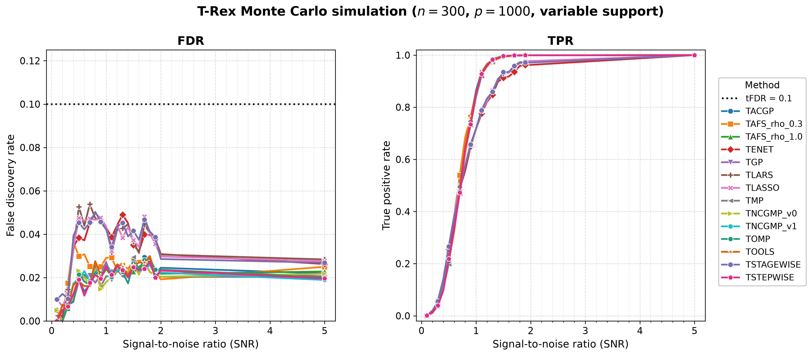
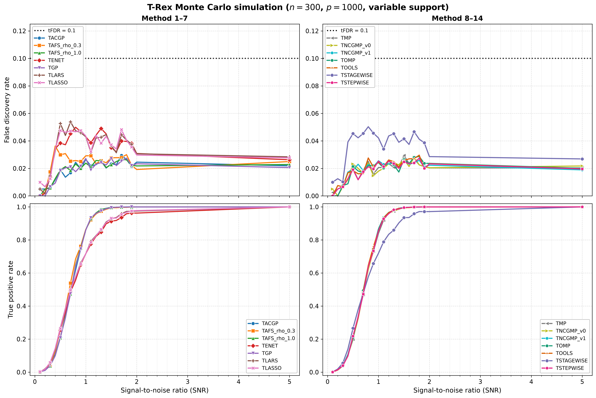

# Demo 03: Monte Carlo Simulation with Variable Support Indices (Python)

## Purpose

Investigate the Terminating Random Experiments (T-Rex) selector performance,
measured by the false discovery rate (FDR), the true positive rate (TPR), the
average dummy multiplier $L$ and the average stopping time $T$, when the
**positions** of the active variables are redrawn on every Monte Carlo (MC) trial
while the **number** of active variables stays fixed. This isolates the effect of
support *location* (rather than support size) and complements the fixed-support
study in Demo 02. Python port of
[cpp/trex_selector_methods/ad/trex_core/demo_trex_03_mc_sim_variable_support](../../../../../cpp/trex_selector_methods/ad/trex_core/demo_trex_03_mc_sim_variable_support/),
using `trexselector`.

---

## Data Generation Parameters

The shared Gaussian data-generating process (DGP) `dgp_gauss_snr` draws an
independent and identically distributed (i.i.d.) standard-normal design
$\boldsymbol{X}$ (independent columns), so the design carries **no correlation
structure** — the empirical column-correlation matrix is essentially the
identity:

```math
\boldsymbol{y} = \boldsymbol{X}\boldsymbol{\beta} + \boldsymbol{\epsilon},
\qquad \boldsymbol{\epsilon} \sim \mathcal{N}(\boldsymbol{0}, \sigma^2 \boldsymbol{I}_n).
```


- **Sample size**: $n = 300$, **features**: $p = 1{,}000$ (high-dimensional)
- **True support cardinality**: fixed at $s = 10$ on every trial. The support
  **size does not vary**, and only the **indices** change — each trial redraws
  them via `make_support_random` (`fixed_support=None`).
- **True coefficients**: fixed $\beta_j = 1$ (`rnd_coef = False`)
- **Signal-to-noise ratio (SNR) grid**: a **21-point grid** —
  $\lbrace0.1, 0.2, \ldots, 2.0\rbrace$ (step $0.1$) plus $5.0$
- **Monte Carlo repetitions**: `num_MC = 200` trials per solver × SNR
  (`_NUM_MC = 200`, mirroring the C++ reference's `num_MC = 200`)

`main()` runs the high-dimensional configuration only.

---

## Control Parameters

```text
K                     = 20         # Random experiments per T-loop iteration
max_dummy_multiplier  = 10         # Max dummies L = 10p
use_max_T_stop        = True       # Cap T <= ceil(n/2)
dummy_distribution    = Normal     # Dummy predictors drawn from N(0,1)
lloop_strategy        = HCONCAT    # Horizontally concatenated dummy columns
tloop_stagnation_stop = True       # Early exit when R_mat stagnates
tloop_max_stagnant_steps = 5       # Stagnation window (-> "stagnation_window_5")
tFDR                  = 0.1        # Target FDR control level
```

---

## Solvers Compared

The same **14** T-Rex base solvers as Demo 02, via `SOLVERS_DEFAULT` (TLARS,
TLASSO, TENET, TSTAGEWISE, TSTEPWISE, TOMP, TGP, TACGP, TMP, TAFS_rho_0.3,
TAFS_rho_1.0, TNCGMP_v1, TNCGMP_v0, TOOLS). Unlike Demo 02, this demo also
records the averaged dummy multiplier $L$ and stopping time $T$ per solver × SNR.

---

## Output Files

Written to `simulation_results/data/`, stem
`demo_trex_03_mc_sim_variable_support_trex_results_n300_p1000_stagnation_window_5`:

- **`..._stagnation_window_5.txt`** — aligned table with four metric rows per
  solver (FDR, TPR, Avg L, Avg T) across the 21 SNR columns.
- **`..._stagnation_window_5.csv`** — tidy `solver,metric,snr,value` schema with
  `FDR`, `TPR`, `AvgL`, `AvgT` rows, matching the C++ result files, so the C++
  suite's
  [`trex_plt_utils.py`](../../../../../cpp/trex_selector_methods/ad/trex_core/trex_plt_utils.py)
  renders the same figures (it plots the FDR/TPR rows and ignores AvgL/AvgT).

The rendered figures, as Portable Network Graphics (PNG) and Portable Document
Format (PDF) files plus the interactive Plotly `.html` page on request, are written to
`simulation_results/plots/` — see [Results Visualization](#results-visualization).

---

## Results Visualization

The suite-level plotting module [`../trex_plt_utils.py`](../trex_plt_utils.py)
renders the tidy comma-separated values (CSV) file three ways (all written to
`simulation_results/plots/`). Only the `FDR` and `TPR` rows are plotted, while
the plotter ignores the `AvgL` / `AvgT` rows, which remain available in the
`.txt` / `.csv` data files.

### Overview (all 14 solvers)

FDR and TPR versus SNR (log-scaled x-axis) over the fine 21-point grid, all
solvers on one pair of panels, with the legend just right of the TPR panel:



*Left:* even with the support indices redrawn every trial, FDR stays well below
the target `tFDR = 0.1` (black dotted line) for every solver across the whole SNR
grid — FDR control is robust to the location of the active set (the maximum over
the entire table is $\approx 0.054$). *Right:* with `num_MC = 200` the fine grid
gives a smooth power curve — TLARS TPR climbs from near-zero at SNR 0.1
($\approx 0.001$) to near-perfect recovery by SNR $\approx 2$ ($\approx 0.975$)
and full recovery at SNR 5.0 ($1.000$).

### Grouped 2×2 view (de-cluttered)

The same data with the solvers split into two halves (columns) and FDR/TPR on the
two rows, so each panel carries only ~7 curves — easier to read where they bunch
up. Both FDR panels share a y-scale for comparison:



### Interactive (Plotly HTML, on request)

`..._fdr_tpr_vs_snr.html` is a self-contained interactive figure — hover for exact
values and **click a solver in the legend to isolate its curve** in both panels.
Open it directly in a browser (it is not rendered inline on GitHub).
The `.html` figures are off by default and never committed, since each embeds a full copy
of plotly.js (about 5 MB). Run `./generate_plots.sh --plotly` to produce them locally.

```bash
open simulation_results/plots/demo_trex_03_mc_sim_variable_support_trex_results_n300_p1000_stagnation_window_5_fdr_tpr_vs_snr.html
```

Vector `.pdf` copies of both static figures sit alongside the `.png` files.

### Regenerating the figures

The wrapper picks up the repo's local `.venv` automatically (no manual path or
`activate` needed):

```bash
# From this demo folder:
./generate_plots.sh                 # overview + grouped (png+pdf)
./generate_plots.sh --plotly        # plus the interactive html (not committed)
./generate_plots.sh --tfdr 0.05     # e.g. a different target-FDR line
```

The shared [`../trex_plt_utils.py`](../trex_plt_utils.py) infers row colours from
the data and is used by every demo in this suite with the tidy
`solver,metric,snr,value` schema (demos 02/03/04/05).

---

## Running

```bash
python Python/trex_selector_methods/ad/trex_core/demo_trex_03_mc_sim_variable_support/demo_trex_03_mc_sim_variable_support.py
```

The MC loop is parallelized with `ProcessPoolExecutor`, with `TREX_NUM_WORKERS`
worker processes (default 8, see `resolve_workers()` in
[`../trex_sim_common.py`](../trex_sim_common.py)).
