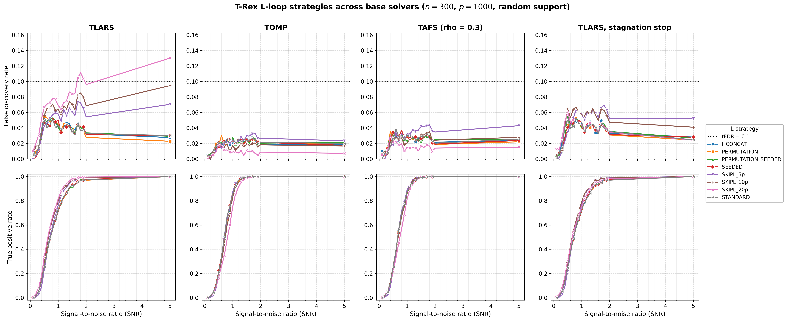
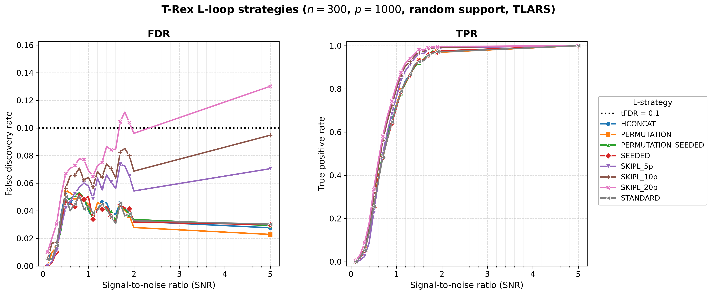

# Demo 04: L-Loop Strategy Comparison (Python)

## Purpose

Compare the **L-loop strategies** of the Terminating Random Experiments (T-Rex)
selector — the different mechanisms by which the dummy-variable structure is
generated/expanded across L-loop iterations — and repeat the whole comparison
across **three base solver families** (TLARS, TOMP, TAFS), plus TLARS_STAG, TLARS
with the T-loop stagnation stop. This shows how the L-loop strategy affects
control of the false discovery rate (FDR), power as measured by the true positive
rate (TPR), and the calibrated dummy multiplier $L$ / stopping time $T$, and —
crucially — where the fixed-budget `SKIPL` FDR overshoot seen under TLARS comes
from. It could be specific to the least-angle regression (LARS) path or come from
TLARS running without the stagnation stop. Python port of
[cpp/trex_selector_methods/ad/trex_core/demo_trex_04_mc_sim_lloop_strategies](../../../../../cpp/trex_selector_methods/ad/trex_core/demo_trex_04_mc_sim_lloop_strategies/),
and the R version sweeps the same four base solvers.

---

## Data Generation Parameters

The shared Gaussian data-generating process (DGP) `dgp_gauss_snr` draws an
independent and identically distributed (i.i.d.) standard-normal design
$\boldsymbol{X}$ (independent columns), so the design carries **no correlation
structure** — the empirical column-correlation matrix is essentially the
identity:

```math
\boldsymbol{y} = \boldsymbol{X}\boldsymbol{\beta} + \boldsymbol{\epsilon},
\qquad \boldsymbol{\epsilon} \sim \mathcal{N}(\boldsymbol{0}, \sigma^2 \boldsymbol{I}_n).
```


- **Sample size**: $n = 300$, **features**: $p = 1{,}000$ (high-dimensional), $s = 10$
- **True support**: random subset of size 10, **redrawn per trial**
  (`block_support=False`), while a contiguous block support
  $\lbrace0, \ldots, s-1\rbrace$ is available via `block_support=True`
- **True coefficients**: fixed $\beta_j = 1$ (`rnd_coef = False`)
- **Signal-to-noise ratio (SNR) grid**: 21 values — $\lbrace0.1, 0.2, \ldots, 2.0\rbrace$ plus $5.0$
- **Monte Carlo (MC) repetitions**: `num_MC = 200` trials per strategy × SNR
  (`_NUM_MC = 200`, mirroring the C++ reference — the full grid is 4 solvers ×
  8 strategies × 21 SNR)
- **Base solvers** (`_SOLVERS`, outer sweep, one result-file pair each): **TLARS**
  (the stagnation stop AUTO-resolves to *disabled*), **TOMP** and **TAFS**
  (`rho_afs = 0.3`), where it is *enabled*, and **TLARS_STAG** (TLARS with the
  stagnation stop *enabled*, window 5)

---

## L-Loop Strategies Tested

`L_STRATEGIES` defines the **eight rows** (mirrors `make_lloop_strategies()`),
spanning two axes: **dummy source** (fresh i.i.d. draws vs a shared base matrix
permuted per experiment) and **storage** (*stored* vs seed-derived *on-demand*):

1. **STANDARD** — stored, with fresh i.i.d. dummy matrices at each L-loop iteration
   (conservative default, matches the Comprehensive R Archive Network (CRAN) R
   reference).
2. **HCONCAT** — stored, horizontally expands (concatenates) dummy columns and is
   prefix-stable.
3. **PERMUTATION** — stored base dummy matrix, re-used via deterministic row permutations.
4. **PERMUTATION_SEEDED** — seed-derived base + row permutations, with nothing stored.
   Bit-identical to PERMUTATION for the same seed.
5. **SEEDED** — seed-derived independent dummies per L-loop step, with nothing stored. It is the storage-free twin
   of STANDARD.
6. **SKIPL_5p / SKIPL_10p / SKIPL_20p** — skip the L-loop entirely and use the
   fixed $L = \text{max\_dummy\_multiplier} \in \lbrace5, 10, 20\rbrace \times p$.

(The former `DIRECT` / `PERMUTATION_DIRECT` names were renamed to `SEEDED` /
`PERMUTATION_SEEDED`, and the old names are no longer accepted by the binding.)

---

## Control Parameters

```text
solver_name           = <varies>   # TLARS / TOMP / TAFS / TLARS_STAG (outer sweep)
rho_afs               = 0.3        # TAFS regularization (ignored by TLARS/TOMP)
tloop_stagnation_stop = None       # AUTO: off for TLARS, on for TOMP/TAFS, True for TLARS_STAG
K                     = 20         # Random experiments per T-loop iteration
max_dummy_multiplier  = <varies>   # 10 for adaptive; 5 / 10 / 20 for SKIPL
use_max_T_stop        = True       # Cap T <= ceil(n/2)
dummy_distribution    = Normal     # Dummy predictors drawn from N(0,1)
lloop_strategy        = <varies>   # Inner sweep across the 6 strategy types (8 rows)
tFDR                  = 0.1        # Target FDR control level
```

---

## Output Files

Written to `simulation_results/data/`, one `.txt` + `.csv` pair **per base
solver**, stems
`demo_trex_04_lloop_strategies_results_n300_p1000_{tlars,tomp,tafs,tlars_stag}_random_support`.
The comma-separated values (CSV) file uses the tidy `solver,metric,snr,value`
schema, but here the "solver" column holds the **strategy** name (the base
solver is encoded in the file name), matching the C++ result files — so the
suite's
[`../trex_plt_utils.py`](../trex_plt_utils.py) renders the same per-solver
figures and the cross-solver comparison grid. The figures land in
`simulation_results/plots/` as Portable Network Graphics (PNG) and Portable Document
Format (PDF) files, plus interactive `.html` files with `--plotly`.

---

## Results Visualization

`./generate_plots.sh` renders two complementary views into
`simulation_results/plots/`: a **cross-solver comparison grid** (the figure for
this demo's core question) and the standard **per-solver figure sets**. Both are
built only after the demo has been run for the base solvers (so the per-solver
CSVs exist), and TLARS_STAG joins once its CSV exists.

### Cross-solver comparison grid

The headline figure — a 2×4 grid, rows = metric (FDR / TPR), columns = base
solver (TLARS / TOMP / TAFS / TLARS with the stagnation stop), with all eight
L-loop strategies drawn as lines in
every panel. Colours and markers are keyed to the strategy, so a given strategy
is the same colour in every panel and can be tracked across solvers. All FDR
panels share one y-scale and all TPR panels share `[0, 1]`, so the columns are
directly comparable:



This grid answers one question. **Where does the fixed-budget `SKIPL` FDR
overshoot come from?** It is produced by the suite plotter's `grid` mode
([`../trex_plt_utils.py`](../trex_plt_utils.py)
`grid --labels ... --csvs ...`), which reads all solver CSVs at once and renders
them on a shared scale.

**Finding — the overshoot comes from the missing stagnation stop**
(`num_MC = 200`, a stable effect rather than MC noise, with numbers read off the
fresh `..._{tlars,tomp,tafs,tlars_stag}_random_support.txt`):

- Under **TLARS** the adaptive strategies (STANDARD, HCONCAT, PERMUTATION,
  PERMUTATION_SEEDED, SEEDED) hold FDR near or below the target FDR (tFDR) $= 0.1$
  across the grid (at most $0.055$) — STANDARD even trends *down* to
  $\approx 0.030$ at SNR 5 — while the fixed-budget `SKIPL` levels rise in
  ascending order of budget. `SKIPL_5p` stays under (max FDR $\approx 0.074$ near
  SNR 1.7), `SKIPL_10p` stays under as well ($\approx 0.095$ at SNR 5), and `SKIPL_20p`
  crosses the line at SNR 1.7–1.9 and ends at **≈ 0.130** at SNR 5 — an
  overshoot that grows with the budget and tracks a runaway stopping time
  (`SKIPL_20p` Avg T reaches $\approx 144$ vs the true support size $s = 10$,
  while `SKIPL_10p` reaches
  $\approx 79$ and `SKIPL_5p` $\approx 24$). Freezing $L$ removes the calibration
  that places the relative-occurrence threshold and the T-loop stop, so an
  over-large fixed dummy pool biases the estimate of the false discovery
  proportion (FDP) optimistic.
- **Neither greedy solver overshoots**. Under **TOMP** the highest FDR over all
  eight strategies and 21 SNR values is $0.033$, and under **TAFS** it is $0.044$
  (`SKIPL_5p` at SNR 1.8). At SNR 5 the `SKIPL` levels read $0.023$ / $0.017$ /
  $0.007$ (TOMP) and $0.043$ / $0.028$ / $0.015$ (TAFS) for 5p / 10p / 20p, so the
  budget ordering **reverses** — a *larger* fixed $L$ yields *lower* FDR — and
  their `Avg T` never runs away ($\approx 6$ at SNR 5). Both run with the
  stagnation stop, which the AUTO setting enables for the greedy solvers only.
- **TLARS_STAG settles the cause**. It is the same LARS path with the stop on, and
  there the overshoot vanishes. `SKIPL_20p` ends at an FDR of $0.024$ at SNR 5
  instead of $0.130$ (at most $0.060$ over all SNR values), `SKIPL_10p` peaks at
  $0.067$ instead of $0.095$, no cell exceeds the target, and the T-loop stops at
  $T \approx 7$ instead of $T \approx 144$. An over-large fixed dummy budget
  therefore only harms FDR control when nothing stops the T-loop. The price is a
  little power for `SKIPL_20p` at moderate SNR (TPR $0.75$ instead of $0.82$ at
  SNR 1), which closes again at high SNR, and the adaptive strategies give the
  same FDR and TPR with and without the stop.

**Library changes.** Library 09debc6 made SEEDED the storage-free twin of STANDARD. Its average $L$ over the SNR grid
under TLARS fell from 3.54 to 3.19, next to STANDARD's 3.19, while its FDR and TPR stayed within MC noise. This run
also brings in the corrected FDP estimate of library 415484d, which took `SKIPL_10p` under TLARS from an FDR of
$0.105$ and $T \approx 86$ to $0.095$ and $T \approx 79$, as it did in the C++ demo. The trial data are seeded and the
selector's dummies are not, so the other rows also move a little from run to run.

These numbers match the C++ run within Monte Carlo noise. See the C++ demo's
[discussion](../../../../../cpp/trex_selector_methods/ad/trex_core/demo_trex_04_mc_sim_lloop_strategies/README.md#results-visualization).

**Practical note**: the seed-based SEEDED / PERMUTATION_SEEDED strategies
hold no dummy matrix in memory, which makes them the preferred choice at scale.
In contrast, SKIPL is a speed/convenience knob, not a drop-in replacement for the
calibrated L-loop, and it belongs with the stagnation stop on.

### Per-solver figure sets

For each base solver, [`../trex_plt_utils.py`](../trex_plt_utils.py) also renders
the usual overview (all eight strategies on one FDR | TPR pair), a de-cluttered
grouped 2×2 view, and with `--plotly` a self-contained interactive Plotly `.html` page (the CSV's
"solver" column holds the strategy name, so the strategies are the legend). The
TLARS overview:



The `_grouped` `.png` / `.pdf` and the interactive `.html` (hover for values, **click a
strategy in the legend to isolate it** in both panels) sit alongside, one set per
solver (`tlars` / `tomp` / `tafs` / `tlars_stag`). Open an `.html` file directly in a browser.
The `.html` figures are off by default and never committed, since each embeds a full copy
of plotly.js (about 5 MB). Run `./generate_plots.sh --plotly` to produce them locally.

```bash
open simulation_results/plots/demo_trex_04_lloop_strategies_results_n300_p1000_tlars_random_support_fdr_tpr_vs_snr.html
```

### Regenerating the figures

Run the demo first (it writes the per-solver CSVs), then the wrapper — it
picks up the repo's local `.venv` automatically and renders **all**
per-solver sets plus the comparison grid:

```bash
# From this demo folder:
./generate_plots.sh                 # 4 per-solver sets (png+pdf) + the grid
./generate_plots.sh --plotly        # plus the interactive html (not committed)
```

---

## Running

```bash
python Python/trex_selector_methods/ad/trex_core/demo_trex_04_mc_sim_lloop_strategies/demo_trex_04_mc_sim_lloop_strategies.py
```

The MC loop is parallelized with `ProcessPoolExecutor`, with `TREX_NUM_WORKERS`
worker processes (default 8, see `resolve_workers()` in
[`../trex_sim_common.py`](../trex_sim_common.py)). The full sweep is large — with
`num_MC = 200` across 4 solvers × 8 strategies × 21 SNR, expect an overnight run
(15 hours on 8 workers). The `SKIPL_20p` / `SKIPL_10p` points at high SNR dominate
under TLARS, where the T-loop runs to $T \approx 80\text{–}150$.
