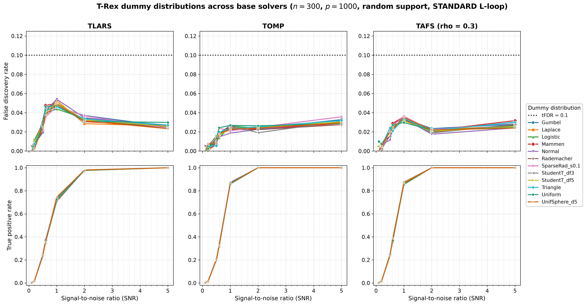
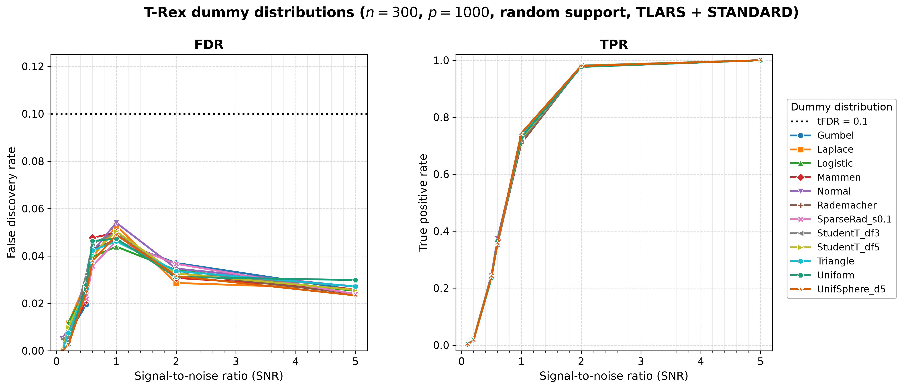

# Demo 05: Dummy Distribution Comparison (Python)

## Purpose

Compare the **dummy distributions** of the Terminating Random Experiments
(T-Rex) selector — the distribution from which the injected dummy (null)
variables are drawn — across **three base solver families** (TLARS, TOMP, TAFS),
with the L-loop strategy fixed at STANDARD. The T-Rex false discovery rate (FDR)
calibration rests on exchangeability between real null predictors and the
dummies. Since dummies are centered and L2-normalized before entering the solver,
their *scale* is immaterial. This demo probes whether the *shape* of the dummy
distribution (tail weight, discreteness, skewness, sparsity, cross-column
dependence) affects the achieved FDR / true positive rate (TPR) and the
calibrated $L$ / $T$ — and whether any such effect depends on the solver family.
Python port of
[cpp/trex_selector_methods/ad/trex_core/demo_trex_05_mc_sim_dummy_distributions](../../../../../cpp/trex_selector_methods/ad/trex_core/demo_trex_05_mc_sim_dummy_distributions/),
using `trexselector`.

---

## Data Generation Parameters

The shared Gaussian data-generating process (DGP) `dgp_gauss_snr` draws an
independent and identically distributed (i.i.d.) standard-normal design
$\boldsymbol{X}$ (independent columns), so the design carries **no correlation
structure** — the empirical column-correlation matrix is essentially the
identity:

```math
\boldsymbol{y} = \boldsymbol{X}\boldsymbol{\beta} + \boldsymbol{\epsilon},
\qquad \boldsymbol{\epsilon} \sim \mathcal{N}(\boldsymbol{0}, \sigma^2 \boldsymbol{I}_n).
```


(Only the injected **dummy** distribution is swept — the design $\boldsymbol{X}$
and its correlation structure above are held fixed.)

- **Sample size**: $n = 300$, **features**: $p = 1{,}000$ (high-dimensional), $s = 10$
- **True support**: random subset of size 10, **redrawn per trial**
  (`block_support=False`)
- **True coefficients**: fixed $\beta_j = 1$ (`rnd_coef = False`)
- **Signal-to-noise ratio (SNR) grid**: 7 values — $\lbrace0.1, 0.2, 0.5, 0.6, 1.0, 2.0, 5.0\rbrace$
- **Monte Carlo (MC) repetitions**: `num_MC = 200` trials per solver × distribution × SNR
  (`_NUM_MC = 200`, mirroring the C++ reference)
- **Base solvers** (`_SOLVERS`, outer sweep): TLARS, TOMP, TAFS (`rho_afs = 0.3`)
- **L-loop strategy**: STANDARD (fixed)

---

## Dummy Distributions Tested

`DISTRIBUTIONS` defines **12 rows** (resolved to `trexselector`
`DummyDistribution` objects inside each worker):

Normal, Uniform, Rademacher, StudentT_df3, StudentT_df5, Laplace, Gumbel,
Triangle, Logistic, Mammen, **SparseRad_s0.1** (constrained sparse Rademacher,
$s = 0.1$), and **UnifSphere_d5** (uniform on the unit 5-sphere, so consecutive
5-column groups are dependent — a deliberate probe of the exchangeability axis).

**Note on UniformSphere**: the library requests dummies in multiples of $p$, so
the sphere dimension must divide $p$. The default $\dim = 3$ would throw at
$p = 1{,}000$, hence $\dim = 5$.

---

## Control Parameters

```text
solver_name           = <varies>   # TLARS / TOMP / TAFS (outer sweep)
rho_afs               = 0.3        # TAFS regularization (ignored by TLARS/TOMP)
K                     = 20         # Random experiments per T-loop iteration
max_dummy_multiplier  = 10         # Upper bound for the adaptive L-loop
use_max_T_stop        = True       # Cap T <= ceil(n/2)
dummy_distribution    = <varies>   # Swept across the 12 rows (inner sweep)
lloop_strategy        = STANDARD   # Fresh i.i.d. dummies per L-loop iteration, fixed
tFDR                  = 0.1        # Target FDR control level
```

---

## Output Files

Written to `simulation_results/data/`, one `.txt` + `.csv` pair **per base
solver**, stems
`demo_trex_05_dummy_distributions_results_n300_p1000_{tlars,tomp,tafs}_random_support`.
The comma-separated values (CSV) file uses the tidy `solver,metric,snr,value`
schema, but here the "solver" column holds the **distribution** name (the base
solver is encoded in the file name), matching the C++ result files.

Figures are written to `simulation_results/plots/` (see *Results Visualization*).

---

## Results Visualization

`./generate_plots.sh` renders two complementary views into
`simulation_results/plots/`: a **cross-solver comparison grid** (the figure for
this demo's core question) and the standard **per-solver figure sets**.

### Cross-solver comparison grid

The headline figure — a 2×3 grid, rows = metric (FDR / TPR), columns = base
solver (TLARS / TOMP / TAFS), with all twelve dummy distributions drawn as lines
in every panel. Colours and markers are keyed to the distribution, so a given
distribution is the same colour in every panel and can be tracked across solvers.
All FDR panels share one y-scale and all TPR panels share `[0, 1]`, so the panels
are directly comparable:



The dummy distribution's **shape** barely moves the statistics. At SNR 1.0
(`num_MC = 200`) the entire twelve-distribution mean-FDR spread is tiny within
each solver family — TLARS spans only $\approx 0.044\text{–}0.054$ (min Logistic
$0.0439$, max Normal $0.0540$), TOMP $\approx 0.019\text{–}0.027$ (min Normal
$0.0187$, max Uniform $0.0268$), and TAFS $\approx 0.030\text{–}0.036$ (min
Uniform $0.0297$, max SparseRad_s0.1 $0.0362$) — all well under `tFDR = 0.1`. The
TPR curves are equally indistinguishable at SNR 1.0 (TLARS $\approx 0.708\text{–}0.744$,
TOMP $\approx 0.859\text{–}0.875$, TAFS $\approx 0.854\text{–}0.875$) and every distribution
reaches $1.0$ by SNR 5.0. The *level* is solver-dependent — TLARS shows the
familiar FDR hump near SNR 0.5–1, while the greedy TOMP / TAFS stay flatter and
lower — but even the dependent **UnifSphere_d5** rows show no systematic deviation.
Together this gives the demo's conclusion. After centering + L2 normalization,
the dummy distribution is effectively a free parameter (the Normal default is
justified), and that holds across all three solver families.

This grid is produced by the suite plotter's `grid` mode
([`../trex_plt_utils.py`](../trex_plt_utils.py)
`grid --labels TLARS TOMP TAFS --csvs ...`), which reads all three solver CSVs at
once and renders them on a shared scale.

### Per-solver figure sets

For each base solver, the suite-level [`../trex_plt_utils.py`](../trex_plt_utils.py)
also renders the usual overview (all twelve distributions on one FDR | TPR pair),
a de-cluttered grouped 2×2 view, and with `--plotly` a self-contained interactive Plotly `.html` page.
The TLARS overview, for example:



The `_grouped` Portable Network Graphics (PNG) figure and the interactive `.html`
(hover for values, **click a distribution in the legend to isolate it** in both
panels) sit alongside, one set per solver — the `_tomp_` and `_tafs_` files
replicate the same layout. Open an `.html` file directly in a browser.
The `.html` figures are off by default and never committed, since each embeds a full copy
of plotly.js (about 5 MB). Run `./generate_plots.sh --plotly` to produce them locally.

```bash
open simulation_results/plots/demo_trex_05_dummy_distributions_results_n300_p1000_tlars_random_support_fdr_tpr_vs_snr.html
```

### Regenerating the figures

```bash
# From this demo folder:
./generate_plots.sh                 # 3 per-solver sets (png+pdf) + the grid
./generate_plots.sh --plotly        # plus the interactive html (not committed)
```

---

## Running

```bash
python Python/trex_selector_methods/ad/trex_core/demo_trex_05_mc_sim_dummy_distributions/demo_trex_05_mc_sim_dummy_distributions.py
```

The MC loop is parallelized with `ProcessPoolExecutor`, with `TREX_NUM_WORKERS`
worker processes (default 8, see `resolve_workers()` in
[`../trex_sim_common.py`](../trex_sim_common.py)).
