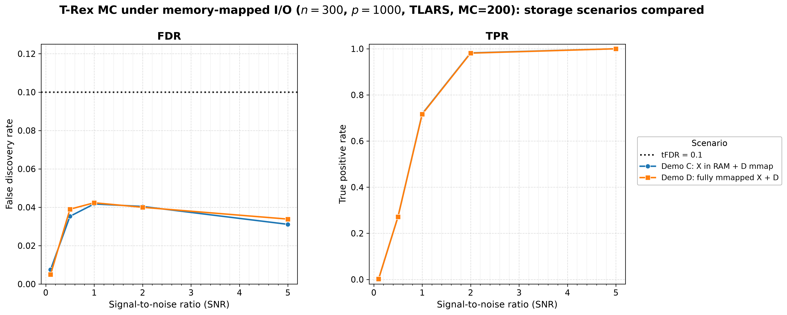
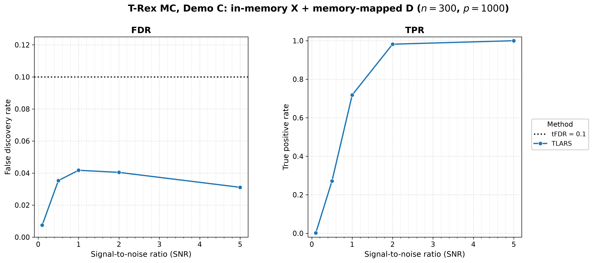
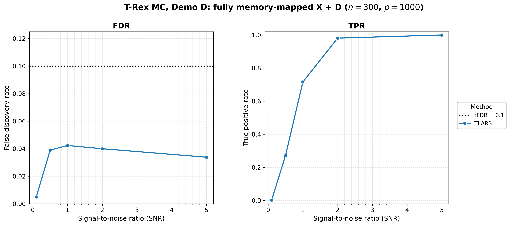

# Demo 07: Monte Carlo Simulation with Memory-Mapped Data (Python)

## Purpose

Validate **Terminating Random Experiments (T-Rex) selector performance under
memory-mapped (mmap) input/output (I/O)** over many Monte Carlo (MC) trials,
mirroring the single-run patterns of Demo 06. Two scenarios
run the identical sweep: (C) in-memory $\mathbf{X}$ with mmap dummy matrices
$\mathbf{D}$ + solver serialization, and (D) a fully memory-mapped pipeline where
each MC iteration creates and destroys its own mmap-backed $\mathbf{X}/\mathbf{y}$
files. The question is whether the storage medium is visible in the *results*.
Python port of
[cpp/trex_selector_methods/ad/trex_core/demo_trex_07_mc_sim_mmap](../../../../../cpp/trex_selector_methods/ad/trex_core/demo_trex_07_mc_sim_mmap/),
using `trexselector`.

---

## Data Generation Parameters

Both scenarios use the same high-dimensional configuration, drawn by the shared
Gaussian data-generating process (DGP) `dgp_gauss_snr`. It draws an independent
and identically distributed (i.i.d.) standard-normal design with independent
columns, so the column-correlation is essentially the identity:


- **Sample size**: $n = 300$, **features**: $p = 1{,}000$, $s = 10$
- **True support**: drawn **once** via `make_support_random(s, p, seed=24)`,
  fixed across all MC trials
- **True coefficients**: fixed $\beta_j = 1$ (`rnd_coef = False`)
- **Signal-to-noise ratio (SNR) range**: $\lbrace0.1, 0.5, 1.0, 2.0, 5.0\rbrace$
- **Base solver**: TLARS only
- **Monte Carlo repetitions**: `num_MC = 200` for **both** scenarios
  (`_NUM_MC = 200`, mirrors C++) — the two runs are directly comparable

---

## Control Parameters

```text
solver_name           = TLARS      # Base solver
K                     = 20         # Random experiments per T-loop iteration
max_dummy_multiplier  = 10         # Max L = 10p
use_max_T_stop        = True       # Cap T <= ceil(n/2)
dummy_distribution    = Normal     # Dummy predictors drawn from N(0,1)
lloop_strategy        = HCONCAT    # Horizontally concatenated dummy columns
tloop_stagnation_stop = True       # Early exit when R_mat stagnates
tloop_max_stagnant_steps = 7       # Stagnation window (-> "sw7" in the stem)
opt_threshold         = 0.75       # Optimization grid point
use_memory_mapping    = True       # D mmap + solver serialization
tFDR                  = 0.1        # Target FDR control level
```

---

## Scenarios

- **Part C** (`trx_03_part_c`) — in-memory $\mathbf{X}$ +
  `use_memory_mapping = True` (D-mmap + solver serialization). Verifies the
  pipeline yields stable, reproducible false discovery rate (FDR) and true
  positive rate (TPR) over many runs.
- **Part D** (`trx_03_part_d`) — fully memory-mapped pipeline, where each MC trial
  writes $\mathbf{X}$ to a unique temp binary file (`numpy_to_memmap`), passes the
  zero-copy `X_mmap.to_numpy()` view to `TRexSelector`, and deletes the file in a
  `finally` block. Adds X-mmap on top of D-mmap + solver serialization.

`main()` runs Part C then Part D, each at `num_MC = 200`.

---

## Output Files

Written to `simulation_results/data/`, stems `d03_trex_mmap_demo_c_n300_p1000_sw7`
and `d03_trex_mmap_demo_d_n300_p1000_sw7`:

- **`.txt`** — aligned FDR / TPR / Avg L / Avg T table for the single TLARS solver
  across the 5 SNR columns.
- **`.csv`** — tidy `solver,metric,snr,value` schema (`FDR`, `TPR`, `AvgL`,
  `AvgT` rows), matching the C++ result files, so the C++ suite's
  [`trex_plt_utils.py`](../../../../../cpp/trex_selector_methods/ad/trex_core/trex_plt_utils.py)
  renders the same figures.

Figures are written separately to `simulation_results/plots/` by
`./generate_plots.sh` (see *Results Visualization*), while the demo itself writes
only the `.txt` / `.csv` pair per scenario.

---

## Results Visualization

The suite-level plotting module [`../trex_plt_utils.py`](../trex_plt_utils.py)
renders the tidy comma-separated values (CSV) files into
`simulation_results/plots/`. Only the `FDR` and `TPR` rows are plotted, while the
plotter ignores the `AvgL` / `AvgT` rows (they remain in the CSV and the `.txt`
table).

### Storage scenarios compared (headline figure)

Both scenarios run the identical sweep, so they belong on one pair of axes. This
demo's question is whether the storage medium is visible in the *results*, and two
curves that lie on top of each other answer it directly. The scenario takes the
place of the "solver" row that the other demos sweep:



*Left:* FDR stays far below the target `tFDR = 0.1` across the whole SNR grid under
**both** storage pipelines, peaking at only $0.0417$ (C) / $0.0424$ (D) at
$\mathrm{SNR}=1.0$. *Right:* the power curves are indistinguishable — TPR climbs
from $\approx 0.002$ at $\mathrm{SNR}=0.1$ to full recovery ($1.0000$ in both) by
$\mathrm{SNR}=5$.

The two pipelines agree to within **0.0037 (FDR, at $\mathrm{SNR}=0.5$)** and
**0.0015 (TPR, at $\mathrm{SNR}=1.0$)** at every grid point — the scale of Monte
Carlo noise at $\text{num\_MC} = 200$, not a systematic effect. This is the result
the demo exists to show. Memory-mapping $\mathbf{X}$ and $\mathbf{D}$ is
transparent to the selector, so it buys its memory savings without moving the
statistics. Note the curves are *not* expected to coincide exactly — the two
scenarios drive different data paths (and `seed = -1` draws dummies from hardware
entropy), so their MC trials are not bit-identical.

### Per-scenario overviews

The same data one scenario at a time, for reading a single pipeline's numbers off a
figure. A single TLARS row per scenario means there is nothing for the grouped 2×2
view to de-clutter, so it is skipped:





### Interactive (Plotly HTML, on request)

With `--plotly`, each static figure gets a self-contained `.html` twin — hover for exact values,
click a scenario in the legend to isolate its curve in both panels. Open it
directly in a browser (it is not rendered inline on GitHub).
The `.html` figures are off by default and never committed, since each embeds a full copy
of plotly.js (about 5 MB). Run `./generate_plots.sh --plotly` to produce them locally.

```bash
open simulation_results/plots/d03_trex_mmap_demo_c_vs_d.html
```

### Regenerating the figures

```bash
# From this demo folder:
./generate_plots.sh                 # overlay + per-scenario (png+pdf)
./generate_plots.sh --plotly        # plus the interactive html (not committed)
```

The overlay is assembled by merging the two per-scenario CSVs into one tidy frame
whose `solver` column carries the scenario name — that column is
`../trex_plt_utils.py`'s generic "what this demo varies" dimension.

---

## Running

```bash
python Python/trex_selector_methods/ad/trex_core/demo_trex_07_mc_sim_mmap/demo_trex_07_mc_sim_mmap.py
```

The MC loop is parallelized with `ProcessPoolExecutor`, with `TREX_NUM_WORKERS`
worker processes (default 8, see `resolve_workers()` in
[`../trex_sim_common.py`](../trex_sim_common.py)).
