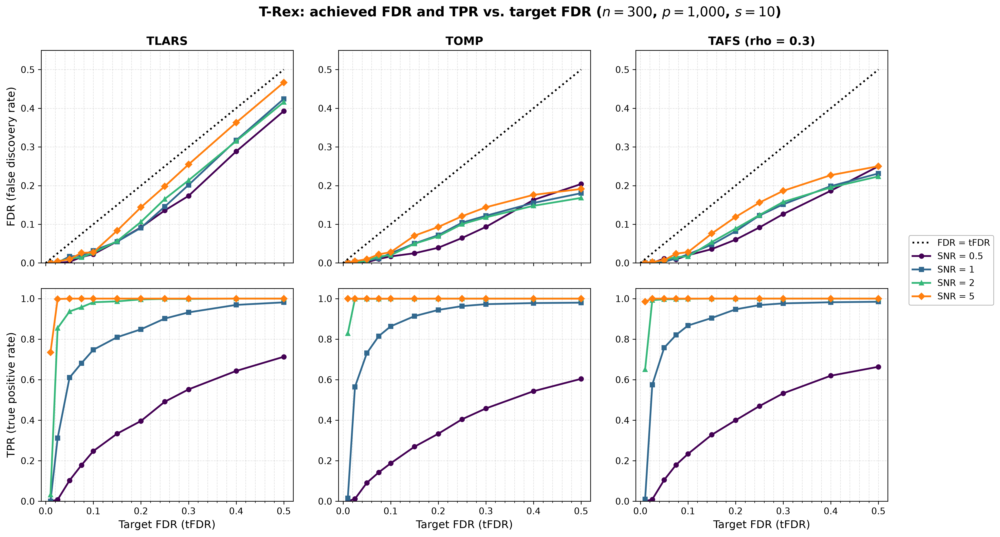

# Demo 09: Achieved FDR and TPR vs. Target FDR

## Purpose

The Terminating Random Experiments (T-Rex) selector controls the false discovery rate (FDR) at a target level
$\mathrm{tFDR}$ that the user chooses. This demo sweeps $\mathrm{tFDR}$ and records the achieved FDR, the mean false
discovery proportion over the trials, and the true positive rate (TPR) for three base solvers and four
signal-to-noise ratios (SNR). FDR control shows as an FDR curve on or below the diagonal $\mathrm{FDR} = \mathrm{tFDR}$,
and the TPR curve shows how much power each level of control costs.

The demo mirrors the
[C++ demo 09](../../../../../cpp/trex_selector_methods/ad/trex_core/demo_trex_09_mc_sim_target_fdr/README.md).

---

## Data Generation Parameters

The data follow [Demo 03](../demo_trex_03_mc_sim_variable_support/README.md).

- $n = 300$ observations and $p = 1{,}000$ predictors, Normal predictors and Normal noise.
- A true support of $s = 10$ variables, redrawn in every trial with `np.random.default_rng(seed + 500000)`, with unit
  coefficients $\beta_j = 1$.
- $\mathrm{SNR} \in \lbrace0.5, 1, 2, 5\rbrace$, calibrated as in all demos of this suite.

---

## Selector

The selector follows [Demo 05](../demo_trex_05_mc_sim_dummy_distributions/README.md) with Normal dummies.

```text
K                    = 20         # random experiments
max_dummy_multiplier = 10         # cap on L
dummy_distribution   = Normal
lloop_strategy       = STANDARD   # fresh dummies in every L-loop iteration
use_max_T_stop       = True
stagnation stop      = AUTO       # off for TLARS, on for TOMP and TAFS
rho_afs              = 0.3        # TAFS only
```

- **Base solvers**: TLARS, TOMP and TAFS ($\rho = 0.3$).
- **Target FDR grid**: $\mathrm{tFDR} \in \lbrace0.01, 0.025, 0.05, 0.075, 0.1, 0.15, 0.2, 0.25, 0.3, 0.4, 0.5\rbrace$.

---

## Monte Carlo Design

- 200 Monte Carlo (MC) trials per (solver, SNR, tFDR) cell, 132 cells and 26,400 selector runs in total.
- Trial $m$ of an SNR uses the data seed $24 + 1000 \cdot i_{\mathrm{SNR}} + m$ for every tFDR and every solver, so
  the curves along tFDR compare the same data sets and differ only through the target level.
- The selector is seeded with the trial seed (`seeded_selector=True` in `run_mc_trex()`), so every cell is
  reproducible.
- Every finished cell is cached in `simulation_results/cache/`, and a stopped run resumes at the first missing cell.
  A completed run removes the cache.

The Python and C++ random number generators differ, so the two languages draw different data sets from the same
seeds and agree statistically, not bit for bit.

---

## Output Files

Written to `simulation_results/data/`:

- `demo_trex_09_mc_sim_target_fdr.txt` — one table per solver, with an FDR and a TPR row per SNR and one column per
  tFDR.
- `demo_trex_09_mc_sim_target_fdr.csv` — tidy long table with the columns `solver,snr,tfdr,metric,mean,sd`. The
  metrics are `FDR`, `TPR`, `AvgL` (mean calibrated dummy multiplier) and `AvgT` (mean stopping time), and `sd` is
  filled for FDR and TPR.

`./generate_plots.sh` renders `simulation_results/plots/demo_trex_09_mc_sim_target_fdr.{png,pdf}` with the `sweep`
mode of [`../trex_plt_utils.py`](../trex_plt_utils.py). The top row shows the achieved FDR against tFDR with the
diagonal, and the bottom row shows the TPR, one column per solver and one line per SNR.

---

## Running

```bash
python Python/trex_selector_methods/ad/trex_core/demo_trex_09_mc_sim_target_fdr/demo_trex_09_mc_sim_target_fdr.py
python Python/trex_selector_methods/ad/trex_core/demo_trex_09_mc_sim_target_fdr/demo_trex_09_mc_sim_target_fdr.py 2
Python/trex_selector_methods/ad/trex_core/demo_trex_09_mc_sim_target_fdr/generate_plots.sh
```

The first command runs 200 trials per cell, and the optional argument sets the number of trials, for example 2 for a
smoke run. The MC loop is parallelized with `ProcessPoolExecutor`, with `TREX_NUM_WORKERS` worker processes (default
8, see `resolve_workers()` in [`../trex_sim_common.py`](../trex_sim_common.py)).

---

## Simulation Results

The full run with 200 trials per cell took 2 h 43 min on 8 workers against library 415484d.

```text
==============================================================================
=== T-Rex achieved FDR / TPR vs. target FDR (mean over 200 trials) ===
    n = 300, p = 1000, s = 10, K = 20, STANDARD L-loop, Normal dummies
==============================================================================

TLARS
  tFDR             0.010   0.025   0.050   0.075   0.100   0.150   0.200   0.250   0.300   0.400   0.500
  FDR SNR 0.5      0.000   0.000   0.003   0.015   0.022   0.056   0.092   0.136   0.173   0.288   0.393
  TPR SNR 0.5      0.000   0.007   0.102   0.178   0.247   0.334   0.396   0.491   0.552   0.643   0.713
  FDR SNR 1        0.000   0.001   0.017   0.019   0.032   0.055   0.091   0.146   0.202   0.317   0.424
  TPR SNR 1        0.000   0.311   0.610   0.681   0.748   0.809   0.848   0.902   0.932   0.969   0.982
  FDR SNR 2        0.000   0.004   0.011   0.014   0.026   0.057   0.106   0.165   0.214   0.315   0.416
  TPR SNR 2        0.032   0.855   0.937   0.958   0.982   0.987   0.996   0.998   0.998   1.000   1.000
  FDR SNR 5        0.000   0.004   0.010   0.026   0.027   0.084   0.144   0.198   0.255   0.363   0.467
  TPR SNR 5        0.735   0.998   1.000   1.000   1.000   1.000   1.000   1.000   1.000   1.000   1.000

TOMP
  tFDR             0.010   0.025   0.050   0.075   0.100   0.150   0.200   0.250   0.300   0.400   0.500
  FDR SNR 0.5      0.000   0.000   0.002   0.010   0.017   0.025   0.039   0.065   0.093   0.163   0.204
  TPR SNR 0.5      0.000   0.011   0.091   0.142   0.187   0.269   0.333   0.404   0.458   0.543   0.604
  FDR SNR 1        0.000   0.003   0.006   0.011   0.025   0.050   0.072   0.104   0.122   0.155   0.180
  TPR SNR 1        0.014   0.564   0.731   0.815   0.863   0.913   0.944   0.963   0.973   0.978   0.980
  FDR SNR 2        0.000   0.001   0.006   0.017   0.020   0.050   0.069   0.100   0.118   0.148   0.168
  TPR SNR 2        0.828   0.998   0.999   0.999   1.000   1.000   1.000   1.000   1.000   1.000   1.000
  FDR SNR 5        0.001   0.005   0.010   0.022   0.028   0.071   0.093   0.121   0.144   0.176   0.191
  TPR SNR 5        1.000   1.000   1.000   1.000   1.000   1.000   1.000   1.000   1.000   1.000   1.000

TAFS
  tFDR             0.010   0.025   0.050   0.075   0.100   0.150   0.200   0.250   0.300   0.400   0.500
  FDR SNR 0.5      0.000   0.000   0.011   0.009   0.020   0.036   0.060   0.092   0.126   0.187   0.250
  TPR SNR 0.5      0.000   0.009   0.105   0.180   0.234   0.328   0.400   0.470   0.532   0.620   0.663
  FDR SNR 1        0.000   0.002   0.003   0.011   0.022   0.047   0.082   0.122   0.151   0.199   0.231
  TPR SNR 1        0.010   0.575   0.757   0.821   0.867   0.905   0.947   0.968   0.977   0.982   0.985
  FDR SNR 2        0.000   0.001   0.008   0.015   0.017   0.054   0.089   0.124   0.158   0.195   0.224
  TPR SNR 2        0.650   0.993   0.996   0.998   0.999   1.000   1.000   1.000   1.000   1.000   1.000
  FDR SNR 5        0.001   0.003   0.007   0.024   0.028   0.076   0.119   0.156   0.186   0.227   0.250
  TPR SNR 5        0.985   1.000   1.000   1.000   1.000   1.000   1.000   1.000   1.000   1.000   1.000
```



### FDR control

The achieved FDR stays below the target in all 132 cells. TLARS follows the diagonal most closely, because its T-loop
runs without a stagnation stop (mean stopping time 20 to 24 at tFDR 0.5 for SNR $\ge 1$), and it reaches an FDR of
0.42 to 0.47 at tFDR 0.5 for SNR $\ge 1$. TOMP and TAFS leave the diagonal from tFDR 0.15 on and level off at an FDR
of about 0.17 to 0.20 and 0.22 to 0.25, because their stagnation stop ends the T-loop after 7 to 9 steps.

### Power

A target of 0.01 calibrates $L$ to the cap of 10 or close to it, and the selector then finds the true variables only
at SNR 5 (TPR 0.73 to 1.00) and, for TOMP and TAFS, at SNR 2 (0.83 and 0.65). At SNR 1 the TPR rises from 0.31 to 0.58
at tFDR 0.025 to 0.75 to 0.87 at 0.1 and 0.85 to 0.95 at 0.2, and TOMP and TAFS lead TLARS up to tFDR 0.4. At SNR 0.5
the power grows almost linearly, from about 0.1 at tFDR 0.05 to 0.60 to 0.71 at 0.5.

### Agreement with C++

The [C++ results](../../../../../cpp/trex_selector_methods/ad/trex_core/demo_trex_09_mc_sim_target_fdr/README.md) come
from the same library. Of the 264 FDR and TPR cells, 14 differ by more than two standard errors and one by more than
three (TAFS at SNR 1 and tFDR 0.05, FDR 0.003 against 0.013), as expected by chance for 264 comparisons. The two
languages draw different data sets from the same seeds.
