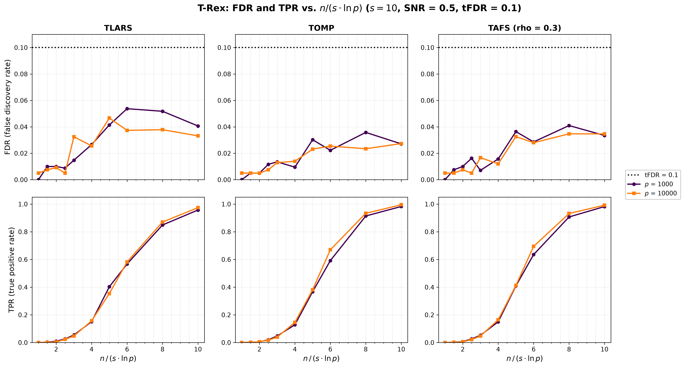
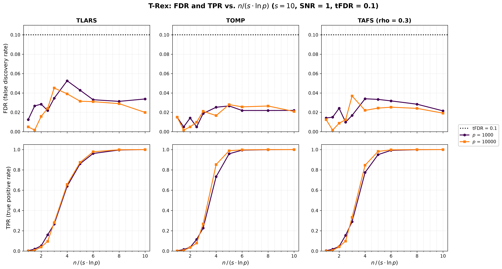
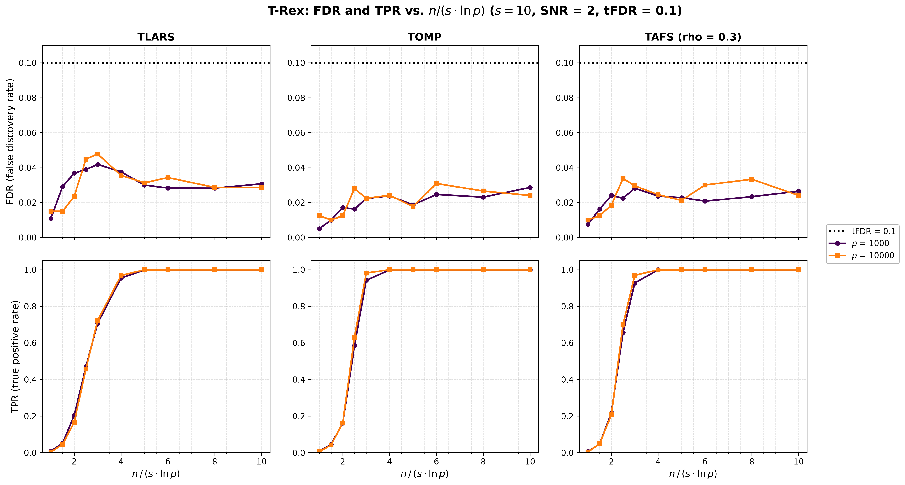

# Demo 10: FDR and TPR vs. the Sample-Size Ratio n / (s ln p)

## Purpose

Sparse recovery needs the number of observations $n$ to grow like $s \log p$, with $s$ true variables among $p$
predictors (the Donoho–Tanner scaling). This demo sets

```math
n = \operatorname{round}\!\left(c \cdot s \ln p\right)
```

for a grid of ratios $c$ and two numbers of predictors, and records the false discovery rate (FDR) and the true
positive rate (TPR) of the Terminating Random Experiments (T-Rex) selector at a target FDR of $0.1$. Curves of the two
$p$ that fall onto each other on the $c$ axis confirm that $c$ governs the power of the FDR-controlled selection.

The demo mirrors the
[C++ demo 10](../../../../../cpp/trex_selector_methods/ad/trex_core/demo_trex_10_mc_sim_dt_ratio/README.md).
[Demo 08](../demo_trex_08_mc_sim_scalability/README.md) already shows the drop of the TPR between $c \approx 2$ and
$c \approx 8$ at a signal-to-noise ratio (SNR) of 1.

---

## Data Generation Parameters

The data follow [Demo 03](../demo_trex_03_mc_sim_variable_support/README.md) except for $n$.

- $p \in \lbrace1{,}000, 10{,}000\rbrace$ predictors, Normal predictors and Normal noise.
- A true support of $s = 10$ variables, redrawn in every trial with `np.random.default_rng(seed + 500000)`, with unit
  coefficients $\beta_j = 1$.
- $c \in \lbrace1, 1.5, 2, 2.5, 3, 4, 5, 6, 8, 10\rbrace$, so $n$ runs from 69 to 691 at $p = 1{,}000$ and from 92 to
  921 at $p = 10{,}000$.
- $\mathrm{SNR} \in \lbrace0.5, 1, 2\rbrace$.

---

## Selector

The selector follows [Demo 05](../demo_trex_05_mc_sim_dummy_distributions/README.md) with Normal dummies, at a target
FDR of $0.1$.

```text
tFDR                 = 0.1
K                    = 20         # random experiments
max_dummy_multiplier = 10         # cap on L
dummy_distribution   = Normal
lloop_strategy       = STANDARD   # fresh dummies in every L-loop iteration
use_max_T_stop       = True
stagnation stop      = AUTO       # off for TLARS, on for TOMP and TAFS
rho_afs              = 0.3        # TAFS only
```

The base solvers are TLARS, TOMP and TAFS ($\rho = 0.3$).

---

## Monte Carlo Design

- 200 Monte Carlo (MC) trials per (solver, $p$, $c$, SNR) cell, 180 cells and 36,000 selector runs in total.
- Trial $m$ of a cell uses the data seed $24 + 1000 \cdot i_{\mathrm{SNR}} + 100{,}000 \cdot i_c + 10^7 \cdot i_p + m$
  for every solver, so the solvers see the same data sets.
- The selector is seeded with the trial seed (`seeded_selector=True` in `run_mc_trex()`), so every cell is
  reproducible.
- Every finished cell is cached in `simulation_results/cache/`, and a stopped run resumes at the first missing cell.
  A completed run removes the cache.

The Python and C++ random number generators differ, so the two languages draw different data sets from the same
seeds and agree statistically, not bit for bit.

---

## Output Files

Written to `simulation_results/data/`:

- `demo_trex_10_mc_sim_dt_ratio.txt` — one table per solver and SNR, with the sample sizes and an FDR and a TPR row
  per $p$, one column per $c$.
- `demo_trex_10_mc_sim_dt_ratio.csv` — tidy long table with the columns `solver,snr,p,n,c,metric,mean,sd`. The
  metrics are `FDR`, `TPR`, `AvgL` (mean calibrated dummy multiplier) and `AvgT` (mean stopping time), and `sd` is
  filled for FDR and TPR.

`./generate_plots.sh` renders one figure per SNR,
`simulation_results/plots/demo_trex_10_mc_sim_dt_ratio_snr*.{png,pdf}`, with the `sweep` mode of
[`../trex_plt_utils.py`](../trex_plt_utils.py). The top row shows the FDR against $c$ with the target line, and the
bottom row shows the TPR, one column per solver and one line per $p$.

---

## Running

```bash
python Python/trex_selector_methods/ad/trex_core/demo_trex_10_mc_sim_dt_ratio/demo_trex_10_mc_sim_dt_ratio.py
python Python/trex_selector_methods/ad/trex_core/demo_trex_10_mc_sim_dt_ratio/demo_trex_10_mc_sim_dt_ratio.py 2
Python/trex_selector_methods/ad/trex_core/demo_trex_10_mc_sim_dt_ratio/generate_plots.sh
```

The first command runs 200 trials per cell, and the optional argument sets the number of trials, for example 2 for a
smoke run. The MC loop is parallelized with `ProcessPoolExecutor`, with `TREX_NUM_WORKERS` worker processes (default
8, see `resolve_workers()` in [`../trex_sim_common.py`](../trex_sim_common.py)).

---

## Simulation Results

The full run with 200 trials per cell took 16 h 58 min on 8 workers against library 415484d. The text file holds
the nine tables of FDR and TPR per solver and SNR.

The ratios $c$ at which the TPR crosses 0.5 and 0.9, interpolated linearly between the grid points:

| Solver | SNR | $c$ at TPR 0.5, $p = 1{,}000$ | $c$ at TPR 0.5, $p = 10{,}000$ | $c$ at TPR 0.9, $p = 1{,}000$ | $c$ at TPR 0.9, $p = 10{,}000$ |
| --- | --- | --- | --- | --- | --- |
| TLARS | 0.5 | 5.59 | 5.64 | 8.94 | 8.57 |
| TLARS | 1 | 3.63 | 3.58 | 5.39 | 5.25 |
| TLARS | 2 | 2.56 | 2.58 | 3.78 | 3.72 |
| TOMP | 0.5 | 5.59 | 5.41 | 7.91 | 7.75 |
| TOMP | 1 | 3.54 | 3.40 | 4.74 | 4.35 |
| TOMP | 2 | 2.40 | 2.36 | 2.94 | 2.88 |
| TAFS | 0.5 | 5.40 | 5.31 | 7.95 | 7.73 |
| TAFS | 1 | 3.43 | 3.33 | 4.72 | 4.40 |
| TAFS | 2 | 2.32 | 2.30 | 2.95 | 2.87 |







The TPR curves of the two $p$ fall onto each other on the $c$ axis, and the TPR crosses 0.5 at the same $c$ within
0.15 for every solver and SNR. Above 0.5 the curve of $p = 10{,}000$ runs slightly ahead, as in C++, and 12 of the 76
cells in which the TPR varies differ between the two $p$ by more than three standard errors, 9 of them in favour of
$p = 10{,}000$. The SNR shifts the transition from $c \approx 5.3\text{–}5.6$ (SNR 0.5) over $3.3\text{–}3.6$ (SNR 1)
to $2.3\text{–}2.6$ (SNR 2), and TOMP and TAFS reach 0.9 earlier than TLARS. The FDR stays below the target in all
180 cells, with a largest value of 0.054 (TLARS, SNR 0.5, $p = 1{,}000$, $c = 6$).

### Agreement with C++

The [C++ results](../../../../../cpp/trex_selector_methods/ad/trex_core/demo_trex_10_mc_sim_dt_ratio/README.md) come
from library 61fd84c, which differs from 415484d only in the estimated false discovery proportion of long
T-loops. Of the 326 FDR and TPR cells with a nonzero standard deviation, 17 differ by more than two standard errors
and one by more than three (TLARS, SNR 2, $p = 10{,}000$, $c = 4$, TPR 0.968 against 0.985), as expected by chance.
The crossings at TPR 0.5 and 0.9 agree within 0.07 on the $c$ axis, with one exception of 0.22 (TLARS, SNR 1,
$p = 10{,}000$, TPR 0.9).
