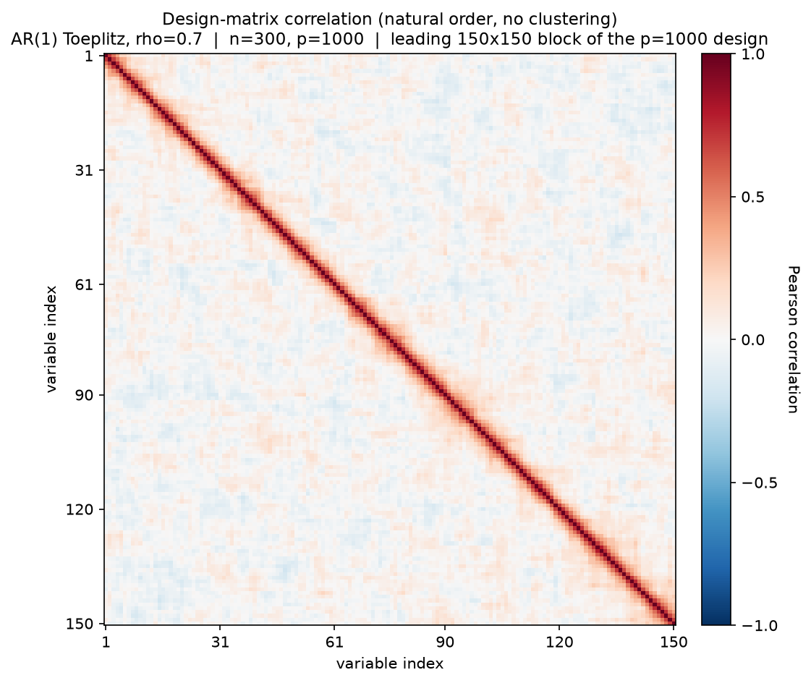
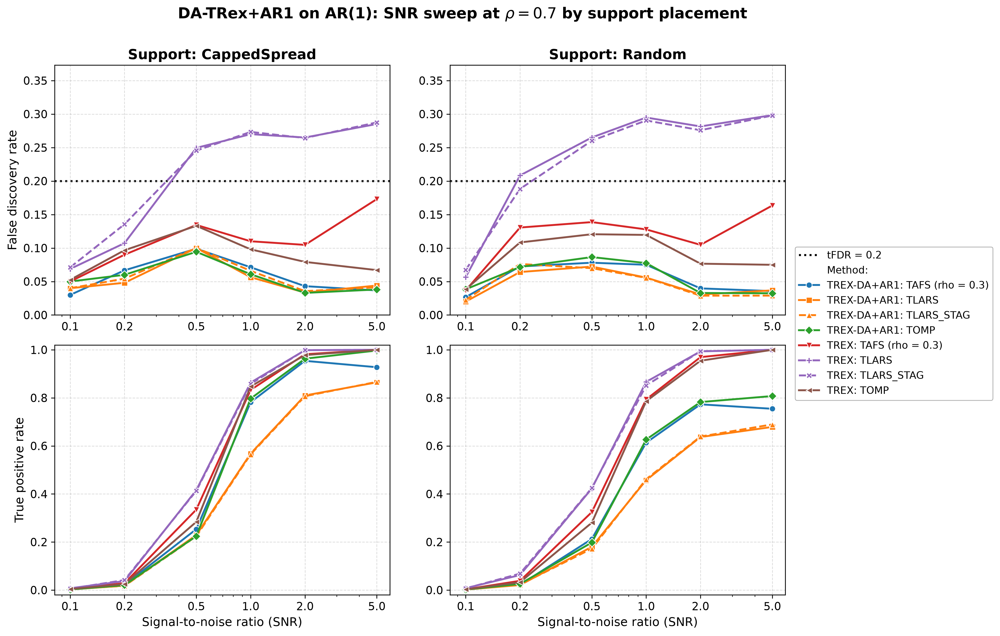
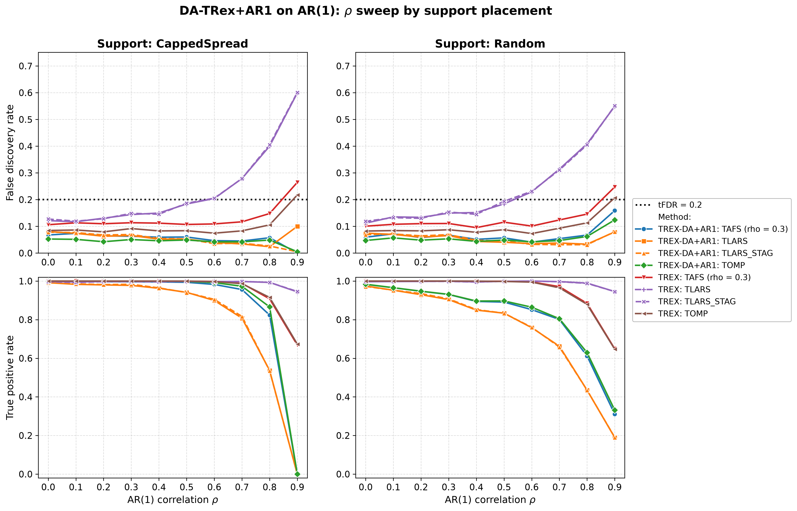
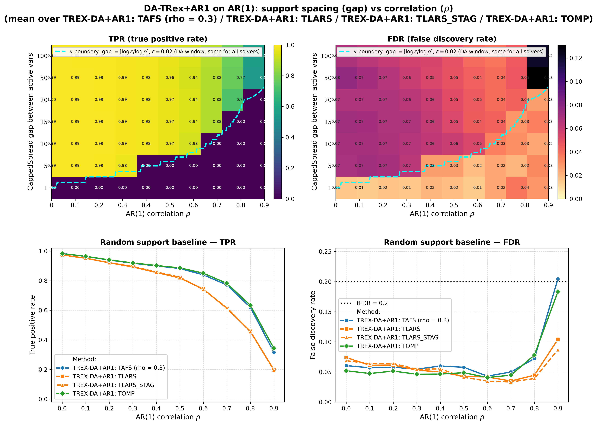

# Demo 01: DA-TRex+AR1 on AR(1) Toeplitz Data (Python)

The following demo presents Monte-Carlo (MC) results for **DA-TRex+AR1** —
the dependency-aware (DA) Terminating Random Experiments (T-Rex) selector (DA-TRex) for the first-order
autoregressive (AR(1)) model — vs. the **classical (no-DA) T-Rex selector** on AR(1) Toeplitz data
($n=300$, $p=1{,}000$, $s=10$, amplitude $3.0$, target false discovery rate (FDR) $\mathrm{tFDR}=0.2$,
$K=20$ random experiments, $\mathrm{MC}=200$ per grid point, and solvers TLARS / TAFS / TOMP, plus TLARS_STAG, TLARS
with the T-loop stagnation stop, see the [suite README](../README.md)).

Python port of the C++ demo
[cpp/trex_selector_methods/ad/trex_da/demo_trex_da_01_mc_sim_ar1](../../../../../cpp/trex_selector_methods/ad/trex_da/demo_trex_da_01_mc_sim_ar1/README.md)
— same data-generating process (DGP), control parameters, sweep axes, console summaries, and result-file naming. The
numbers below are this Python run's own results, and they agree with the C++ reference up to Monte-Carlo noise
(independent random number generator (RNG) streams).

The greedy solvers use *exchangeable tie-breaking* (`exch_tie_alpha = 0.25` for TAFS/TOMP, `0` for TLARS and
TLARS_STAG). Look up `Exchangeable_Tie_Breaking_DA_TRex.md` in the TRex_Research documentation.
TAFS additionally runs with its adaptive forward-selection (AFS) correlation parameter `rho_afs = 0.3`
(`0` for TLARS, TLARS_STAG and TOMP), which is why the figures label it `TAFS (rho = 0.3)`.
With this fix, **all four DA solvers are FDR-controlled across the entire $\rho$ grid and both support placements** —
including the greedy-solver cells at $\rho = 0.9$ with power (for gap=100: TAFS $0.16$, TOMP $0.15$, and for Random
support: TAFS $0.16$, TOMP $0.12$), where TAFS/TOMP also retain more power than DA-TLARS.

---

## Setup — data generating process and selector configuration

**Linear model.** Each Monte-Carlo trial draws

```math
y = X\beta + \varepsilon, \qquad X \in \mathbb{R}^{n \times p},\; n = 300,\; p = 1{,}000,
```

where $\beta$ has $s = 10$ nonzero entries of amplitude $3.0$ on the support (placed by the `CappedSpread` or
`Random` policy, see the parts below) and $\varepsilon_i \stackrel{\text{iid}}{\sim} \mathcal{N}(0, \sigma^2)$ with
the noise variance calibrated to the target signal-to-noise ratio (SNR),
$\sigma^2 = \widehat{\mathrm{Var}}(X\beta) / \mathrm{SNR}$.

**Covariance model (AR(1) Toeplitz).** The generator `dgp_ar1_snr` draws the rows of $X$ independent and identically
distributed (i.i.d.) zero-mean Gaussian with autoregressive column dependence,

```math
X_{i,1} = \eta_{i,1}, \qquad
X_{i,j} = \rho\, X_{i,j-1} + \sqrt{1-\rho^2}\; \eta_{i,j}, \qquad
\eta_{i,j} \stackrel{\text{iid}}{\sim} \mathcal{N}(0,1),
```

so that

```math
\Sigma_{jk} = \rho^{|j-k|}
```

— neighboring columns are the strongest-correlated, decaying geometrically with index distance.



Empirical Pearson correlation of an exemplary design drawn from this DGP (`dgp_ar1_snr`, seed 2026), in
**natural variable order — no hierarchical clustering**. The red band fading off the diagonal is the
$\rho^{|j-k|}$ decay, and only the leading 150×150 block of the $p=1{,}000$ design is shown so that band stays
legible. One figure per DGP lives in [`../dgp_corr_plots/`](../dgp_corr_plots/). Regenerate the whole suite
with [`../generate_corr_plots.sh`](../generate_corr_plots.sh) (shared plotter
[`../../../corr_plt_utils.py`](../../../corr_plt_utils.py)).

In the following we refer to a linear signal to noise ratio

```math
\mathrm{SNR} = \frac{\mathrm{Var}(X\beta)}{\sigma^2}
```

to assess the performance of the method.

---

## Running the Demo

```bash
python Python/trex_selector_methods/ad/trex_da/demo_trex_da_01_mc_sim_ar1/demo_trex_da_01_mc_sim_ar1.py
```

The three parts are toggled by the `RUN_PART_*` flags at the top of the file (all `True`, mirroring the cpp
`if (true)` toggles). Reduce `NUM_MC` to preview. The file inserts both its own folder and the parent suite
directory onto `sys.path`, so the shared `dgp_generators` / `da_sim_common` modules resolve in the demo *and*
in the spawned workers — hence the demo must be run as a file, not piped via `python -`. Monte-Carlo trials
run in parallel through `concurrent.futures.ProcessPoolExecutor` (one persistent pool per run with
`TREX_NUM_WORKERS` worker processes, 8 by default and every available core for `0`). Support and group indices are
**0-based**.

Afterwards, regenerate the figures from the comma-separated values (CSV) files with
[`generate_plots.sh`](generate_plots.sh), which drives the suite plotting module
[`../trex_da_plt_utils.py`](../trex_da_plt_utils.py) through the repo-root `.venv`
(`pip install matplotlib pandas plotly`):

```bash
./generate_plots.sh                 # this demo's full figure set
./generate_plots.sh --plotly        # plus the interactive html (not committed)
./generate_plots.sh <other.csv>     # just that CSV (default FDR/TPR mode)
./generate_plots.sh --formats png   # extra args pass through to the plotter
```

---

## Output Files

Data tables are written to `simulation_results/data/` (`.txt` pretty-printed, `.csv` tidy long format):

- `da_trex_mc_da_ar1_snr_capped.txt` / `.csv`
- `da_trex_mc_da_ar1_snr_random.txt` / `.csv`
- `da_trex_mc_da_ar1_rho_capped.txt` / `.csv`
- `da_trex_mc_da_ar1_rho_random.txt` / `.csv`
- `da_trex_mc_da_ar1_gap_rho.txt` / `.csv`

Figures in Portable Network Graphics (PNG) and Portable Document Format (PDF) go to `simulation_results/plots/`.
With `--plotly`, `./generate_plots.sh` also writes interactive Plotly `.html` pages for the per-CSV overviews. They
are not committed to the repository, since each embeds a full copy of plotly.js (about 5 MB).

---

## Part 1 — SNR sweep (at $\rho = 0.7$)

DA-TRex+AR1 vs. base T-Rex over $\mathrm{SNR} \in \lbrace0.1, 0.2, 0.5, 1, 2, 5\rbrace$, CappedSpread vs. Random
support:



All four DA solvers stay below $\mathrm{tFDR}=0.2$ at every SNR (worst cells $0.100$, DA-TLARS and TLARS_STAG at
$\mathrm{SNR}=0.5$), while base T-Rex TLARS violates from $\mathrm{SNR}=0.5$ on (FDR $\approx 0.25$ CappedSpread /
$0.27$ Random, rising to $\approx 0.29\text{–}0.30$). The DA cost in true positive rate (TPR) appears from
$\mathrm{SNR}=0.5$ on and is largest for TLARS, peaking at $\mathrm{SNR}=1$ (DA $0.57$ vs. base $0.86$ CappedSpread,
$0.46$ vs. $0.87$ Random). At $\mathrm{SNR}=2$ it is still $0.81$ vs. $1.00$ (CappedSpread) and $0.64$ vs. $0.99$ under
Random support, where the active variables are not kept apart by construction. The greedy solvers pay less (TOMP
$0.96$ vs. $0.98$ CappedSpread and $0.78$ vs. $0.95$ Random at $\mathrm{SNR}=2$). TLARS_STAG gives the same FDR and TPR
as TLARS within Monte Carlo noise, in the DA rows and in the base rows.

---

## Part 2 — $\rho$ sweep (at $\mathrm{SNR} = 2$)

DA-TRex+AR1 vs. base T-Rex over $\rho \in \lbrace0.0, 0.1, \dots, 0.9\rbrace$.



- **CappedSpread (max_gap = 20), left column:** the $\rho = 0.9$ point is the **collapse regime** for this support
  gap $20 < \kappa = 38$, so all active variables fall inside each other's correction windows, DA suppresses
  everything (TPR $\approx 0$), and the tiny residual FDR values are rare lone-survivor events (binary per-trial
  false discovery proportion (FDP) — hence the large standard deviation (sd) in the tables, with DA-TLARS at
  $0.100 \pm 0.301$, TLARS_STAG at $0.005 \pm 0.071$ and the greedy solvers at $0.005$ or below).
- **Random support, right column:** most actives stay isolated, so power persists to $\rho = 0.9$
  (TPR $\approx 0.31\text{–}0.33$ for the greedy DA solvers) while FDR stays controlled ($0.12\text{–}0.16$). Base
  T-Rex TLARS climbs to $\approx 0.55$.
- **TLARS_STAG:** same power as DA-TLARS, while its T-loop stops after at most $6.3$ steps on average, where DA-TLARS
  averages up to $T \approx 40$ at $\rho = 0.9$. Its FDR is at most $0.08$ over both $\rho$ sweeps.

Against the previous run on library commit `44cf1ab`, DA-TAFS and DA-TOMP lose FDR in all three parts while their
TPR stays flat, and all three language trees show the same drop. Over the $112$ DA cells of the five tables, the mean
FDR falls from $0.081$ to $0.057$ for TAFS and from $0.070$ to $0.046$ for TOMP, and $68$ and $71$ of these cells move
by more than three standard errors, the largest by $8.9$. The mean TPR goes from $0.684$ to $0.687$ for TAFS and stays
at $0.692$ for TOMP. The drop is largest in this $\rho$ sweep, where the CappedSpread means fall from $0.089$ to
$0.054$ (TAFS) and from $0.076$ to $0.043$ (TOMP). The base TAFS and TOMP rows lose about $0.02$ as well ($0.141$ to
$0.123$ and $0.116$ to $0.095$), while DA-TLARS and TLARS_STAG move much less ($0.064$ to $0.055$ and $0.058$ to
$0.050$). Base TLARS instead shortens its T-loop, from a mean $T$ of $8.5$ to $6.9$ over the SNR and $\rho$ sweeps and
from $40.2$ to $16.7$ at $\rho = 0.9$ with CappedSpread support, while its FDR barely moves ($0.236$ to $0.230$).
Library commit `415484d` removed the lower clamp $\Phi' \geq 0$ from the FDP estimate, which makes the estimate
larger. It is the only library change on the path of TAFS and TOMP, and both stop their T-loop on stagnation, so the
larger estimate raises the voting threshold instead of shortening the loop. TLARS runs without the stagnation stop, so
there the estimate can end the T-loop earlier.

---

## Part 3 — 2D gap × $\rho$ study ($\mathrm{SNR} = 2$)

`CappedSpread(gap)` for gap $\in \lbrace100, 50, 20, 15, 10, 5, 1\rbrace$ plus a Random-support column, over the
full $\rho$ grid, per solver. The overlaid $\kappa$-boundary ($\kappa = \lceil \log \varepsilon / \log \rho \rceil$,
$\varepsilon = 0.02$) marks where active variables enter each other's DA correction windows, so below it TPR collapses
by construction.



- **Heatmaps (top row)** show the **mean over the four DA solvers** per (gap, $\rho$) cell, and the dashed
  $\kappa$-boundary is the DA correction-window threshold gap $= \lceil \log 0.02 / \log \rho \rceil$
  ($\varepsilon = 0.02$ = `rho_thr_DA`) — a property of the correction itself, identical for all four solvers.
- **Random-support baseline (bottom row)** shows one line per method. There the TAFS FDR ends at $0.20$ at
  $\rho = 0.9$, within one Monte Carlo standard error ($\approx 0.02$) of the target, while Part 2 measures $0.16$ for
  the same setting.
- **TPR heatmap** — the sharp $\kappa$-boundary cliff (gap $< \kappa \Rightarrow$ TPR $\approx 0$) is a structural
  property of the AR1 correction window, not a solver artifact. At $\rho = 0.9$ the mean true positive proportion
  (TPP) drops from $\approx 0.55$ (gap $= 50/100$, above the boundary) to below $0.001$ at gap $= 20$.
- **FDR heatmap** — with the exchangeable-tie fix, the wide-gap / $\text{high-}\rho$ corner
  (gap $= 100/50$, $\rho = 0.9$) stays controlled for TAFS ($0.16/0.18$) and TOMP ($0.15/0.16$). The C++ README
  documents that these cells sat at $0.21\text{–}0.27$ there before the fix, driven by collinear shadows (distance-1
  neighbors of true actives) that greedy winner-take-all selection let through the DA deflation.
- **TLARS_STAG below the boundary** — where the support gap is smaller than $\kappa$ and no true variable survives
  (gap $\le 20$ at $\rho = 0.9$), DA-TLARS still raises false alarms in $6\text{–}10.5\,\%$ of the runs, while
  TLARS_STAG stays at or below $1.5\,\%$. The long T-loop of DA-TLARS most likely gives null variables more chances
  to collect votes, which the stagnation stop cuts short.

---

## References

- Machkour, J., Muma, M., & Palomar, D. P., "FDR-Controlled Sparse Index Tracking with Autoregressive Stock
  Dependency Models", European Signal Processing Conference (EUSIPCO), 2024, pp. 2662–2666,
  [DOI link](https://ieeexplore.ieee.org/document/10715329).
