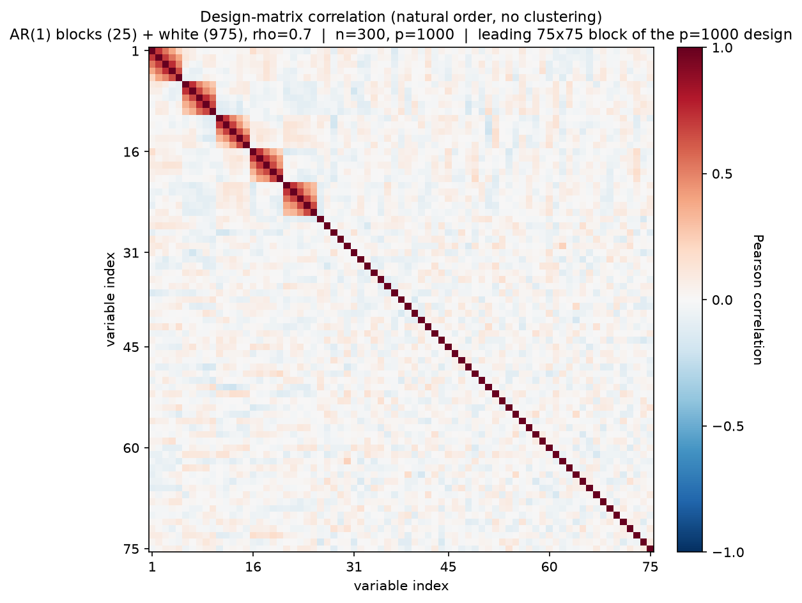
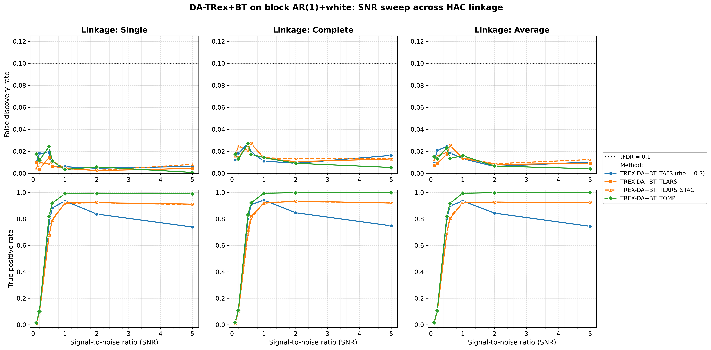
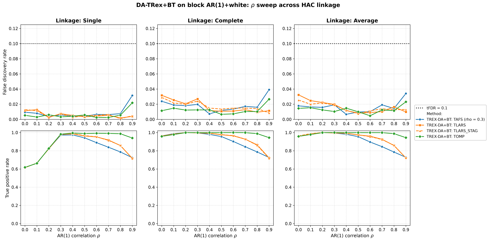
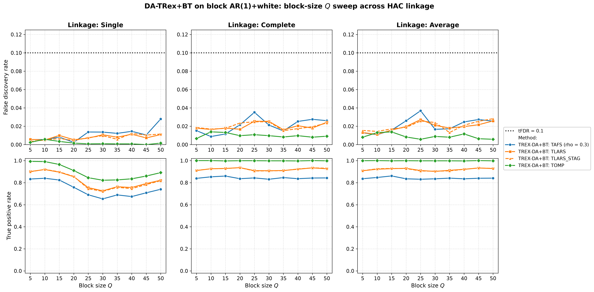
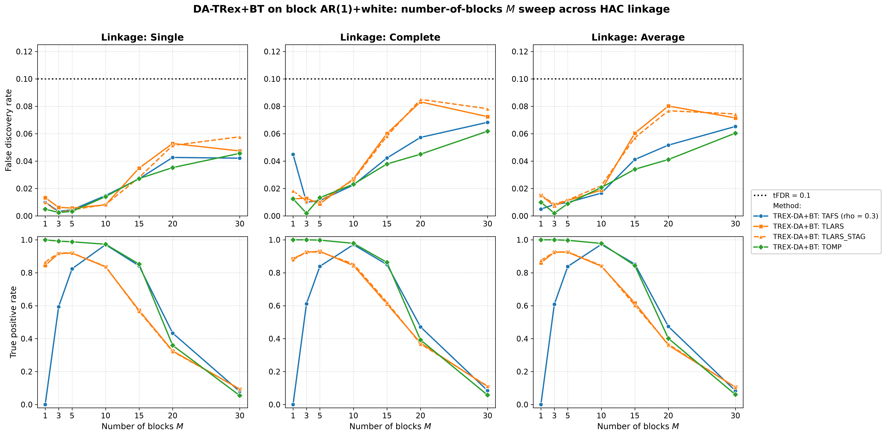

# Demo 02: DA-TRex+BT (Binary-Tree Dependency-Aware T-Rex) on Block AR(1) + White-Noise Data (Python)

Monte-Carlo (MC) results for **DA-TRex+BT** — the Dependency-Aware (DA) Terminating Random Experiments (T-Rex)
selector (DA-TRex) with the Binary-Tree (BT) group design (`DAMethod.BT`) — on a block-diagonal first-order
autoregressive (AR(1)) design diluted by a large block of independent and identically distributed (i.i.d.) white-noise
columns, sweeping the signal-to-noise ratio (SNR), $\rho$, block size $Q$, and number of blocks $M$, each across the
three hierarchical agglomerative clustering (HAC) linkage methods (Single / Complete / Average).
Common setup: $n=300$, $p_{\text{total}}=1{,}000$, amplitude $1.0$, target false discovery rate (FDR)
$\mathrm{tFDR}=0.1$, $K=20$ random experiments, $\mathrm{MC}=200$ per grid point, and solvers TLARS / TAFS / TOMP,
plus TLARS_STAG (TLARS with the T-loop stagnation stop on, window 7, see the
[C++ suite README](../../../../../cpp/trex_selector_methods/ad/trex_da/README.md)).

Python port of the C++ demo
[cpp/trex_selector_methods/ad/trex_da/demo_trex_da_02_mc_sim_ar1_blocks_plus_white](../../../../../cpp/trex_selector_methods/ad/trex_da/demo_trex_da_02_mc_sim_ar1_blocks_plus_white/README.md)
— same data-generating process (DGP), control parameters, sweep axes, console summaries, and result-file naming. The
numbers below are this Python run's own results, and they agree with the C++ reference up to Monte-Carlo noise
(independent random number generator (RNG) streams). Against the previous run on library commit `44cf1ab`, neither
the FDR nor the power of any cell moves by more than two standard errors, so the rerun changes the numbers only by
Monte Carlo noise.

The greedy solvers use *exchangeable tie-breaking* (`exch_tie_alpha = 0.25` for TAFS/TOMP, `0` for
TLARS/TLARS_STAG). See `Exchangeable_Tie_Breaking_DA_TRex.md` in the TRex_Research documentation.
TAFS additionally runs with its adaptive forward-selection (AFS) correlation parameter `rho_afs = 0.3`
(`0` for TLARS/TOMP), which is why the figures label it `TAFS (rho = 0.3)`.

---

## Setup — the DA-TRex+BT selector

As in the other DA demos, the selector deflates each variable's ordinary relative occurrence
$\Phi_{T,L}(j)$ by a penalty built from its most similar competitor within a group of correlated
variables,

```math
\Phi^{\mathrm{BT}}_{T,L}(j) := \Psi^{\mathrm{BT}}_{T,L}(j) \cdot \Phi_{T,L}(j),
\qquad
\Psi^{\mathrm{BT}}_{T,L}(j) :=
\begin{cases}
\displaystyle \frac{1}{2 - \underset{j' \in \mathrm{Gr}(j)}{\min}
  \left| \Phi_{T,L}(j) - \Phi_{T,L}(j') \right|}\,,
& \mathrm{Gr}(j) \neq \emptyset \\[10pt]
\displaystyle 1/2, & \mathrm{Gr}(j) = \emptyset
\end{cases}
```

but — unlike the correlation-threshold group design of the nearest-neighbor (NN) variant DA-TRex+NN (Demo 07) — the
**BT group design** obtains $\mathrm{Gr}(j)$ from a **binary tree**. Variables are clustered by hierarchical
agglomerative clustering (HAC) on the dissimilarity $1 - |\mathrm{corr}(\boldsymbol x_j, \boldsymbol x_{j'})|$,
and the dendrogram cut defines disjoint variable groups. The **linkage method**
(`LinkageMethod` from `trexselector.ml_methods.clustering`) sets the between-cluster distance
during agglomeration:

- **Single** — $d(A,B) = \min_{j \in A,\, j' \in B} d(j, j')$ (nearest member, prone to chaining),
- **Complete** — $d(A,B) = \max_{j \in A,\, j' \in B} d(j, j')$ (farthest member, compact clusters),
- **Average** — $d(A,B) = \underset{j \in A,\, j' \in B}{\operatorname{mean}}\, d(j, j')$
  (unweighted pair group method with arithmetic mean (UPGMA)).

Whether this choice materially changes the FDR or the true positive rate (TPR) on a clean block design is this demo's
core question, so every sweep below is run once per linkage.

## Setup — data generating process (`dgp_ar1_block_white_snr`)

The design concatenates $M$ statistically independent AR(1) blocks of size $Q$ with a large block of
white-noise columns. The within-block correlation follows the $Q \times Q$ Toeplitz matrix

```math
\left[\boldsymbol{\Sigma}_{m}(\rho)\right]_{j,k} = \rho^{|j-k|},
\qquad m = 1, \ldots, M,
```

generated per block via the recursion $z_{j} = \rho\, z_{j-1} + \sqrt{1-\rho^{2}}\,\varepsilon_{j}$
with $z_1, \varepsilon_j \sim \mathcal{N}(0,1)$, so $p_{\text{ar}} = M \cdot Q$. The $(M+1)$-th block
holds $p_{\text{white}} = p_{\text{total}} - p_{\text{ar}}$ i.i.d. $\mathcal{N}(0,1)$ columns,
giving the block-diagonal total covariance

```math
\boldsymbol{\Sigma} =
\begin{bmatrix}
\boldsymbol{\Sigma}_1(\rho) & & & \\
& \ddots & & \\
& & \boldsymbol{\Sigma}_M(\rho) & \\
& & & \boldsymbol{I}_{p_{\text{white}}}
\end{bmatrix} \in \mathbb{R}^{p_{\text{total}} \times p_{\text{total}}},
\qquad p_{\text{total}} = p_{\text{ar}} + p_{\text{white}} = 1{,}000 \text{ fixed}.
```



Empirical Pearson correlation of an exemplary design drawn from this DGP (base point $M=5$, $Q=5$,
$\rho=0.7$, seed 2026), in **natural variable order — no hierarchical clustering**, cropped to the
leading 75×75 corner of the $p=1{,}000$ design. The five AR(1) blocks occupy the first
$p_{\text{ar}} = 25$ columns, and everything after them is the uncorrelated white padding (bare diagonal).
One figure per DGP lives in [`../dgp_corr_plots/`](../dgp_corr_plots/). Regenerate them with
[`../generate_corr_plots.sh`](../generate_corr_plots.sh) (shared plotter
[`../../../corr_plt_utils.py`](../../../corr_plt_utils.py)).

**Support (`OnePerBlock`).** The true support draws exactly one representative per AR(1) block,

```math
\mathcal{S} = \{s_1, \ldots, s_M\}, \qquad s_m \in \{(m-1)Q, \ldots, mQ - 1\},
```

(0-based Python indices, while the R suite is 1-based), so $s = M$ and all actives lie in the AR part — the
white block is pure null padding that makes the problem high-dimensional ($p_{\text{total}} > n$).

**Linear model and SNR control.** Each trial draws $y = X\beta + \varepsilon$ with active amplitude
$\beta_{s_m} = 1.0$, $\varepsilon_i \stackrel{\text{iid}}{\sim} \mathcal{N}(0, \sigma^2)$, and
$\sigma^2 = \widehat{\mathrm{Var}}(X\beta)/\mathrm{SNR}$.

**Base parameters** (each sweep varies one dimension, ceteris paribus): $M=5$, $Q=5$
($p_{\text{ar}}=25$, $p_{\text{white}}=975$, $s=5$), $\rho=0.7$, $\mathrm{SNR}=2.0$, seed $2026$.

---

## Running the Demo

```bash
python Python/trex_selector_methods/ad/trex_da/demo_trex_da_02_mc_sim_ar1_blocks_plus_white/demo_trex_da_02_mc_sim_ar1_blocks_plus_white.py
```

The four parts are toggled by the `RUN_PART_*` flags at the top of the file (all `True`, mirroring the
cpp `if (true)` toggles). Reduce `NUM_MC` to preview. The file inserts both its own folder and the
parent suite directory onto `sys.path` so `dgp_generators` / `da_sim_common` resolve in the demo *and*
in the spawned workers — run it as a file, not piped via `python -`. Monte-Carlo trials run in
parallel through `concurrent.futures.ProcessPoolExecutor` on `TREX_NUM_WORKERS` worker processes (default 8, and `0`
uses every usable core, see `resolve_workers()` in [`../da_sim_common.py`](../da_sim_common.py)).

Afterwards, regenerate the figures from the comma-separated values (CSV) files with
[`generate_plots.sh`](generate_plots.sh), which drives the suite plotting module
[`../trex_da_plt_utils.py`](../trex_da_plt_utils.py) through the repo-root `.venv`
(`pip install matplotlib pandas plotly`).

---

## Output Files

Data tables are written to `simulation_results/data/` (24 files = 12 scenario stems, one
`.txt`+`.csv` pair each):

- `da_trex_mc_da_ar1_blocks_plus_white_snr_{Single,Complete,Average}.txt` / `.csv`
- `da_trex_mc_da_ar1_blocks_plus_white_rho_{Single,Complete,Average}.txt` / `.csv`
- `da_trex_mc_da_ar1_blocks_plus_white_Q_{Single,Complete,Average}.txt` / `.csv`
- `da_trex_mc_da_ar1_blocks_plus_white_M_{Single,Complete,Average}.txt` / `.csv`

Figures go to `simulation_results/plots/`: one FDR/TPR overview (Portable Network Graphics (PNG) and Portable
Document Format (PDF), plus interactive Plotly `.html` with `--plotly`) per sweep × linkage, plus one
linkage-comparison grid (Single/Complete/Average columns) per sweep — the four grids embedded below.

---

## Part 1 — SNR sweep ($\mathrm{SNR} \in \lbrace0.1, 0.2, 0.5, 0.6, 1, 2, 5\rbrace$)

- **FDR is very tightly controlled**: at most $0.027$ across every linkage × solver × SNR cell —
  far below the (already stricter) $\mathrm{tFDR}=0.1$ target. With $975$ uncorrelated null columns
  diluting the design, there is little correlated structure for false discoveries to latch onto.
- TPR: TOMP is essentially perfect from $\mathrm{SNR}=1$ on ($0.99\text{–}1.0$), while TLARS and TLARS_STAG plateau
  around $0.91\text{–}0.93$. TAFS peaks at $\mathrm{SNR}=1$ ($0.94$) and then *declines* to $0.74\text{–}0.75$ at
  $\mathrm{SNR}=5$ — a notable non-monotonicity unique to TAFS in this design.
- The choice of linkage barely matters at the base point ($M=5$, $Q=5$, $\rho=0.7$).



---

## Part 2 — $\rho$ sweep ($\rho \in \lbrace0.0, 0.1, \ldots, 0.9\rbrace$)

- **This is where linkage matters most — at *low* $\rho$**. With Single linkage, TPR drops to
  $\approx 0.61\text{–}0.66$ for all solvers at $\rho \leq 0.1$, while Complete/Average hold
  $\approx 0.96\text{–}0.99$. With weak within-block correlation the Single-linkage cut groups variables by
  noise, while compact-cluster linkages are robust. From $\rho \geq 0.3$ all three linkages coincide.
- FDR stays controlled over the whole grid (max $0.039$, TAFS at $\rho=0.9$ under Complete linkage).
  The mild uptick at $\rho=0.9$ is shared by TAFS/TOMP across linkages but stays far under target.
- At high correlation TPR declines moderately ($\rho=0.9$: TLARS and TLARS_STAG $0.72$,
  TAFS $0.72\text{–}0.73$, TOMP $\approx 0.94$) — the within-block shadows become harder to separate.



---

## Part 3 — Block-size $Q$ sweep ($Q \in \lbrace5, 10, \ldots, 50\rbrace$)

Here $p_{\text{ar}} = 5Q$ and $p_{\text{white}} = 1{,}000 - 5Q$.

- FDR is controlled everywhere (max $0.037$, TAFS with Average linkage at $Q = 25$).
- **Single linkage costs power as blocks grow**. From $Q \geq 20$ it dips to a trough around
  $Q = 30\text{–}40$ (TAFS $\approx 0.65\text{–}0.69$, TLARS/TLARS_STAG $\approx 0.72\text{–}0.76$,
  TOMP $\approx 0.82\text{–}0.84$), while Complete/Average stay flat across the whole grid (TOMP $\approx 1.0$,
  TLARS/TLARS_STAG $0.90\text{–}0.94$, TAFS $0.83\text{–}0.86$). A plausible reason is that longer in-block chains
  give Single linkage more chances to merge blocks with the white pool, although the gap shrinks again at
  $Q = 45\text{–}50$ (from $0.18\text{–}0.19$ at $Q = 30$ to $0.10\text{–}0.11$ at $Q = 50$).



---

## Part 4 — Number-of-blocks $M$ sweep ($M \in \lbrace1, 3, 5, 10, 15, 20, 30\rbrace$, $s = M$)

- This is the stress dimension. Here $s = M$ grows while $n = 300$ and the amplitude ($1.0$) stay fixed,
  so the per-signal SNR shrinks. **TPR collapses once $M \gtrsim 20$** ($\approx 0.32\text{–}0.47$ at
  $M=20$, $\approx 0.05\text{–}0.11$ at $M=30$) for every solver and linkage.
- At $M=15$ the greedy solvers clearly outlast TLARS (TAFS/TOMP $\approx 0.84\text{–}0.86$ vs. TLARS/TLARS_STAG
  $\approx 0.57\text{–}0.62$).
- FDR stays at or below target throughout the collapse — the selector fails *safe* (selects little
  rather than selecting wrongly). The largest cell is TLARS_STAG at $0.085$ ($M=20$, Complete linkage), where
  TLARS reaches $0.083$.
- The $M=1$ column reproduces the C++ reference's TAFS quirk (TPR $=0$ with a single active
  variable, where TLARS and TLARS_STAG reach $0.85\text{–}0.89$ and TOMP $1.0$). TAFS still trails at $M=3$
  ($0.59\text{–}0.61$ vs. at least $0.91$ for the other solvers).



---

## TLARS_STAG

TLARS_STAG (TLARS with the T-loop stagnation stop) matches TLARS in every sweep. Over all $102$ cells its mean FDR
and TPR changes stay below $0.001$, and a single cell loses at most $0.028$ TPR. Its largest FDR increase, $0.010$
at $M = 30$ under Single linkage, keeps the FDR below target. Its mean T-loop length stays at or below $7.3$ steps
in every cell, where TLARS runs to a median of $7\text{–}19$ steps per sweep and up to $65$ in the $M$ sweep. The
figures draw TLARS_STAG dashed in the TLARS colour.

---

## Interpretation

- Compare against **Demo 03** (same block AR(1) core, *no* white-noise columns), which also runs at half the
  sample size ($n = 150$) and twice the target ($\mathrm{tFDR} = 0.2$). The white padding, together with the larger
  $n$, keeps the FDR low here, also relative to the halved target. Outside the $M$ stress sweep it stays at or below
  $0.039$ (and at most $0.085$ in it), while Demo 03 reaches $0.113$ already in its SNR sweep and $0.26$ at
  $\rho = 0.9$. This comes without hurting the detection of the true blocks at the base point.
- The linkage question gets a two-sided answer. Linkage is irrelevant at the well-correlated base
  point, but **Single linkage is fragile** exactly where the block structure is weak (low $\rho$) or
  large (high $Q$) — Complete or Average are the safer defaults for this DGP.
- The $M$ sweep shows a graceful, FDR-safe power collapse as the signal budget is spread over more
  and more active variables.
