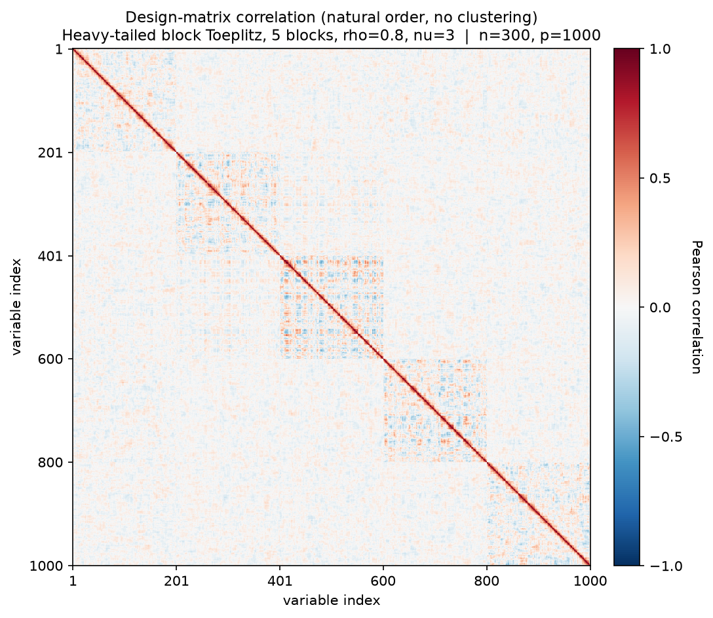
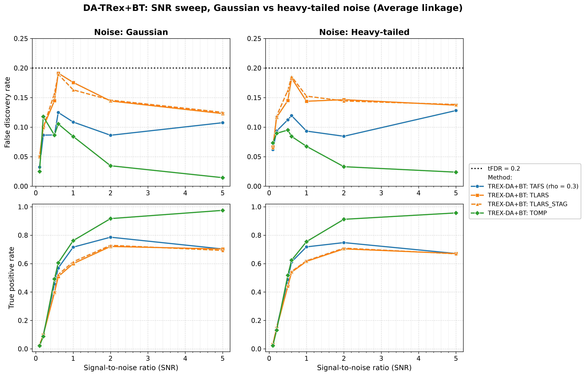
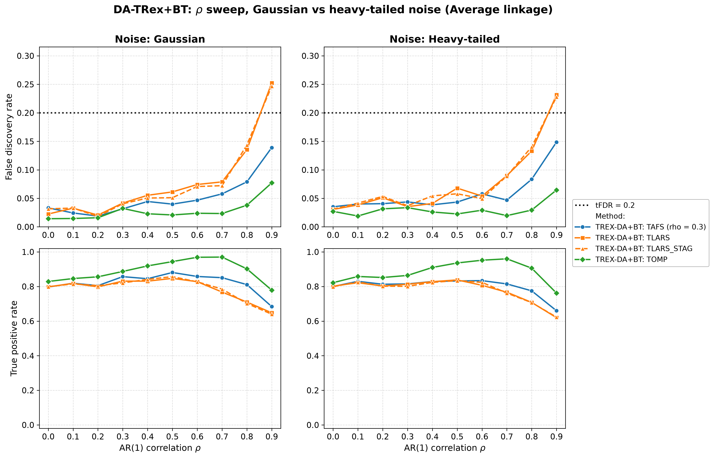
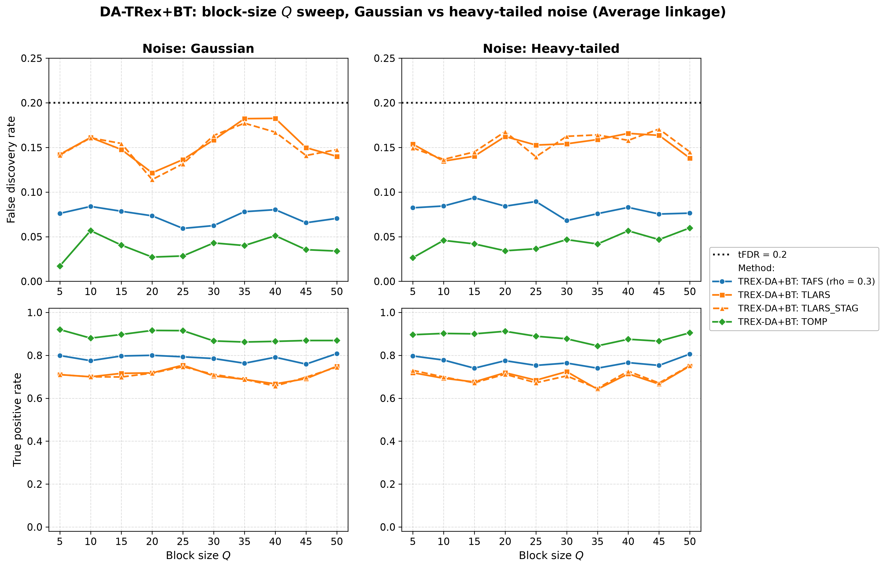
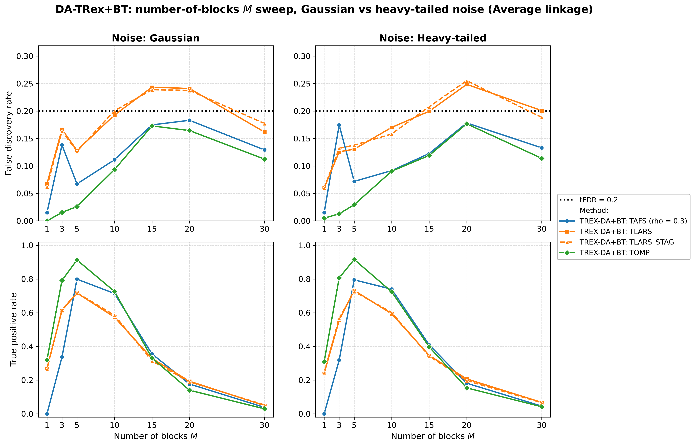
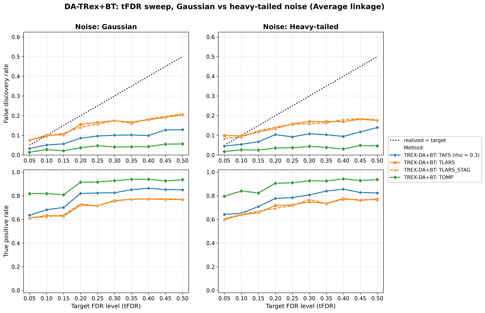
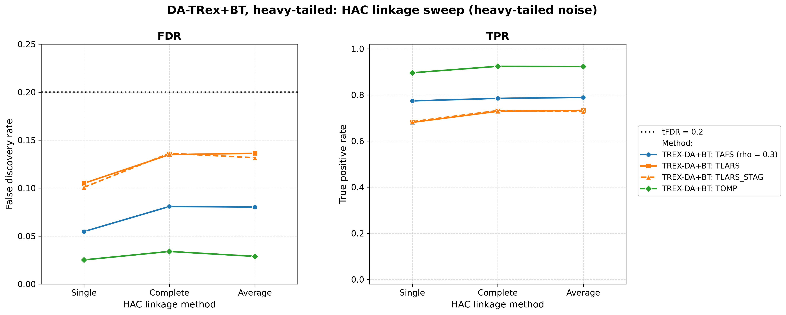

# Demo 04: DA-TRex+BT (Binary-Tree Dependency-Aware T-Rex) on Heavy-Tailed Block Data (Python)

Monte-Carlo (MC) results for **DA-TRex+BT** — the Dependency-Aware (DA) Terminating Random Experiments (T-Rex)
selector (DA-TRex) with the Binary-Tree (BT) group design (`DAMethod.BT`) — on a **heavy-tailed** block-diagonal
Toeplitz design, where the predictors always follow a multivariate $\text{Student-}t(\nu{=}3)$ law, and the response
noise is either Gaussian (**s1_Gauss**) or $t(\nu{=}3)$ (**s2_Heavy**). Five ceteris-paribus sweeps (signal-to-noise
ratio (SNR), $\rho$, block size $Q$, number of blocks $M$, target false discovery rate (FDR)) plus a dedicated linkage
sweep are each run under both noise scenarios and the three hierarchical agglomerative clustering (HAC) linkage
methods (Single / Complete / Average).
Common setup: $n=150$, amplitude $1.0$, $\rho=0.8$, $\nu=3$, $\mathrm{tFDR}=0.2$, $K=20$ random
experiments, $\mathrm{MC}=200$ per grid point, and solvers TLARS / TAFS / TOMP, plus TLARS_STAG (TLARS with the
T-loop stagnation stop on, window 7, see the [suite README](../README.md)).

Python port of the C++ demo
[cpp/trex_selector_methods/ad/trex_da/demo_trex_da_04_mc_sim_ht_blocks](../../../../../cpp/trex_selector_methods/ad/trex_da/demo_trex_da_04_mc_sim_ht_blocks/README.md)
— same data-generating process (DGP), control parameters, sweep axes, console summaries, and result-file naming. The
numbers below are this Python run's own results, and they agree with the C++ reference **CSVs** up to Monte-Carlo
noise (independent random number generator (RNG) streams).

The greedy solvers use *exchangeable tie-breaking* (`exch_tie_alpha = 0.25` for TAFS/TOMP, `0` for
TLARS and TLARS_STAG) in every part, as in C++. TAFS runs with its adaptive forward-selection (AFS) correlation
parameter `rho_afs = 0.3` throughout (`0` for TLARS, TLARS_STAG and TOMP), which is why the figures label it
`TAFS (rho = 0.3)`.

---

## Setup — the DA-TRex+BT selector

The selector deflates each variable's ordinary relative occurrence $\Phi_{T,L}(j)$ by the penalty
$\Psi_{T,L}^{\mathrm{BT}}(j) \in [1/2, 1]$ built from its most similar competitor within its
variable group,

```math
\Phi^{\mathrm{BT}}_{T,L}(j) := \Psi^{\mathrm{BT}}_{T,L}(j) \cdot \Phi_{T,L}(j),
```

where the **BT group design** obtains the groups $\mathrm{Gr}(j)$ from a **binary tree**. Variables
are clustered by hierarchical agglomerative clustering (HAC) on the dissimilarity
$1 - |\mathrm{corr}(\boldsymbol x_j, \boldsymbol x_{j'})|$ and the dendrogram cut defines disjoint
groups (see [Demo 02](../demo_trex_da_02_mc_sim_ar1_blocks_plus_white/README.md) for the full penalty
formula). The **linkage method** sets the between-cluster distance during agglomeration —
**Single** ($\min$, prone to chaining), **Complete** ($\max$, compact clusters), **Average**
(mean, unweighted pair group method with arithmetic mean (UPGMA)). Because heavy-tailed data make the sample
correlations that drive HAC noisier, every sweep is run once per linkage and Part 6 probes linkage directly.

## Setup — data generating process (`dgp_block_toeplitz_hvt_snr`)

The design consists of $M$ statistically independent first-order autoregressive (AR(1)) blocks of size $Q$ — and
nothing else. As in Demo 03 there is no white-noise padding, so *every* column belongs to a correlated block and
$p = M \cdot Q$. The within-block correlation follows the $Q \times Q$ Toeplitz matrix

```math
\left[\boldsymbol{\Sigma}_{m}(\rho)\right]_{j,k} = \rho^{|j-k|},
\qquad m = 1, \ldots, M,
```

giving the block-diagonal scale matrix

```math
\boldsymbol{\Sigma} =
\begin{bmatrix}
\boldsymbol{\Sigma}_1(\rho) & & \\
& \ddots & \\
& & \boldsymbol{\Sigma}_M(\rho)
\end{bmatrix} \in \mathbb{R}^{p \times p},
\qquad p = M \cdot Q.
```

**Heavy-tailed predictors.** Each block is drawn as a **multivariate $\text{Student-}t$** with $\nu$ degrees
of freedom and scale matrix $\boldsymbol\Sigma_m$, via the Gaussian scale-mixture

```math
\boldsymbol{X}_i^{(m)} = \sqrt{\tfrac{\nu}{u_{i,m}}}\; \boldsymbol{L}_m \boldsymbol{z}, \qquad
\boldsymbol{z} \sim \mathcal{N}(\boldsymbol{0}, \boldsymbol{I}_Q),\;\;
u_{i,m} \sim \chi^2_{\nu},
```

where $\boldsymbol L_m$ is the Cholesky factor of $\boldsymbol\Sigma_m$ and the mixing variable
$u_{i,m}$ is drawn independently per row $i$ and block $m$ — so extreme events are block-local. The
correlation structure $\rho^{|j-k|}$ is preserved. The marginals are $t(\nu)$ (finite variance
$\tfrac{\nu}{\nu-2}$ for $\nu=3$), so the tails are much heavier than Gaussian.



Empirical Pearson correlation of an exemplary design drawn from this DGP (illustrative instance:
$n=300$, $p=1{,}000$, 5 blocks of 200, $\rho=0.8$, $\nu=3$), in **natural variable order — no
hierarchical clustering**. The five blocks show up as *noisy* squares. The within-block Toeplitz
decay concentrates near the diagonal, and the heavy tails make the off-diagonal sample correlations
themselves erratic — which is exactly why the HAC clustering that drives the BT groups gets harder
here. Regenerate the per-DGP figures with
[`../generate_corr_plots.sh`](../generate_corr_plots.sh) (shared plotter
[`../../../corr_plt_utils.py`](../../../corr_plt_utils.py)).

**Support (`OnePerBlock`).** Exactly one representative per AR(1) block (the block's first column),

```math
\mathcal{S} = \{s_1, \ldots, s_M\}, \qquad s_m = (m-1)Q,
```

(0-based Python indices, while the R suite is 1-based), so $s = M$ and every block carries a signal.

**Linear model, noise scenarios, and SNR control.** Each trial draws $y = X\beta + \varepsilon$ with
active amplitude $\beta_{s_m} = 1.0$ and SNR-calibrated noise variance
$\sigma^2 = \widehat{\mathrm{Var}}(X\beta)/\mathrm{SNR}$. The two scenarios differ only in the noise
law:

- **s1_Gauss:** $\varepsilon_i \stackrel{\text{iid}}{\sim} \mathcal{N}(0, \sigma^2)$,
- **s2_Heavy:** $\varepsilon_i \propto t(\nu)$, variance-matched to $\sigma^2$ (scaled by
  $\sqrt{\sigma^2 (\nu-2)/\nu}$).

Note that the **predictors are heavy-tailed in *both* scenarios** — the s1/s2 switch isolates the
additional effect of heavy-tailed *noise* on top of an already heavy-tailed design.

**Base parameters** (each sweep varies one dimension, ceteris paribus): $M=5$, $Q=5$ ($p=25$,
$s=5$), $\rho=0.8$, $\nu=3$, $\mathrm{SNR}=2.0$, seed $2026$.

---

## Running the Demo

```bash
python Python/trex_selector_methods/ad/trex_da/demo_trex_da_04_mc_sim_ht_blocks/demo_trex_da_04_mc_sim_ht_blocks.py
```

The six parts are toggled by the `RUN_PART_*` flags at the top of the file (all `True`, mirroring the
cpp `if (true)` toggles), and every non-linkage part loops scenario × linkage. Reduce `NUM_MC` to preview.
The file inserts both its own folder and the parent suite directory onto `sys.path` so
`dgp_generators` / `da_sim_common` resolve in the demo *and* in the spawned workers — run it as a
file, not piped via `python -`. Monte-Carlo trials run in parallel through
`concurrent.futures.ProcessPoolExecutor` with `TREX_NUM_WORKERS` worker processes (default 8, and `0` uses every
usable core, see `resolve_workers()` in [`../da_sim_common.py`](../da_sim_common.py)). A full run (5 sweeps × 2
scenarios × 3 linkages, plus the linkage sweep) takes about 40 minutes on 8 workers.

Afterwards, regenerate the figures from the comma-separated values (CSV) files with
[`generate_plots.sh`](generate_plots.sh), which drives the suite plotting module
[`../trex_da_plt_utils.py`](../trex_da_plt_utils.py) through the repo-root `.venv`
(`pip install matplotlib pandas plotly`).

---

## Output Files

Data tables are written to `simulation_results/data/` (64 files — the largest output set of any demo
here: 32 scenario stems, one `.txt`+`.csv` pair each). Five sweeps
(`snr`, `rho`, `Q`, `M`, `tFDR`) × 2 noise scenarios × 3 linkages = 30 stems following the pattern
`da_trex_mc_da_ht_blocks_{snr|rho|Q|M|tFDR}_{s1_Gauss|s2_Heavy}_{Single|Complete|Average}.{txt,csv}`, plus
the dedicated linkage-sweep section's 2 stems
`da_trex_mc_da_ht_blocks_linkage_{s1_Gauss|s2_Heavy}.{txt,csv}` (which omit the trailing linkage suffix
since linkage itself is the swept variable).

Figures go to `simulation_results/plots/`: per-CSV FDR and true positive rate (TPR) overviews (Portable Network
Graphics (PNG) and Portable Document Format (PDF), plus interactive Plotly `.html` with `--plotly`), one
linkage-comparison grid per (sweep × scenario), and — embedded below — one **Gaussian-vs-heavy scenario grid** per
sweep (at Average linkage).
The scenario grid is the figure for this demo's core question, namely how much heavy tails cost in FDR control and
power. The numbers quoted in Parts 1 to 5 are read at Average linkage unless stated otherwise.

---

## Part 1 — SNR sweep ($\mathrm{SNR} \in \lbrace0.1, 0.2, 0.5, 0.6, 1, 2, 5\rbrace$)

- **TOMP is the clear winner**. FDR falls to $\approx 0.01\text{–}0.04$ at high SNR while TPR climbs to
  $0.91\text{–}0.98$. TAFS peaks at $\mathrm{SNR}=2$ (TPR $\approx 0.75\text{–}0.79$, FDR $\leq 0.09$) then
  *declines* toward $\mathrm{SNR}=5$ ($\approx 0.67\text{–}0.70$) — the same non-monotonicity seen in the
  Gaussian block demos.
- **TLARS carries the highest FDR from $\mathrm{SNR}=0.5$ on and comes closest to the $\mathrm{tFDR}=0.2$ target
  at $\mathrm{SNR}=0.6$** ($0.191$ Gaussian noise / $0.183$ heavy noise, TLARS_STAG $0.189$ / $0.186$) without
  crossing it, settling at $\approx 0.12\text{–}0.18$ for higher SNR. Its power is the lowest from $\mathrm{SNR}=0.5$
  to $2$, and at $\mathrm{SNR}=5$ TAFS falls to the same level (both $\approx 0.67\text{–}0.70$).
- **Gaussian vs. heavy-tailed noise is nearly indistinguishable** — the two columns almost overlay,
  because the predictors are heavy-tailed in both cases and dominate the added noise.



---

## Part 2 — $\rho$ sweep ($\rho \in \lbrace0.0, 0.1, \ldots, 0.9\rbrace$)

- **FDR rises with $\rho$ and TLARS breaks the target at $\rho = 0.9$** ($0.253$ under Gaussian noise,
  $0.232$ under heavy noise, TLARS_STAG $0.247$ / $0.228$), while TAFS stays controlled
  ($\approx 0.14\text{–}0.15$) and
  **TOMP comfortably so** ($\approx 0.07$). Strong within-block correlation makes the block shadows progressively
  harder to deflate — the block counterpart of the $\text{high-}\rho$ corner in Demos 01 and 07.
- TPR peaks mid-to-high $\rho$ and falls at $\rho=0.9$: TOMP $0.76\text{–}0.97$ (best), TAFS
  $\approx 0.66\text{–}0.88$, TLARS $0.62\text{–}0.85$ (lowest from $\rho = 0.6$ on). At $\rho \le 0.2$ Single
  linkage costs power (TPR $\approx 0.52\text{–}0.63$ against $\approx 0.80\text{–}0.89$), as in Demo 03.
- Again the two noise scenarios track each other closely.



---

## Part 3 — Block-size $Q$ sweep ($Q \in \lbrace5, 10, \ldots, 50\rbrace$, $p = 5Q$ grows to $250 > n$)

- Performance is **remarkably flat across the whole sweep**, even as the design crosses well into the
  high-dimensional regime ($p = 250 > n = 150$ at $Q=50$). TOMP holds TPR $\approx 0.84\text{–}0.92$ with
  FDR $\leq 0.060$, and TAFS reaches $\approx 0.74\text{–}0.81$ TPR at FDR $\approx 0.06\text{–}0.09$.
- **TLARS and TLARS_STAG are the FDR-loosest solvers at every $Q$** ($\approx 0.11\text{–}0.18$, still under the
  $0.2$ target) with TPR $\approx 0.64\text{–}0.75$ — visibly looser than the fully-Gaussian Demo 03, whose
  $Q$-sweep TLARS FDR stayed at $\approx 0.07\text{–}0.11$, but Demo 03 runs at $\rho = 0.7$ against $\rho = 0.8$
  here (see the Interpretation).



---

## Part 4 — Number-of-blocks $M$ sweep ($M \in \lbrace1, 3, 5, 10, 15, 20, 30\rbrace$, $s = M$, $p = 5M$)

- This is the stress dimension. Here $s = M$ grows while $n=150$ and the amplitude stay fixed. **TPR collapses
  for $M \gtrsim 15\text{–}20$** ($\approx 0.14\text{–}0.21$ at $M=20$, $\leq 0.07$ at $M=30$, where $p = n$),
  while FDR climbs to $\approx 0.16\text{–}0.26$ at $M=20$. TLARS exceeds the target there
  ($0.241$ / $0.249$) and at $M=15$ under Gaussian noise ($0.243$, and it lands on the target with $0.200$ under heavy
  noise), TLARS_STAG alike, while TAFS and TOMP stay below it ($0.12\text{–}0.18$ at $M=15\text{–}20$).
- The $M=1$ corner is degenerate ($p=5$, a single active variable), and TAFS almost never selects anything
  (TPR $0.00$) — with one signal there is no occurrence spread for the DA deflation to exploit.
- The sweet spot sits at $M \approx 5\text{–}10$, where TOMP holds $\approx 0.72\text{–}0.92$ TPR at FDR
  $\approx 0.03\text{–}0.09$.



---

## Part 5 — Target-FDR sweep ($\mathrm{tFDR} \in \lbrace0.05, 0.10, \ldots, 0.50\rbrace$)

Unique to Demos 04–05, this part sweeps the *target* FDR to check calibration of the realized FDR.

- **Realized FDR increases with the target**, as it should, and from $\mathrm{tFDR}=0.15$ on every solver runs
  *below* the identity line. Only TLARS and TLARS_STAG overshoot the strictest target ($0.074\text{–}0.099$ at
  $\mathrm{tFDR}=0.05$) and sit at the target for $\mathrm{tFDR}=0.1$ ($0.091\text{–}0.101$), so they cannot deliver
  very low FDR.
  **TLARS is the least conservative** ($\approx 0.14\text{–}0.16$ at $\mathrm{tFDR}=0.2$, $\approx 0.18\text{–}0.20$
  at $\mathrm{tFDR}=0.5$), **TAFS** sits in between ($\approx 0.09\text{–}0.10$ at $\mathrm{tFDR}=0.2$,
  $\approx 0.13\text{–}0.14$ at $0.5$), and **TOMP is markedly conservative** ($\approx 0.04$ at $\mathrm{tFDR}=0.2$,
  still only $\approx 0.05$ at $\mathrm{tFDR}=0.5$).
- Power rises with the target as expected, and TOMP stays high throughout ($\approx 0.80\text{–}0.94$).

The loose end of this sweep reflects a corrected false discovery proportion (FDP) estimate. Library commit 415484d
removed the lower clamp $\Phi' \geq 0$ from the estimate, so the realized FDR falls from a target of about $0.30$ upward
and the curves flatten there, while targets up to $0.20$ and the other sweeps at $\mathrm{tFDR}=0.2$ move only by noise.
Averaged over the six scenario × linkage cells at $\mathrm{tFDR}=0.5$, the FDR drops from $0.230$ to $0.177$ for TLARS,
from $0.201$ to $0.176$ for TLARS_STAG, from $0.150$ to $0.119$ for TAFS and from $0.080$ to $0.051$ for TOMP. TPR does
not pay for this, since the same averages go from $0.757$ to $0.772$, from $0.764$ to $0.773$, from $0.835$ to $0.843$
and from $0.931$ to $0.934$, and no single cell moves by more than two standard errors.



---

## Part 6 — HAC linkage sweep (Single / Complete / Average, base parameters)

At the well-correlated base point ($\rho=0.8$) **linkage choice barely matters**: TOMP FDR
$\approx 0.02\text{–}0.04$ / TPR $\approx 0.90\text{–}0.92$, TAFS FDR $\approx 0.05\text{–}0.08$ / TPR
$\approx 0.77\text{–}0.79$, TLARS FDR $\approx 0.10\text{–}0.16$ / TPR $\approx 0.66\text{–}0.73$, TLARS_STAG FDR
$\approx 0.10\text{–}0.15$ / TPR $\approx 0.67\text{–}0.73$ — Single, Complete and Average land within a few points
of one another under both noise scenarios. As Demo 03 shows,
linkage differences open up mainly at *low* $\rho$ and *large* $Q$, where the correlation signal HAC
relies on is weak.



---

## TLARS_STAG

TLARS_STAG (TLARS with the T-loop stagnation stop) matches TLARS in every sweep. Averaged over a sweep's cells, TPR
changes by at most $0.003$ and FDR by at most $0.002$, and no single cell loses more than $0.028$ TPR. The two also
coincide at the loosest target of the target FDR (tFDR) sweep (mean $0.176$ against $0.177$ at $\mathrm{tFDR}=0.5$),
because the corrected estimate of Part 5 lowers TLARS by $0.053$ and TLARS_STAG by $0.026$. Its mean T-loop length is
at most $7.2$ steps, while TLARS runs to a median of $32$ and up to $44$ steps. It exceeds the target by more than two
standard errors in $12$ cells, against $15$ for TLARS, all in the same regions ($\rho = 0.9$, $M = 15\text{–}20$ and
$\mathrm{tFDR} = 0.05$).

---

## Interpretation

- **The noise law matters little.** Across every sweep the
  s1_Gauss and s2_Heavy columns are nearly identical. Since $X$ is $t(3)$ in both scenarios, adding a
  variance-matched $t(3)$ *noise* on top changes little.
- **Heavy-tailed predictors cost power more than FDR control.** The $\rho$ sweeps of Demo 03 and of this demo share
  $n$, $p$, $M$, $Q$, $s$, SNR, tFDR, the support placement, the seeds and the solver pool, and differ only in the
  $t(3)$ mixing of $X$ (plus the $t(3)$ noise of the heavy-noise scenario). From $\rho = 0.4$ on the TPR here is
  $0.011\text{–}0.100$ lower than in Demo 03 (Average linkage, every solver and both noise laws), while at
  $\rho \le 0.2$ it is up to $0.157$ higher. TLARS's FDR is not systematically looser at the same $\rho$. It matches
  at $\rho = 0.8$ ($0.136$ with Gaussian and $0.133$ with heavy noise against $0.135$), is tighter at $\rho = 0.7$
  ($0.079$ / $0.090$ against $0.132$), nominally tighter at $\rho = 0.9$ ($0.253$ / $0.232$ against $0.259$), and
  lower on average over the grid ($0.078$ / $0.077$ against $0.083$). The
  looser TLARS FDR on this demo's $Q$ sweep ($\approx 0.12\text{–}0.18$ against $\approx 0.07\text{–}0.11$ in
  Demo 03) is consistent with the higher base correlation, $\rho = 0.8$ against $0.7$ (Demo 03 gives $0.135$ at
  $\rho = 0.8$, at the lower end of this range). Its mild further rise toward large $Q$ (mean $0.142$ / $0.149$ at
  $Q \le 25$ against $0.163$ / $0.156$ at $Q \ge 30$) has no counterpart in the flat $Q$ sweep of Demo 03.
- **Solver ranking is consistent** with the other block demos. **TOMP is the most robust** (highest
  TPR *and* lowest FDR in most cells, except at low SNR and in the $M$ collapse), TAFS sits in between with its
  high-SNR power decline, and **TLARS is the most FDR-fragile** — it breaches the target at $\rho = 0.9$, in the $M$
  collapse region and at $\mathrm{tFDR} = 0.05$, and is the least conservative on the tFDR sweep. TLARS_STAG
  behaves like TLARS throughout.
- The failure modes are *safe*. Where the problem becomes too hard ($M \to 30$, $p \to n$), power
  collapses toward zero rather than FDR exploding.
- **Linkage** is a minor knob at this correlation level, while Complete or Average remain the safe defaults
  for the regimes (low $\rho$, large blocks) where it starts to matter.

---

## References

- R legacy simulation (Gaussian block baseline this demo extends with heavy tails):
  `TRex Legacy CRAN Simulations/trex_da/simulation_results/Results_trex_da_05_bt_ar1_block_sweeps.md`.
- R legacy simulation for the white-padded block variant (extended with heavy tails in
  [Demo 05](../demo_trex_da_05_mc_sim_ht_blocks_plus_white/README.md)):
  `.../Results_trex_da_06_bt_ar1_pwhiteblock_sweeps.md`.
- Machkour, J., Muma, M., & Palomar, D. P., "The Terminating-Random Experiments Selector: Fast
  High-Dimensional Variable Selection with False Discovery Rate Control," 2024.
