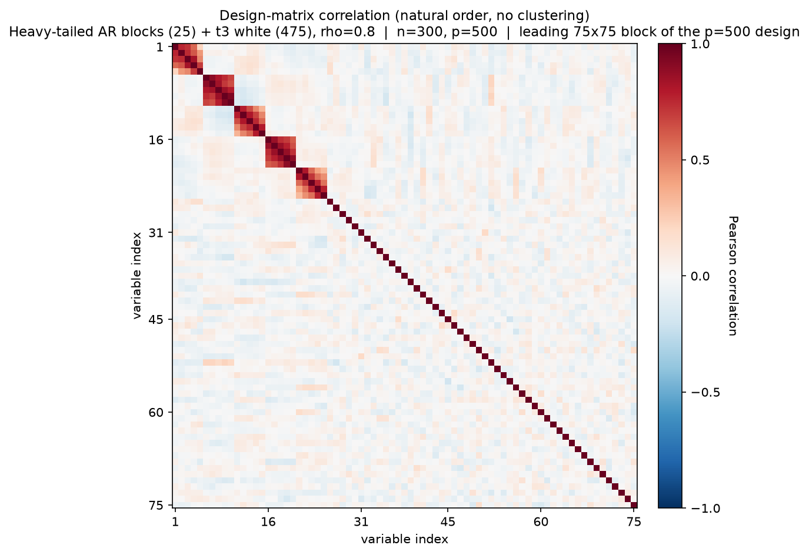
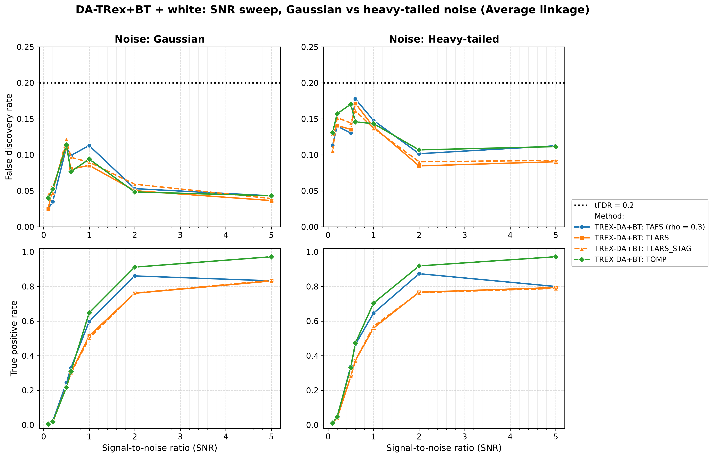
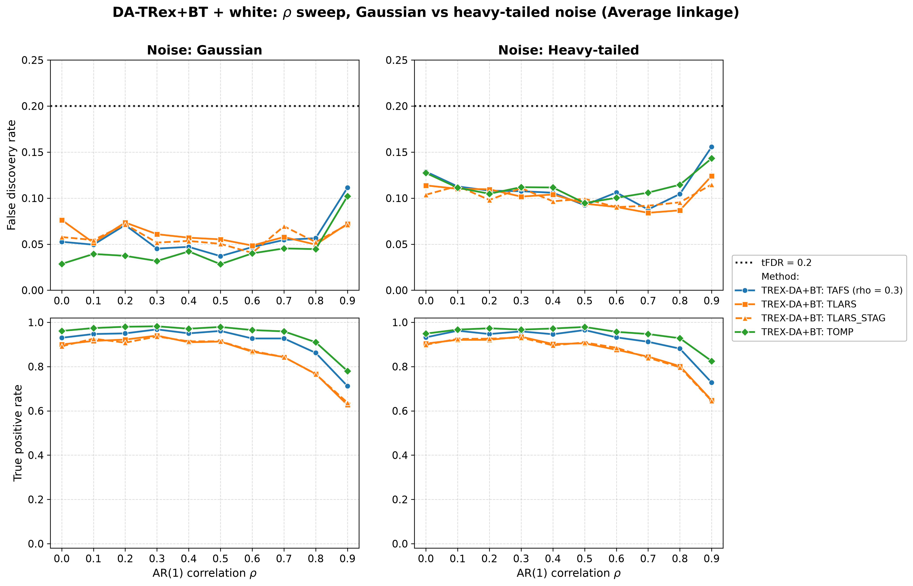
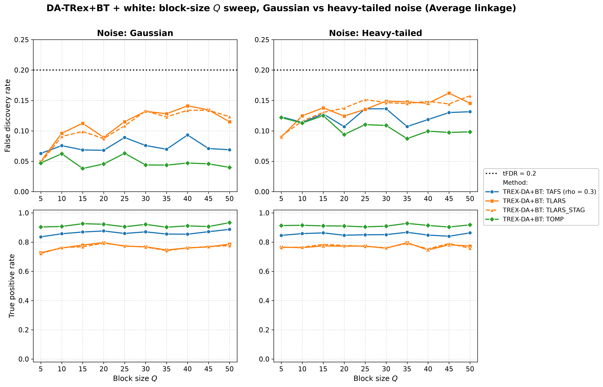
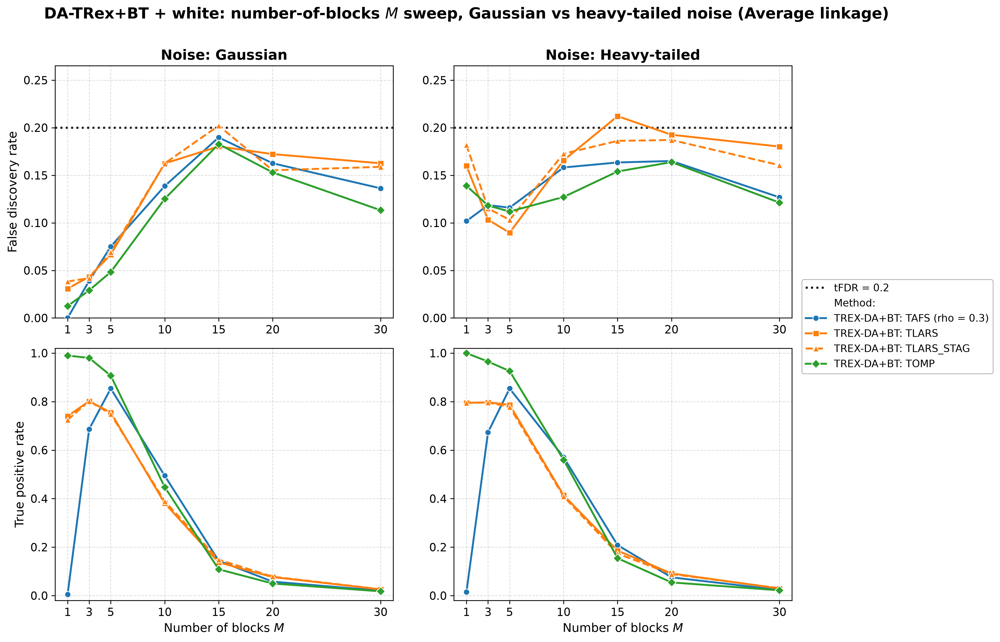
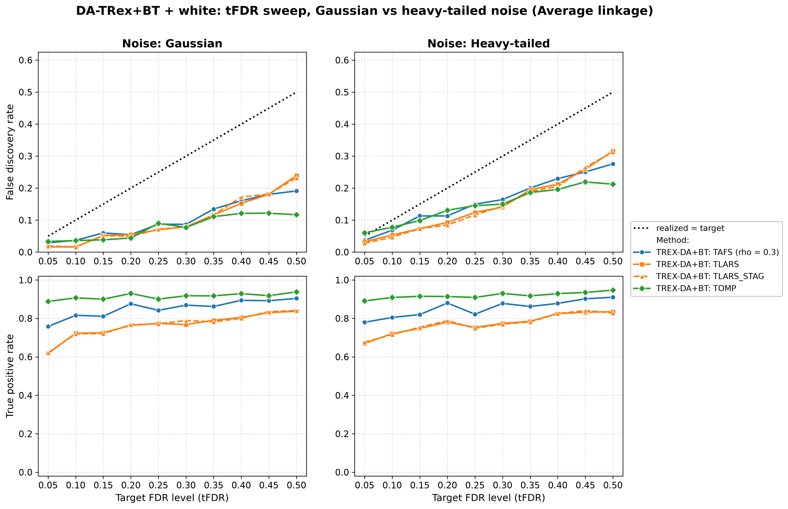

# Demo 05: DA-TRex+BT (Binary-Tree Dependency-Aware T-Rex) on Heavy-Tailed Block + White-Noise Data (Python)

Monte-Carlo (MC) results for **DA-TRex+BT** — the Dependency-Aware (DA) Terminating Random Experiments (T-Rex) selector
(DA-TRex) with the Binary-Tree (BT) group design (`DAMethod.BT`) — on the "combined effects" design of heavy-tailed
(multivariate $t_{\nu}$) first-order autoregressive (AR(1)) Toeplitz blocks embedded in a larger design padded with
independent and identically distributed (i.i.d.) $\text{Student-}t$ white-noise columns. It merges Demo 02's white-noise
dilution with Demo 04's heavy-tailed robustness study, sweeping the signal-to-noise ratio (SNR), $\rho$, block size $Q$,
number of blocks $M$, and the target false discovery rate (FDR) level $\mathrm{tFDR}$ — each across two noise scenarios
(Gaussian vs. heavy-tailed response noise) and the three hierarchical agglomerative clustering (HAC) linkage methods.
Common setup: $n=150$, $p_{\text{total}}=500$, amplitude $1.0$, $\nu=3$, $\mathrm{tFDR}=0.2$ (except the target FDR
(tFDR) sweep), $K=20$ random experiments, $\mathrm{MC}=200$ per grid point, and solvers TLARS / TAFS / TOMP, plus
TLARS_STAG (TLARS with the T-loop stagnation stop on, window 7, see the [suite README](../README.md)).

Python port of the C++ demo
[cpp/trex_selector_methods/ad/trex_da/demo_trex_da_05_mc_sim_ht_blocks_plus_white](../../../../../cpp/trex_selector_methods/ad/trex_da/demo_trex_da_05_mc_sim_ht_blocks_plus_white/README.md)
— same data-generating process (DGP), control parameters, sweep axes, console summaries, and result-file naming. The
numbers below are this Python run's own results, and they agree with the C++ reference up to Monte-Carlo noise
(independent random number generator (RNG) streams).

The greedy solvers use *exchangeable tie-breaking* (`exch_tie_alpha = 0.25` for TAFS/TOMP, `0` for
TLARS and TLARS_STAG) in every part, as in C++. TAFS runs with its adaptive forward-selection (AFS) correlation
parameter `rho_afs = 0.3` throughout (`0` for TLARS, TLARS_STAG and TOMP), which is why the figures label it
`TAFS (rho = 0.3)`.

---

## Setup — the DA-TRex+BT selector

The selector deflates each variable's ordinary relative occurrence $\Phi_{T,L}(j)$ by the penalty
$\Psi_{T,L}^{\mathrm{BT}}(j) \in [1/2, 1]$ built from its most similar competitor within its
variable group, with the groups obtained from a **binary tree**: HAC clustering on the dissimilarity
$1 - |\mathrm{corr}(\boldsymbol x_j, \boldsymbol x_{j'})|$, dendrogram cut into disjoint groups
(see [Demo 02](../demo_trex_da_02_mc_sim_ar1_blocks_plus_white/README.md) for the full penalty
formula). Every sweep runs across the three HAC **linkage methods** (Single / Complete / Average).
For heavy-tailed data the *sample* correlations feeding the clustering are themselves noisier, so
linkage robustness is part of what this demo probes.

## Setup — data generating process (`dgp_ht_block_white_snr`)

The design concatenates $M$ statistically independent **heavy-tailed** blocks of size $Q$ with a
white-noise block. Each block starts from the $Q \times Q$ AR(1) Toeplitz correlation

```math
\left[\boldsymbol{\Sigma}_{m}(\rho)\right]_{j,k} = \rho^{|j-k|},
\qquad m = 1, \ldots, M,
```

and transforms the Gaussian draw into a **multivariate $t_{\nu}$** vector,

```math
\boldsymbol{X}_{i}^{(m)} = \frac{\boldsymbol{Z}_{i}^{(m)}}{\sqrt{U_{i}^{(m)} / \nu}},
\qquad
\boldsymbol{Z}^{(m)}_{i} \sim \mathcal{N}(\boldsymbol{0}, \boldsymbol{\Sigma}_{m}(\rho)),
\quad U_{i}^{(m)} \sim \chi^2_{\nu},
```

with all $\boldsymbol Z_{i}^{(m)}, U_{i}^{(m')}$ independent across blocks.
**Heavy-tail behavior:** when a block draws $U_i^{(m)}$ near zero, *all* $Q$ variables of that block
explode simultaneously (within-block tail dependence), while the other blocks are unaffected —
extreme events are block-local. The remaining $p_{\text{white}} = p_{\text{total}} - M \cdot Q$
columns are i.i.d. $t_{\nu}$ white noise, so the full design is heavy-tailed but only the blocks are
correlated.



Empirical Pearson correlation of an exemplary design drawn from this DGP ($M=5$, $Q=5$, $\rho=0.8$,
$\nu=3$, $p=500$, drawn at $n=300$ for a cleaner picture, seed 2026), in **natural variable order —
no hierarchical clustering**, cropped to the leading 75×75 corner. The five heavy-tailed blocks
occupy the first $p_{\text{ar}} = 25$ columns, and everything after them is $t_{\nu}$ white padding
(bare diagonal). Regenerate the per-DGP figures with
[`../generate_corr_plots.sh`](../generate_corr_plots.sh) (shared plotter
[`../../../corr_plt_utils.py`](../../../corr_plt_utils.py)).

**Noise scenarios.** The response is $y = X\beta + \varepsilon$ with

- `s1_Gauss`: $\varepsilon_i \stackrel{\text{iid}}{\sim} \mathcal{N}(0, \sigma^2)$ — heavy-tailed
  design, Gaussian noise,
- `s2_Heavy`: $\varepsilon_i \stackrel{\text{iid}}{\sim} t_{\nu}$ (scaled) — heavy tails in *both*
  design and noise,

and $\sigma^2 = \widehat{\mathrm{Var}}(X\beta)/\mathrm{SNR}$ in both cases.

**Support (`OnePerBlock`).** One representative per heavy-tailed block, $s = M$, all actives in the
block part (amplitude $1.0$). Indices are 0-based (Python convention).

**Base parameters** (each sweep varies one dimension, ceteris paribus): $M=5$, $Q=5$
($p_{\text{ar}}=25$, $p_{\text{white}}=475$, $s=5$), $\rho=0.8$, $\nu=3$, $\mathrm{SNR}=2.0$,
seed $2026$.

---

## Running the Demo

```bash
python Python/trex_selector_methods/ad/trex_da/demo_trex_da_05_mc_sim_ht_blocks_plus_white/demo_trex_da_05_mc_sim_ht_blocks_plus_white.py
```

The five parts are toggled by the `RUN_PART_*` flags at the top of the file (all `True`, mirroring the
cpp `if (true)` toggles), and every part loops scenario × linkage. Reduce `NUM_MC` to preview. The file
inserts both its own folder and the parent suite directory onto `sys.path` so `dgp_generators` /
`da_sim_common` resolve in the demo *and* in the spawned workers — run it as a file, not piped via
`python -`. Monte-Carlo trials run in parallel through `concurrent.futures.ProcessPoolExecutor`
with `TREX_NUM_WORKERS` worker processes (default 8, and `0` uses every usable core, see `resolve_workers()` in
[`../da_sim_common.py`](../da_sim_common.py)). A full run takes about 3.2 hours on 8 workers.

Afterwards, regenerate the figures from the comma-separated values (CSV) files with
[`generate_plots.sh`](generate_plots.sh), which drives the suite plotting module
[`../trex_da_plt_utils.py`](../trex_da_plt_utils.py) through the repo-root `.venv`
(`pip install matplotlib pandas plotly`).

---

## Output Files

Data tables are written to `simulation_results/data/` (60 files = 30 scenario stems, one
`.txt`+`.csv` pair each):
`da_trex_mc_da_ht_blocks_plus_white_{snr,rho,Q,M,tFDR}_{s1_Gauss,s2_Heavy}_{Single,Complete,Average}.txt` / `.csv`.

Figures go to `simulation_results/plots/`: one FDR and true positive rate (TPR) overview (Portable Network Graphics
(PNG) and Portable Document Format (PDF), plus interactive Plotly `.html` with `--plotly`) per sweep × scenario ×
linkage, one linkage-comparison grid per sweep × scenario, and one **Gaussian-vs-heavy scenario grid** per sweep (at
Average linkage) — the five scenario grids, this demo's core exhibits, are embedded below. The numbers quoted below
are read at Average linkage unless stated otherwise.

---

## Part 1 — SNR sweep ($\mathrm{SNR} \in \lbrace0.1, 0.2, 0.5, 0.6, 1, 2, 5\rbrace$)

- **Gaussian noise is comfortably controlled.** FDR peaks at $0.122$ (TLARS_STAG, $\mathrm{SNR}=0.5$) and
  falls to $\approx 0.04$ at $\mathrm{SNR}=5$ — under the $\mathrm{tFDR}=0.2$ target
  everywhere.
- **Heavy-tailed noise costs FDR, not power**. The whole `s2_Heavy` column sits $\approx 0.02\text{–}0.11$
  higher (peak $0.178$, TAFS at $\mathrm{SNR}=0.6$) while staying under target, and TPR is unchanged or
  slightly *better* at low SNR.
- TPR is nearly scenario-independent: TOMP $0.91\text{–}0.97$ from $\mathrm{SNR}=2$, TAFS
  $\approx 0.80\text{–}0.87$, TLARS and TLARS_STAG $\approx 0.76\text{–}0.84$.



---

## Part 2 — $\rho$ sweep ($\rho \in \lbrace0.0, 0.1, \ldots, 0.9\rbrace$)

- FDR stays flat up to $\rho = 0.8$ and rises at $\rho = 0.9$ in both scenarios, but remains controlled
  throughout. The Gaussian scenario peaks at $0.111$ and the heavy scenario at $0.156$ (both TAFS at $\rho = 0.9$)
  — the heavy scenario carries a roughly constant $+0.05$ offset over the whole grid.
- TPR holds up well to $\rho = 0.8$ (TOMP $\approx 0.91\text{–}0.93$) and drops at $\rho = 0.9$
  (TOMP $\approx 0.78\text{–}0.83$, TAFS $\approx 0.71\text{–}0.73$, TLARS and TLARS_STAG $\approx 0.63\text{–}0.65$)
  — the usual strong-correlation power cost, essentially identical across noise scenarios. At $\rho \le 0.2$ Single
  linkage costs power (TPR $\approx 0.56\text{–}0.68$ against $\approx 0.89\text{–}0.99$), as in Demo 03.



---

## Part 3 — Block-size $Q$ sweep ($Q \in \lbrace5, 10, \ldots, 50\rbrace$)

The block part grows as $p_{\text{ar}} = 5Q$, while the white padding shrinks as $p_{\text{white}} = 500 - 5Q$.

- TPR is remarkably flat in $Q$ (TOMP $0.90\text{–}0.93$, TAFS $0.84\text{–}0.89$, TLARS and TLARS_STAG
  $0.72\text{–}0.80$ at Average linkage) — growing the correlated blocks inside a fixed $p_{\text{total}}$ barely
  affects power here.
- FDR stays controlled in the Gaussian scenario (max $0.141$, TLARS at $Q=40$), while the heavy scenario sits up
  to $0.09$ higher and tops out at $0.162$ (TLARS at $Q=45$) — still under target across the sweep.



---

## Part 4 — Number-of-blocks $M$ sweep ($M \in \lbrace1, 3, 5, 10, 15, 20, 30\rbrace$, $s = M$)

- The power collapse hits **earlier and harder than in the Gaussian demos 02/03**. TPR is already
  down to $\leq 0.21$ at $M=15$, $\leq 0.10$ at $M=20$ and about $0.02\text{–}0.03$ at $M=30$ (vs.
  $\approx 0.12\text{–}0.19$ at $M=20$ in Demo 03) — spreading a fixed signal budget over many *heavy-tailed* blocks
  at $n=150$ is the hardest setting in this suite.
- During the collapse the realized FDR peaks at $M=15\text{–}20$, where TLARS and TLARS_STAG touch the target
  (TLARS $0.212$ heavy and TLARS_STAG $0.202$ Gaussian, both at $M=15$) — with almost nothing
  selected, a single false discovery dominates the false discovery proportion (FDP) ratio, so these cells are
  high-variance.
- The $M=1$ corner separates the solvers sharply. TOMP finds the lone signal essentially always
  (TPR $0.99\text{–}1.0$), TLARS and TLARS_STAG $\approx 0.73\text{–}0.80$, TAFS almost never ($\leq 0.02$) — the
  same TAFS single-signal failure seen in Demos 03 and 04.



---

## Part 5 — tFDR sweep ($\mathrm{tFDR} \in \lbrace0.05, 0.10, \ldots, 0.50\rbrace$)

- Realized FDR **tracks at or below the target across the whole range** (the identity line is the
  reference in these panels). The only excess is a small overshoot of TOMP at the strictest target
  ($\mathrm{tFDR}=0.05$) under heavy-tailed noise ($0.060$, $+0.010$).
- The selector grows increasingly *conservative* as the target loosens — at $\mathrm{tFDR}=0.5$ TOMP
  realizes $0.12$ (Gaussian) / $0.21$ (heavy), i.e. $0.29\text{–}0.38$ below target, while TLARS and TLARS_STAG
  stay closest ($0.23\text{–}0.24$ / $0.31\text{–}0.32$). The TPR of TOMP and TAFS saturates around $0.9$ from
  $\mathrm{tFDR}\approx 0.2$ on, so loosening the target beyond that buys little power.

Against the previous run on library commit `44cf1ab`, this sweep shows one systematic move, like the one in Demo 04.
Library commit `415484d` removed the lower clamp $\Phi' \geq 0$ from the FDP estimate, which makes the estimate larger,
so the realized FDR now falls from a target of about $0.35$ upward, while targets up to $0.30$ and the other sweeps at
$\mathrm{tFDR}=0.2$ move only by noise. All three language trees show the same move. Averaged over the six scenario ×
linkage cells at $\mathrm{tFDR}=0.5$, the FDR drops from $0.299$ to $0.225$ for TLARS, from $0.293$ to $0.222$ for
TLARS_STAG, from $0.259$ to $0.195$ for TAFS and from $0.182$ to $0.139$ for TOMP. TPR does not pay for this, since
the same averages go from $0.829$ to $0.846$, from $0.832$ to $0.845$, from $0.910$ to $0.907$ and from $0.943$ to
$0.942$, and no single cell of the demo moves by more than two standard errors in TPR.



---

## TLARS_STAG

TLARS_STAG (TLARS with the T-loop stagnation stop) matches TLARS in every sweep. Averaged over a sweep's cells, TPR
changes by at most $0.001$ and FDR by at most $0.002$. The largest single-cell difference is $+0.033$ in FDR at a cell
where both T-loops stop early ($M=15$, heavy noise, Complete linkage, $5.0$ against $5.4$ steps), which is Monte Carlo
noise. Its mean T-loop length is at most $7.1$ steps, while TLARS runs to a median of $11$ and up to $38$ steps. No
solver exceeds the target by more than two standard errors in any cell.

---

## Interpretation

- Read as the "combined effects" check against **Demo 03** (Gaussian, no white noise), **Demo 02**
  (Gaussian, with white noise), and **Demo 04** (heavy-tailed, no white noise). The white-noise
  padding again *helps* FDR control (mean over the Gaussian-scenario cells $0.072$ here against $0.095$ in Demo 04,
  and TLARS $0.050$ against $0.144$ at $\mathrm{SNR}=2$, although Demo 04 also has far fewer variables, $p = 25$
  against $500$), while heavy-tailed *response* noise adds a roughly constant FDR offset on top — the two effects
  partially offset, and every base-parameter cell stays under target.
- Heavy tails cost almost no power. Their price is paid in FDR (the `s2_Heavy` offset, plus the
  high-variance cells in the $M$-collapse).
- Solver ranking matches the block-design pattern: **TOMP strongest** (highest TPR, and the lowest FDR in most
  Gaussian-noise cells), TLARS weakest in power and, with TLARS_STAG, the only solver to touch the target in the
  $M$-collapse, TAFS in between but unusable in the single-signal corner.
