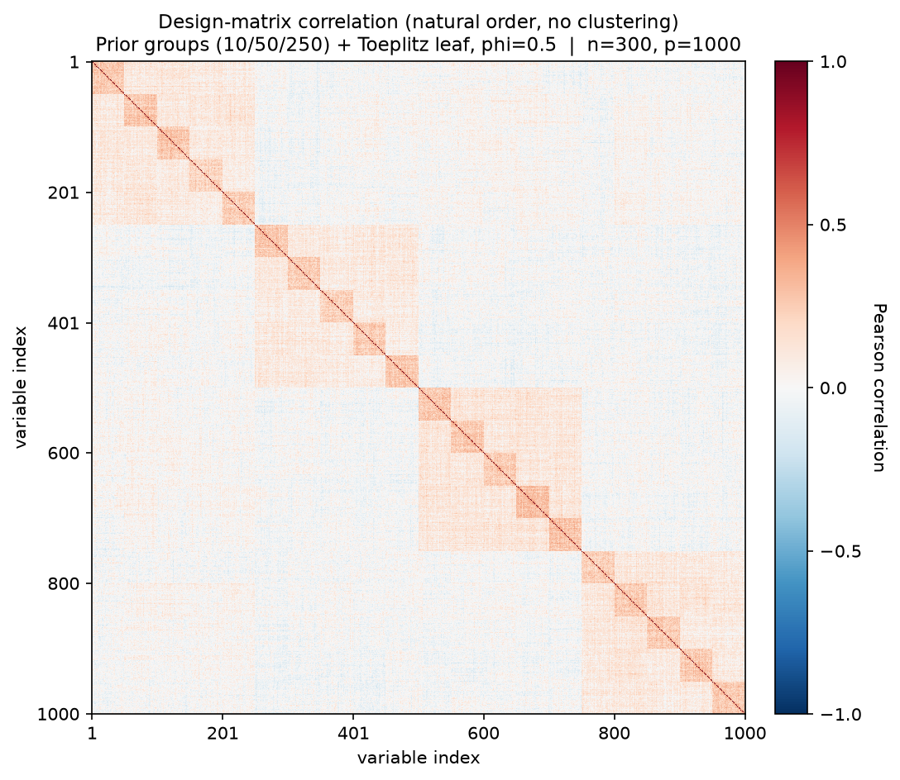
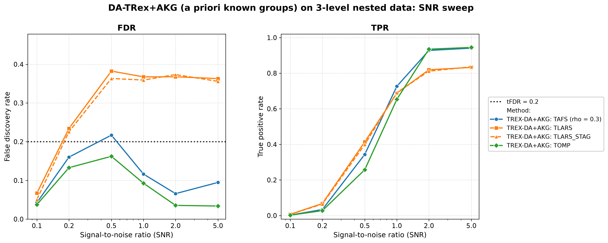

# Demo 06: DA-TRex+AKG (A Priori Known Groups) on Multi-Level Nested Data (Python)

Monte-Carlo (MC) results for **DA-TRex+AKG** — the dependency-aware (DA) Terminating Random Experiments (T-Rex)
selector (DA-TRex) with **a priori known groups (AKG)**, where the true group structure is supplied to the selector
as a hard **constraint** on its dependency tree (constrained sub-clustering), instead of letting hierarchical
agglomerative clustering (HAC) discover the structure from scratch.
The data-generating process (DGP) is a three-level nested latent-factor model with a non-exchangeable
Toeplitz leaf layer.
Common setup: $n=300$, $p=1{,}000$, $s=10$, `Random` support, amplitude $3.0$, target false discovery rate (FDR)
$\mathrm{tFDR}=0.2$, $K=20$ random experiments, $\mathrm{MC}=200$ per grid point, solvers TLARS / TAFS / TOMP plus
TLARS_STAG (TLARS with the T-loop stagnation stop on, window 7), and a signal-to-noise ratio (SNR) sweep
$\mathrm{SNR} \in \lbrace0.1, 0.2, 0.5, 1, 2, 5\rbrace$.

Python port of the C++ demo
[cpp/trex_selector_methods/ad/trex_da/demo_trex_da_06_mc_sim_groups](../../../../../cpp/trex_selector_methods/ad/trex_da/demo_trex_da_06_mc_sim_groups/README.md)
— same DGP, control parameters, sweep axis, console summaries, and result-file naming. The numbers
below are this Python run's own results, and they agree with the C++ reference up to Monte-Carlo noise
(independent random number generator (RNG) streams).

The greedy solvers use *exchangeable tie-breaking* (`exch_tie_alpha = 0.25` for TAFS/TOMP, `0` for
TLARS). See `Exchangeable_Tie_Breaking_DA_TRex.md` in the TRex_Research documentation.
TAFS additionally runs with its adaptive forward-selection (AFS) correlation parameter `rho_afs = 0.3`
(`0` for TLARS/TOMP), which is why the figures label it `TAFS (rho = 0.3)`.

---

## Setup — the DA-TRex+AKG selector (constrained sub-clustering)

The known three-level hierarchy is passed via `da_control.prior_groups` (when non-empty, the
`method` field is ignored). The `PRIOR_GROUPS` method treats these labels as
**merge constraints**, not as deflation neighbourhoods:

1. the **finest common refinement** of the supplied levels (here the groups of 10) partitions the
   variables — two variables can only ever share a deflation neighbourhood if they share a group
   on every level,
2. **HAC runs within each constraint group** (`hc_linkage`, correlation distance) — merges across
   group boundaries are structurally impossible,
3. the calibration **rho grid is data-driven**, with the pooled within-group dendrogram heights
   subsampled to `hc_grid_length` (default $\min(20, p) = 20$) grid points, terminated by the
   conservative $\rho = 1$ singleton anchor (every neighbourhood empty $\Rightarrow$ the paper's
   maximal penalty $\Psi = 1/2$ everywhere),
4. the binary-tree (BT) style occurrence deflation and 3D $(T, v, \rho)$ calibration (see
   [Demo 02](../demo_trex_da_02_mc_sim_ar1_blocks_plus_white/README.md) for the penalty formula)
   run unchanged on these tight within-group neighbourhoods.

Negative group labels are rejected by the Python binding.

**Why not use the raw groups as neighbourhoods?** That was the earlier behaviour, and it
fails by design, because the nearest-partner penalty
$\Psi_j = 1/(2 - \min_{j' \in \mathrm{Gr}(j)} |\Phi_j - \Phi_{j'}|)$ presumes tight, near-exchangeable
neighbourhoods. Inside a 10/50/250-member group nearly every variable has *some*
member with an almost identical occurrence, so the denominator of $\Psi_j$ tends to $2$ uniformly and the
shadow/active ranking is left invariant. The full analysis, including the archived results of the old behaviour,
is in `TRex_Research/documentation/Prior_Groups_Deflation_Mismatch_DA_TRex.md` (§1–§8 the
mismatch, §9 this resolution).

**Relation to BT.** The method is now exactly "BT, tightened by prior knowledge". It uses the same
machinery, but the tree can never merge across known group boundaries, so actives are never deflated against
unrelated variables. The BT reference run in the C++ README shows that the constraints buy power, not a different
failure mode. The figures label the
method `TREX-DA+AKG: <solver>` (applied at plot time via the plotter's `--relabel` flag, so the CSVs
keep the raw `TREX-DA:` labels the demo writes).

## Setup — data generating process (`dgp_groups_toeplitz_leaf`)

Each predictor is a sum of nested latent factors plus a correlated leaf term,

```math
X_{i,j} = \sum_{x=1}^{L-1} \sqrt{\rho_x - \rho_{x+1}}\; f_{g_x(j)}
        + \sqrt{\rho_0 - \rho_1}\; u_{g_0(j),\,j}
        + \sqrt{1-\rho_0}\;\eta_{i,j},
```

where the coarser levels $x \geq 1$ use one standard-normal latent factor per group, and the finest
level ($x = 0$) uses a **Toeplitz-correlated leaf block** — within each finest group the leaf
variables $u_r$ satisfy $\mathrm{Cov}(u_r, u_s) = \phi^{|r-s|}$ with $\phi_{\text{leaf}} = 0.5$ —
so even the members of a finest-level group are *not* exchangeable.

- **Three nested grouping levels** over $p = 1{,}000$, with groups of $10$ on the finest level $x = 0$
  ($100$ groups), groups of $50$ on level $x = 1$ ($20$ groups) and groups of $250$ on level $x = 2$ ($4$ groups).
- **Cumulative correlation masses** (fine → coarse): $(\rho_0, \rho_1, \rho_2) = (0.55, 0.25, 0.10)$. The group of
  250 contributes $0.10$ of each variable's variance, the group of 50 another $0.15$ and the Toeplitz leaf of the
  group of 10 another $0.30$, while $0.45$ is idiosyncratic. Two members of the same group of 10 therefore correlate
  at $0.25 + 0.30 \cdot 0.5^{|r-s|}$, that is $0.25\text{–}0.40$, members of the same group of 50 at $0.25$ and
  members of the same group of 250 at $0.10$.
- Support: $s = 10$ active variables drawn by the `Random` policy per trial (0-based indices),
  amplitude $3.0$, and $y = X\beta + \varepsilon$ with
  $\sigma^2 = \widehat{\mathrm{Var}}(X\beta)/\mathrm{SNR}$.



Empirical Pearson correlation of an exemplary design drawn from this DGP (groups of 10/50/250,
$\rho = \lbrace0.55, 0.25, 0.10\rbrace$, $\phi = 0.5$, seed 2026), in **natural variable order — no
hierarchical clustering**. The nested block structure is visible as squares within squares.
Regenerate the per-DGP figures with [`../generate_corr_plots.sh`](../generate_corr_plots.sh)
(shared plotter [`../../../corr_plt_utils.py`](../../../corr_plt_utils.py)).

---

## Running the Demo

```bash
python Python/trex_selector_methods/ad/trex_da/demo_trex_da_06_mc_sim_groups/demo_trex_da_06_mc_sim_groups.py
```

Reduce `NUM_MC` to preview. The file inserts both its own folder and the parent suite directory onto
`sys.path` so `dgp_generators` / `da_sim_common` resolve in the demo *and* in the spawned workers —
run it as a file, not piped via `python -`. Monte-Carlo trials run in parallel through
`concurrent.futures.ProcessPoolExecutor` with `TREX_NUM_WORKERS` worker processes (default 8, and `0` uses every
usable core, see `resolve_workers()` in [`../da_sim_common.py`](../da_sim_common.py)).

Afterwards, regenerate the figure from the comma-separated values (CSV) file with
[`generate_plots.sh`](generate_plots.sh), which drives the suite plotting module
[`../trex_da_plt_utils.py`](../trex_da_plt_utils.py) through the repo-root `.venv`
(`pip install matplotlib pandas plotly`).

---

## Output Files

Data tables are written to `simulation_results/data/`:

- `da_trex_mc_da_groups_toeplitz_leaf.txt` / `.csv`

The figure (Portable Network Graphics (PNG) and Portable Document Format (PDF), plus interactive Plotly `.html` with
`--plotly`) goes to `simulation_results/plots/`.

---

## Results — SNR sweep

- **The greedy solvers win on power once the signal is clear and are controlled wherever the signal is
  resolvable**. TOMP reaches true positive rate (TPR) $0.945$ with FDR down to $\approx 0.03$ at high SNR, and TAFS
  reaches TPR $0.941$ with FDR $\approx 0.07\text{–}0.12$ from $\mathrm{SNR}=1$ on. TAFS overtakes TLARS in TPR at
  $\mathrm{SNR}=1$ ($0.727$ against $0.688$) and TOMP at $\mathrm{SNR}=2$ ($0.935$ against $0.820$). Below that TLARS
  has the higher TPR ($0.414$ against $0.344$ for TAFS and $0.258$ for TOMP at $\mathrm{SNR}=0.5$), bought with an
  FDR of $0.382$.
- Both greedy solvers have a **high-variance excursion in the low-SNR transition region**. At
  $\mathrm{SNR}=0.5$ TAFS realizes $0.217$ (above the $\mathrm{tFDR}=0.2$ target, standard deviation (sd) $0.213$)
  and TOMP $0.162$, with TPR still only $0.26\text{–}0.34$ there. With so few selections per trial the false
  discovery proportion (FDP) takes coarse values, although it is not near-binary (sd $0.213$ / $0.234$ against
  $0.41$ / $0.37$ for a 0/1 FDP with the same mean). These cells carry a Monte-Carlo standard error of
  $0.015\text{–}0.017$, several times that at $\mathrm{SNR} \geq 2$ (the C++ reference run lands at $0.185$ /
  $0.138$ in the same cells).
- **TLARS remains the outlier of the suite**: FDR $\approx 0.36\text{–}0.38$ from $\mathrm{SNR}=0.5$ on
  (vs. the $\mathrm{tFDR}=0.2$ target) and **flat in SNR**, with TPR $\approx 0.83$ at
  $\mathrm{SNR}=5$.
- **TLARS_STAG shows the same violation** ($0.36\text{–}0.37$ from $\mathrm{SNR}=0.5$ on) with the same power,
  although its T-loop stops after $4\text{–}5$ steps instead of TLARS' $6\text{–}8$. The leak therefore does not
  come from a long T-loop, which supports the structural explanation below.

Against the previous run on library commit `44cf1ab`, TAFS and TOMP lose $0.011\text{–}0.019$ of FDR at
$\mathrm{SNR}=2$ and $5$ while their TPR stays flat. All three language trees show the same drop, so it is more than
Monte Carlo noise. The corrected FDP estimate of library commit `415484d` causes it, because it is the only library
change on the path of the two solvers. Both stop their T-loop on stagnation, so the larger estimate raises the voting
threshold instead of shortening the loop.



---

## Interpretation — why does TLARS still fail although the groups are known?

With the constrained sub-clustering, the deflation operates on tight, data-driven neighbourhoods
inside the true groups — the structure the nearest-partner penalty

```math
\Psi_j = \frac{1}{2 - \min_{j' \in \mathrm{Gr}(j)} |\Phi_j - \Phi_{j'}|}
```

was designed for. What it *cannot* repair is the penalty's **pairwise symmetry**. It deflates a
shadow and its nearest neighbour (typically the true active) by the same factor, leaving their
*ranking* invariant. Whether the ranking is decided correctly is therefore up to the solver's
occurrence profile:

- **Greedy solvers thrive** at moderate within-group correlation ($0.25\text{–}0.40$ inside a group of 10, far
  from Demo 01's near-collinear $0.9$). Winner-take-all in-group competition reliably crowns the *true*
  active once the signal is clear. Their low FDR is consistent with shadows that finish near $\Phi = 0$ and never
  reach the voting threshold.
- **The least-angle regression (LARS) path distributes credit**. After an active enters, its group siblings still carry
  residual correlation with $y$ and collect *intermediate* occurrences — distinct from both the
  active's high $\Phi$ and the bulk at $\approx 0$, exactly the profile a symmetric pairwise
  penalty cannot separate. The dummy-calibrated $\widehat{\mathrm{FDP}}$ cannot see them either
  (dummies are uncorrelated with $X$), so they are selected. The FDR plateau, *flat in SNR*,
  is consistent with a structural leak. Shadows inherit signal through the shared group factors and rise
  together with the actives.
- Together with Demo 01 this brackets the design space. *Mutual deflation* handles the
  near-collinear regime (where LARS naturally produces ties — and the greedy solvers needed the
  `exch_tie_alpha` fix), while *winner-take-all* handles the moderate-correlation regime (where
  LARS's graded credit-sharing defeats the deflation). TLARS on moderate multi-level correlation
  falls into the gap between the two mechanisms — with or without prior knowledge (the run without prior groups
  is the BT reference run in the C++ README, since the Python port has none).

**Follow-ups worth running**: (a) an *asymmetric* penalty (gap-to-leader instead of
nearest-partner) — the one §7 candidate the constrained sub-clustering does not subsume,
(b) sweep the finest mass $\rho_0$ toward $0.9$ — TLARS should *recover* as the fine groups approach
exchangeability and mutual deflation kicks in, and (c) log per-trial occurrence histograms per solver
to verify the "intermediate shadow occurrence" picture directly.
