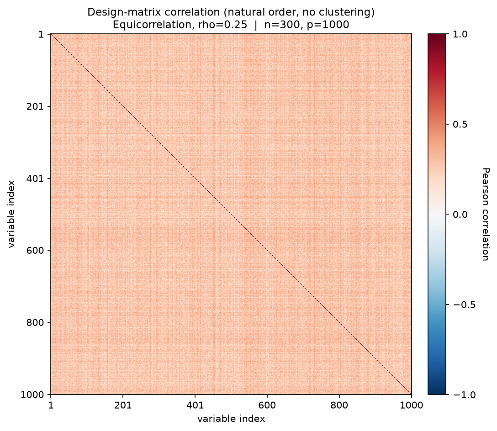
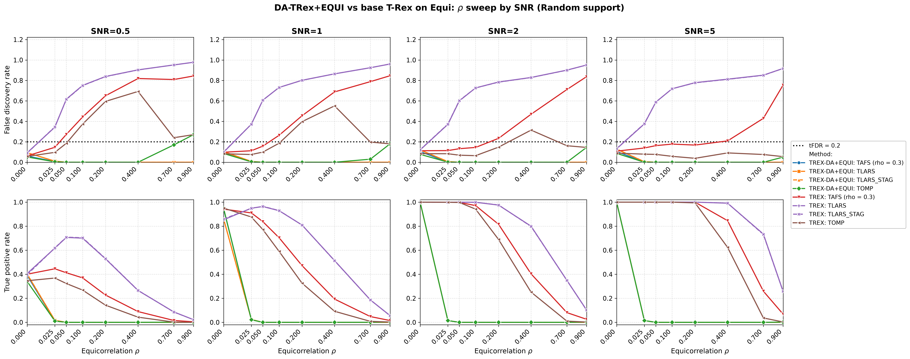

# Demo 08: DA-TRex+EQUI on Equicorrelated (EQUI) Data — 2D SNR × ρ Sweep (Python)

Monte-Carlo (MC) results for **DA-TRex+EQUI** — the dependency-aware (DA) Terminating Random Experiments (T-Rex)
selector (DA-TRex) with the equicorrelation (EQUI) correction — vs. the **classical (no-DA) T-Rex selector** on
equicorrelated data. The demo runs one 2D sweep. For each signal-to-noise ratio (SNR) column in
$\lbrace0.5, 1, 2, 5\rbrace$, it runs a full $\rho$ sweep over $\lbrace0, 0.025, 0.05, 0.1, 0.2, 0.4, 0.7, 0.9\rbrace$,
dense near $0$ to locate the DA suppression cliff. Common configuration: $n=300$, $p=1{,}000$, $s=10$, amplitude
$3.0$, target false discovery rate (FDR) $\mathrm{tFDR}=0.2$, $K=20$ random experiments, $\mathrm{MC}=200$ per grid
point, `Random` support with a full redraw per trial, and solvers TLARS / TAFS / TOMP with *exchangeable
tie-breaking* (`exch_tie_alpha = 0.25` for the greedy solvers TAFS/TOMP, `0` for the path solver TLARS), plus
TLARS_STAG (TLARS with the T-loop stagnation stop on, window 7), each with its base (no-DA) T-Rex comparison row —
8 method rows per grid point. TAFS additionally runs with its adaptive
forward-selection (AFS) correlation parameter `rho_afs = 0.3` (`0` for TLARS/TOMP), which is why the figures label
it `TAFS (rho = 0.3)`.

Python port of the C++ demo
[cpp/trex_selector_methods/ad/trex_da/demo_trex_da_08_mc_sim_equi_and_bt](../../../../../cpp/trex_selector_methods/ad/trex_da/demo_trex_da_08_mc_sim_equi_and_bt/README.md)
— same data-generating process (DGP), control parameters, sweep axes, console summaries, and result-file naming (the
folder keeps the cpp name "equi_and_bt", because earlier revisions also carried binary-tree (BT) sweeps on
block-equicorrelated data, dropped as redundant since the BT method is exercised on better-suited block designs in
Demos 02–05). The numbers below are this Python run's own results, and they agree with the C++ reference
up to Monte-Carlo noise (independent random number generator (RNG) streams).

> **Purpose**: Equicorrelation is the stress case of the `trex_da` framework — every column loads
> on one shared factor, so there is no "distance" to exploit the way the first-order autoregressive (AR(1)) model
> has, and **individual variable selection is structurally infeasible for any method**. The 2D layout shows the three
> facts that make this demo worth keeping: (1) the DA suppression cliff sits at very small $\rho$,
> (2) it is SNR-independent — signal strength never rescues it, and (3) at $\rho = 0$ everything
> works, anchoring the comparison. DA-EQUI fails *safe* (selects nothing), base T-Rex fails
> *unsafe* (FDR far above target).

---

## Setup — data generating process

### Sparse linear model and SNR control

Each Monte-Carlo trial draws

```math
\boldsymbol{y} = \boldsymbol{X} \boldsymbol{\beta} + \boldsymbol{\varepsilon},
\qquad \boldsymbol{\varepsilon} \sim \mathcal{N}(0,\,\sigma^2 \boldsymbol{I}_n),
\quad \boldsymbol{\varepsilon} \perp \boldsymbol{X},
```

with a **sparse coefficient vector** $\boldsymbol{\beta} \in \mathbb{R}^p$ whose support and
sparsity level are

```math
\mathcal{S} = \operatorname{supp}(\boldsymbol{\beta}) = \{j : \beta_j \neq 0\},
\qquad s = |\mathcal{S}| = 10 \ll p,
```

all active coefficients set to amplitude $3.0$, support placed by the `Random` policy with a full
redraw per trial (0-based indices). The noise variance is calibrated to the target signal-to-noise
ratio,

```math
\mathrm{SNR} = \frac{\operatorname{Var}(\boldsymbol{X} \boldsymbol{\beta})}{\sigma^{2}},
\qquad \sigma^2 = \widehat{\operatorname{Var}}(\boldsymbol{X}\boldsymbol{\beta}) / \mathrm{SNR}.
```

### Equicorrelation (`dgp_equi_snr`)

$n$ observations on $p$ predictors are generated through a **single latent factor model**:

```math
X_{i,j} = \sqrt{\rho}\, f_i + \sqrt{1-\rho}\, \eta_{i,j},
\qquad f_i \overset{\text{i.i.d.}}{\sim} \mathcal{N}(0,1),
\quad \eta_{i,j} \overset{\text{i.i.d.}}{\sim} \mathcal{N}(0,1),
```

with all variables mutually independent. Each row

```math
\boldsymbol{x}_i = (X_{i,1},\ldots,X_{i,p})^\top
```

is then an independent and identically distributed (i.i.d.) draw from a zero-mean Gaussian with **compound
symmetry** covariance

```math
\boldsymbol{\Sigma}_{\text{equi}} =
(1 - \rho) \, \boldsymbol{I}_p + \rho \, \mathbf{1}_p \mathbf{1}_p^{\top},
\qquad [\boldsymbol{\Sigma}_{\text{equi}}]_{jj} = 1 \;\forall j,
```

valid for $\rho \in \left(-\tfrac{1}{p-1},\, 1\right)$ (the demo uses $\rho \in [0, 0.9]$). The
eigenstructure is fully explicit:

```math
\begin{aligned}
\lambda_1 &= 1 + (p-1)\rho && \text{multiplicity 1 (eigenvector } \mathbf{1}_p/\sqrt{p}) \\
\lambda_2 &= 1 - \rho && \text{multiplicity } p-1
\end{aligned}
```

When $\rho \leq \rho_{\text{thr\_DA}}$ the single factor is negligible. As $\rho \to 1$ the $p-1$
minor eigenvalues collapse to zero, the predictor matrix becomes rank-1, and the regression is
unidentifiable — unlike AR(1), the correlation is *uniform* across all variable pairs, so there is
no isolation of actives by index distance. The shared factor puts every variable inside every
other variable's DA correction set, and the correction deflates all candidates at once.



Empirical Pearson correlation of an exemplary design drawn from this DGP ($\rho = 0.25$, $n=300$,
$p=1{,}000$, seed 2026), in **natural variable order — no hierarchical clustering**. It shows a uniform positive
wash over the *entire* matrix, with no structure to localize. Regenerate the per-DGP figures with
[`../generate_corr_plots.sh`](../generate_corr_plots.sh) (shared plotter
[`../../../corr_plt_utils.py`](../../../corr_plt_utils.py)).

### Sweep design

- **Outer loop (SNR columns)**: $\mathrm{SNR} \in \lbrace0.5, 1, 2, 5\rbrace$, one output file pair per
  column, disjoint seed blocks per column (statistically independent columns).
- **Inner sweep ($\rho$)**: $\rho \in \lbrace0, 0.025, 0.05, 0.1, 0.2, 0.4, 0.7, 0.9\rbrace$ — front-loaded
  at small $\rho$, where the suppression cliff is expected (the legacy 1D sweeps bracket it only
  as "somewhere in $(0, 0.1]$").

---

## Reference behavior (previous runs)

- **Legacy Comprehensive R Archive Network (CRAN) runs** (`Results_trex_da_02_equi.md`, $n=150$, $p=500$, $s=5$):
  total suppression at every grid point except $\rho = 0$ — true positive proportion (TPP) $=$ false discovery
  proportion (FDP) $= 0$ across all SNRs at $\rho = 0.25$, and power only at $\rho = 0.0$ in the $\rho$ sweep
  (TPP $\approx 1.0$, FDP $\approx 0.13$).
- **C++ 2D sweep** (the direct reference for this port): same cliff position and the same
  base-T-Rex failure pattern at $n=300$, $p=1{,}000$.

---

## Running the Demo

```bash
python Python/trex_selector_methods/ad/trex_da/demo_trex_da_08_mc_sim_equi_and_bt/demo_trex_da_08_mc_sim_equi_and_bt.py
```

Reduce `NUM_MC` to preview. The file inserts both its own folder and the parent suite directory onto
`sys.path` so `dgp_generators` / `da_sim_common` resolve in the demo *and* in the spawned workers —
run it as a file, not piped via `python -`. Monte-Carlo trials run in parallel through
`concurrent.futures.ProcessPoolExecutor` with `TREX_NUM_WORKERS` worker processes (default 8, and `0` uses every
usable core, see `resolve_workers()` in [`../da_sim_common.py`](../da_sim_common.py)).

Afterwards, regenerate the figures from the comma-separated values (CSV) files with
[`generate_plots.sh`](generate_plots.sh), which drives the suite plotting module
[`../trex_da_plt_utils.py`](../trex_da_plt_utils.py) through the repo-root `.venv`
(`pip install matplotlib pandas plotly`).

---

## Output Files

Data tables are written to `simulation_results/data/` (`.txt` pretty-printed, `.csv` tidy long
format), one pair per SNR column:

- `da_trex_mc_da_equi_rho_snr0p5.txt` / `.csv`
- `da_trex_mc_da_equi_rho_snr1.txt` / `.csv`
- `da_trex_mc_da_equi_rho_snr2.txt` / `.csv`
- `da_trex_mc_da_equi_rho_snr5.txt` / `.csv`

The single figure goes to `simulation_results/plots/`:

- `da_trex_mc_da_equi_rho_snr_grid.png` / `.pdf` — a 2×4 grid with rows = FDR / true positive rate (TPR),
  columns = SNR, and x-axis = $\rho$ on a square-root scale so the dense $\text{low-}\rho$ cliff region stays
  readable.
  (One-off per-CSV overviews can still be produced on demand via
  `./generate_plots.sh <csv>`.)

---

## Results (MC=200)



- **The DA suppression cliff sits at the first nonzero grid point, $\rho = 0.025$, in every SNR
  column.** At $\rho = 0$ all four DA solvers are controlled (FDR $0.05\text{–}0.13$) with the power
  the SNR allows (TPR $\approx 0.34\text{–}0.40$ at SNR $0.5$, $0.86\text{–}0.95$ at SNR $1$, at least $0.998$ at
  SNR $2/5$). At $\rho = 0.025$ they are already dead (TPR $\leq 0.024$, FDR $\leq 0.011$, DA-TLARS almost always
  runs into the cap of $T = 150$ dummies), and from $\rho = 0.05$ on DA-TLARS, DA-TAFS and DA-TLARS_STAG select nothing,
  while DA-TOMP keeps its TPR at or below $0.0025$. **Signal strength never moves the cliff** — it only
  changes how much power is lost at it. DA-EQUI works only where no correction is needed.
- **Base T-Rex TLARS fails unsafe from the same grid point**: FDR $0.34\text{–}0.38$ at
  $\rho = 0.025$, climbing monotonically to $0.92\text{–}0.98$ at $\rho = 0.9$ in every column — at
  SNR $5$, $\rho = 0.4$ it finds essentially all actives (TPR $0.99$) buried in garbage
  (FDR $0.81$).
- **High-SNR nuance on the greedy base side**: at SNR $= 5$, base TOMP is FDR-controlled at
  *every* $\rho$ (FDR $\leq 0.09$) with full power through $\rho = 0.2$ (TPR $\geq 0.994$, and $0.62$ at
  $\rho = 0.4$), and base TAFS is at/near the limit up to $\rho \approx 0.4$
  (FDR $0.14\text{–}0.21$). At lower SNR both violate early. At SNR $0.5$ base TAFS exceeds the target from
  $\rho = 0.05$ on and base TOMP from $\rho = 0.1$ on, and at SNR $1$ base TAFS does from $\rho = 0.1$ on and base
  TOMP at $\rho = 0.2\text{–}0.4$. So for moderate equicorrelation and strong signal, plain greedy T-Rex (TOMP) is
  the most reliable selector, while the DA-EQUI correction selects almost nothing there. Base TAFS is usable as well
  where the signal is strong and $\rho$ small (FDR at most $0.178$ with TPR $1.00$ at SNR $5$, $\rho \leq 0.2$, and
  at most $0.145$ with TPR at least $0.97$ at SNR $2$, $\rho \leq 0.1$).
- **TLARS_STAG matches TLARS in both rows.** With the stagnation stop, FDR and TPR differ from TLARS by at most
  $0.004$ and $0.009$, while the T-loop of the DA row stops after about $8$ steps instead of running into the cap of
  $150$, and the base row's median $T$ drops from $50$ to $10$.
- **DA-TOMP raises false alarms at high $\rho$ and low SNR.** At SNR $0.5$ its FDR is $0.17$ at $\rho = 0.7$ and
  $0.27$ at $\rho = 0.9$, while it finds essentially no true variable there (TPR $\leq 0.0025$). At $\rho = 0.9$
  the rate falls with the SNR to $0.18$, $0.145$ and $0.05$ at SNR $1$, $2$ and $5$. In all these cells the
  per-run FDP is either $0$ or $1$, so `sd_FDR` matches $\sqrt{\mathrm{FDR}\,(1 - \mathrm{FDR})}$. The C++ README
  explains this
  [false-alarm plateau of DA-TOMP](../../../../../cpp/trex_selector_methods/ad/trex_da/demo_trex_da_08_mc_sim_equi_and_bt/README.md#the-false-alarm-plateau-of-da-tomp)
  (a lone winner passes the EQUI correction, and exchangeable tie-breaking holds its rate near the target), and its
  [check with 1,000 runs per cell](../../../../../cpp/trex_selector_methods/ad/trex_da/demo_trex_da_08_mc_sim_equi_and_bt/README.md#check-with-1000-runs-per-cell)
  puts the plateau at about $0.21$. The $0.27$ here lies about two standard errors ($0.03$ at 200 runs) above that
  level, so it is most likely a high Monte Carlo draw.

Against the previous run on library commit `44cf1ab`, TAFS and TOMP lose FDR where they still select, while no TPR
cell moves by more than two standard errors. Base TOMP falls from $0.194$ to $0.185$ on average over the $32$ cells
and from $0.093$ to $0.071$ in the SNR $5$ column, and base TAFS goes from $0.393$ to $0.386$. At $\rho = 0$ the DA
rows follow, with DA-TAFS falling from $0.133$ to $0.105$ and DA-TOMP from $0.114$ to $0.078$ at SNR $2$, and from
$0.140$ to $0.105$ and from $0.122$ to $0.087$ at SNR $5$. All three language trees show the same drop. Base TLARS
shortens its T-loop instead, with the mean $T$ falling from $87.1$ to $68.6$ and the median from $108$ to $50$, while
its FDR barely moves ($0.672$ to $0.665$). Library commit `415484d` removed the lower clamp $\Phi' \geq 0$ from the
FDP estimate, which makes the estimate larger. It is the only library change on the path of TAFS and TOMP, and both
stop their T-loop on stagnation, so the larger estimate raises the voting threshold instead of shortening the loop.
TLARS runs without the stagnation stop, so there the estimate can end the T-loop earlier.

**Bottom line**: equicorrelation defeats individual variable selection for the DA framework —
DA-EQUI fails *safe* (selects nothing for any $\rho \geq 0.025$, regardless of SNR, apart from the false-alarm
plateau of DA-TOMP above), base T-Rex TLARS fails *unsafe* (FDR up to $0.98$). The demo's value is documenting this
boundary of the method precisely.
