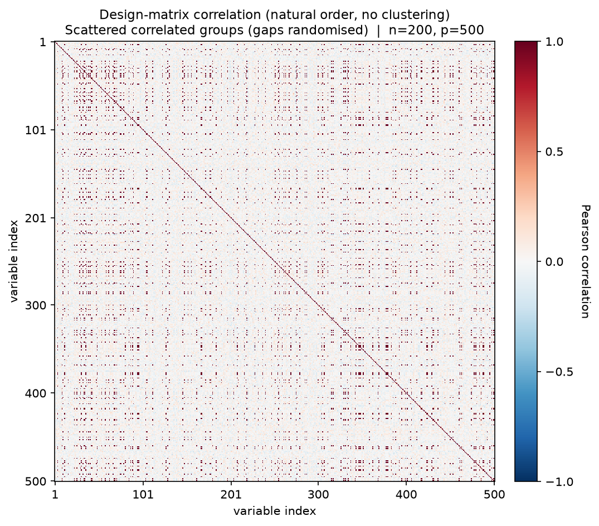
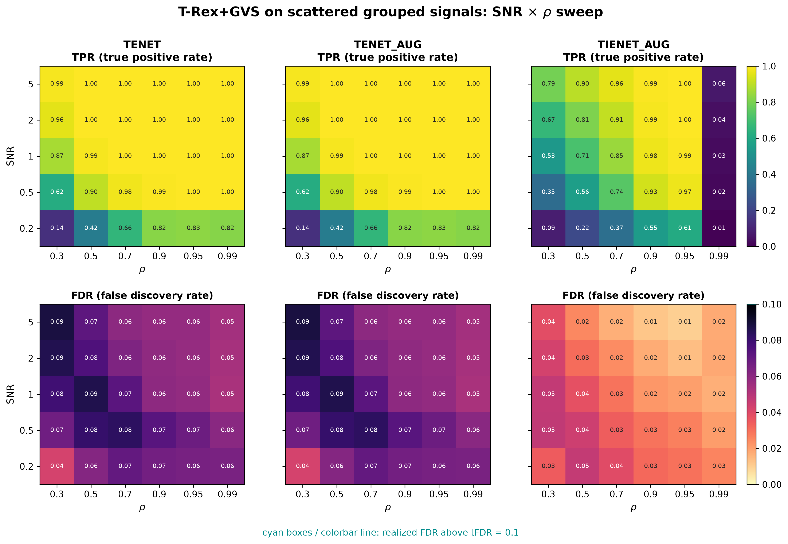

# Demo 02: T-Rex+GVS on Scattered Blocks (Python)

## Purpose

Test whether spatially **scattering** the members of a correlated group across the design matrix — rather than
 keeping them contiguous — affects the group recovery of the Terminating Random Experiments (T-Rex) selector with
 Grouped Variable Selection (GVS), in short T-Rex+GVS. This isolates the effect of column layout from the effect of
 correlation strength, since the underlying group
  structure is otherwise identical to Demo 01.
 Selection and evaluation are per variable (see
 [What is actually measured](../README.md#what-is-actually-measured-in-these-demos)).

This is the Python port of the C++ demo
[demo_trex_gvs_02_mc_sim_scattered_blocks](../../../../../cpp/trex_selector_methods/ad/trex_gvs/demo_trex_gvs_02_mc_sim_scattered_blocks/),
using `trexselector`'s `TRexGVSSelector`.

---

## Data Generation Parameters (`dgp_scattered_grouped_snr`)

We consider again the linear model:

```math
\boldsymbol{y} = \boldsymbol{X}\boldsymbol{\beta} + \boldsymbol{\epsilon},
\qquad \boldsymbol{\epsilon} \sim \mathcal{N}(\boldsymbol{0}, \sigma_{\varepsilon}^2 \boldsymbol{I}_n)
```

- $\boldsymbol{y} \in \mathbb{R}^n$ is the response vector.
- $\boldsymbol{X} \in \mathbb{R}^{n \times p}$ is the design matrix.
- $\boldsymbol{\beta} \in \mathbb{R}^p$ is the coefficient vector, with $s$ nonzero entries.
- $\boldsymbol{\epsilon}$ is the noise vector, independent and identically distributed (i.i.d.) standard normal.
- $\sigma_{\varepsilon}^2$ is the noise variance, calibrated to achieve a target linear signal-to-noise ratio (SNR).
- $n = 200$, $p = 500$, $s = 150$.

The design matrix $\boldsymbol{X}$ is generated from a latent-factor model with three active groups:

```math
X_{ij} = Z_{i,\,g(j)} + \sigma_x\, \xi_{ij}, \qquad \xi_{ij} \sim \mathcal{N}(0,1),
```

- `n_groups` correlated groups of `group_size` variables each (here 3 groups of 50 variables,
   matching Demo 01's Hastie design).
- Group membership is assigned via a **random column permutation** instead of contiguous
   blocks — group members can be spread arbitrarily across the $p$ columns.
- All grouped variables are active, $\beta_j = 3$, while background columns are i.i.d.
   $\mathcal{N}(0,1)$, $\beta_j = 0$.
- Within-group correlation $\rho = 1/(1 + \sigma_x^2)$, same convention as Demo 01.



Empirical Pearson correlation of an exemplary design drawn from the data-generating process (DGP)
`dgp_scattered_grouped_snr` ($n=200$, $p=500$, seed 2026, default $\sigma_x = \sqrt{0.01}$), in **natural variable
order — no hierarchical clustering**. The same three 50-variable groups as Demo 01 are present, but the random
column permutation scatters their members across the design, so the contiguous diagonal blocks of Demo 01 dissolve
into a speckle of isolated high-correlation entries. One figure per DGP lives in
[`../dgp_corr_plots/`](../dgp_corr_plots/). Regenerate the whole suite with
[`../generate_corr_plots.sh`](../generate_corr_plots.sh) (shared plotter
[`../../../corr_plt_utils.py`](../../../corr_plt_utils.py)).

---

## Control Parameters

```text
K = 20                          # Random experiments per T-loop iteration
tFDR = 0.1                      # Target FDR
corr_max = 0.98                 # HAC auto-clustering correlation threshold
hc_linkage = Single             # Single-linkage HAC
lambda2_method = CV_1SE_CCD     # Elastic-net penalty selection, EN rows (TENET, TENET_AUG)
lambda2_method = CV_1SE_IEN_CCD # IEN rows (TIENET_AUG)
cv_dfmax_ratio = 1.0            # IEN support cap 1.0 * n_train = 180 (default 0.8 gives 144)
MC = 200                        # Monte Carlo repetitions per grid point
```

---

## Methods Compared

Three T-Rex+GVS solver variants: **TENET** (elastic net) [[3]](#references),
**TENET_AUG** (row-augmented elastic net) [[1]](#references), and **TIENET_AUG** (informed
elastic net) [[2]](#references). All use single-linkage hierarchical agglomerative clustering
(HAC) grouping. TENET and TENET_AUG select $\lambda_2$ with `CV_1SE_CCD`, and TIENET_AUG with
`CV_1SE_IEN_CCD`, the rule built for the informed elastic net geometry, with its support cap raised to
$180$ variables (see [Demo 01](../demo_trex_gvs_01_mc_sim_hastie_en_blocks/README.md), Part 2).

---

## The Sweep

A single **2-D SNR $\times$ $\rho$ grid**, over
$\mathrm{SNR} \in \lbrace0.2, 0.5, 1, 2, 5\rbrace$ and
$\rho \in \lbrace0.30, 0.50, 0.70, 0.90, 0.95, 0.99\rbrace$
(with $\sigma_x = \sqrt{(1-\rho)/\rho}$), 200 Monte Carlo (MC) trials per cell.

---

## Output Files

Written to `simulation_results/data/`:

- `gvs_scattered_grouped_2d.txt` / `.csv` — mean false discovery proportion (FDP) / true positive proportion (TPP) over
  the SNR $\times$ $\rho$ grid.

The file names and comma-separated values (CSV) schema match the C++ demo, and the suite plotter
[`../trex_gvs_plt_utils.py`](../trex_gvs_plt_utils.py) is the same module the C++ suite uses.

Figures in Portable Network Graphics (PNG) and Portable Document Format (PDF) go to `simulation_results/plots/`,
produced by `./generate_plots.sh`.

---

## Running the Demo

```bash
python demo_trex_gvs_02_mc_sim_scattered_blocks.py       # full run (about 2.5 h on 8 workers)
python demo_trex_gvs_02_mc_sim_scattered_blocks.py 8     # with 8 worker processes
./generate_plots.sh                                      # render the figure below from the saved CSV
```

Monte Carlo trials are parallelized with `ProcessPoolExecutor`, and the optional first command-line interface (CLI)
argument sets the number of worker processes. Without it the demo uses `TREX_NUM_WORKERS` workers (default 8, and `0`
uses every usable core). For a quick smoke test, temporarily reduce `num_MC` and the sweep grids at the top of the
script.

---

## Simulation Results

The numbers and figure below are this Python run's own results (200 MC trials per cell). They agree with the
[C++ reference](../../../../../cpp/trex_selector_methods/ad/trex_gvs/demo_trex_gvs_02_mc_sim_scattered_blocks/README.md#simulation-results)
up to Monte-Carlo noise — the two ports draw from independent random number generator (RNG) streams.

- **TENET** and **TENET_AUG** are numerically identical here and keep the false discovery rate (FDR) below the
   $\mathrm{tFDR} = 0.1$ target in every cell ($0.042\text{–}0.088$, no cyan violation outlines), with true positive
   rate (TPR) $\approx 1$ from $\mathrm{SNR} \ge 1$ for $\rho \ge 0.5$ and $0.87 \to 0.96 \to 0.99$ over
   $\mathrm{SNR} \in \lbrace1, 2, 5\rbrace$ in the weakest column $\rho = 0.30$.
- **TIENET_AUG** is markedly more conservative (FDR $\le 0.047$, below TENET in all 30 cells) and has less power,
   most of all at low $\rho$. From $\mathrm{SNR} = 1$ on it reaches a TPR of $0.976\text{–}0.999$ for
   $\rho = 0.9\text{–}0.95$, against $0.851\text{–}0.957$ at $\rho = 0.7$. Its power collapses in the extreme
   $\rho = 0.99$ column (TPR $\le 0.064$, about 10 of the 150 active variables), where the within-group columns
   become nearly collinear. This is the only column that the fixed cut at `corr_max = 0.98` divides into groups, and
   a plausible reading is that each group then forms one cluster and TIENET_AUG keeps only a few variables per group,
   as in Demo 01.
- Scattering the group members leaves the FDR/TPR pattern very close to Demo 01's contiguous-block results. Over the
   120 distinct cells (FDR and TPR of TENET and TIENET_AUG at every grid point) the largest gap is $0.024$ in TPR
   (TENET at $\mathrm{SNR}=0.2$, $\rho=0.7$, $0.657$ here vs. $0.682$) and $0.011$ in FDR. The largest gap in units
   of the combined Monte Carlo standard error is $|z| = 2.44$, and 4 of the 120 cells exceed $|z| = 1.96$. TENET's
   FDR is lower here in 28 of 30 cells, by $0.004$ on average. All cells of a demo reuse the same 200 trial seeds,
   so their Monte Carlo errors are correlated, and such a common shift does not by itself point to a layout effect.
- HAC clusters the columns on the distance $1 - |\mathrm{corr}|$, which does not depend on column order. The
   dendrogram merges each group at a distance of about $1 - \rho$, but below $\rho = 0.99$ the fixed cut at
   `corr_max = 0.98` lies above the within-group correlation and leaves every variable in its own cluster. So only
   the $\rho = 0.99$ column, the only one cut into groups, tests group *discovery*. There the TPR of both families
   agrees with Demo 01 within $0.005$, and the largest standardized gap is the TENET FDR at $\mathrm{SNR}=1$
   ($0.053$ vs. $0.063$, $|z| = 2.44$). A gap of the same size appears without any grouping at $\rho = 0.95$
   ($0.058$ vs. $0.067$, $|z| = 2.03$), so it does not point to a layout effect on group discovery.

TPR (top) and FDR (bottom) heatmaps over the SNR $\times$ $\rho$ grid, one column per solver.
FDR cells above the $\mathrm{tFDR} = 0.1$ target would be outlined in cyan.



---

## References

1. Machkour, J., Muma, M., & Palomar, D. P., "False Discovery Rate Control for Grouped Variable Selection
   in High-Dimensional Linear Models using the T-Knock Filter.", European Signal Processing Conference (EUSIPCO), 2022,
    pp. 892–896, European Association for Signal Processing (EURASIP).
    [DOI-Link](https://doi.org/10.23919/EUSIPCO55093.2022.9909883)
2. Machkour, J., Muma, M., & Palomar, D. P., "The Informed Elastic Net for Fast Grouped Variable Selection and
   FDR Control in Genomics Research.", Workshop on Computational Advances in Multi-Sensor Adaptive Processing (CAMSAP),
    2023, pp. 466–470, IEEE.
    [DOI-Link](https://doi.org/10.1109/CAMSAP58249.2023.10403489)
3. Zou, H., & Hastie, T. (2005). "Regularization and variable selection via the elastic net." *Journal of the Royal
   Statistical Society: Series B (Statistical Methodology)*, 67(2), pp. 301–320.
   [DOI-Link](https://doi.org/10.1111/j.1467-9868.2005.00503.x)
