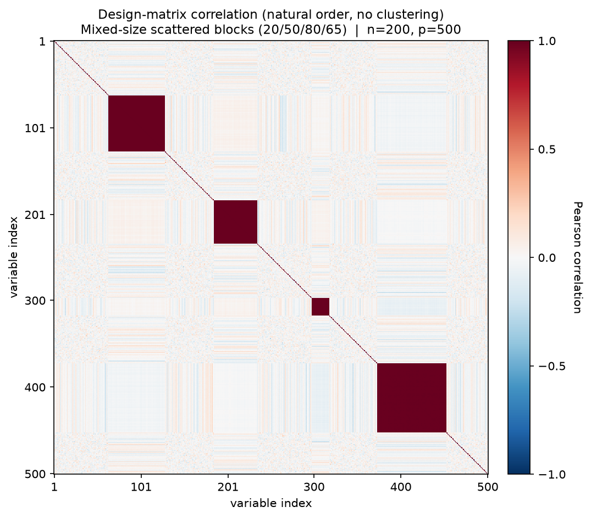
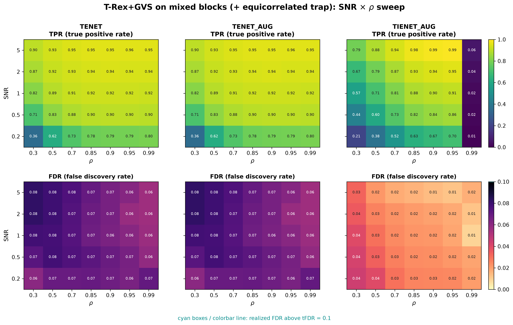

# Demo 03: T-Rex+GVS on Mixed Blocks (Python)

## Purpose

Evaluate the Terminating Random Experiments (T-Rex) selector with Grouped Variable Selection (GVS), in short T-Rex+GVS,
on a more realistic grouped design:
 four contiguous equicorrelated blocks of unequal size,
 placed in **random order** with **random noise gaps** between and around them, and including one **inactive
 equicorrelated trap block**.
 The design stresses whether the pipeline can recover the active groups while correctly rejecting a null block that
 shares their correlation structure.
 Selection and evaluation are per variable (see
 [What is actually measured](../README.md#what-is-actually-measured-in-these-demos)).

This is the Python port of the C++ demo
[demo_trex_gvs_03_mc_sim_mixed_blocks](../../../../../cpp/trex_selector_methods/ad/trex_gvs/demo_trex_gvs_03_mc_sim_mixed_blocks/),
using `trexselector`'s `TRexGVSSelector`.

---

## Data Generation Parameters (`dgp_mixed_blocks_snr`)

We consider again the linear model:

```math
\boldsymbol{y} = \boldsymbol{X}\boldsymbol{\beta} + \boldsymbol{\epsilon},
\qquad \boldsymbol{\epsilon} \sim \mathcal{N}(\boldsymbol{0}, \sigma_{\varepsilon}^2 \boldsymbol{I}_n)
```

- $\boldsymbol{y} \in \mathbb{R}^n$ is the response vector.
- $\boldsymbol{X} \in \mathbb{R}^{n \times p}$ is the design matrix.
- $\boldsymbol{\beta} \in \mathbb{R}^p$ is the coefficient vector, with $s$ nonzero entries.
- $\boldsymbol{\epsilon}$ is the noise vector, independent and identically distributed (i.i.d.) standard normal.
- $\sigma_{\varepsilon}^2$ is the noise variance, calibrated to achieve a target linear signal-to-noise ratio (SNR).
- $n = 200$, $p = 500$, $s = 150$ (the sum of the three active blocks).

Each block of the design matrix $\boldsymbol{X}$ follows the equicorrelated latent-factor model:

```math
X_{ij} = Z_{i,\,g(j)} + \sigma_x\, \xi_{ij}, \qquad \xi_{ij} \sim \mathcal{N}(0,1),
```

- Four contiguous blocks of sizes $\lbrace20, 50, 80, 65\rbrace$ (215 grouped columns in total).
- **Blocks 0–2 are active** ($\beta_j = 3$), while **block 3 is an inactive trap** ($\beta_j = 0$) carrying the same
   equicorrelated structure as the active blocks.
- Blocks are placed in a **random order** with **random-width noise gaps** (5 gap slots: before, between, and after
   the blocks) filled with i.i.d. $\mathcal{N}(0,1)$ background columns.
- Within-block correlation $\rho = 1/(1 + \sigma_x^2)$, same convention as Demo 01.



Empirical Pearson correlation of an exemplary design drawn from the data-generating process (DGP)
`dgp_mixed_blocks_snr` ($n=200$, $p=500$, seed 2026, default $\sigma_x = \sqrt{0.01}$), in **natural variable
order — no hierarchical clustering**. The four solid diagonal squares are the blocks of sizes
$\lbrace20, 50, 80, 65\rbrace$ in one random order, separated by the random-width white-noise gaps. The inactive trap
block is indistinguishable from the active ones in the correlation structure alone — which is exactly the point of
this demo. One figure per DGP lives in [`../dgp_corr_plots/`](../dgp_corr_plots/). Regenerate the whole suite with
[`../generate_corr_plots.sh`](../generate_corr_plots.sh) (shared plotter
[`../../../corr_plt_utils.py`](../../../corr_plt_utils.py)).

---

## Control Parameters

```text
K = 20                          # Random experiments per T-loop iteration
tFDR = 0.1                      # Target FDR
corr_max = 0.98                 # HAC auto-clustering correlation threshold
hc_linkage = Single             # Single-linkage HAC
lambda2_method = CV_1SE_CCD     # Elastic-net penalty selection, EN rows (TENET, TENET_AUG)
lambda2_method = CV_1SE_IEN_CCD # IEN rows (TIENET_AUG)
cv_dfmax_ratio = 1.0            # IEN support cap 1.0 * n_train = 180 (default 0.8 gives 144)
MC = 200                        # Monte Carlo repetitions per grid point
```

---

## Methods Compared

Three T-Rex+GVS solver variants: **TENET** (elastic net) [[3]](#references),
**TENET_AUG** (row-augmented elastic net) [[1]](#references), and **TIENET_AUG** (informed
elastic net) [[2]](#references). All use single-linkage hierarchical agglomerative clustering
(HAC) grouping. TENET and TENET_AUG select $\lambda_2$ with `CV_1SE_CCD`, and TIENET_AUG with
`CV_1SE_IEN_CCD`, the rule built for the informed elastic net geometry, with its support cap raised to
$180$ variables (see [Demo 01](../demo_trex_gvs_01_mc_sim_hastie_en_blocks/README.md), Part 2).

---

## The Sweep

A single **2-D SNR $\times$ $\rho$ grid**, over
$\mathrm{SNR} \in \lbrace0.2, 0.5, 1, 2, 5\rbrace$ and
$\rho \in \lbrace0.30, 0.50, 0.70, 0.85, 0.90, 0.95, 0.99\rbrace$
(with $\sigma_x = \sqrt{(1-\rho)/\rho}$), 200 Monte Carlo (MC) trials per cell. The seven $\rho$ levels span
weak to near-collinear within-block correlation.

---

## Output Files

Written to `simulation_results/data/`:

- `gvs_mixed_blocks_2d.txt` / `.csv` — mean false discovery proportion (FDP) / true positive proportion (TPP) over the
  SNR $\times$ $\rho$ grid.

The file names and comma-separated values (CSV) schema match the C++ demo, and the suite plotter
[`../trex_gvs_plt_utils.py`](../trex_gvs_plt_utils.py) is the same module the C++ suite uses.

Figures in Portable Network Graphics (PNG) and Portable Document Format (PDF) go to `simulation_results/plots/`,
produced by `./generate_plots.sh`.

---

## Running the Demo

```bash
python demo_trex_gvs_03_mc_sim_mixed_blocks.py       # full run (about 2.7 h on 8 workers)
python demo_trex_gvs_03_mc_sim_mixed_blocks.py 8     # with 8 worker processes
./generate_plots.sh                                  # render the figure below from the saved CSV
```

Monte Carlo trials are parallelized with `ProcessPoolExecutor`, and the optional first command-line interface (CLI)
argument sets the number of worker processes. Without it the demo uses `TREX_NUM_WORKERS` workers (default 8, and `0`
uses every usable core). For a quick smoke test, temporarily reduce `num_MC` and the sweep grids at the top of the
script.

---

## Simulation Results

The numbers and figure below are this Python run's own results (200 MC trials per cell). They agree with the
[C++ reference](../../../../../cpp/trex_selector_methods/ad/trex_gvs/demo_trex_gvs_03_mc_sim_mixed_blocks/README.md#simulation-results)
up to Monte-Carlo noise — the two ports draw from independent random number generator (RNG) streams.

- **TENET** and **TENET_AUG** are numerically identical here and keep the false discovery rate (FDR) controlled
   everywhere ($0.056\text{–}0.082$, no cyan violation outlines), so the inactive equicorrelated trap block does
   **not** push the FDR over target. A plausible reading is that the selector mostly leaves the trap out, but the
   saved data record no per-variable selections. The true positive rate (TPR) peaks at $0.96$, a ceiling below $1$,
   so on average about 7 of the 150 active variables are missed. The data do not show which block they belong to.
- **TIENET_AUG** is far more conservative (FDR $0.009\text{–}0.045$, below TENET in all 35 cells). Its TPR lies
   below TENET's at low $\rho$ and SNR, but above it in five of the six cells with $\mathrm{SNR} \ge 2$ and
   $\rho = 0.85\text{–}0.95$ (up to $0.994$ against $0.956$ at $\mathrm{SNR} = 5$, $\rho = 0.95$). Its TPR collapses
   in the extreme $\rho = 0.99$ column ($0.008\text{–}0.059$), where the within-block columns become nearly
   collinear.
- The random gaps and random block order test whether the grouping and selection are invariant to block
   *placement*. TPR rises with SNR here as in the contiguous design of
   [Demo 01](../demo_trex_gvs_01_mc_sim_hastie_en_blocks/README.md), but on the 30 grid points both demos share it
   stays lower in 26, and in every one from $\mathrm{SNR} = 1$ on. At $\mathrm{SNR} \ge 2$ and $\rho \ge 0.9$
   Demo 01's TENET finds every active variable in every run (TPR $1$), while this demo reaches $0.938\text{–}0.956$.
   The two demos also differ in block sizes and the trap block, so the data cannot attribute this gap to placement
   alone.
- Sweeping $\rho$ from $0.30$ up to $0.99$ shows how detection power and FDR control respond as within-block
   correlation strengthens, all else equal. For TENET at $\mathrm{SNR}=1$, TPR climbs $0.82 \to 0.92$ between
   $\rho = 0.30$ and $\rho = 0.85$ and then flattens, while FDR drifts *down* from $0.078$ to $0.056$.

TPR (top) and FDR (bottom) heatmaps over the SNR $\times$ $\rho$ grid, one column per solver.
FDR cells above the $\mathrm{tFDR} = 0.1$ target would be outlined in cyan.



---

## References

1. Machkour, J., Muma, M., & Palomar, D. P., "False Discovery Rate Control for Grouped Variable Selection
   in High-Dimensional Linear Models using the T-Knock Filter.", European Signal Processing Conference (EUSIPCO), 2022,
    pp. 892–896, European Association for Signal Processing (EURASIP).
    [DOI-Link](https://doi.org/10.23919/EUSIPCO55093.2022.9909883)
2. Machkour, J., Muma, M., & Palomar, D. P., "The Informed Elastic Net for Fast Grouped Variable Selection and
   FDR Control in Genomics Research.", Workshop on Computational Advances in Multi-Sensor Adaptive Processing (CAMSAP),
    2023, pp. 466–470, IEEE.
    [DOI-Link](https://doi.org/10.1109/CAMSAP58249.2023.10403489)
3. Zou, H., & Hastie, T. (2005). "Regularization and variable selection via the elastic net." *Journal of the Royal
   Statistical Society: Series B (Statistical Methodology)*, 67(2), pp. 301–320.
   [DOI-Link](https://doi.org/10.1111/j.1467-9868.2005.00503.x)
