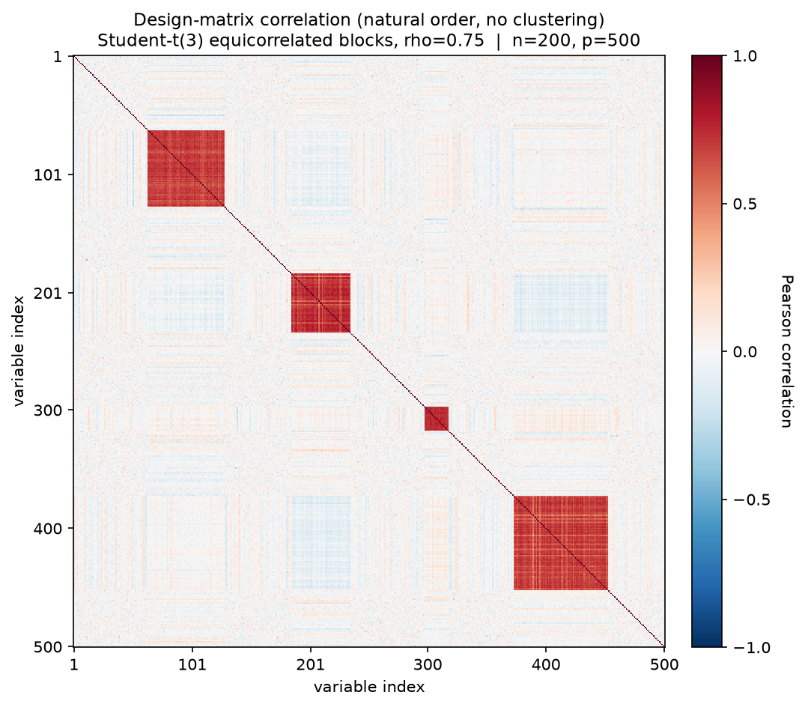
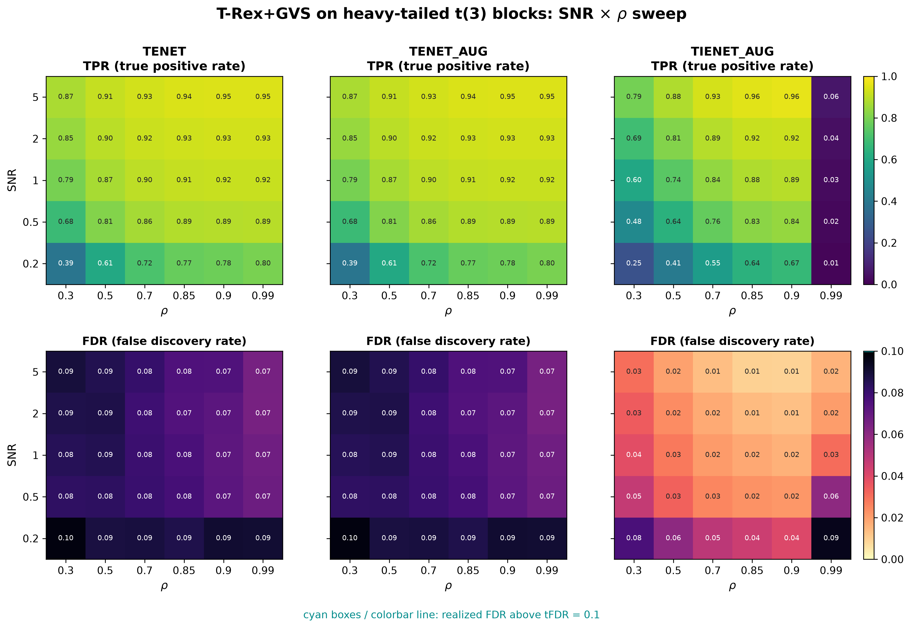

# Demo 05: T-Rex+GVS on Heavy-Tailed (Student-t(3)) Blocks (Python)

## Purpose

Stress-test the Terminating Random Experiments (T-Rex) selector with Grouped Variable Selection (GVS), in short
T-Rex+GVS, on non-Gaussian data.
 This demo reuses the same four-block active/trap geometry as Demo 03 (Mixed Blocks), but replaces every Gaussian
 component of the data-generating process (DGP) — latent factors, within-block perturbations, and response noise —
 with scaled Student-t(3) variables, testing robustness to heavy-tailed departures from the Gaussian assumption.
 Selection and evaluation are per variable (see
 [What is actually measured](../README.md#what-is-actually-measured-in-these-demos)).

This is the Python port of the C++ demo
[demo_trex_gvs_05_mc_sim_t3_blocks](../../../../../cpp/trex_selector_methods/ad/trex_gvs/demo_trex_gvs_05_mc_sim_t3_blocks/),
using `trexselector`'s `TRexGVSSelector`.

---

## Data Generation Parameters (`dgp_t3_equi_blocks_snr`)

We consider again the linear model, but with heavy-tailed rather than Gaussian noise:

```math
\boldsymbol{y} = \boldsymbol{X}\boldsymbol{\beta} + \sigma_{\varepsilon}\, \boldsymbol{\epsilon},
\qquad \epsilon_i \sim t(3)/\sqrt{3}
```

- $\boldsymbol{y} \in \mathbb{R}^n$ is the response vector.
- $\boldsymbol{X} \in \mathbb{R}^{n \times p}$ is the design matrix.
- $\boldsymbol{\beta} \in \mathbb{R}^p$ is the coefficient vector, with $s$ nonzero entries.
- $\boldsymbol{\epsilon}$ is the noise vector, independent and identically distributed (i.i.d.) $t(3)/\sqrt{3}$ — a
   Student-t distribution with 3 degrees of freedom, rescaled to unit variance.
- $\sigma_{\varepsilon}^2$ is the noise variance, calibrated to achieve a target linear signal-to-noise ratio (SNR).
- $n = 200$, $p = 500$, $s = 150$ (the sum of the three active blocks).

Unlike Demos 01–04, the design matrix uses the **unit-variance** equicorrelated form, parameterized directly by
 $\rho$ rather than through $\sigma_x$:

```math
X_{ij} = \sqrt{\rho}\, Z_{i,\,g(j)} + \sqrt{1-\rho}\, \xi_{ij},
\qquad Z_{\cdot,k},\, \xi_{ij} \sim t(3)/\sqrt{3},
```

- Same 4-block geometry as Demo 03: sizes $\lbrace20, 50, 80, 65\rbrace$ (215 grouped columns in total).
- **Blocks 0–2 are active** ($\beta_j = 3$), while **block 3 is an inactive heavy-tailed trap** ($\beta_j = 0$).
- Both the latent factors $Z_{\cdot,k}$ and the within-block perturbations $\xi_{ij}$ are $t(3)/\sqrt{3}$, so the
   heavy tails enter the design matrix as well as the response.



Empirical Pearson correlation of an exemplary design drawn from this DGP (`dgp_t3_equi_blocks_snr`, $n=200$,
$p=500$, $\rho = 0.75$, seed 2026), in **natural variable order — no hierarchical clustering**. The four diagonal
squares are the blocks of sizes $\lbrace20, 50, 80, 65\rbrace$ in one random order. Compared with the Gaussian Demo 03
they are visibly *paler and grainier* at the same nominal correlation — the $t(3)$ tails make the empirical
correlation a noisier estimate of the population value. One figure per DGP lives in
[`../dgp_corr_plots/`](../dgp_corr_plots/). Regenerate the whole suite with
[`../generate_corr_plots.sh`](../generate_corr_plots.sh) (shared plotter
[`../../../corr_plt_utils.py`](../../../corr_plt_utils.py)).

---

## Control Parameters

```text
K = 20                          # Random experiments per T-loop iteration
tFDR = 0.1                      # Target FDR
corr_max = 0.98                 # HAC auto-clustering correlation threshold
hc_linkage = Single             # Single-linkage HAC
lambda2_method = CV_1SE_CCD     # Elastic-net penalty selection, EN rows (TENET, TENET_AUG)
lambda2_method = CV_1SE_IEN_CCD # IEN rows (TIENET_AUG)
cv_dfmax_ratio = 1.0            # IEN support cap 1.0 * n_train = 180 (default 0.8 gives 144)
MC = 200                        # Monte Carlo repetitions per grid point
```

---

## Methods Compared

Three T-Rex+GVS solver variants: **TENET** (elastic net) [[3]](#references),
**TENET_AUG** (row-augmented elastic net) [[1]](#references), and **TIENET_AUG** (informed
elastic net) [[2]](#references). All use single-linkage hierarchical agglomerative clustering
(HAC) grouping. TENET and TENET_AUG select $\lambda_2$ with `CV_1SE_CCD`, and TIENET_AUG with
`CV_1SE_IEN_CCD`, the rule built for the informed elastic net geometry, with its support cap raised to
$180$ variables (see [Demo 01](../demo_trex_gvs_01_mc_sim_hastie_en_blocks/README.md), Part 2).

---

## The Sweep

A single **2-D SNR $\times$ $\rho$ grid**, over
$\mathrm{SNR} \in \lbrace0.2, 0.5, 1, 2, 5\rbrace$ and
$\rho \in \lbrace0.30, 0.50, 0.70, 0.85, 0.90, 0.99\rbrace$, 200 Monte Carlo (MC) trials per cell. Here $\rho$
enters the DGP directly (no $\sigma_x$ reparameterization).

---

## Output Files

Written to `simulation_results/data/`:

- `gvs_t3_blocks_2d.txt` / `.csv` — mean false discovery proportion (FDP) / true positive proportion (TPP) over the SNR
  $\times$ $\rho$ grid.

The file names and comma-separated values (CSV) schema match the C++ demo, and the suite plotter
[`../trex_gvs_plt_utils.py`](../trex_gvs_plt_utils.py) is the same module the C++ suite uses.

Figures in Portable Network Graphics (PNG) and Portable Document Format (PDF) go to `simulation_results/plots/`,
produced by `./generate_plots.sh`.

---

## Running the Demo

```bash
python demo_trex_gvs_05_mc_sim_t3_blocks.py       # full run (hours)
python demo_trex_gvs_05_mc_sim_t3_blocks.py 8     # with 8 worker processes
./generate_plots.sh                               # render the figure below from the saved CSV
```

Monte Carlo trials are parallelized with `ProcessPoolExecutor` on `TREX_NUM_WORKERS` worker processes (default 8,
and `0` uses every usable core, see `resolve_workers()` in [`../gvs_sim_common.py`](../gvs_sim_common.py)). The
optional first command-line interface (CLI) argument overrides this count. A full run takes about 2.3 hours on
8 workers. For a quick smoke test, temporarily reduce `num_MC` and the sweep grids at the top of the script.

---

## Simulation Results

The numbers and figure below are this Python run's own results (200 MC trials per cell). They agree with the
[C++ reference](../../../../../cpp/trex_selector_methods/ad/trex_gvs/demo_trex_gvs_05_mc_sim_t3_blocks/README.md#simulation-results)
up to Monte-Carlo noise — the two ports draw from independent random number generator (RNG) streams.

- Despite the $t(3)$ noise, false discovery rate (FDR) control holds throughout. **TENET** and **TENET_AUG**
   (numerically identical here) stay in the $0.065\text{–}0.097$ band, just under the $\mathrm{tFDR} = 0.1$ target in
   every cell, with true positive rate (TPR) rising from $0.39$ to $0.95$.
- Against the Gaussian [Demo 03](../demo_trex_gvs_03_mc_sim_mixed_blocks/README.md) at the same SNR and $\rho$,
   the heavy tails cost the TENET variants a little power and a little FDR margin. Their TPR is lower in 29 of the
   30 grid points, by at most $0.032$, and higher only at $\mathrm{SNR} = 0.2$, $\rho = 0.3$ (by $0.034$). Their FDR
   is higher at all 30 grid points, by $0.003\text{–}0.037$, and still stays below target. The saved data do not
   show the cause.
- **TIENET_AUG** is the most conservative of the three within this demo (FDR $0.009\text{–}0.076$ outside the
   $\rho = 0.99$ column, and below TENET in 29 of the 30 cells). Its TPR lies below TENET's at low $\rho$ but above
   it at $\mathrm{SNR} = 5$ and $\rho = 0.7\text{–}0.9$ (peak $0.961$ against $0.946$ at $\rho = 0.9$). Its power
   collapses in the extreme $\rho = 0.99$ column (TPR $0.012\text{–}0.060$), where the within-block columns become
   nearly collinear. There its FDR reaches $0.095$ at $\mathrm{SNR} = 0.2$, just below the target and the only cell
   where it exceeds TENET's ($0.090$).
- This is the same pattern as on the Gaussian equicorrelated designs (Demos 01–03). There, too, TIENET_AUG trades
   power for a lower FDR and collapses only at $\rho = 0.99$, while elsewhere its TPR reaches $0.999$ in Demos 01–02
   and $0.994$ in Demo 03. The heavy tails keep this pattern without a uniform cost in TIENET_AUG power against
   Demo 03. From $\mathrm{SNR} = 1$ on, its TPR at $\rho \le 0.9$ lies above Demo 03 in 9 of the 15 cells (by
   $-0.025$ to $+0.036$), mostly at $\rho \le 0.7$, and below it in most cells at $\rho = 0.85\text{–}0.9$. Its FDR
   is higher at only 10 of the 30 grid points, mostly in the $\mathrm{SNR} = 0.2$ row and the $\rho = 0.99$ column,
   by at most $0.074$ ($\mathrm{SNR} = 0.2$, $\rho = 0.99$).

TPR (top) and FDR (bottom) heatmaps over the SNR $\times$ $\rho$ grid, one column per solver.
FDR cells above the $\mathrm{tFDR} = 0.1$ target would be outlined in cyan (none are here).



---

## References

1. Machkour, J., Muma, M., & Palomar, D. P., "False Discovery Rate Control for Grouped Variable Selection
   in High-Dimensional Linear Models using the T-Knock Filter.", European Signal Processing Conference (EUSIPCO), 2022,
    pp. 892–896, European Association for Signal Processing (EURASIP).
    [DOI-Link](https://doi.org/10.23919/EUSIPCO55093.2022.9909883)
2. Machkour, J., Muma, M., & Palomar, D. P., "The Informed Elastic Net for Fast Grouped Variable Selection and
   FDR Control in Genomics Research.", Workshop on Computational Advances in Multi-Sensor Adaptive Processing (CAMSAP),
    2023, pp. 466–470, IEEE.
    [DOI-Link](https://doi.org/10.1109/CAMSAP58249.2023.10403489)
3. Zou, H., & Hastie, T. (2005). "Regularization and variable selection via the elastic net." *Journal of the Royal
   Statistical Society: Series B (Statistical Methodology)*, 67(2), pp. 301–320.
   [DOI-Link](https://doi.org/10.1111/j.1467-9868.2005.00503.x)
