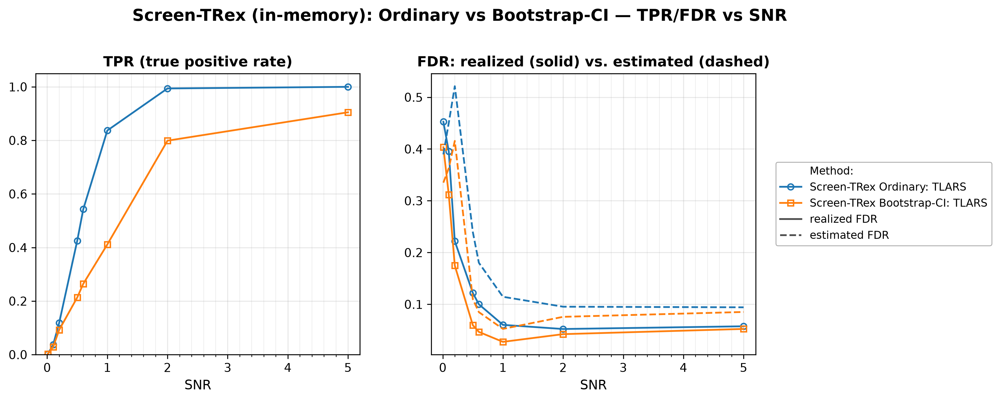

# Demo 01: Screen-TRex on an i.i.d. Gaussian Design (Python)

## Purpose

The demo establishes the **baseline behaviour of Screen-TRex** [[1]](#references) on the easiest
 possible design: independent Gaussian predictors with no correlation structure at all.
Two thresholding rules are compared — the **Ordinary** majority-vote rule ($\Phi_j > 0.5$) and the
 **Bootstrap-CI** rule, built on a bootstrap confidence interval (CI) — over a signal-to-noise sweep.
Everything the later demos add (correlation, dependency-aware corrections, biobank routing, solver
 backends) is measured against the numbers established here.
Screening returns a *candidate set*, and the false discovery rate (FDR) and the true positive rate (TPR) are
 evaluated on the individual selected variables
 (see [What is actually measured](../README.md#what-is-actually-measured-in-these-demos)).

This is the Python port of the C++ demo
[demo_trex_scr_01_mc_sim_screen_trex](../../../../../cpp/trex_selector_methods/ad/trex_screening/demo_trex_scr_01_mc_sim_screen_trex/README.md),
using `trexselector`'s `TRexScreeningSelector`. In-memory variant — see Demo 02 for the
memory-mapped counterpart.

---

## Data Generation Parameters (`dgp_iid_snr`)

We consider the linear model:

```math
\boldsymbol{y} = \boldsymbol{X}\boldsymbol{\beta} + \boldsymbol{\epsilon},
\qquad \boldsymbol{\epsilon} \sim \mathcal{N}(\boldsymbol{0}, \sigma_{\varepsilon}^2 \boldsymbol{I}_n)
```

- $\boldsymbol{y} \in \mathbb{R}^n$ is the response vector.
- $\boldsymbol{X} \in \mathbb{R}^{n \times p}$ is the design matrix.
- $\boldsymbol{\beta} \in \mathbb{R}^p$ is the coefficient vector, with $s$ nonzero entries.
- $\boldsymbol{\epsilon}$ is the noise vector, independent and identically distributed (i.i.d.) normal.
- $\sigma_{\varepsilon}^2$ is the noise variance, calibrated to achieve a target linear signal-to-noise ratio (SNR).
- $n = 300$, $p = 1{,}000$, $s = 10$ (high-dimensional, $p > n$).

The design matrix has **no correlation structure**:

```math
X_{ij} \sim \mathcal{N}(0,1) \quad \text{i.i.d.}
```

- The active support is drawn uniformly at random *per Monte Carlo (MC) trial*, so the results are not tied to
   one support pattern.
- All active coefficients are $\beta_j = 1$. The support draw uses its own random number generator (RNG) seed,
   the trial seed plus `500000`, so it stays independent of the design and noise draws.
- Noise calibration:
   $\sigma_{\varepsilon} = \sqrt{\lVert \boldsymbol{X}\boldsymbol{\beta} \rVert^2 / (n \cdot \mathrm{SNR})}$.


Empirical Pearson correlation of an exemplary design drawn from this data-generating process (DGP)
`dgp_iid_snr` ($n=300$, $p=1{,}000$, seed 2026), in **natural variable order — no hierarchical clustering**.
Only the unit diagonal stands out, and the off-diagonal noise is the $O(1/\sqrt{n})$ sampling fluctuation
expected of independent columns. One figure per DGP lives in [`../dgp_corr_plots/`](../dgp_corr_plots/).
Regenerate the whole suite with [`../generate_corr_plots.sh`](../generate_corr_plots.sh) (shared
plotter [`../../../corr_plt_utils.py`](../../../corr_plt_utils.py)).

---

## Control Parameters

```text
K = 20                       # Random experiments per T-loop iteration
R_boot = 1000                # Bootstrap replicates (Bootstrap-CI rule only)
ci_grid_step = 0.001         # Bootstrap-CI threshold grid granularity
solver = TLARS               # T-Rex solver backend
use_memory_mapping = False   # In-memory variant (Demo 02 flips this)
MC = 200                     # Monte Carlo repetitions per grid point
```

Note that Screen-TRex has **no target-FDR parameter**, because unlike the classical Terminating Random Experiments
(T-Rex) selector, screening
 thresholds the voting statistic instead of calibrating to a user-specified level.

---

## Methods Compared

Two Screen-TRex thresholding rules [[1]](#references), both using `ScreenTRexMethod.TREX`:

- **Screen-TRex Ordinary: TLARS** — selects $\lbrace j : \Phi_j > 0.5 \rbrace$, a simple majority vote of the
   random experiments (`use_bootstrap_CI = False`).
- **Screen-TRex Bootstrap-CI: TLARS** — builds a bootstrap confidence band around the estimated FDR
   curve (`R_boot = 1000` replicates) and picks its threshold from that band
   (`use_bootstrap_CI = True`).

Both report an **estimated FDR** alongside the realized FDR/TPR. Each trial constructs
`trex.TRexScreeningSelector(X, y, screen_control=…, trex_control=…, seed=-1)` and reads
`sel.selected_indices` (0-based) and `res.estimated_FDR`.

---

## The Sweep

A single **SNR sweep** over $\mathrm{SNR} \in \lbrace0.01, 0.1, 0.2, 0.5, 0.6, 1, 2, 5\rbrace$, 200 MC trials per
point, with a fresh design, support, and noise draw in every trial. Per-cell trial seeds follow the C++
source (`base_seed = 24 + snr_idx * 1000`, trial `mc` uses `base_seed + mc`).

---

## Output Files

Written to `simulation_results/data/`:

- `scr_screen_trex_snr_n300_p1000.txt` / `.csv` — FDR, TPR, and estimated FDR per method and SNR level.
  The `.csv` is a tidy long comma-separated values (CSV) table with the columns `method, metric, SNR, value`.

The file names and CSV schemas match the C++ demo, and the suite plotter
[`../trex_scr_plt_utils.py`](../trex_scr_plt_utils.py) is the same module the C++ suite uses.

Figures go to `simulation_results/plots/` as Portable Network Graphics (PNG) and Portable Document Format (PDF)
files, produced by `./generate_plots.sh`.

---

## Running the Demo

```bash
python demo_trex_scr_01_mc_sim_screen_trex.py    # full run (~1.7 min with 8 workers)
./generate_plots.sh                              # render the figure below from the saved CSV
```

Monte Carlo trials are parallelized with `ProcessPoolExecutor` over `TREX_NUM_WORKERS` worker processes
(default 8, capped at the usable cores, and `0` uses all of them). The suite's older `SCR_NUM_WORKERS` still
works and takes precedence, e.g. `SCR_NUM_WORKERS=12`. Each worker pins its inner Open Multi-Processing (OpenMP)
pool to one thread, so the demo never exceeds the worker count in total cores. For a quick smoke test,
temporarily reduce `_NUM_MC` and `SNR_GRID` at the top of the script.

---

## Simulation Results

The numbers and figure below are this Python run's own results (200 MC trials per grid point).
They are compared with the
[C++ reference](../../../../../cpp/trex_selector_methods/ad/trex_screening/demo_trex_scr_01_mc_sim_screen_trex/README.md#simulation-results)
by size, not digit for digit, because the two ports draw from independent RNG streams (NumPy here, the C++
engine there). The tables store only the 200-trial means without standard deviations. The mean absolute
difference from the C++ run is $0.022$ in the FDR, $0.015$ in the TPR and $0.012$ in the estimated FDR.

- **Screening is not FDR-controlling at low SNR.** At $\mathrm{SNR} \le 0.2$ the realized FDR runs between
   $0.17$ and $0.45$ for both rules, while the TPR stays at or below $0.12$. Screening has no target level that
   would hold the FDR down when almost no signal can be recovered.
- **Both rules become reliable once signal is present.** From $\mathrm{SNR} \ge 0.5$ the Ordinary rule's
   FDR drops to $0.12$ and settles around $0.05\text{–}0.06$, while its TPR climbs $0.43 \to 1.00$. All ten
   active variables are recovered at $\mathrm{SNR} = 5$.
- **Bootstrap-CI is the conservative rule, with lower FDR and clearly less power.** Its FDR stays below
   $0.06$ for $\mathrm{SNR} \ge 0.5$ (roughly half the Ordinary rule's up to $\mathrm{SNR} = 1$), paid for with
   TPR $0.91$ vs. $1.00$ at $\mathrm{SNR} = 5$, and a much wider gap mid-sweep ($0.41$ vs. $0.84$ at
   $\mathrm{SNR} = 1$).
   Choose it when false discoveries are costlier than missed ones. It also runs `R_boot = 1000` bootstrap
   replicates per trial on top of the voting step.
- **The internal FDR estimate is conservative here.** For $\mathrm{SNR} \ge 0.5$ it sits *above* the
   realized FDR for both rules (e.g. $0.115$ vs. $0.060$ for Ordinary at $\mathrm{SNR} = 1$) — it
   over-states the error rate rather than hiding it. At the lowest SNR points it becomes unreliable in both
   directions. Demo 03 shows this same estimate failing far more dramatically under correlation.

TPR (left) and FDR (right) vs. SNR, one line per thresholding rule. On the FDR panel the solid
line is the realized FDR and the dashed line the procedure's own estimated FDR.



---

## References

1. Machkour, J., Muma, M., & Palomar, D. P., "False Discovery Rate Control for Fast Screening of
   Large-Scale Genomics Biobanks.", IEEE Statistical Signal Processing Workshop (SSP), 2023,
    pp. 666–670, IEEE.
    [DOI-Link](https://doi.org/10.1109/SSP53291.2023.10207957)
