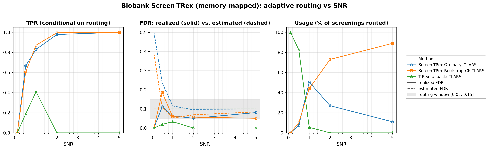
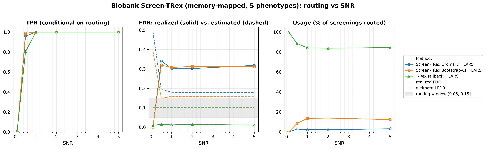

# Demo 05: Biobank Screen-TRex (Algorithm 1) — Memory-Mapped (Python)

## Purpose

The demo repeats the **Biobank Screen-TRex workflow** ("Algorithm 1") of [[1]](#references) — see
 [Demo 04](../demo_trex_scr_04_mc_sim_biobank/README.md) — with **memory-mapped dummy matrices**
 (`use_memory_mapping = True`), the storage mode intended for biobank-scale problems where holding the
 dummy matrices in random-access memory (RAM) is infeasible.
For every phenotype the selector derives two estimates of the false discovery rate (FDR) from one Screen-TRex run,
 one for the **Screen-TRex Ordinary** majority-vote rule and one for **Screen-TRex Bootstrap-CI**, whose threshold
 comes from a bootstrap confidence interval (CI). A screening result is accepted only if its estimated FDR lies in the
 window $\lbrack 0.05, 0.15\rbrack$, and if neither estimate does, the phenotype falls back to the **classical
 Terminating Random Experiments (T-Rex) selector** at a target FDR of $0.10$.
The algorithm is unchanged, and the point of this demo is that moving the dummy matrices to disk changes the
 memory footprint and **not** the statistics.
Screening returns a *candidate set*, and the FDR and the true positive rate (TPR) are evaluated on the individual
 selected variables
 (see [What is actually measured](../README.md#what-is-actually-measured-in-these-demos)).

This is the Python port of the C++ demo
[demo_trex_scr_05_mc_sim_biobank_mmap](../../../../../cpp/trex_selector_methods/ad/trex_screening/demo_trex_scr_05_mc_sim_biobank_mmap/README.md),
using `trexselector`'s `TRexBiobankScreeningSelector`.

---

## Data Generation Parameters (`dgp_iid_snr`)

We consider the linear model:

```math
\boldsymbol{y} = \boldsymbol{X}\boldsymbol{\beta} + \boldsymbol{\epsilon},
\qquad \boldsymbol{\epsilon} \sim \mathcal{N}(\boldsymbol{0}, \sigma_{\varepsilon}^2 \boldsymbol{I}_n)
```

- $\boldsymbol{y} \in \mathbb{R}^n$ is the response vector.
- $\boldsymbol{X} \in \mathbb{R}^{n \times p}$ is the design matrix.
- $\boldsymbol{\beta} \in \mathbb{R}^p$ is the coefficient vector, with $s$ nonzero entries.
- $\boldsymbol{\epsilon}$ is the noise vector, independent and identically distributed (i.i.d.) normal.
- $\sigma_{\varepsilon}^2$ is the noise variance, calibrated to a target linear signal-to-noise ratio (SNR),
   $\sigma_{\varepsilon}^2 = \lVert \boldsymbol{X}\boldsymbol{\beta} \rVert_2^2 / (n \cdot \mathrm{SNR})$, and the
   response is centred.
- $n = 300$, $p = 1{,}000$, with $s = 10$ in Part 1 and $s = 5$ in Part 2 (high-dimensional, $p > n$).

The design matrix has **no correlation structure**:

```math
X_{ij} \sim \mathcal{N}(0,1) \quad \text{i.i.d.}
```

- The active support is drawn uniformly at random *per Monte Carlo (MC) trial*, so the results are not tied to
   one support pattern.
- All active coefficients are $\beta_j = 1$, and the support-selection random number generator (RNG) is offset
   from the trial seed so it stays independent of the design and noise draws.
- In Part 2 all $q = 5$ phenotypes of a trial share **one design matrix** $\boldsymbol{X}$ (a fixed
   `x_seed` per trial), while each phenotype receives its **own random support** (`sup_seed_base + k`) and
   its own noise draw. This is the biobank setting, where a single genotype matrix is screened against many traits.
- All seeds match Demo 04, so both demos screen the same datasets and differ only in the random experiments and
   the storage mode of the dummy matrices.


Empirical Pearson correlation of an exemplary design drawn from this data-generating process (DGP)
`dgp_iid_snr` ($n=300$, $p=1{,}000$, seed 2026), in **natural variable order — no hierarchical clustering**.
The design is identical to Demo 04's, and only the dummy-matrix storage differs between the two demos. One
figure per DGP lives in [`../dgp_corr_plots/`](../dgp_corr_plots/). Regenerate the whole suite with
[`../generate_corr_plots.sh`](../generate_corr_plots.sh) (shared plotter
[`../../../corr_plt_utils.py`](../../../corr_plt_utils.py)).

---

## Control Parameters

```text
K = 20                       # Random experiments per T-loop iteration
lower_bound_FDR = 0.05       # Lower edge of the acceptable estimated-FDR window
upper_bound_FDR = 0.15       # Upper edge of the acceptable estimated-FDR window
target_FDR_trex = 0.10       # Target FDR of the classical T-Rex fallback
R_boot = 1000                # Bootstrap replicates (Bootstrap-CI rule only)
ci_grid_step = 0.001         # Bootstrap-CI threshold grid granularity
solver = TLARS               # T-Rex solver backend
use_memory_mapping = True    # Dummy (D) matrices backed by on-disk files, not RAM
MC = 200                     # Monte Carlo repetitions per grid point
```

The window $\lbrack 0.05, 0.15\rbrack$ is the routing criterion. A screening result is *accepted* only if the
 procedure's own estimated FDR lands inside it. In Python these are fields of
 `trex.BiobankScreenTRexControl`, which nests a `ScreenTRexControlParameter` and a
 `TRexControlParameter`. As in Demo 02, the design matrix `X` stays in RAM, while only the dummy matrices
 move to disk, into library-managed scratch files.

---

## Methods Compared

The three routing outcomes of Algorithm 1 [[1]](#references), all using `ScreenTRexMethod.TREX`:

- **Screen-TRex Ordinary: TLARS** — the majority-vote rule ($\Phi_j > 0.5$).
- **Screen-TRex Bootstrap-CI: TLARS** — the bootstrap confidence-band rule (`R_boot = 1000` replicates).
- **T-Rex fallback: TLARS** — the classical T-Rex selector at `target_FDR_trex = 0.10`, used when neither
   screening rule produces an acceptable estimate.

Both estimates come from the same $K$ random experiments, because the Bootstrap-CI rule is applied to the result of
 the Ordinary run. The library then takes the decision step of Algorithm 1 (`applyDecisionLogic()` in
 `trex_biobank_screening.cpp`):

- If exactly one estimate lies in the window, that rule is used.
- If both lie in the window, the rule with the larger estimate is used, and a tie goes to Bootstrap-CI.
- If neither lies in the window, the phenotype goes to the T-Rex fallback.

The routing decision of each phenotype is read back from `result.method_used`.

All reported FDR and TPR values are **conditional on routing**. They average only over the phenotypes that
 were actually handled by the respective method. The additional **Usage %** row is unconditional and states
 what fraction of all screenings each method took. A row with low usage therefore rests on few phenotypes (Usage
 times 200 in Part 1, times 1,000 in Part 2), and a row with $0\%$ usage is an average over an empty set, not a
 performance statement. The **Est. FDR** row of a screening rule averages that rule's own estimate over *all*
 screenings, because both estimates are computed for every phenotype. For the fallback it is its target $0.10$.

---

## The Two Parts

- **Part 1 — single phenotype.** One response per trial, $s = 10$ active variables, SNR sweep over
   $\lbrace0.1, 0.5, 1, 2, 5\rbrace$, 200 MC trials per grid point (trial seed `1000 * snr_idx + mc`, mirroring the
   C++ source).
- **Part 2 — $q = 5$ phenotypes sharing one $\boldsymbol{X}$.** $s = 5$ active variables per phenotype, the
   same SNR grid and 200 MC trials, hence $5 \times 200 = 1{,}000$ phenotype screenings per SNR level.

---

## Output Files

Written to `simulation_results/data/`:

- `scr_biobank_mmap_snr_n300_p1000_s10.txt` / `.csv` — Part 1: Usage %, FDR, TPR, and estimated FDR
   per method and SNR level.
- `scr_biobank_mmap_multi_n300_p1000_q5_s5.txt` / `.csv` — Part 2: the same metrics for the
   multi-phenotype study.

The file names and comma-separated values (CSV) schemas match the C++ demo, and the suite plotter
[`../trex_scr_plt_utils.py`](../trex_scr_plt_utils.py) is the same module the C++ suite uses.

Figures go to `simulation_results/plots/` as Portable Network Graphics (PNG) and Portable Document Format (PDF)
files, produced by `./generate_plots.sh`.

---

## Running the Demo

```bash
python demo_trex_scr_05_mc_sim_biobank_mmap.py   # full run (~23 min with 8 workers)
./generate_plots.sh                              # render the figures below from the saved CSVs
```

Monte Carlo trials are parallelized with `ProcessPoolExecutor` over `TREX_NUM_WORKERS` worker processes
(default 8, capped at the usable cores, and `0` uses all of them). The suite's older `SCR_NUM_WORKERS` still
works and takes precedence. This is the **heaviest** demo of the suite, because every phenotype runs the bootstrap
rule with 1,000 replicates, every phenotype that falls back runs a second selector, and both drive memory-mapped
dummy files. The suite runner [`../run_overnight.sh`](../run_overnight.sh) skips it under `SKIP_HEAVY=1`.

---

## Simulation Results

The numbers and figures below are this Python run's own results (200 MC trials per grid point).
The two ports draw their data from independent RNG streams (NumPy here, the C++ engine there), so they are not
expected to match the
[C++ reference](../../../../../cpp/trex_selector_methods/ad/trex_screening/demo_trex_scr_05_mc_sim_biobank_mmap/README.md#simulation-results)
exactly. The tables carry no standard deviations. For the Usage shares an approximate binomial $z$ against C++
reaches at most $1.84$ in Part 1 (Bootstrap-CI at $\mathrm{SNR} = 1$, $44.0\%$ against $35.0\%$) and $1.40$ in
Part 2, the latter approximate because the five phenotypes of a trial share one design. The conditional FDR and TPR
averages rest on the cases each rule was chosen in, so cells with low usage are noisy.

### Part 1 — Single Phenotype ($s = 10$)

- **Routing follows the same pattern as in the in-memory run.** At $\mathrm{SNR} = 0.1$ all phenotypes
   ($100.0\%$) go to the classical T-Rex fallback, with neither screening estimate in the window and both far above
   it on average ($0.502$ Ordinary, $0.390$ Bootstrap-CI). At $\mathrm{SNR} = 1$ the split is $50.5\%$ Ordinary /
   $44.0\%$ Bootstrap-CI / $5.5\%$ fallback, and at $\mathrm{SNR} = 5$ Bootstrap-CI handles $89.0\%$ of all
   screenings with the fallback never invoked. The Usage gap to Demo 04 with the largest approximate binomial $z$
   ($1.73$, treating the two runs as independent) is Ordinary at $\mathrm{SNR} = 5$ ($11.0\%$ against $17.0\%$).
- **Conditional error control on the screening routes is good once signal is present.** For
   $\mathrm{SNR} \ge 1$ the realized FDR is $0.051\text{–}0.081$ for Ordinary and $0.059 \to 0.051$ for
   Bootstrap-CI, with TPR reaching $1.000$ for both at $\mathrm{SNR} = 5$. The Ordinary value of $0.081$ at
   $\mathrm{SNR} = 5$ rests on 22 cases (usage $11.0\%$). As in Demo 04, $\mathrm{SNR} = 0.5$ is the weak point,
   where the accepted screenings realize an FDR of $0.111$ (Ordinary, 15 cases) and $0.186$ (Bootstrap-CI,
   20 cases), both small-sample averages.
- **The fallback's TPR of $0.000$ at $\mathrm{SNR} = 2$ and $5$ is not a failure.** Its usage is $0.0\%$ at
   those points. Nothing is routed to it, so the conditional average is over an empty set and prints as
   zero. Where it is used it is the conservative option. At $\mathrm{SNR} = 1$ (11 cases) its realized FDR is
   $0.033$ against a target of $0.10$, with a TPR of $0.409$.
- **The estimates mostly err on the safe side.** The Est. FDR row averages over all cases while the realized FDR
   covers only the routed ones, so the comparison is indicative. Ordinary's estimate settles at
   $0.095\text{–}0.116$ against a realized $0.051\text{–}0.081$ for $\mathrm{SNR} \ge 1$, and Bootstrap-CI's at
   $0.052\text{–}0.084$ against a realized $0.051\text{–}0.059$, below the realized value only at
   $\mathrm{SNR} = 1$.

TPR (conditional on routing), FDR (solid = realized, dashed = the rule's own estimate averaged over all cases, with
the fallback's dashed line at its target $0.10$ and the $\lbrack 0.05, 0.15\rbrack$ routing window shaded), and
per-method Usage % vs. SNR.



### Part 2 — Five Phenotypes Sharing One Design ($q = 5$, $s = 5$)

- **The fallback dominates, and more signal does not change that.** The classical T-Rex selector handles
   $83.9\%\text{–}100.0\%$ of all screenings ($100.0\%$ at $\mathrm{SNR} = 0.1$, $84.4\%$ at
   $\mathrm{SNR} = 5$), with Ordinary at $2.2\%\text{–}3.2\%$ and Bootstrap-CI at $8.5\%\text{–}13.9\%$ for
   $\mathrm{SNR} \ge 0.5$.
- **The rarely used screening routes are poorly calibrated.** For $\mathrm{SNR} \ge 0.5$ the realized FDR of
   the accepted screening results is $0.302\text{–}0.342$ (Ordinary, 22 to 32 cases per level) and
   $0.308\text{–}0.320$ (Bootstrap-CI), roughly twice the upper edge of the routing window, although every accepted
   case had an estimate inside it. Averaged over all cases the estimates are $0.178\text{–}0.194$ (Ordinary) and
   $0.149\text{–}0.159$ (Bootstrap-CI), at the upper edge of the window or above it. TPR is $1.000$ for both rules
   from $\mathrm{SNR} = 1$ on. With all five true variables found, one false selection gives a false discovery
   proportion (FDP) of $1/6 \approx 0.17$, so a realized FDR near $0.31$ cannot come from single false selections
   alone.
- **The fallback remains reliable on the bulk of the traffic.** Its realized FDR is $0.010\text{–}0.014$ against
   a target of $0.10$, with TPR rising $0.019 \to 1.000$ across the sweep.
- **Memory mapping changes the footprint, and the tables show no systematic change in the statistics.** The Part 2
   Ordinary route here reads Usage $0.0/2.9/2.2/2.2/3.2\%$, FDR $0.000/0.342/0.302/0.302/0.318$ and estimate
   $0.491/0.194/0.180/0.179/0.178$, against Demo 04's $0.0/3.5/2.2/2.9/3.2\%$,
   $0.000/0.328/0.314/0.318/0.316$ and $0.505/0.195/0.180/0.179/0.178$, with the estimate columns matching to three
   decimals from $\mathrm{SNR} = 1$ on. In Part 2 the estimate rows of the two demos differ by at most $0.014$ and
   the routing shares by at most $1.6$ percentage points, an approximate binomial $z$ of at most $1.06$. The tables
   carry no standard deviations, so the FDR differences of the small Ordinary route cannot be tested. Exact
   equality is not expected, because the selector is constructed with `seed = -1`, which the library resolves from
   hardware entropy, so the two runs use different random experiments.

TPR (conditional on routing), FDR (solid = realized, dashed = the rule's own estimate averaged over all cases, with
the fallback's dashed line at its target $0.10$ and the $\lbrack 0.05, 0.15\rbrack$ routing window shaded), and
per-method Usage % vs. SNR.



---

## References

1. Machkour, J., Muma, M., & Palomar, D. P., "False Discovery Rate Control for Fast Screening of
   Large-Scale Genomics Biobanks.", IEEE Statistical Signal Processing Workshop (SSP), 2023,
    pp. 666–670, IEEE.
    [DOI-Link](https://doi.org/10.1109/SSP53291.2023.10207957)
