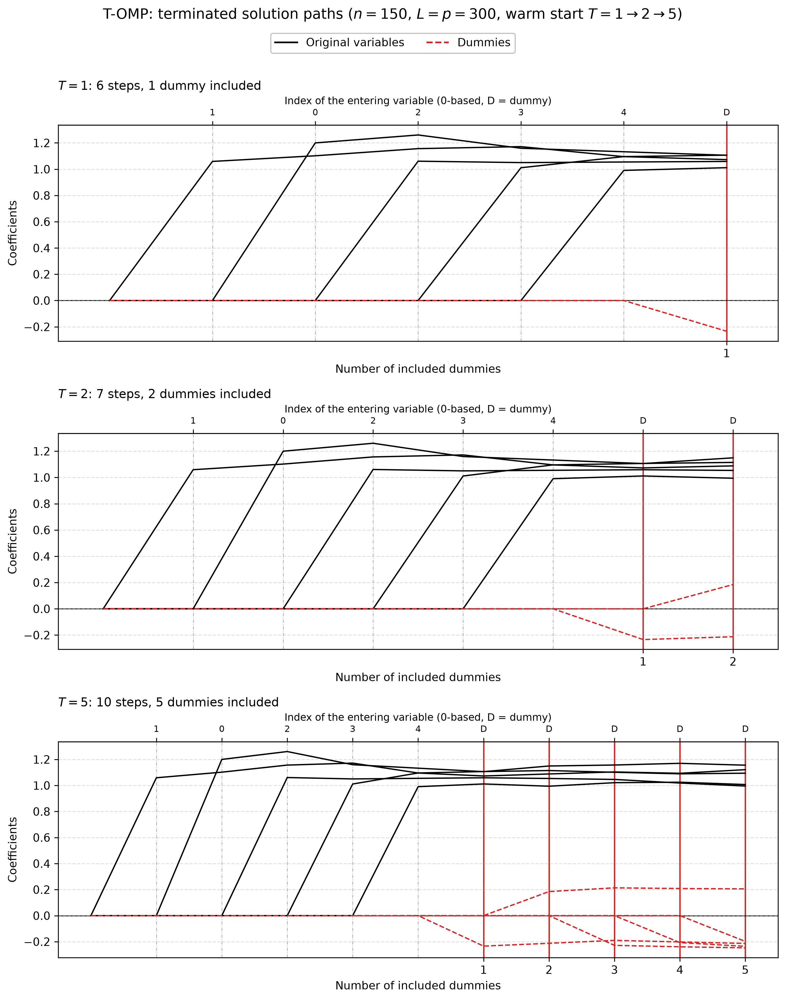

# Demo: T-OMP Solver (Python)

## Purpose

This demo runs the terminating orthogonal matching pursuit (T-OMP) solver of the TRexSelector Python package on its
own, outside the T-Rex selector. It mirrors the [C++ demo](../../../../cpp/tsolvers/ad/demo_ts_06_tomp/README.md) part
by part, with the same settings, seeds and console format, while NumPy draws the data, so the numbers differ from the
C++ run. Orthogonal matching pursuit adds the variable with the largest absolute correlation with the residual and then
refits all active coefficients by least squares, so the residual is orthogonal to the active variables.

The demo has five parts:

1. early stopping with internal normalization, for $p > n$ and $n > p$,
2. the same data normalized outside the solver,
3. a checkpoint saved to disk, reloaded and continued,
4. data memory-mapped from disk,
5. terminated solution paths of one warm-started object, drawn as a figure.

---

## Key idea

A terminating solver does not compute the whole path. It stops once $T$ dummies have entered the active set:

```math
\hat{\boldsymbol{\beta}}^{(T)} = \mathrm{TOMP}(\mathbf{X}, \mathbf{D}, \mathbf{y}; T).
```

The demo calls

```python
solver.executeStep(T_stop, early_stop=True)
```

and the path stops as soon as the number of active dummies reaches `T_stop`.

---

## Running the demo

From the repository root, with the package installed in the repository's virtual environment:

```bash
.venv/bin/python Python/tsolvers/ad/demo_ts_06_tomp/demo_ts_06_tomp.py        # Parts 1-5
.venv/bin/python Python/tsolvers/ad/demo_ts_06_tomp/demo_ts_06_tomp.py 1 2 3  # Parts 1 to 3
.venv/bin/python Python/tsolvers/ad/demo_ts_06_tomp/demo_ts_06_tomp.py 5      # Part 5 only
Python/tsolvers/ad/demo_ts_06_tomp/generate_plots.sh                          # path figure from the Part 5 data
```

The optional arguments select the parts to run, and all five parts run in a few seconds. `generate_plots.sh` draws the
figure with the plotting module of the C++ demos, of which `Python/tsolvers/ts_plt_utils.py` is a byte-identical copy,
and writes it as Portable Network Graphics (PNG) and Portable Document Format (PDF) files to
`simulation_results/plots/`. The output below is a run against library b95b984 (TRexSelector 1.0.0).

---

## Console walk-through

### Part 1: early stopping

Part 1 draws $n = 1{,}000$ observations of $p = 5{,}000$ variables and then $n = 5{,}000$ observations of $p = 1{,}000$
variables, each time with $L = 10p$ standard normal dummies (NumPy seed 42). Five true coefficients equal to 1 sit on
the variables 4, 27, 149, 398 and 420, and `snr = 1` gives a noise standard deviation of about 2.2. T-OMP centers and
scales the data itself (`normalize=True, intercept=True`) and runs to $T = 10$.

```text
============================================================
Demo 1: Basic T-OMP with Early Stopping
============================================================
High-dimensional (p > n)
Configuration:
  n = 1000, p = 5000
  num_dummies = 50000
  T_stop = 10
  True support size = 5
  True support: 27 149 398 420 4
  True coefficients: 1 1 1 1 1
  SNR = 1

[Info] TOMP sequence
  Samples (n): 1000
  Features (p): 55000 (5000 real + 50000 dummies)
  Max steps: 7992

Selection:
  Predictors: {4, 398, 149, 420, 27, 3491}
  Dummies: {21446, 42682, 48846, 33620, 29448, 9157, 35515, 18287, 33187, 44369}
  Path: [+v4, +v398, +v149, +v420, +v27, +v3491, +D16446, +D37682, +D43846, +D28620, +D24448, +D4157, +D30515, +D13287, +D28187, +D39369]

Selection Quality:
  True Positives:  5
  False Positives: 1
  False Negatives: 0
  FDP:             0.166667
  TPP:             1
  Precision:       0.833333
  Recall:          1
  F1 Score:        0.909091

============================================================
Demo 1: Basic T-OMP with Early Stopping
============================================================
Low-dimensional (n > p)
Configuration:
  n = 5000, p = 1000
  num_dummies = 10000
  T_stop = 10
  True support size = 5
  True support: 27 149 398 420 4
  True coefficients: 1 1 1 1 1
  SNR = 1

[Info] TOMP sequence
  Samples (n): 5000
  Features (p): 11000 (1000 real + 10000 dummies)
  Max steps: 39992

Selection:
  Predictors: {4, 27, 398, 149, 420}
  Dummies: {7732, 8236, 10736, 4441, 6685, 4493, 2111, 6590, 3559, 2368}
  Path: [+v4, +v27, +v398, +v149, +v420, +D6732, +D7236, +D9736, +D3441, +D5685, +D3493, +D1111, +D5590, +D2559, +D1368]

Selection Quality:
  True Positives:  5
  False Positives: 0
  False Negatives: 0
  FDP:             0
  TPP:             1
  Precision:       1
  Recall:          1
  F1 Score:        1
```

For $p > n$ the five true variables enter first, in the order 4, 398, 149, 420, 27, the null variable `v3491` follows at
step 6, and ten dummies end the path after 16 steps. The selection holds six variables, with a false discovery
proportion (FDP) of $1/6 = 0.167$ and a true positive proportion (TPP) of 1, while T-LARS admits four null variables on
the same data. For $n > p$ the five true variables come first and ten dummies follow, so the selection is exactly the
true support.

The `Dummies` line counts the columns of the combined matrix $[\mathbf{X}, \mathbf{D}]$ from 0, while the `Path` line
numbers the dummies on their own, so column `21446` is dummy `D16446`, because the $p = 5{,}000$ columns of $\mathbf{X}$
come first. The step limit `Max steps` is $8 \min(n - 1, p + L)$, because the intercept takes one degree of freedom,
which gives 7,992 and 39,992.

### Part 2: external normalization

Part 2 uses the same data but centers and scales $\mathbf{X}$ and $\mathbf{D}$ outside the solver with `LpNormScaler`
(unit $L_2$ norm) and centers $\mathbf{y}$. T-OMP then runs without its own normalization and intercept
(`normalize=False, intercept=False`). The part starts with the case $n > p$.

```text
============================================================
=== Demo 2: T-OMP with External Normalization ===
============================================================
Low-dimensional (n > p)
Configuration:
  n = 5000, p = 1000
  num_dummies = 10000
  T_stop = 10
  True support size = 5
  True support: 4 27 149 398 420
  True coefficients: 1 1 1 1 1
  SNR = 1

Applying external L2 normalization...
[Info] TOMP sequence
  Samples (n): 5000
  Features (p): 11000 (1000 real + 10000 dummies)
  Max steps: 40000

Selection:
  Predictors: {4, 27, 398, 149, 420}
  Dummies: {7732, 8236, 10736, 4441, 6685, 4493, 2111, 6590, 3559, 2368}
  Path: [+v4, +v27, +v398, +v149, +v420, +D6732, +D7236, +D9736, +D3441, +D5685, +D3493, +D1111, +D5590, +D2559, +D1368]

Selection Quality:
  True Positives:  5
  False Positives: 0
  False Negatives: 0
  FDP:             0
  TPP:             1
  Precision:       1
  Recall:          1
  F1 Score:        1
```

The selection and the path equal those of Part 1, and the case $p > n$ that follows repeats the Part 1 path as well. So
the external normalization and the internal one lead to the same solver run. Only the step limit changes to 40,000 and
8,000, because the data are not marked as precentered and the solver takes the rank as $n$ instead of $n - 1$.

### Part 3: checkpoint and warm start

Part 3 uses a small problem with $n = 100$, $p = 50$, $L = 50$ and the three true coefficients 2.5, −1.8 and 3.2 on the
variables 10, 25 and 40. It scales the data once in front, and three solvers read the same arrays without copies. A
reference solver runs to $T = 15$. A second solver runs to $T = 7$ and saves its state to `tomp_checkpoint.bin`, and a
third one is constructed on the same arrays, loads that file and continues to $T = 15$.

```text
============================================================
=== Demo 3: T-OMP Serialization & Warm Start ===
============================================================
Configuration:
  n = 100, p = 50
  num_dummies = 50
  T_stop = 15
  True support size = 3
  True support: 10 25 40
  True coefficients: 2.5 -1.8 3.2
  SNR = 1

✓ Reference completed with 28 steps

Checkpoint at partial stop: 13 steps
✓ Checkpoint saved at 'tomp_checkpoint.bin'
Loaded from checkpoint: 13 steps

COMPARISON:
Reference steps: 28
Reloaded steps:  28
RSS diff:   0
R2 diff:    0
✓ Paths match
✓ Checkpoint file removed
```

The checkpoint holds the first 13 steps, up to $T = 7$. The reloaded solver continues to the same 28 steps as the
reference, with differences of exactly 0 in the residual sum of squares (RSS) and in $R^2$ and the same actions. Writers
would not work here, because each of them centers and scales the arrays in place, and a second writer on a held buffer
raises an error under the in-place contract of the library.

### Part 4: memory-mapped data

Part 4 writes the $p > n$ data of Part 1 ($n = 1{,}000$, $p = 5{,}000$, $L = 50{,}000$) with `numpy_to_memmap` to three
files next to the script, about 440 MB, and runs T-OMP as a writer on their zero-copy views to $T = 10$. Its selection
equals the $p > n$ selection of Part 1, and the files are removed at the end. The C++ demo runs this part with
$p = 500{,}000$ and about 44 GB, while the Python port keeps the size of Part 1.

### Part 5: terminated solution paths

Part 5 repeats the quick start of the R tlars vignette. With $n = 150$, $p = 300$, five true coefficients equal to 1 and
$L = p = 300$ dummies, one T-OMP object runs to $T = 1$ and is then warm-started to $T = 2$ and $T = 5$. Each call
continues the stored path, and a snapshot of the path after each call goes to `simulation_results/data/`, in the
comma-separated values (CSV) format of the C++ demo. The setting `snr = 5` gives a noise standard deviation of about 1,
as in the vignette.

```text
============================================================
=== Demo 5: T-OMP Terminated Solution Paths ===
============================================================
Configuration:
  n = 150, p = 300
  num_dummies = 300
  T_stop = 5
  True support size = 5
  True support: 0 1 2 3 4
  True coefficients: 1 1 1 1 1
  SNR = 5

T_stop = 1: steps =  6, predictors =  5, dummies = 1, FDP = 0.000, TPP = 1.000
T_stop = 2: steps =  7, predictors =  5, dummies = 2, FDP = 0.000, TPP = 1.000
T_stop = 5: steps = 10, predictors =  5, dummies = 5, FDP = 0.000, TPP = 1.000

Selection:
  Predictors: {1, 0, 2, 3, 4}
  Dummies: {418, 446, 515, 309, 307}
  Path: [+v1, +v0, +v2, +v3, +v4, +D118, +D146, +D215, +D9, +D7]

Path data written to:
  .../Python/tsolvers/ad/demo_ts_06_tomp/simulation_results/data/tomp_terminated_paths_path.csv
  .../Python/tsolvers/ad/demo_ts_06_tomp/simulation_results/data/tomp_terminated_paths_actions.csv
```

The five true variables enter in the first five steps and only dummies follow, so the selection is exactly the true
support at every $T$, with an FDP of 0 and a TPP of 1. The run to $T = 5$ takes 10 steps. T-Stepwise, T-OLS, T-AFS with
$\rho = 1$ and the fully corrective T-NCGMP follow the same path on this data.

The figure shows the three snapshots, and each one continues the previous path. Original variables are black, dummies
red and dashed, a red vertical line marks each included dummy, and the top axis names the variable that enters at each
step.



---

## Technical notes

- Part 3 writes the checkpoint `tomp_checkpoint.bin` next to the script, under a path relative to the
  working directory, and removes it after the comparison.
- Part 4 writes $\mathbf{X}$, $\mathbf{D}$ and $\mathbf{y}$ into three temporary files of about 440 MB in total
  next to the script and removes them at the end, also when the run fails.
- `ts_demo_utils.py` sets Python's and the C library's standard output to line buffering, so the log lines of the C++
  backend appear in their place when the output goes to a file or a pipe.
- NumPy's permuted congruential generator (PCG64) draws the data, so the paths differ from the C++ run of the same
  setup, while the settings, the seeds and the console format are the same.
- The path data and figures under `simulation_results/` are committed, so the figure is visible without a run.
