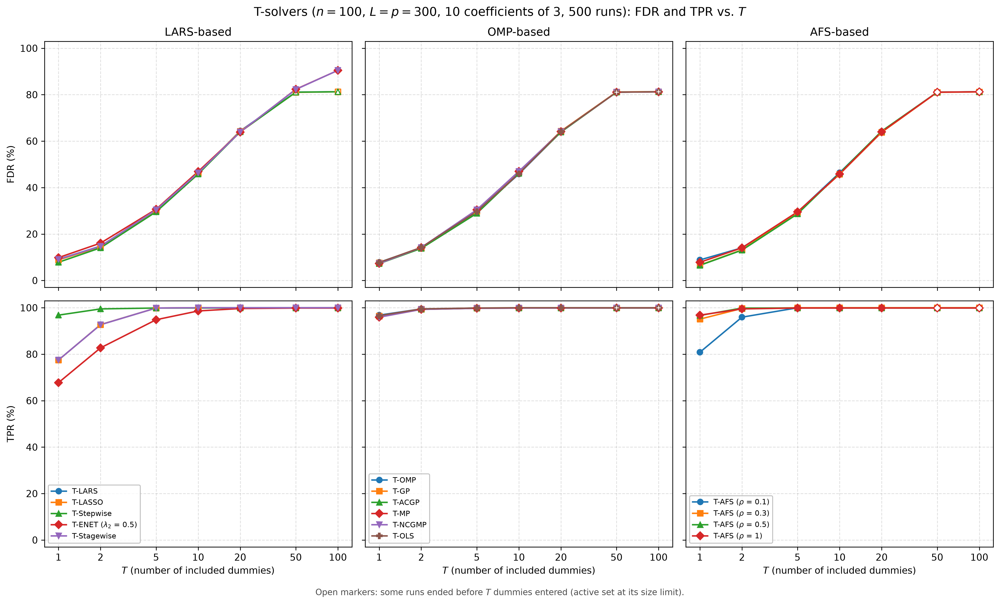
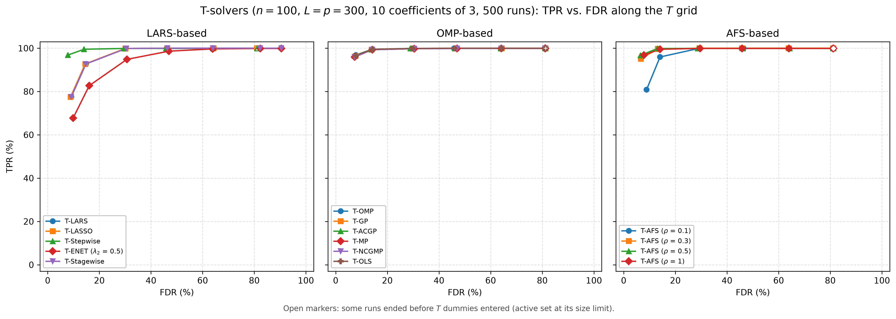
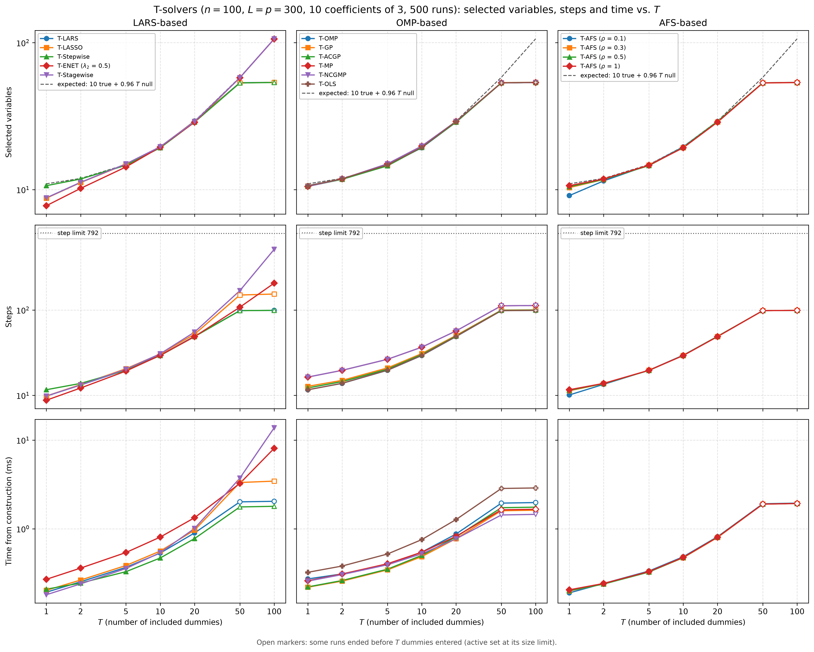
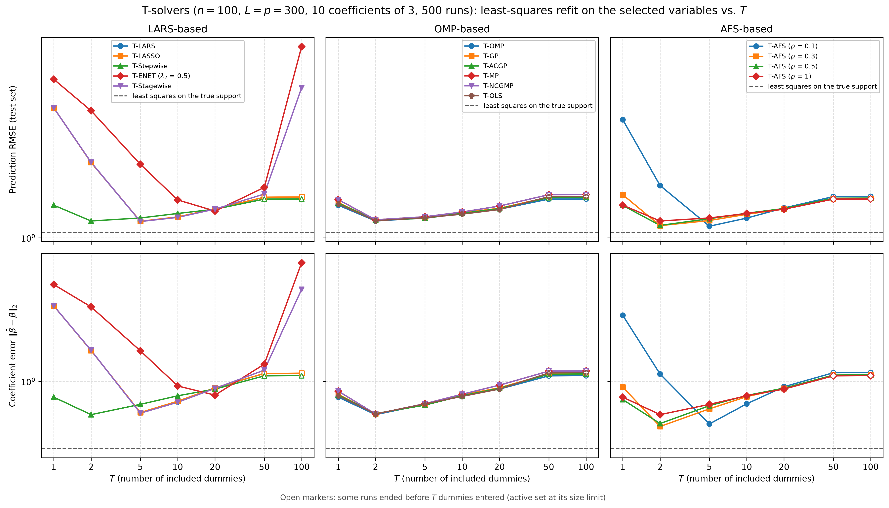

# Demo: FDR and TPR of the T-Solvers vs. T (Python)

## Purpose

This demo compares the terminated solution paths of all demo T-solvers by their false discovery rate (FDR) and true
positive rate (TPR) as the number $T$ of included dummies grows. It mirrors the
[C++ demo](../../../../cpp/tsolvers/ad/demo_ts_perf_01_fdr_tpr_vs_T/README.md) with the same settings, seeds and console
format, while NumPy draws the data, so the numbers differ from the C++ run. Like the C++ demo, it repeats the
simulation study of the R tlars vignette, runs it for every solver on the same data, and warm-starts each solver along
the $T$ grid instead of fitting every $T$ from scratch. A least-squares refit on the selected variables then shows
which $T$ gives the best estimate.

---

## Setup

- $n = 100$ observations and $p = 300$ variables with independent standard normal entries,
- ten true coefficients equal to 3 on a fixed random support, noise standard deviation about 1 (`snr = 90`),
- $L = p = 300$ standard normal dummies, drawn fresh in every run,
- $T \in \lbrace 1, 2, 5, 10, 20, 50, 100 \rbrace$ and 500 Monte Carlo runs,
- a fresh test set of 1,000 rows per run for the refit.

The support is drawn once with `np.random.default_rng(12345)`, so it differs from the support of the C++ demo.
`gen_synthetic_data()` of [`ts_demo_utils.py`](../../ts_demo_utils.py) draws $\mathbf{X}$, $\mathbf{D}$ and the noise
with NumPy's permuted congruential generator (PCG64). It sets the noise standard deviation to the square root of the
signal variance over `snr`, with the Bessel-corrected sample variance for $n \le 100$ as in the C++ data generator, so
the signal variance of about $10 \cdot 3^2 = 90$ gives a noise level of about 1.

Each run centers and scales $\mathbf{X}$ and $\mathbf{D}$ in place with `LpNormScaler` and centers $\mathbf{y}$ once,
and hands them to all 15 solver configurations of [`ts_perf_solvers.py`](../../ts_perf_solvers.py) as readers. These are
the 12 solvers of the solver demos with their demo settings (T-ENET with $\lambda_2 = 0.5$, T-NCGMP in its line-search
variant) and T-AFS for $\rho \in \lbrace 0.1, 0.3, 0.5, 1 \rbrace$. The readers are marked `precentered=True`. The
centered design has rank $n - 1$, so the active sets stop at $n - 1 = 99$ variables, as with a fitted intercept (T-ENET
with $\lambda_2 > 0$ runs without this cap).

A variable counts as selected when its coefficient is nonzero, as in the T-Rex selector and the vignette. With the
selected set $\widehat{\mathcal{A}}$ and the true support $\mathcal{A}$, the false discovery proportion (FDP) and the
true positive proportion (TPP) of a run are

```math
\mathrm{FDP} = \frac{\lvert \widehat{\mathcal{A}} \setminus \mathcal{A} \rvert}
{\max(1, \lvert \widehat{\mathcal{A}} \rvert)},
\qquad
\mathrm{TPP} = \frac{\lvert \widehat{\mathcal{A}} \cap \mathcal{A} \rvert}{\max(1, \lvert \mathcal{A} \rvert)},
```

and FDR and TPR are their means over the runs.

---

## Running the demo

From the repository root, with the package installed in the repository's virtual environment:

```bash
.venv/bin/python Python/tsolvers/ad/demo_ts_perf_01_fdr_tpr_vs_T/demo_ts_perf_01_fdr_tpr_vs_T.py         # 500 runs, 6 workers
.venv/bin/python Python/tsolvers/ad/demo_ts_perf_01_fdr_tpr_vs_T/demo_ts_perf_01_fdr_tpr_vs_T.py 20 8    # 20 runs, 8 workers
Python/tsolvers/ad/demo_ts_perf_01_fdr_tpr_vs_T/generate_plots.sh                                         # figures
```

The two optional arguments are the number of runs and of worker processes. A multiprocessing pool spreads the runs
over the workers, and every worker sets the library to one thread, so each solver runs single-threaded inside its run,
in place of the OpenMP threads of the C++ demo. The 500 runs take 7.4 s on an Apple Silicon machine with 6 workers,
close to the 7.3 s of the C++ run. The result files carry the number of runs in their name
(`fdr_tpr_vs_T_mc500.csv` and `.txt`), so a short test run does not overwrite the full one. `generate_plots.sh` draws
the figures with `Python/tsolvers/ts_plt_utils.py`, a byte-identical copy of the C++ plotting module, into
`simulation_results/plots/`. The output below is a run against library b95b984 (TRexSelector 1.0.0), and its
T-Stagewise rows come from a rerun of that solver alone against library 09debc6 with the same seeds. Run $k$ draws its
data with the seed `1000 + k` and its test set with the seed `2000000 + k`, so the results do not depend on the number
of workers.

---

## Console walk-through

### FDR and TPR

```text
n = 100, p = 300, L = p = 300, true coefficients: 10 x 3, SNR = 90
True support: 60 66 93 117 190 201 203 231 236 295
T grid: 1 2 5 10 20 50 100
15 solvers, 500 runs on 6 worker processes (single-threaded solvers)

FDR (%)
solver                     T=1     T=2     T=5    T=10    T=20    T=50   T=100
------------------------------------------------------------------------------
T-LARS                     9.1    14.8    30.2    46.1    64.4    81.1    81.3
T-LASSO                    8.8    14.5    30.1    46.3    64.3    81.0    81.2
T-Stepwise                 7.8    14.1    29.6    45.8    64.0    81.1    81.2
T-ENET (lambda2 0.5)       9.8    16.1    30.7    46.9    63.9    82.3    90.5
T-Stagewise                9.1    14.7    30.4    46.3    64.0    82.3    90.5
T-OMP                      7.8    14.1    29.6    45.8    64.0    81.1    81.2
T-GP                       7.7    13.9    29.8    46.7    64.3    81.2    81.3
T-ACGP                     7.3    13.8    28.9    46.1    63.9    81.1    81.2
T-MP                       7.3    14.2    30.4    47.0    64.1    81.1    81.2
T-NCGMP                    7.3    14.2    30.4    47.0    64.1    81.1    81.2
T-OLS                      7.8    14.2    29.7    46.0    64.1    81.1    81.3
T-AFS (rho 0.1)            8.8    14.1    29.4    46.4    64.2    81.1    81.2
T-AFS (rho 0.3)            6.6    13.2    29.3    45.8    63.8    81.0    81.2
T-AFS (rho 0.5)            6.5    13.1    28.7    46.2    64.3    81.1    81.3
T-AFS (rho 1)              7.8    14.1    29.6    45.8    64.0    81.1    81.2

TPR (%)
solver                     T=1     T=2     T=5    T=10    T=20    T=50   T=100
------------------------------------------------------------------------------
T-LARS                    77.5    92.7    99.9   100.0   100.0   100.0   100.0
T-LASSO                   77.5    92.7    99.9   100.0   100.0   100.0   100.0
T-Stepwise                96.8    99.5    99.9    99.9    99.9    99.9    99.9
T-ENET (lambda2 0.5)      67.7    82.7    94.8    98.6    99.7    99.9    99.9
T-Stagewise               77.5    92.7    99.9   100.0   100.0   100.0   100.0
T-OMP                     96.8    99.5    99.9    99.9    99.9    99.9    99.9
T-GP                      96.4    99.4    99.9    99.9    99.9    99.9    99.9
T-ACGP                    96.5    99.4    99.9    99.9    99.9    99.9    99.9
T-MP                      95.9    99.3    99.8    99.9    99.9    99.9    99.9
T-NCGMP                   95.9    99.3    99.8    99.9    99.9    99.9    99.9
T-OLS                     96.6    99.5    99.9   100.0   100.0   100.0   100.0
T-AFS (rho 0.1)           80.8    95.9   100.0   100.0   100.0   100.0   100.0
T-AFS (rho 0.3)           95.1    99.7   100.0   100.0   100.0   100.0   100.0
T-AFS (rho 0.5)           96.7    99.9    99.9    99.9    99.9    99.9    99.9
T-AFS (rho 1)             96.8    99.5    99.9    99.9    99.9    99.9    99.9
```

At $T = 1$ every solver keeps the FDR between 6.5% and 9.8%, and the TPR separates the families. The solvers that refit
by least squares after each entry (T-Stepwise, the orthogonal matching pursuit (OMP) family and T-AFS for
$\rho \ge 0.3$) find 95.1% to 96.8% of the true variables. T-LARS, T-LASSO and T-Stagewise find 77.5%, T-ENET 67.7%, and
T-AFS at $\rho = 0.1$ sits close to its least-angle regression (LARS) end at 80.8%. The C++ run gives the same picture
within about two percentage points.

As $T$ grows, the FDR rises alike for all solvers, to about 30% at $T = 5$, 46% at $T = 10$ and 64%
at $T = 20$. This follows from the exchangeability of null variables and dummies. The 290 null variables and the 300
dummies are independent standard normal columns that carry no information about $\mathbf{y}$, so a solver cannot tell
them apart, and every order in which they enter the path is equally likely. When the $T$-th dummy enters, the number
$V_T$ of null variables that entered before it follows a negative hypergeometric distribution with mean

```math
\mathbb{E}[V_T] = \frac{p - s}{L + 1}\,T = \frac{290}{301}\,T \approx 0.96\,T.
```

With $s = 10$ true variables that are nearly always found, a path holds about $10 + 0.96\,T$ variables, which matches
the tables. At $T = 20$, for example, the paths of all solvers hold 28.8 to 29.3 variables, and 18.8 to 19.3 of them
are null against the expected 19.3. This is the idea behind the T-Rex selector. The included dummies count the null
variables that entered, so they estimate the false discoveries of a path. The TPR reaches at least 99.8% by $T = 5$ for
every solver except T-ENET, which needs $T = 20$ for 99.7%. A single terminated path therefore trades FDR against TPR
through $T$, and the T-Rex selector controls the FDR by averaging many such paths with a calibrated $T$ and $L$.

### Paths that end early

```text
Runs that reached T dummies (%)
solver                     T=1     T=2     T=5    T=10    T=20    T=50   T=100
------------------------------------------------------------------------------
T-LARS                     100     100     100     100     100      17       0
T-LASSO                    100     100     100     100     100      20       0
T-Stepwise                 100     100     100     100     100      19       0
T-ENET (lambda2 0.5)       100     100     100     100     100     100     100
T-Stagewise                100     100     100     100     100     100     100
T-OMP                      100     100     100     100     100      19       0
T-GP                       100     100     100     100     100      15       0
T-ACGP                     100     100     100     100     100      16       0
T-MP                       100     100     100     100     100      18       0
T-NCGMP                    100     100     100     100     100      18       0
T-OLS                      100     100     100     100     100      16       0
T-AFS (rho 0.1)            100     100     100     100     100      17       0
T-AFS (rho 0.3)            100     100     100     100     100      16       0
T-AFS (rho 0.5)            100     100     100     100     100      17       0
T-AFS (rho 1)              100     100     100     100     100      19       0

Average number of selected variables
solver                     T=1     T=2     T=5    T=10    T=20    T=50   T=100
------------------------------------------------------------------------------
T-LARS                     8.8    11.2    14.9    19.5    29.3    53.4    53.7
T-LASSO                    8.8    11.2    14.9    19.6    29.2    53.2    53.7
T-Stepwise                10.6    11.8    14.7    19.3    28.8    53.3    53.6
T-ENET (lambda2 0.5)       7.8    10.2    14.3    19.5    28.8    57.8   106.0
T-Stagewise                8.8    11.2    15.0    19.6    29.1    57.8   106.3
T-OMP                     10.6    11.8    14.7    19.3    28.8    53.3    53.6
T-GP                      10.6    11.8    14.7    19.6    29.1    53.5    53.7
T-ACGP                    10.5    11.8    14.5    19.4    28.8    53.3    53.6
T-MP                      10.5    11.8    15.0    19.8    29.1    53.3    53.6
T-NCGMP                   10.5    11.8    15.0    19.8    29.1    53.3    53.6
T-OLS                     10.6    11.9    14.7    19.4    29.1    53.3    53.7
T-AFS (rho 0.1)            9.1    11.5    14.7    19.5    29.1    53.3    53.6
T-AFS (rho 0.3)           10.3    11.7    14.7    19.3    28.9    53.2    53.5
T-AFS (rho 0.5)           10.5    11.7    14.6    19.4    29.2    53.3    53.7
T-AFS (rho 1)             10.6    11.8    14.7    19.3    28.8    53.3    53.6
```

The readers are precentered, so the active set of most solvers is capped at the rank $n - 1 = 99$ of the centered
design, dummies included. At $T = 50$ only 15% to 20% of the runs reach 50 dummies before the cap, and no run reaches
100. The paths then end with about 54 original variables and 45 dummies, and the FDR stays at about 81%. The open
markers in the figures show these $T$ values. T-NCGMP stops by the rules of T-MP and ends exactly like it.

Two solvers go further. T-ENET reaches 100 dummies in every run, because an elastic-net path with $\lambda_2 > 0$ may
hold more than $n$ variables, as in the algorithm of Zou and Hastie (2005). It ends at an FDR of 90.5% with about 106
selected variables. T-Stagewise freezes the variables it drops from the active set, and a frozen variable keeps its
coefficient, so its support grows past the cap while its active set stays at the cap. The dummies of the support count
toward $T$, so T-Stagewise reaches 50 and 100 dummies in every run. Its selection matches the expected $10 + 0.96\,T$
with 57.8 variables at $T = 50$ and 106.3 at $T = 100$, more than $n$, and like T-ENET it ends at an FDR of 90.5%. The
cap still costs it steps, because its path cycles through drops and re-entries once the active set is full. It needs
55.1 steps to reach $T = 20$, close to the 49 to 57 of the other solvers, but 168.6 to reach $T = 50$ and 513.6 to
reach $T = 100$, against 107.9 and 206.3 for T-ENET. On average it stays well below its step limit of
$8 \cdot 99 = 792$. The step counts of the C++ run differ from these by at most 1.3.

### Steps and run time

```text
Average number of steps
solver                     T=1     T=2     T=5    T=10    T=20    T=50   T=100
------------------------------------------------------------------------------
T-LARS                     9.8    13.2    19.9    29.5    49.3    98.4    99.0
T-LASSO                    9.8    13.4    20.5    30.6    52.1   149.8   153.8
T-Stepwise                11.6    13.8    19.7    29.3    48.8    98.3    99.0
T-ENET (lambda2 0.5)       8.8    12.2    19.3    29.5    48.8   107.9   206.3
T-Stagewise                9.8    13.2    20.2    30.7    55.1   168.6   513.6
T-OMP                     11.6    13.8    19.7    29.3    48.8    98.3    99.0
T-GP                      12.8    15.0    21.0    30.9    50.4    99.7   100.2
T-ACGP                    12.2    14.5    20.3    30.1    49.5    99.2    99.7
T-MP                      16.4    19.6    26.5    36.7    56.8   112.1   112.9
T-NCGMP                   16.4    19.6    26.5    36.7    56.8   112.1   112.9
T-OLS                     11.6    13.9    19.7    29.4    49.0    98.3    99.0
T-AFS (rho 0.1)           10.1    13.5    19.7    29.5    49.1    98.4    99.0
T-AFS (rho 0.3)           11.3    13.7    19.7    29.3    48.9    98.3    99.0
T-AFS (rho 0.5)           11.5    13.7    19.6    29.4    49.2    98.3    99.0
T-AFS (rho 1)             11.6    13.8    19.7    29.3    48.8    98.3    99.0

Average time from construction to T (ms, cumulative)
solver                     T=1     T=2     T=5    T=10    T=20    T=50   T=100
------------------------------------------------------------------------------
T-LARS                    0.19    0.25    0.37    0.53    0.90    2.01    2.04
T-LASSO                   0.20    0.26    0.39    0.56    0.97    3.33    3.45
T-Stepwise                0.21    0.24    0.33    0.47    0.78    1.76    1.79
T-ENET (lambda2 0.5)      0.27    0.36    0.54    0.81    1.33    3.25    8.09
T-Stagewise               0.18    0.24    0.36    0.54    1.01    3.73   13.79
T-OMP                     0.27    0.31    0.40    0.54    0.87    1.95    1.98
T-GP                      0.22    0.26    0.34    0.49    0.77    1.60    1.62
T-ACGP                    0.22    0.26    0.35    0.50    0.81    1.73    1.75
T-MP                      0.26    0.31    0.40    0.54    0.82    1.64    1.66
T-NCGMP                   0.26    0.30    0.39    0.52    0.77    1.43    1.45
T-OLS                     0.32    0.38    0.52    0.75    1.27    2.85    2.89
T-AFS (rho 0.1)           0.19    0.24    0.33    0.48    0.81    1.92    1.95
T-AFS (rho 0.3)           0.20    0.24    0.33    0.47    0.80    1.90    1.93
T-AFS (rho 0.5)           0.20    0.24    0.33    0.47    0.81    1.90    1.93
T-AFS (rho 1)             0.20    0.24    0.33    0.48    0.80    1.90    1.93
```

Up to $T = 20$, where every path still reaches its $T$, a whole warm-started path takes 0.8 to 1.3 ms for every
solver, and T-OMP needs about 0.9 ms. T-OLS belongs to this group, because the library scores its candidates in one
pass per step, and needs about 1.3 ms to $T = 20$ and 2.9 ms to $T = 100$. T-Stagewise needs about 1.0 ms to $T = 20$,
and its time grows to 3.7 ms at $T = 50$ and 13.8 ms at $T = 100$, the most of all solvers, while its path cycles
through drops and re-entries at the cap for 168.6 and 513.6 steps on average. T-LASSO shows the same effect more
mildly, with 150 steps at $T = 50$ against about 98 for T-LARS. The times at $T = 50$ and 100 therefore describe the
saturated regime rather than the solvers. They are measured inside the parallel workers and serve for comparison only.
Both demos run the same C++ solvers, and up to $T = 20$ the Python times lie within about 0.1 ms of the C++ ones for
every solver.

### Least-squares refit on the selected variables

After each $T$, the demo drops the dummies from the selection, fits least squares with an intercept on the selected
original variables of the unscaled data with `np.linalg.lstsq`, and scores the fit on a fresh test set of 1,000 rows.
The refit on the true support is the reference, with a prediction root-mean-square error (RMSE) of 1.06 against the
noise level $\sigma \approx 1$ and a coefficient error of 0.33.

```text
Prediction RMSE of the least-squares refit on the selected variables (test set)
solver                     T=1     T=2     T=5    T=10    T=20    T=50   T=100
------------------------------------------------------------------------------
T-LARS                    3.87    2.19    1.19    1.24    1.35    1.52    1.53
T-LASSO                   3.87    2.19    1.19    1.24    1.35    1.53    1.53
T-Stepwise                1.40    1.19    1.23    1.29    1.35    1.50    1.50
T-ENET (lambda2 0.5)      5.21    3.76    2.15    1.48    1.32    1.69    7.32
T-Stagewise               3.87    2.20    1.18    1.24    1.35    1.58    4.77
T-OMP                     1.40    1.19    1.23    1.29    1.35    1.50    1.50
T-GP                      1.44    1.20    1.23    1.30    1.36    1.53    1.53
T-ACGP                    1.44    1.20    1.22    1.29    1.36    1.52    1.52
T-MP                      1.49    1.21    1.24    1.31    1.39    1.57    1.57
T-NCGMP                   1.49    1.21    1.24    1.31    1.39    1.57    1.57
T-OLS                     1.42    1.19    1.23    1.28    1.34    1.54    1.54
T-AFS (rho 0.1)           3.42    1.72    1.13    1.23    1.36    1.54    1.54
T-AFS (rho 0.3)           1.57    1.13    1.20    1.28    1.35    1.50    1.51
T-AFS (rho 0.5)           1.40    1.14    1.22    1.29    1.36    1.51    1.51
T-AFS (rho 1)             1.40    1.19    1.23    1.29    1.35    1.50    1.50

Coefficient error of the refit, ||beta_hat - beta||_2
solver                     T=1     T=2     T=5    T=10    T=20    T=50   T=100
------------------------------------------------------------------------------
T-LARS                    3.51    1.67    0.59    0.71    0.90    1.14    1.14
T-LASSO                   3.51    1.67    0.60    0.72    0.90    1.14    1.15
T-Stepwise                0.77    0.57    0.68    0.79    0.88    1.10    1.10
T-ENET (lambda2 0.5)      5.01    3.45    1.66    0.93    0.80    1.33    7.19
T-Stagewise               3.51    1.68    0.59    0.71    0.89    1.21    4.62
T-OMP                     0.77    0.57    0.68    0.79    0.88    1.10    1.10
T-GP                      0.81    0.58    0.68    0.80    0.90    1.14    1.14
T-ACGP                    0.80    0.59    0.67    0.79    0.89    1.13    1.13
T-MP                      0.85    0.58    0.69    0.81    0.94    1.19    1.19
T-NCGMP                   0.85    0.58    0.69    0.81    0.94    1.19    1.19
T-OLS                     0.79    0.58    0.69    0.78    0.88    1.15    1.16
T-AFS (rho 0.1)           3.00    1.13    0.49    0.69    0.91    1.15    1.16
T-AFS (rho 0.3)           0.91    0.47    0.63    0.78    0.89    1.11    1.11
T-AFS (rho 0.5)           0.74    0.50    0.67    0.79    0.89    1.11    1.11
T-AFS (rho 1)             0.77    0.57    0.68    0.79    0.88    1.10    1.10

Least-squares refit on the true support: prediction RMSE 1.06, coefficient error 0.33

Failed solver runs: 0
Wall time: 7.4 s
```

Every solver has a sweet spot at a small $T$. The least-squares refit solvers reach a prediction RMSE of 1.13 to 1.21
already at $T = 2$, where they have found 99.3% to 99.9% of the true variables with few false ones. T-LARS, T-LASSO
and T-Stagewise miss more than a fifth of the true variables at $T = 1$ (RMSE 3.87) and are best at $T = 5$ (1.19 and
1.18), and T-ENET only at $T = 20$ (1.32). T-AFS at $\rho = 0.1$ reaches the smallest prediction error of all, 1.128
at $T = 5$ in `fdr_tpr_vs_T_mc500.csv`, just ahead of T-AFS at $\rho = 0.3$ with 1.135 at $T = 2$. The coefficient
error has its minimum of 0.47 for $\rho = 0.3$ at $T = 2$, just below the 0.49 of $\rho = 0.1$ at $T = 5$. Beyond the
sweet spot the errors grow slowly, because every further null variable in the refit adds estimation noise, to about
1.5 at the cap. The refit does not blow up there, because the dummies are dropped and about 54 variables remain for
100 rows.

Only T-Stagewise and T-ENET, whose selections grow past $n$ at $T = 100$, end with a minimum-norm refit that
interpolates the training data, with a prediction RMSE of 4.8 and 7.3 there. The C++ run ends T-Stagewise at 5.7, with
a standard error of 0.60 against 0.16 here, so the gap of 0.9 amounts to 1.5 combined standard errors.

---

## Figures

The first figure shows FDR (top row) and TPR (bottom row) against $T$, one column per library family. Solvers with
equal or nearly equal results overlap within a panel. T-LARS lies under T-LASSO, and T-MP under T-NCGMP. T-Stagewise
lies on T-LARS in TPR, and its FDR follows T-LARS up to $T = 20$ and T-ENET at $T = 50$ and 100.



The second figure shows TPR against FDR along the $T$ grid. The least-squares refit solvers start near the top left
corner, with a TPR of about 96% at an FDR of about 7%, while T-LARS, T-LASSO, T-Stagewise, T-ENET and T-AFS at
$\rho = 0.1$ need a larger $T$ and a higher FDR for the same TPR.



The third figure shows the remaining tables against $T$ on log axes. The dashed line in the top row is the expected
selection $10 + 0.96\,T$ derived above. The OMP family and T-AFS for $\rho \ge 0.3$ follow it until the active-set cap
stops their paths after $T = 20$. T-ENET, which has no cap at $n - 1$, and T-Stagewise, whose frozen coefficients
carry its selection past the cap, stay on it up to $T = 100$ with about 106 variables. T-LARS, T-LASSO, T-ENET,
T-Stagewise and T-AFS at $\rho = 0.1$ start below the line because they find fewer true variables at $T = 1$. The
middle row shows T-Stagewise climbing to 513.6 steps at $T = 100$, below the dotted step limit of 792, and T-LASSO
climbing at saturation. The bottom row shows the rise of T-Stagewise, T-LASSO and T-ENET at saturation, with
T-Stagewise the slowest solver at $T = 50$ and 100, while the other solvers, T-OLS included, stay within a factor of
two of each other.



The fourth figure shows both errors of the refit against $T$ on log axes, with the refit on the true support as the
dashed reference. The U shape of every solver marks its sweet spot, and the jumps of T-Stagewise and T-ENET at
$T = 100$ mark their selections past $n$.



---

## Technical notes

- The loop of the vignette passes the loop index `t` instead of `T_vec[t]` to `tlars()`. The published curves are
  therefore the results for $T = 1, \dots, 7$, drawn at the positions 1, 2, 5, 10, 20, 50 and 100. This demo runs the
  intended grid.
- Every solver gets the seed of its run for its tie-break engine through `setTieSeed()`, which resolves exact ties such
  as several dummies entering at once. The library default seeds that engine from `std::random_device`, which lets
  single runs differ between repetitions.
- The support is drawn once with `np.random.default_rng(12345)` and printed 0-based. The C++ demo draws it with
  `std::sample` and `std::mt19937` from the same seed, so the two supports differ, and in the vignette it comes from an
  unseeded `sample()`.
- The active set is not the selection for every solver. T-Stagewise keeps frozen variables with their coefficients
  outside it, so `selected_predictors()` of [`ts_perf_utils.py`](../../ts_perf_utils.py) selects by nonzero coefficient,
  as the T-Rex selector does. For the same reason, `included_dummies()` lets a run reach $T$ when $T$ dummies carry a
  nonzero coefficient, the count at which the library stops the path.
- T-Stepwise and T-AFS at $\rho = 1$ give the same tables as T-OMP apart from the times, and T-NCGMP in its line-search
  variant the same as T-MP, as in the shared paths of the [T-solver README](../../README.md).
- The timed window runs from the construction of the solver to each $T$ and includes the Python calls that read the
  selection in between. The refits run after the path, so they stay out of the solver times.
- `np.linalg.lstsq` returns the minimum-norm solution, as the complete orthogonal decomposition of Eigen does in the
  C++ demo, so a selection with more variables than rows still gets a refit.
- NumPy's PCG64 draws the data, so the tables differ from the C++ run of the same setup, while the settings, the seeds
  and the console format are the same.
