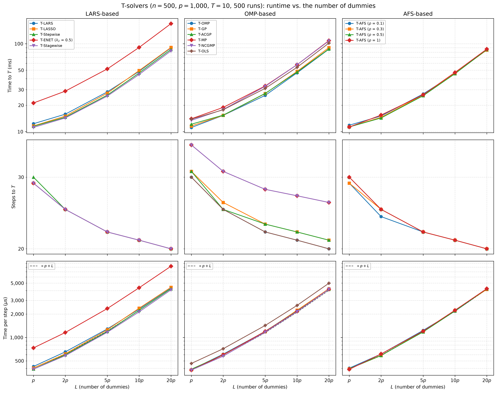
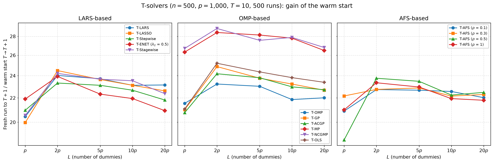

# Demo: Runtime of the T-Solvers vs. the Number of Dummies (Python)

## Purpose

This demo measures how the run time of the terminated solution paths grows with the number $L$ of dummies, for all
demo T-solvers on the same data. It mirrors the
[C++ demo](../../../../cpp/tsolvers/ad/demo_ts_perf_02_runtime_vs_dummies/README.md) with the same settings, seeds and
console format, while NumPy draws the data. The solvers behind the binding are the same C++ code, so the times also
show how close the Python demo comes to the C++ one. The demo splits the time to the $T$-th dummy into the number of
steps and the time per step, and it compares a warm start from $T$ to $T + 1$ with a fresh run to $T + 1$.

---

## Setup

- $n = 500$ observations and $p = 1{,}000$ variables with independent standard normal entries,
- ten true coefficients equal to 3 on a fixed random support, noise standard deviation about 1 (`snr = 90`),
- $L \in \lbrace p, 2p, 5p, 10p, 20p \rbrace$ standard normal dummies, and $T = 10$,
- 500 Monte Carlo runs, with medians over the runs.

Every run draws $20p = 20{,}000$ dummies once with NumPy's permuted congruential generator (PCG64), and each $L$ uses
the first $L$ of them, so the dummy sets are nested across the grid. The support comes from
`np.random.default_rng(12345)` as in [demo_ts_perf_01](../demo_ts_perf_01_fdr_tpr_vs_T/README.md), and
`reader_data()` of [`ts_perf_utils.py`](../../ts_perf_utils.py) centers and scales $\mathbf{X}$ and $\mathbf{D}$ and
centers $\mathbf{y}$ once. All 15 solver configurations of demo_ts_perf_01 run on these arrays as precentered readers
with the seed of the run for their tie-breaking. For every $L$ and solver the run measures the time from construction
to $T = 10$ with its number of steps, the extra time of a warm start to $T = 11$, and the time of a fresh run to
$T = 11$, each with `time.perf_counter()`.

---

## Running the demo

From the repository root, with the package installed in the repository's virtual environment:

```bash
.venv/bin/python Python/tsolvers/ad/demo_ts_perf_02_runtime_vs_dummies/demo_ts_perf_02_runtime_vs_dummies.py        # 500 runs, 6 workers
.venv/bin/python Python/tsolvers/ad/demo_ts_perf_02_runtime_vs_dummies/demo_ts_perf_02_runtime_vs_dummies.py 5 3    # 5 runs, 3 workers
Python/tsolvers/ad/demo_ts_perf_02_runtime_vs_dummies/generate_plots.sh                                             # figures
```

The two optional arguments are the number of runs and of worker processes. A multiprocessing pool spreads the runs
over the workers, and every worker sets the library to one thread, so each solver runs single-threaded inside its run
and the times show the cost of the algorithms rather than their parallel speed. The 500 runs take 545.5 s, about 9
minutes, on an Apple Silicon machine with 6 workers, against 545.8 s for the C++ demo with 6 OpenMP threads. The
result files carry the number of runs in their name (`runtime_vs_dummies_mc500.csv` and `.txt`), so a short test run
does not overwrite the full one. `generate_plots.sh` draws the figures with `Python/tsolvers/ts_plt_utils.py`, a
byte-identical copy of the C++ plotting module, into `simulation_results/plots/`. The output below is a run against
library b95b984 (TRexSelector 1.0.0). Two fixes in library 09debc6 change the paths of T-Stagewise, so its rows
come from a rerun of the 500 runs on that library in a session of their own, with the same seeds and workers. The wall
times quoted here are those of the first runs.

---

## Console walk-through

### Time and steps to $T = 10$

```text
n = 500, p = 1000, L in {1, 2, 5, 10, 20} x p, T = 10, true coefficients: 10 x 3, SNR = 90
15 solvers, 500 runs on 6 worker processes (single-threaded solvers)

Median time to T = 10 (ms)
solver                      L=p     L=2p     L=5p    L=10p    L=20p
-------------------------------------------------------------------
T-LARS                    12.32    15.82    28.38    48.51    89.75
T-LASSO                   11.62    15.02    27.44    49.59    90.80
T-Stepwise                11.50    14.60    26.07    46.44    86.00
T-ENET (lambda2 0.5)      21.20    28.90    51.71    90.82   169.18
T-Stagewise               11.18    14.32    25.40    44.74    82.88
T-OMP                     11.16    15.32    25.87    46.65    86.74
T-GP                      11.60    15.35    27.12    48.49    90.40
T-ACGP                    12.17    15.42    27.26    47.60    87.17
T-MP                      14.02    18.88    33.14    57.77   108.52
T-NCGMP                   13.45    17.88    32.78    57.69   107.42
T-OLS                     13.88    17.74    31.10    53.97   101.63
T-AFS (rho 0.1)           11.85    15.08    26.85    45.77    85.64
T-AFS (rho 0.3)           11.33    14.57    26.25    46.15    84.85
T-AFS (rho 0.5)           11.32    14.31    25.62    45.64    85.69
T-AFS (rho 1)             11.29    15.46    26.27    47.15    86.91

Median steps to T = 10
solver                      L=p     L=2p     L=5p    L=10p    L=20p
-------------------------------------------------------------------
T-LARS                     29.0     25.0     22.0     21.0     20.0
T-LASSO                    29.0     25.0     22.0     21.0     20.0
T-Stepwise                 30.0     25.0     22.0     21.0     20.0
T-ENET (lambda2 0.5)       29.0     25.0     22.0     21.0     20.0
T-Stagewise                29.0     25.0     22.0     21.0     20.0
T-OMP                      30.0     25.0     22.0     21.0     20.0
T-GP                       31.0     26.0     23.0     22.0     21.0
T-ACGP                     31.0     25.0     23.0     22.0     21.0
T-MP                       36.0     31.0     28.0     27.0     26.0
T-NCGMP                    36.0     31.0     28.0     27.0     26.0
T-OLS                      30.0     25.0     22.0     21.0     20.0
T-AFS (rho 0.1)            29.0     24.0     22.0     21.0     20.0
T-AFS (rho 0.3)            29.0     25.0     22.0     21.0     20.0
T-AFS (rho 0.5)            30.0     25.0     22.0     21.0     20.0
T-AFS (rho 1)              30.0     25.0     22.0     21.0     20.0
```

The time to $T = 10$ grows about linearly with $L$ once $L \ge 2p$. T-LARS needs 12 ms at $L = p$ and 90 ms at
$L = 20p$, 7.3 times as much for 10.5 times as many columns. The number of steps falls at the same time, from 29 at
$L = p$ to 20 at $L = 20p$, and the exchangeability of null variables and dummies from
[demo_ts_perf_01](../demo_ts_perf_01_fdr_tpr_vs_T/README.md) predicts these counts. A path to the tenth dummy holds
the ten true variables and the ten dummies, plus on average

```math
\mathbb{E}[V_T] = \frac{p - s}{L + 1}\,T = \frac{990}{L + 1} \cdot 10
```

null variables: 9.9 at $L = p$, 4.9 at $L = 2p$, 2.0 at $L = 5p$, 1.0 at $L = 10p$ and 0.5 at $L = 20p$. The expected
path lengths of 29.9, 24.9, 22.0, 21.0 and 20.5 steps match the medians of most solvers within about one step. T-MP
and T-NCGMP need more steps, 36 at $L = p$, because matching pursuit can select a variable again.

### Time per step

```text
Median time per step (us)
solver                      L=p     L=2p     L=5p    L=10p    L=20p
-------------------------------------------------------------------
T-LARS                    423.4    652.8   1287.9   2315.6   4357.5
T-LASSO                   404.8    615.3   1257.7   2377.6   4419.8
T-Stepwise                392.7    598.6   1195.3   2230.5   4238.9
T-ENET (lambda2 0.5)      733.5   1157.5   2354.7   4360.1   8242.5
T-Stagewise               390.9    583.5   1167.7   2136.0   4098.4
T-OMP                     384.9    610.4   1195.3   2222.7   4234.1
T-GP                      384.0    599.7   1183.9   2240.2   4224.8
T-ACGP                    390.6    596.0   1202.5   2189.7   4159.8
T-MP                      380.9    596.5   1198.0   2172.9   4173.2
T-NCGMP                   380.4    574.5   1174.5   2156.7   4162.4
T-OLS                     463.1    716.1   1428.0   2585.0   4982.2
T-AFS (rho 0.1)           403.0    612.5   1233.5   2178.8   4215.8
T-AFS (rho 0.3)           395.8    584.0   1197.5   2231.9   4151.3
T-AFS (rho 0.5)           394.8    587.3   1178.8   2190.9   4223.6
T-AFS (rho 1)             388.8    613.3   1205.9   2239.8   4242.3
```

The time per step grows with the number of columns $p + L$, since every step scans the correlations of all columns.
T-LARS needs 0.42 ms per step at $L = p$ and 4.4 ms at $L = 20p$, 10.3 times as much for 10.5 times as many columns. The
orthogonal matching pursuit (OMP) family starts slightly lower, at about 0.38 ms (T-OLS at 0.46 ms), and grows 10.7 to
11.0 times, so at $L = 20p$ all solvers except T-ENET need about 4.1 to 5.0 ms per step, where the scan over the columns
dominates. T-ENET needs about twice as long per step as the other solvers. More dummies therefore cut the path by the
null variables they keep out, but every step gets dearer, and in total a path to $T = 10$ at $L = 20p$ costs 7.2 to 8.0
times a path at $L = p$.

### Warm start

```text
Median warm start T = 10 -> 11 (ms)
solver                      L=p     L=2p     L=5p    L=10p    L=20p
-------------------------------------------------------------------
T-LARS                    0.521    0.762    1.256    2.176    4.040
T-LASSO                   0.525    0.764    1.227    2.230    4.061
T-Stepwise                0.521    0.756    1.164    2.116    4.081
T-ENET (lambda2 0.5)      1.026    1.469    2.535    4.348    8.631
T-Stagewise               0.514    0.609    1.168    2.070    4.033
T-OMP                     0.521    0.770    1.185    2.195    4.084
T-GP                      0.516    0.757    1.185    2.177    4.133
T-ACGP                    0.520    0.760    1.296    2.139    4.021
T-MP                      0.509    0.757    1.232    2.153    4.194
T-NCGMP                   0.504    0.751    1.386    2.111    4.062
T-OLS                     0.605    0.802    1.418    2.375    4.527
T-AFS (rho 0.1)           0.526    0.770    1.222    2.114    4.161
T-AFS (rho 0.3)           0.525    0.770    1.205    2.122    4.057
T-AFS (rho 0.5)           0.524    0.765    1.164    2.172    4.007
T-AFS (rho 1)             0.526    0.770    1.174    2.297    4.096

Median fresh run to T = 11 over warm start 10 -> 11 (ratio)
solver                      L=p     L=2p     L=5p    L=10p    L=20p
-------------------------------------------------------------------
T-LARS                     20.4     24.0     23.7     23.1     23.1
T-LASSO                    20.0     24.5     23.6     23.1     22.6
T-Stepwise                 21.0     23.3     23.1     22.7     21.8
T-ENET (lambda2 0.5)       21.9     23.9     22.3     21.9     20.9
T-Stagewise                20.5     24.2     23.7     23.5     22.4
T-OMP                      21.5     23.2     23.0     21.9     22.0
T-GP                       21.0     24.9     23.8     23.2     22.7
T-ACGP                     20.8     24.2     23.8     23.0     22.7
T-MP                       26.3     28.4     28.1     27.8     26.5
T-NCGMP                    26.7     28.9     27.6     27.9     26.8
T-OLS                      21.1     25.2     24.4     23.8     23.4
T-AFS (rho 0.1)            20.9     22.7     22.7     22.6     22.0
T-AFS (rho 0.3)            22.2     22.7     22.9     22.2     22.3
T-AFS (rho 0.5)            18.7     23.8     23.5     22.2     22.5
T-AFS (rho 1)              21.0     23.3     23.0     21.9     21.8

Failed solver runs: 0
Wall time: 545.5 s
```

A warm start from $T = 10$ to 11 costs about 1/21 to 1/25 of a fresh run to 11 for most solvers once $L \ge 2p$, and
1/26 to 1/29 for T-MP and T-NCGMP over the whole range of $L$, because their paths are longer. A fresh run repeats the
whole path of about 21 to 38 steps, while the warm start adds only the steps between the tenth and the eleventh dummy,
on average $1 + (p - s)/(L + 1)$, about two at $L = p$ and one at $L = 20p$. This longer warm start fits the lower
ratios at $L = p$, 18.7 to 22.2 for most solvers.

### Python and C++ times

Both demos run the same C++ solvers on data with the same distribution, and their wall times of 545.5 s and 545.8 s
agree within 0.1%. The median steps to $T = 10$ agree within one step at every $L$. From $L = 5p$ on, the median times
to $T = 10$ of the solvers apart from T-Stagewise lie between 2% below and 8% above the C++ medians, with a typical
excess of 2% to 3% over the solvers. At
$L = p$ the Python medians are higher by 0.5 to 4.4 ms, or 4% to 46% and 19% for the typical solver, which also lifts
the time per step of the OMP family apart from T-OLS at $L = p$ to about 0.38 ms against 0.26 to 0.31 ms in the C++
run. This extra of
a few milliseconds weighs most on the short paths at small $L$. Since the solvers and their step counts are the same,
it points to the Python side of the runs, such as the calls through the binding, rather than to the algorithms.

T-Stagewise is left out of these ranges, because its rows in both demos come from reruns in sessions of their own.
With the same steps, its Python medians lie 40% to 43% above the C++ ones from $L = 2p$ on and 61% at $L = p$. The
Python rerun puts T-Stagewise 5% to 7% below the typical Python solver, while the C++ rerun puts it about 30% below the
typical C++ solver, so this gap reflects the two sessions rather than the binding.

---

## Figures

The first figure shows the time to $T$, the steps and the time per step against $L$ on log axes, one column per
library family. The middle row shows the steps falling with $L$, with T-MP and T-NCGMP above the rest of the OMP
family. The dashed line in the bottom row grows in proportion to $p + L$ from the median of the family at $L = p$.
Every solver runs nearly parallel to it, and T-ENET and T-OLS lie a nearly constant factor above their families.



The second figure shows the ratio of a fresh run to $T + 1$ over the warm start from $T$ to $T + 1$. T-MP and T-NCGMP
lie above the other OMP solvers at every $L$, and most curves dip at $L = p$.



---

## Technical notes

- The runs share the memory bandwidth of the machine, and at $L = 20p$ every worker holds about 84 MB of data. The
  absolute times are therefore higher than in a run alone and serve for comparison only. T-MP and T-NCGMP follow the
  same path, and their median times to $T = 10$ differ by up to 5.6%, which marks the run-to-run noise of the medians.
  Their warm starts, which take 0.5 to 4.2 ms, differ by up to 12.5%.
- The nested dummy sets keep the comparison across $L$ tight, because a larger $L$ adds dummies to the same data
  instead of drawing new ones. `D_all[:, :factor * p]` is a contiguous view of the Fortran-ordered array, so the
  solvers read the first $L$ columns without a copy.
- The times come from `time.perf_counter()` around the calls into the binding, so they include the Python side of each
  call and of the construction.
- NumPy's PCG64 draws the data, so the steps and times differ from the C++ run in detail, while the settings, the seeds
  and the console format are the same.
