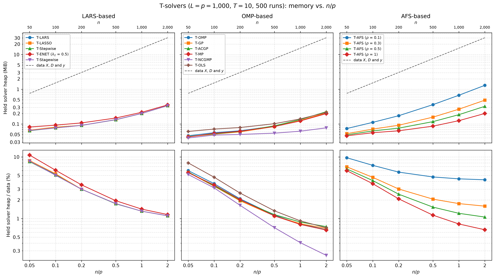

# Demo: Memory of the T-Solvers vs. the Ratio n/p (Python)

## Purpose

This demo measures the memory that the terminating solvers (T-solvers) of the demos hold on the heap once their paths
have reached $T = 10$ dummies. It runs them for a fixed number $p$ of variables and a growing number $n$ of
observations, so the ratio $n/p$ runs from 0.05 to 2. The library reports this memory itself with `getMemoryBytes()`.
The demo compares it with the size of the data and reports the number of steps to $T$, which sets the length of the
stored path. It mirrors the [C++ demo](../../../../cpp/tsolvers/ad/demo_ts_perf_03_memory_vs_np/README.md) with the same
settings, seeds and console format, while NumPy draws the data, so the numbers differ slightly from the C++ run. The
report counts the state of the C++ solver only, so the Python objects around it do not enter.

---

## Setup

- $p = 1{,}000$ variables and $n \in \lbrace 50, 100, 200, 500, 1{,}000, 2{,}000 \rbrace$ observations with
  independent standard normal entries,
- ten true coefficients equal to 3 on a fixed random support, noise standard deviation about 1 (`snr = 90`),
- $L = p$ standard normal dummies and $T = 10$,
- 500 Monte Carlo runs, with medians over the runs.

The support is drawn once with `default_rng(12345)`. For every run `mc` and every $n$ the demo draws the data with
`gen_synthetic_data()` and the seed `1000 + mc`, as the C++ demo does, but with NumPy's `default_rng`, a permuted
congruential generator (PCG64). The noise variance is the variance of the drawn signal divided by `snr`, so the ten
coefficients equal to 3 give a noise standard deviation of about 1. `reader_data()` centers and scales $\mathbf{X}$
and $\mathbf{D}$ in place with `LpNormScaler` and centers $\mathbf{y}$ once. All 15 solver configurations of
[demo_ts_perf_01](../demo_ts_perf_01_fdr_tpr_vs_T/README.md) run on these arrays as precentered readers to $T = 10$,
with the seed of the run for their tie-breaking. After the run of a solver the demo reads `getMemoryBytes()` and the
number of steps. The data take

```math
8\,n\,(p + L + 1)\ \text{bytes} = 16{,}008\,n\ \text{bytes},
```

which is 0.76 mebibytes (MiB, $2^{20}$ bytes) at $n = 50$ and 30.5 MiB at $n = 2{,}000$.

### The solver memory

The solver memory is the number of heap bytes that a solver holds after $T = 10$. `getMemoryBytes()` returns the
count of the C++ `memoryBytes()`, which covers the copy of $\mathbf{y}$, the residual, the correlations, the Cholesky
factor of the active set, the sparse coefficient path with the running coefficients, the diagnostics of every step,
the index sets and every reservation made up front. Vectors count with their capacity and Eigen objects with their
size. The data do not count, because the solver borrows the NumPy arrays of $\mathbf{X}$ and $\mathbf{D}$ without a
copy. The temporaries inside a step do not count either, and neither does the solver object itself, about 3,300 bytes
in C++. The Python solver object, the binding and the interpreter stay outside the count.

This is the state that a solver keeps between two calls, and for given data it comes out the same in every run.
Earlier versions of this demo measured another quantity, the rise of the peak resident set size of a forked child
process while it ran one solver. That peak also held the temporaries of a step, the page granularity of the allocator
and what the binding and the interpreter allocated, so its numbers are not comparable with the ones below. The
technical notes give the reasons for the change.

---

## Running the demo

From the repository root, with the package installed in the repository's virtual environment:

```bash
.venv/bin/python Python/tsolvers/ad/demo_ts_perf_03_memory_vs_np/demo_ts_perf_03_memory_vs_np.py        # 500 runs, 6 workers
.venv/bin/python Python/tsolvers/ad/demo_ts_perf_03_memory_vs_np/demo_ts_perf_03_memory_vs_np.py 5 3    # 5 runs, 3 workers
Python/tsolvers/ad/demo_ts_perf_03_memory_vs_np/generate_plots.sh                                        # figure
```

The two optional arguments are the number of runs and of worker processes. A multiprocessing pool spreads the runs
over the workers, and every worker sets the library to one thread, so each solver runs single-threaded inside its run,
as in [demo_ts_perf_01](../demo_ts_perf_01_fdr_tpr_vs_T/README.md). The report depends only on the data and the seed
of a run, and a test with different numbers of workers gave a byte-identical `.csv` file. The 500 runs below took
330.2 s with 6 workers on an Apple Silicon machine. The result files carry the number of runs in their name
(`memory_vs_np_mc500.csv` and `.txt`), so a short test run does not overwrite the full one, and `generate_plots.sh`
takes the `.csv` file of such a run as an optional argument. It draws the figure with
`Python/tsolvers/ts_plt_utils.py`, a byte-identical copy of the C++ plotting module. The output below is a run against
library 44cf1ab (TRexSelector 1.0.0). The T-Stagewise rows come from a rerun of that solver alone on library
09debc6, with the same seeds.

---

## Console walk-through

### Solver memory

```text
============================================================
T-Solver Performance: Memory vs. n/p
============================================================
p = 1000, L = p, n in {50, 100, 200, 500, 1000, 2000}, T = 10, true coefficients: 10 x 3, SNR = 90
Solver memory: held heap bytes after T = 10 (getMemoryBytes; X, D borrowed, not counted)
15 solvers, 500 runs on 6 worker processes (single-threaded solvers)
```

```text
Data X, D and y (MiB)
solver                     n=50    n=100    n=200    n=500   n=1000   n=2000
----------------------------------------------------------------------------
all solvers                0.76     1.53     3.05     7.63    15.27    30.53

Median solver memory: held heap after T = 10 (MiB)
solver                     n=50    n=100    n=200    n=500   n=1000   n=2000
----------------------------------------------------------------------------
T-LARS                     0.07     0.08     0.09     0.13     0.20     0.34
T-LASSO                    0.07     0.08     0.09     0.13     0.20     0.34
T-Stepwise                 0.06     0.08     0.09     0.13     0.20     0.34
T-ENET (lambda2 0.5)       0.08     0.09     0.11     0.15     0.22     0.35
T-Stagewise                0.07     0.08     0.09     0.13     0.20     0.34
T-OMP                      0.05     0.06     0.06     0.09     0.12     0.20
T-GP                       0.04     0.05     0.06     0.08     0.13     0.21
T-ACGP                     0.04     0.05     0.06     0.09     0.13     0.23
T-MP                       0.04     0.05     0.06     0.08     0.12     0.20
T-NCGMP                    0.04     0.05     0.05     0.05     0.06     0.08
T-OLS                      0.06     0.07     0.08     0.10     0.14     0.22
T-AFS (rho 0.1)            0.07     0.11     0.17     0.36     0.67     1.30
T-AFS (rho 0.3)            0.05     0.07     0.09     0.16     0.27     0.49
T-AFS (rho 0.5)            0.05     0.06     0.08     0.12     0.19     0.32
T-AFS (rho 1)              0.05     0.06     0.06     0.09     0.12     0.20

Largest solver memory over the runs: held heap after T = 10 (MiB)
solver                     n=50    n=100    n=200    n=500   n=1000   n=2000
----------------------------------------------------------------------------
T-LARS                     0.08     0.10     0.11     0.16     0.23     0.37
T-LASSO                    0.09     0.10     0.11     0.16     0.23     0.37
T-Stepwise                 0.08     0.10     0.12     0.16     0.23     0.36
T-ENET (lambda2 0.5)       0.11     0.12     0.13     0.18     0.25     0.38
T-Stagewise                0.08     0.10     0.11     0.16     0.23     0.37
T-OMP                      0.06     0.08     0.09     0.11     0.15     0.23
T-GP                       0.06     0.06     0.07     0.10     0.14     0.22
T-ACGP                     0.06     0.07     0.07     0.10     0.15     0.24
T-MP                       0.05     0.07     0.07     0.10     0.14     0.21
T-NCGMP                    0.05     0.06     0.06     0.07     0.08     0.09
T-OLS                      0.08     0.09     0.10     0.13     0.16     0.24
T-AFS (rho 0.1)            0.09     0.14     0.20     0.39     0.70     1.32
T-AFS (rho 0.3)            0.07     0.09     0.12     0.18     0.29     0.51
T-AFS (rho 0.5)            0.07     0.09     0.11     0.15     0.21     0.35
T-AFS (rho 1)              0.06     0.08     0.09     0.11     0.15     0.22
```

The data grow 40-fold from $n = 50$ to $n = 2{,}000$. The solver memory grows too, by less and at a rate that depends
on the solver. At $n = 50$ all solvers hold 0.04 to 0.08 MiB. At $n = 2{,}000$ the least angle regression (LARS)
family holds 0.34 to 0.35 MiB, and the orthogonal matching pursuit (OMP) family holds 0.20 to 0.23 MiB, apart from
T-NCGMP with 0.08 MiB. The adaptive forward stepwise (AFS) solver T-AFS holds 0.20 MiB for $\rho = 1$ and 1.30 MiB for
$\rho = 0.1$. The largest value over the runs lies at most 0.04 MiB above the median for every solver.

Most of this memory is reserved before the first step. Every solver records the number of dummies in the active set
after each step, and the LARS family also records the penalty level $\lambda$ of each step. The constructors of all
solvers but T-NCGMP reserve these vectors for the largest number of steps the solver may take, eight times the largest
active set. Precentered data have rank $n - 1$, and $n - 1 < p + L$ on the whole grid, so each reserved vector holds

```math
8\,\min(p + L,\ n - 1) + 1 = 8\,(n - 1) + 1\ \text{entries of 8 bytes},
```

which is 3,144 bytes at $n = 50$ and 127,944 bytes (0.12 MiB) at $n = 2{,}000$. T-AFS moves only the fraction $\rho$
of the way in a step, so it divides the step limit by $\rho$ and reserves $\lceil 8\,(n - 1)/\rho \rceil + 1$
entries. At $n = 2{,}000$ the two reservations of T-LARS take 255,888 of its 354,964 bytes (72%), the one of T-OMP
takes 127,944 of 210,956 bytes (61%), and the one of T-AFS with $\rho = 0.1$ takes 1,279,368 of 1,363,306 bytes (94%).
At $n = 2{,}000$ the T-AFS curves differ by their reservations alone. The median for $\rho = 0.3$ lies 298,520 bytes
above the one for $\rho = 1$, which equals the difference of the reservations, $(53{,}308 - 15{,}993) \cdot 8$ bytes,
and the gap of 127,936 bytes for $\rho = 0.5$ matches in the same way.

The rest is small. Every solver copies $\mathbf{y}$ and keeps a residual, $8n$ bytes each, and it keeps the
correlations and the list of inactive variables, $8\,(p + L) = 16{,}000$ bytes each. The LARS family adds a
compensation vector of the same length for its running correlations. T-ENET extends the residual by $p + L$ entries
for its ridge part, and T-OLS keeps the projected norms of all $p + L$ columns, 16,000 bytes more in both cases.
T-GP and T-ACGP keep one and two further vectors of length $n$ for the projections of their search directions. The
sparse path, the diagnostics and the Cholesky factor of about 30 active variables make up the remaining 19,000 bytes
or so of T-LARS and T-OMP at $n = 2{,}000$.

So every solver grows linearly in $n$, and the slope counts the reserved vectors. Each of them adds 64 bytes per
observation, and the copy of $\mathbf{y}$ and the residual add 16 more. The LARS family grows by $2 \cdot 64 + 16 = 144$
bytes per observation, the OMP family apart from T-NCGMP by 80 to 96 bytes and T-AFS by $64/\rho + 16$ bytes, which
is 656 bytes for $\rho = 0.1$. Over the 1,950 observations from $n = 50$ to $n = 2{,}000$ this predicts rises of
0.27 MiB for T-LARS, 0.15 MiB for T-OMP and 1.22 MiB for T-AFS with $\rho = 0.1$, and the table shows 0.27, 0.15 and
1.23 MiB.

T-NCGMP stays much smaller, with 41,532 bytes at $n = 50$ and 81,140 bytes at $n = 2{,}000$. It derives from the
solver base directly rather than from T-OMP. Its constructor sets the same step limit $8\,(n - 1)$ but reserves
nothing for it, so its record of dummies grows one entry per step, a few dozen entries at $T = 10$. In the line-search
variant of the demo it keeps no Cholesky factor either. Only the copy of $\mathbf{y}$ and the residual grow with $n$,
by 16 bytes per observation, and from $n = 200$ to $n = 2{,}000$ its median rises by 15.9 bytes per observation. T-MP
takes the same line-search steps, 36 of them from $n = 200$ on, but it derives from T-OMP and inherits its
reservation. At $n = 2{,}000$ it holds 127,510 bytes more than T-NCGMP, nearly the 127,944 bytes of the reservation.

### Share of the data

```text
Median solver memory relative to the data X, D and y (%)
solver                     n=50    n=100    n=200    n=500   n=1000   n=2000
----------------------------------------------------------------------------
T-LARS                      8.7      5.1      3.0      1.7      1.3      1.1
T-LASSO                     8.7      5.3      3.0      1.7      1.3      1.1
T-Stepwise                  8.4      5.1      3.0      1.7      1.3      1.1
T-ENET (lambda2 0.5)       10.7      6.1      3.5      1.9      1.4      1.2
T-Stagewise                 8.5      5.0      3.0      1.7      1.3      1.1
T-OMP                       6.0      3.7      2.1      1.1      0.8      0.7
T-GP                        5.6      3.3      1.9      1.1      0.8      0.7
T-ACGP                      5.7      3.4      2.0      1.2      0.9      0.7
T-MP                        5.5      3.5      2.0      1.1      0.8      0.7
T-NCGMP                     5.2      3.1      1.6      0.7      0.4      0.3
T-OLS                       8.0      4.7      2.6      1.3      0.9      0.7
T-AFS (rho 0.1)             9.7      7.3      5.7      4.7      4.4      4.3
T-AFS (rho 0.3)             6.9      4.7      3.0      2.1      1.7      1.6
T-AFS (rho 0.5)             6.4      4.1      2.5      1.5      1.2      1.1
T-AFS (rho 1)               6.0      3.7      2.1      1.1      0.8      0.7
```

The share of the data falls with $n/p$, but not like $1/n$. With a fixed part $a$ and a slope $b$ per observation, the
solver memory relative to the data is

```math
\frac{a + b\,n}{16{,}008\,n} = \frac{a}{16{,}008\,n} + \frac{b}{16{,}008},
```

so the fixed part fades with $n$, while the slope sets a floor. At $n/p = 0.05$ the solvers add 5.2% (T-NCGMP) to
10.7% (T-ENET) to the data. At $n/p = 2$ the LARS family adds 1.1% to 1.2%, close to its floor of 0.9% for
$b = 144$ bytes, and the OMP family apart from T-NCGMP adds 0.7%, against a floor of 0.5% for T-OMP. T-AFS with
$\rho = 0.1$ has the steepest slope and levels off early, at 4.7% to 4.3% from $n/p = 0.5$ on, against a floor of
4.1%. T-NCGMP, with its 16 bytes per observation, keeps falling to 0.3%. In every cell the solvers hold less than 11%
of the data, and from $n/p = 0.5$ on less than 5%.

### Steps to $T = 10$

```text
Median steps to T = 10
solver                     n=50    n=100    n=200    n=500   n=1000   n=2000
----------------------------------------------------------------------------
T-LARS                     24.0     30.0     29.0     30.0     29.0     29.0
T-LASSO                    24.0     32.0     29.0     30.0     29.0     29.0
T-Stepwise                 21.0     29.0     29.0     29.0     29.0     29.0
T-ENET (lambda2 0.5)       24.0     29.0     30.0     30.0     30.0     30.0
T-Stagewise                25.0     31.0     29.0     30.0     29.0     29.0
T-OMP                      21.0     29.0     29.0     29.0     29.0     29.0
T-GP                       21.0     30.0     30.0     30.0     30.0     30.0
T-ACGP                     21.0     30.0     30.0     30.0     30.0     30.0
T-MP                       21.0     34.0     36.0     36.0     36.0     36.0
T-NCGMP                    21.0     34.0     36.0     36.0     36.0     36.0
T-OLS                      21.0     29.0     29.0     29.0     29.0     29.0
T-AFS (rho 0.1)            23.0     30.0     29.0     29.5     29.0     30.0
T-AFS (rho 0.3)            21.0     30.0     29.0     29.0     29.0     29.0
T-AFS (rho 0.5)            21.0     30.0     29.0     29.0     29.0     29.0
T-AFS (rho 1)              21.0     29.0     29.0     29.0     29.0     29.0

Failed solver runs: 0
Wall time: 330.2 s
```

From $n = 200$ on most solvers need 29 to 30 steps, and T-MP and T-NCGMP need 36, as at $L = p$ in
[demo_ts_perf_02](../demo_ts_perf_02_runtime_vs_dummies/README.md). By the exchangeability count of that demo, a path
to the tenth dummy holds the ten dummies and about ten null variables. The 21 to 25 steps at $n = 50$ therefore leave
room for only one to five of the ten true variables. T-Stagewise takes 25 and 31 steps at $n = 50$ and $n = 100$,
within one step of T-LASSO. Its paths were longer, with 33 and 41 steps, until library 09debc6 made a variable removed
within a step no candidate for the move of that step and let the dummies of the support count toward $T$. The steps
set only the part of the memory that grows along the path, the entry of the sparse path with the active coefficients
and the diagnostics of each step, several hundred bytes to about 1,000 bytes per step. The reservations depend on $n$
alone, so the path length moves the median little. With eight steps fewer at $n = 50$ the median of T-Stagewise fell
by 6,688 bytes, about 800 bytes per step. No solver run fails.

### Comparison with the C++ run

The data of the two runs differ, so the path lengths and the bytes differ slightly. The median table in MiB matches
the C++ table in every cell. In bytes, 54 of the 90 medians equal the C++ value, and all others but one differ from it
by at most 1,020 bytes, about one step of the path. The exception is T-LASSO at $n = 100$, 2,784 bytes above the C++
value with 32 against 31 median steps. The median steps agree with the C++ run within one step in every cell. The
[R demo](../../../../R/tsolvers/ad/demo_ts_perf_03_memory_vs_np/README.md) compares all three runs.

On the same data the languages agree. A check outside the committed runs, on library 44cf1ab, passed the same
$\mathbf{X}$, $\mathbf{D}$ and $\mathbf{y}$ at $n = 50$ and $n = 2{,}000$ to all 15 solvers in C++, Python and R. In
29 of the 30 pairs of solver and $n$ the bytes and the steps were the same in all three languages. The exception was
T-Stagewise at $n = 50$, with 60 steps in C++, 56 in Python and 50 in R, a near-tie on its path that each build of the
library breaks differently.

---

## Figures

The figure shows the solver memory against $n/p$ on log axes, one column per library family, with $n$ on the top
axis. The dashed line in the top row is the size of the data, and the bottom row shows the solver memory as a share of
the data. The curves rise with the slopes of their reservations, most steeply for T-AFS with $\rho = 0.1$, while
T-NCGMP stays nearly flat.



---

## Technical notes

- `getMemoryBytes()` exists on every solver of the package and returns the C++ `memoryBytes()` of the wrapped
  solver. The [C++ demo](../../../../cpp/tsolvers/ad/demo_ts_perf_03_memory_vs_np/README.md) gives the library's check
  of the report against the allocator and the peak inside a step, which the report leaves out.
- Earlier versions ran every solver in a child forked with `os.fork()` and reported the rise of its peak resident set
  size from `resource.getrusage()`. This was dropped for three reasons. On macOS the Open Multi-Processing (OpenMP)
  runtime resets the thread count in a forked child, so the children meant to run single-threaded ran the solvers on
  12 threads. `os.fork()` does not exist on Windows. A spawned child is portable, but a fresh Python or R interpreter
  serves the small allocations of a solver from memory it already holds, so R read about 0 MiB per solver. The memory
  report needs neither a fork nor the Unix-only `resource` module, so the demo runs on macOS, Linux and Windows alike.
- `run_parallel()` of [`ts_perf_utils.py`](../../ts_perf_utils.py) starts a `multiprocessing.Pool` with Python's
  default start method, which spawns fresh interpreters on macOS and Windows. The solvers run serially by
  default, so a worker never spawns threads of its own. A worker runs whole runs, and no solver runs in a process
  of its own.
- A writer, a solver with `normalize=True` or `intercept=True`, centers and scales the caller's $\mathbf{X}$ and
  $\mathbf{D}$ in place and restores them when it is released, so it borrows the data too. It holds $16\,(p + L)$
  bytes more than a reader for the means and norms of the columns. This demo runs the precentered readers only.
