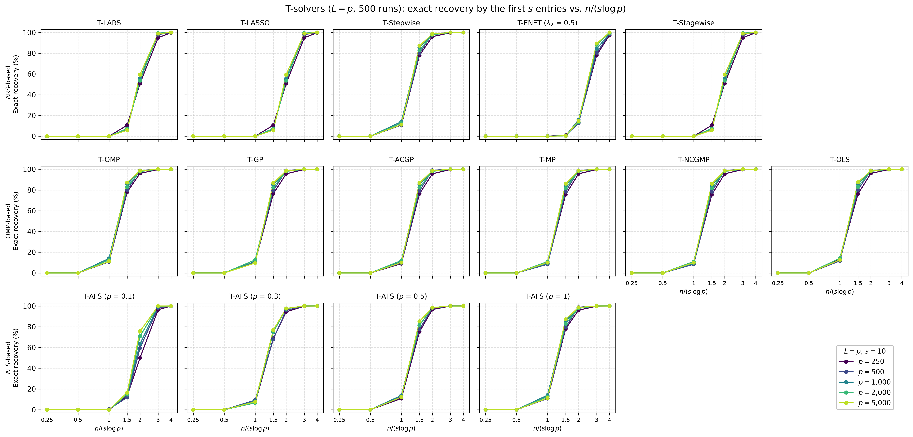
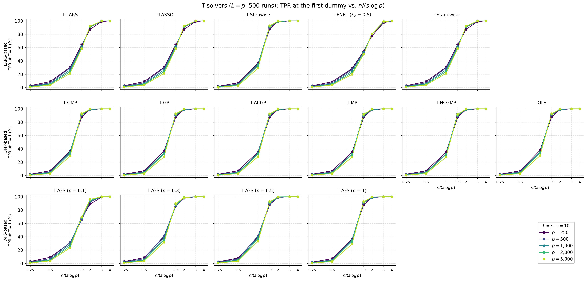
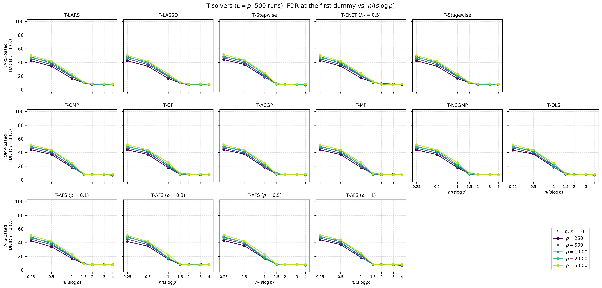
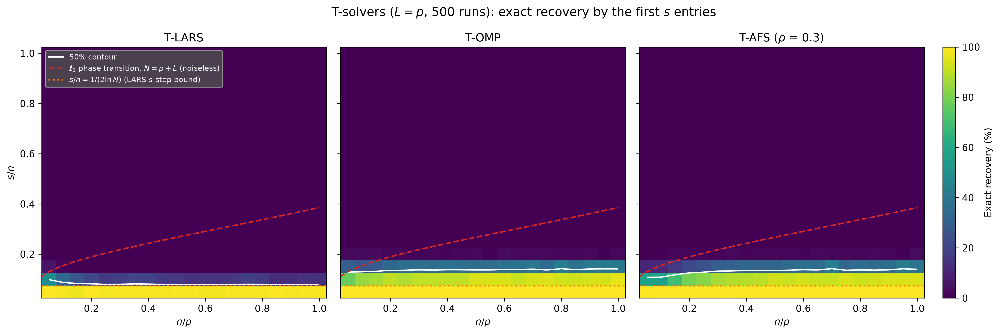

# Demo: Support Recovery of the T-Solvers vs. the Ratio n/(s log p) (Python)

## Purpose

This demo measures how many observations the demo T-solvers need to recover the true support. It counts a run as an
exact recovery when the first $s$ distinct variables that enter the path are the $s$ true ones, so a null variable or
a dummy among them is a miss. Part 1 plots this probability against $n/(s \log p)$ for several $p$, and curves that
fall onto each other confirm that $n$ has to grow like $s \log p$. Part 2 draws the Donoho–Tanner diagram over $n/p$
and $s/n$ for three solvers. The demo mirrors the
[C++ demo](../../../../cpp/tsolvers/ad/demo_ts_perf_04_recovery_vs_dt_ratio/README.md) with the same settings, seeds and
console format, while NumPy draws the supports and the data, so the numbers differ from the C++ run.

---

## Setup

- independent standard normal predictors and $L = p$ standard normal dummies,
- coefficients equal to 3 on a fixed random support and noise standard deviation about 1,
- every solver runs to the first dummy ($T = 1$), which also gives the true positive rate (TPR) and the false
  discovery rate (FDR) of that selection,
- 500 Monte Carlo runs.

**Part 1** uses $p \in \lbrace 250, 500, 1{,}000, 2{,}000, 5{,}000 \rbrace$ and $s = 10$, with

```math
n = \operatorname{round}\!\left(c \cdot s \ln p\right), \qquad c \in \lbrace 0.25, 0.5, 1, 1.5, 2, 3, 4 \rbrace,
```

so $n$ runs from 14 to 341. All 15 solver configurations of
[demo_ts_perf_01](../demo_ts_perf_01_fdr_tpr_vs_T/README.md) run on the same data.

**Part 2** uses $p = 400$ and the grid $n/p, s/n \in \lbrace 0.05, 0.10, \dots, 1 \rbrace$, so $n$ runs from 20 to
400 and every $s$ is a whole number. T-LARS, T-OMP and T-AFS ($\rho = 0.3$) run in each of the 400 cells.

For every data set the demo centers and scales $\mathbf{X}$ and $\mathbf{D}$ in place with `LpNormScaler` and centers
$\mathbf{y}$ once, and the solvers run on it as precentered readers with the seed of the run for their tie-breaking.
The seeds are those of the C++ demo. Part 1 draws its support for every $p$ with `default_rng(12345)` and the data of
run `mc` with the seed `1000 + mc`, and Part 2 draws the support of cell `c` with `12345 + c` and its data with
`3000000 + 400 * mc + c`. NumPy's `default_rng`, a permuted congruential generator (PCG64), turns these seeds into the
supports and into the data of `gen_synthetic_data()`.

---

## Running the demo

From the repository root, with the package installed in the repository's virtual environment:

```bash
demo=Python/tsolvers/ad/demo_ts_perf_04_recovery_vs_dt_ratio/demo_ts_perf_04_recovery_vs_dt_ratio.py
.venv/bin/python $demo                 # 500 runs, 6 workers, Parts 1 and 2
.venv/bin/python $demo 5 3             # 5 runs, 3 workers
.venv/bin/python $demo 500 6 2         # Part 2 only
Python/tsolvers/ad/demo_ts_perf_04_recovery_vs_dt_ratio/generate_plots.sh          # figures
```

The optional arguments are the number of runs, the number of worker processes and the parts to run. The runs are
spread over a `multiprocessing` pool of worker processes, and each solver runs single-threaded inside its worker. With
6 workers on an Apple Silicon machine, Part 1 takes about 1.5 minutes (92.0 s) and Part 2 about 1.2 minutes (72.8 s).
The Python demo is thus faster than the C++ one, which needs 144 s and 277 s. Most likely NumPy draws the data faster
than the C++ data generator, which matters most for the 200,000 small data sets of Part 2. The demo does not time the
drawing on its own, so this reason is not proven.

The result files carry the number of runs in their name (`recovery_vs_dt_ratio_mc500` and `phase_transition_mc500`,
each as `.csv` and `.txt`), so a short test run does not overwrite the full one, and `generate_plots.sh 5` draws the
figures of a 5-run test. It draws them with `Python/tsolvers/ts_plt_utils.py`, a byte-identical copy of the C++
plotting module. The output below is a run against library b95b984 (TRexSelector 1.0.0).

---

## Console walk-through

### Part 1: exact recovery vs. $n/(s \log p)$

The two extremes of the $p$ grid show the scaling, first $p = 250$:

```text
============================================================
T-Solver Performance: Recovery vs. n/(s log p)
============================================================
500 runs on 6 worker processes


============================================================
Part 1: Recovery vs. n/(s log p)
============================================================
p in {250, 500, 1000, 2000, 5000}, L = p, s = 10, n/(s log p) in {0.25, 0.5, 1, 1.5, 2, 3, 4}, T = 1
15 solvers, 500 runs

Exact recovery by the first s = 10 entries (%), p = 250
n/(s log p)               0.25     0.5       1     1.5       2       3       4
n                           14      28      55      83     110     166     221
------------------------------------------------------------------------------
T-LARS                     0.0     0.0     0.0    10.6    50.8    95.0    99.8
T-LASSO                    0.0     0.0     0.0    10.6    50.8    95.0    99.8
T-Stepwise                 0.0     0.0    10.8    78.0    96.0    99.8   100.0
T-ENET (lambda2 0.5)       0.0     0.0     0.0     1.0    13.2    78.2    97.4
T-Stagewise                0.0     0.0     0.0    10.6    50.8    95.0    99.8
T-OMP                      0.0     0.0    10.8    78.0    96.0    99.8   100.0
T-GP                       0.0     0.0    11.0    76.4    95.6    99.8   100.0
T-ACGP                     0.0     0.0     9.0    76.4    95.6    99.8   100.0
T-MP                       0.0     0.0     9.2    75.6    95.6    99.8   100.0
T-NCGMP                    0.0     0.0     9.2    75.6    95.6    99.8   100.0
T-OLS                      0.0     0.0    13.6    76.2    96.0    99.8   100.0
T-AFS (rho 0.1)            0.0     0.0     0.0    13.2    50.0    96.4   100.0
T-AFS (rho 0.3)            0.0     0.0     6.8    68.8    94.4    99.8   100.0
T-AFS (rho 0.5)            0.0     0.0    10.8    75.2    96.6   100.0   100.0
T-AFS (rho 1)              0.0     0.0    10.8    78.0    96.0    99.8   100.0
```

and then $p = 5{,}000$:

```text
Exact recovery by the first s = 10 entries (%), p = 5000
n/(s log p)               0.25     0.5       1     1.5       2       3       4
n                           21      43      85     128     170     256     341
------------------------------------------------------------------------------
T-LARS                     0.0     0.0     0.0     5.8    59.4    99.0   100.0
T-LASSO                    0.0     0.0     0.0     5.8    59.4    99.0   100.0
T-Stepwise                 0.0     0.0    11.2    87.2    98.6   100.0   100.0
T-ENET (lambda2 0.5)       0.0     0.0     0.0     0.4    14.6    89.4   100.0
T-Stagewise                0.0     0.0     0.0     5.8    59.4    99.0   100.0
T-OMP                      0.0     0.0    11.2    87.2    98.6   100.0   100.0
T-GP                       0.0     0.0     9.6    86.6    98.6   100.0   100.0
T-ACGP                     0.0     0.0    10.0    86.8    98.6   100.0   100.0
T-MP                       0.0     0.0    10.0    86.0    98.6   100.0   100.0
T-NCGMP                    0.0     0.0    10.0    86.0    98.6   100.0   100.0
T-OLS                      0.0     0.0    12.6    87.4    98.6   100.0   100.0
T-AFS (rho 0.1)            0.0     0.0     0.0    16.4    75.6   100.0   100.0
T-AFS (rho 0.3)            0.0     0.0     7.6    76.8    97.6   100.0   100.0
T-AFS (rho 0.5)            0.0     0.0    12.2    85.2    98.4   100.0   100.0
T-AFS (rho 1)              0.0     0.0    11.2    87.2    98.6   100.0   100.0
```

From $p = 250$ to $p = 5{,}000$ the number of variables grows 20-fold, and at the same $n/(s \log p)$ the recoveries of
the five $p$ lie within 11.2 percentage points of each other. Only T-AFS ($\rho = 0.1$) moves more at 2, from 50.0% at
$p = 250$ to 75.6% at $p = 5{,}000$. So $n$ has to grow like $s \log p$. The solvers fall into two groups. The
orthogonal matching pursuit (OMP) family, T-Stepwise and T-AFS with $\rho \ge 0.3$ recover the support in 68% to 87% of
the runs at $n/(s \log p) = 1.5$ and in at least 94% at 2. T-LARS, T-LASSO, T-Stagewise and T-AFS with $\rho = 0.1$ need
about 1.5 times as many observations and reach 50% to 76% at 2. Their steep rise between 1.5 and 3 brackets the $s$-step
bound of Donoho and Tsaig (2008), by which least-angle regression (LARS) recovers the support in its first $s$ steps
once $n > 2 s \ln N$ with $N = p + L$ columns, which is $n/(s \log p) > 2.16$ to $2.25$ here. T-ENET needs the most
observations and recovers the support in 78% to 89% of the runs at 3.

T-AFS moves between the two groups. With $\rho = 0.1$ it takes small steps and follows T-LARS, ahead of it at 2 from
$p = 500$ on, and with $\rho = 1$ it takes full steps and equals T-OMP. T-OMP, T-Stepwise and T-AFS ($\rho = 1$) show
the same rows, and so do T-MP and T-NCGMP, as the identities in the [folder README](../../README.md) predict. T-OLS
follows a selection rule of its own and differs from T-OMP by up to 2.8 percentage points in exact recovery. T-LARS,
T-LASSO and T-Stagewise also agree in every exact-recovery entry, because they share the path up to the first drop,
and their TPR and FDR differ by less than 0.4 percentage points.

The small rise with $p$ at a fixed ratio, for instance of T-OMP from 78.0% at $p = 250$ to 87.2% at $p = 5{,}000$ at
1.5, fits the dummies, which double the number of columns. Since $\ln(2p)/\ln p$ falls from 1.13 at $p = 250$ to 1.08
at $p = 5{,}000$, a fixed $n/(s \log p)$ gives slightly more observations per $s \ln N$ at larger $p$. The C++ run
shows the same groups and identities, and its entries of all three measures differ from these by at most 5.8
percentage points. That is within about three standard errors, so the two runs agree up to the different data drawn
by NumPy.

### Part 1: TPR and FDR at the first dummy

```text
TPR at T = 1 (%), p = 1000
n/(s log p)               0.25     0.5       1     1.5       2       3       4
n                           17      35      69     104     138     207     276
------------------------------------------------------------------------------
T-LARS                     1.6     5.7    26.5    61.7    90.7    99.9   100.0
T-LASSO                    1.6     5.7    26.5    61.7    90.7    99.9   100.0
T-Stepwise                 1.2     4.5    35.6    92.2    99.0   100.0   100.0
T-ENET (lambda2 0.5)       1.5     5.5    24.9    52.7    80.6    98.8   100.0
T-Stagewise                1.6     5.7    26.5    61.7    90.7    99.9   100.0
T-OMP                      1.2     4.5    35.6    92.2    99.0   100.0   100.0
T-GP                       1.2     4.5    33.9    92.1    99.0   100.0   100.0
T-ACGP                     1.2     4.5    34.2    92.2    99.0   100.0   100.0
T-MP                       1.2     4.5    31.8    92.4    98.8   100.0   100.0
T-NCGMP                    1.2     4.5    31.8    92.4    98.8   100.0   100.0
T-OLS                      1.2     4.6    35.3    92.1    99.0   100.0   100.0
T-AFS (rho 0.1)            1.6     5.6    29.0    69.6    93.7   100.0   100.0
T-AFS (rho 0.3)            1.6     5.4    37.9    88.6    98.9   100.0   100.0
T-AFS (rho 0.5)            1.5     5.1    39.2    90.3    99.1   100.0   100.0
T-AFS (rho 1)              1.2     4.5    35.6    92.2    99.0   100.0   100.0

FDR at T = 1 (%), p = 1000
n/(s log p)               0.25     0.5       1     1.5       2       3       4
n                           17      35      69     104     138     207     276
------------------------------------------------------------------------------
T-LARS                    48.3    38.8    20.2    10.2     7.7     7.5     7.8
T-LASSO                   48.3    38.8    20.2    10.1     7.6     7.5     7.8
T-Stepwise                49.1    41.2    18.8     8.1     7.6     8.0     7.4
T-ENET (lambda2 0.5)      48.6    38.7    20.9    11.1     8.7     7.5     8.2
T-Stagewise               48.3    38.8    20.2    10.2     7.8     7.5     7.8
T-OMP                     49.1    41.2    18.8     8.1     7.6     8.0     7.4
T-GP                      49.1    41.4    19.2     8.0     8.1     7.7     7.4
T-ACGP                    49.1    41.3    19.2     8.1     8.2     7.6     7.3
T-MP                      49.1    41.4    19.6     8.0     8.2     7.9     7.4
T-NCGMP                   49.1    41.4    19.6     8.0     8.2     7.9     7.4
T-OLS                     49.0    41.2    18.6     8.4     7.7     7.9     7.2
T-AFS (rho 0.1)           48.5    38.5    19.8     9.5     8.0     7.3     8.1
T-AFS (rho 0.3)           48.8    39.2    17.0     8.1     7.5     7.1     7.7
T-AFS (rho 0.5)           48.6    40.1    17.0     8.2     8.1     8.1     7.0
T-AFS (rho 1)             49.1    41.2    18.8     8.1     7.6     8.0     7.4
```

The TPR at the first dummy follows the same two groups. At $n/(s \log p) = 1.5$ the OMP family finds about 92% of the
true variables and T-LARS about 62%, and from 3 on every solver finds at least 98.8% at $p = 1{,}000$. Once the true
variables come first, the FDR settles at 7% to 9% for every solver, which the exchangeability of null variables and
dummies from [demo_ts_perf_01](../demo_ts_perf_01_fdr_tpr_vs_T/README.md) predicts. Null variables and dummies are
about equally many ($p - s = 990$ and $L = 1{,}000$), so $V$ null variables enter before the first dummy with
probability about $(1/2)^{V+1}$, and

```math
\mathrm{FDR} \approx \sum_{k \ge 1} \left(\tfrac{1}{2}\right)^{k+1} \frac{k}{k + s} = 7.8\,\% \qquad (s = 10).
```

Over all five $p$ the columns 3 and 4 average an FDR of 7.8%, in line with this value. With too few observations the
true variables rarely enter, and the FDR approaches 50% (48.3% to 49.1% at 0.25). The first entry is then a dummy in
about half of the runs, which leaves an empty selection, and a null variable in the other half. Part 1 ends with no
failed solver run.

### Part 2: the Donoho–Tanner diagram

The rows with $s/n \ge 0.30$ are zero in all three tables and are left out here:

```text
============================================================
Part 2: Donoho-Tanner phase transition
============================================================
p = 400, L = p, n/p and s/n in {0.05, 0.10, ..., 1}, T = 1
T-LARS, T-OMP and T-AFS (rho 0.3), 500 runs per cell

Exact recovery by the first s entries (%), T-LARS
 s/n \ n/p 0.05 0.10 0.15 0.20 0.25 0.30 0.35 0.40 0.45 0.50 0.55 0.60 0.65 0.70 0.75 0.80 0.85 0.90 0.95 1.00
--------------------------------------------------------------------------------------------------------------
      0.25    0    0    0    0    0    0    0    0    0    0    0    0    0    0    0    0    0    0    0    0
      0.20    0    0    0    0    0    0    0    0    0    0    0    0    0    0    0    0    0    0    0    0
      0.15    5    1    0    0    0    0    0    0    0    0    0    0    0    0    0    0    0    0    0    0
      0.10   49   33   26   22   17   18   21   20   17   16   14   15   15   16   18   17   12   13   14   14
      0.05  100   99   98   99   99   99   99   99   99   99   99   98   98   99   99   99   99   99   99   99

Exact recovery by the first s entries (%), T-OMP
 s/n \ n/p 0.05 0.10 0.15 0.20 0.25 0.30 0.35 0.40 0.45 0.50 0.55 0.60 0.65 0.70 0.75 0.80 0.85 0.90 0.95 1.00
--------------------------------------------------------------------------------------------------------------
      0.25    0    0    0    0    0    0    0    0    0    0    0    0    0    0    0    0    0    0    0    0
      0.20    2    3    2    1    2    1    1    1    2    2    1    3    2    2    2    2    2    2    0    2
      0.15   30   27   29   34   35   37   35   37   37   35   35   37   38   40   34   42   37   41   41   40
      0.10   77   85   87   90   88   91   91   91   91   94   94   94   92   94   95   93   92   93   94   96
      0.05  100  100  100  100  100  100  100  100  100  100  100  100  100  100  100  100  100  100  100  100

Exact recovery by the first s entries (%), T-AFS (rho 0.3)
 s/n \ n/p 0.05 0.10 0.15 0.20 0.25 0.30 0.35 0.40 0.45 0.50 0.55 0.60 0.65 0.70 0.75 0.80 0.85 0.90 0.95 1.00
--------------------------------------------------------------------------------------------------------------
      0.25    0    0    0    0    0    0    0    0    0    0    0    0    0    0    0    0    0    0    0    0
      0.20    0    0    1    1    1    1    2    1    1    1    1    1    2    1    2    1    2    2    1    3
      0.15   11   11   16   22   25   30   31   33   32   32   34   37   35   42   33   35   34   35   41   39
      0.10   58   58   69   79   82   87   88   89   90   93   92   93   92   92   94   92   93   94   94   94
      0.05  100   99  100  100  100  100  100  100  100  100  100  100  100  100  100  100  100  100  100  100

Failed solver runs: 0
Wall time: 72.8 s
```

T-LARS recovers the support in 98% to 100% of the runs at $s/n = 0.05$ over the whole range of $n/p$, in 12% to 49%
at 0.10 and in 5% or less above. Its edge lies at $s/n \approx 0.08$ from $n/p = 0.15$ on, right at the $s$-step
bound $1/(2 \ln N) = 0.075$ for $N = p + L = 800$ columns. T-OMP reaches further, with 77% to 96% at $s/n = 0.10$ and
27% to 42% at 0.15. T-AFS ($\rho = 0.3$) stays within 6.4 percentage points of T-OMP from $n/p = 0.30$ on and falls
behind below, by up to 27 percentage points at $n/p = 0.10$. The C++ diagram differs from this one by at most 9.4
percentage points in a cell, again within about three standard errors.

The edges of T-LARS and T-OMP are nearly flat in $n/p$, and the edge of T-AFS rises from $s/n \approx 0.11$ at
$n/p \le 0.10$ to about the one of T-OMP at $n/p = 0.30$. A flat edge sits at a fixed $s/n$ and thus at a fixed
$n/(s \ln N)$, the scaling of Part 1. The edges also agree with Part 1 in numbers. At $p = 400$ the 50% edge of T-LARS
at $s/n \approx 0.08$ means $n/(s \log p) \approx 2.1$, and the edge of T-OMP at 0.13 to 0.14 means 1.2 to 1.3. The
two solvers cross 50% in Part 1 near these values, at about 2 and 1.3. All edges lie far below the $\ell_1$ phase
transition of Donoho and Tanner, which reaches $s/n = 0.39$ at $n/p = 1$. That curve marks where the $\ell_1$ solution
at the end of a noiseless path equals the true coefficients, while exact recovery here asks that no wrong variable
enters before the $s$ true ones.

---

## Figures

The first three figures show exact recovery, TPR and FDR at the first dummy against $n/(s \log p)$, one panel per
solver with the families in the rows and one curve per $p$. Every configuration reached the first dummy in at least
99.8% of the runs, so the figures carry no open markers.







The fourth figure shows the Donoho–Tanner diagram of Part 2 with the 50% contour of every solver. The dashed curve is
the noiseless $\ell_1$ phase transition for $N = p + L$ columns, computed from the statistical dimension of the
$\ell_1$ descent cone (Amelunxen, Lotz, McCoy and Tropp, 2014). The dotted line is the $s$-step bound
$s/n = 1/(2 \ln N)$.



---

## Technical notes

- A variable counts once among the first $s$ entries, also when T-MP selects it again or T-LASSO lets it enter
  again after a drop.
- The noise standard deviation stays at about 1 for every $s$, because the demo sets the signal-to-noise ratio of the
  data generator to $9s$, the signal variance of $s$ coefficients equal to 3. `gen_synthetic_data()` divides the
  variance of the drawn signal by this ratio.
- Part 1 draws its support once per $p$, and Part 2 once per cell. With independent standard normal predictors the
  place of the support does not matter.
- The solvers run serially by default, so the 6 workers of the pool share 6 cores with single-threaded solvers.
  Part 1 hands out one task per cell and run, and Part 2 hands out its 200,000 tasks in chunks of 64.
- References: D. L. Donoho and Y. Tsaig, *Fast solution of ℓ1-norm minimization problems when the solution may
  be sparse*, IEEE Transactions on Information Theory 54(11), 2008. D. Amelunxen, M. Lotz, M. B. McCoy and
  J. A. Tropp, *Living on the edge: phase transitions in convex programs with random data*, Information and
  Inference 3(3), 2014.
