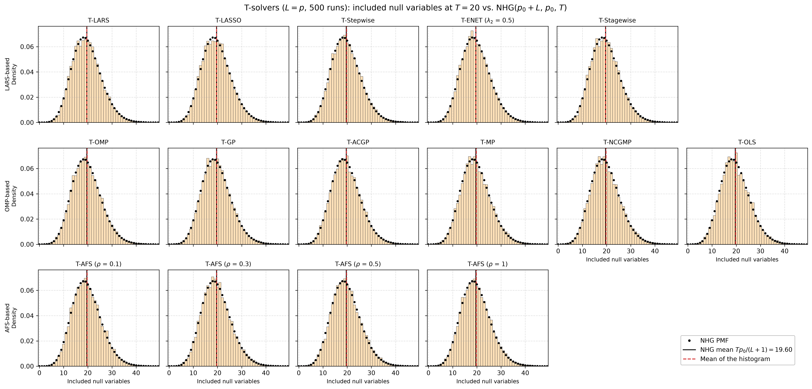
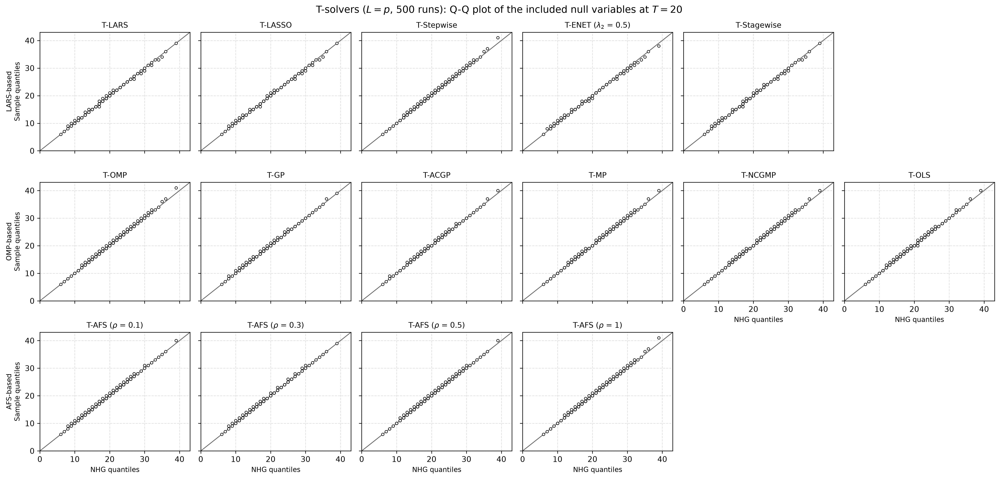
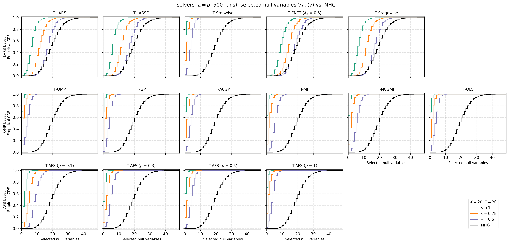

# Demo: Null Variables of the T-Solvers vs. the Negative Hypergeometric Distribution (Python)

## Purpose

The false discovery rate (FDR) control of the Terminating Random Experiments (T-Rex) selector rests on the number of
null variables that enter a solution path before it is terminated. When the null variables and the dummies are
exchangeable, a terminated path draws them like a sample without replacement, and the number $V$ of null variables
that enter before the $T$-th dummy follows the negative hypergeometric (NHG) distribution

```math
P(V = v) = \frac{\binom{v + T - 1}{v} \binom{p_0 + L - v - T}{p_0 - v}}{\binom{p_0 + L}{p_0}},
\qquad v = 0, \ldots, p_0, \qquad \mathbb{E}[V] = \frac{T \, p_0}{L + 1},
```

with $p_0$ null variables and $L$ dummies. The supplement of the T-Rex paper verifies this for T-LARS in its
Figures 10 and 11. This demo is the Python port of the
[C++ demo](../../../../cpp/tsolvers/ad/demo_ts_perf_05_null_counts_vs_nhg/README.md) and repeats the verification for
all 15 solver configurations of [demo_ts_perf_01](../demo_ts_perf_01_fdr_tpr_vs_T/README.md). It checks two
statements.

- **Corollary 2 and assumption A-I.** The number of null variables included in one random experiment at $T$ follows
  $\mathrm{NHG}(p_0 + L, p_0, T)$.
- **Assumption A-II.** The number $V_{T,L}(v)$ of null variables that the T-Rex selector selects at the voting level
  $v \in [0.5, 1)$ is stochastically dominated by the same NHG distribution.

---

## Setup

The setup is the one of the supplement and of the C++ demo.

- $n = 150$ observations and $p = 300$ independent standard normal predictors.
- $p_1 = 5$ coefficients equal to 1 on a fixed random support, so $p_0 = 295$ null variables.
- A signal-to-noise ratio (SNR) of 1, calibrated on the sample.
- $K = 20$ random experiments per run, each with $L = p = 300$ fresh standard normal dummies.
- Every solver runs to $T = 20$ included dummies in every experiment.
- 500 Monte Carlo (MC) runs.

The seeds keep the values of the C++ demo, while NumPy draws other numbers from them, so the support and the data
differ from the C++ ones. For every data set the demo centers and scales $\mathbf{X}$ and the $K$ dummy matrices and
centers $\mathbf{y}$ once, and the solvers run on them as precentered readers, with a tie-breaking seed per run and
experiment.

A variable counts as included in experiment $k$ when its coefficient is nonzero after the solver stopped, as in the
T-Rex selector. The relative occurrence of variable $j$ over the experiments and the selected set at the voting level
$v$ are

```math
\Phi_{T,L}(j) = \frac{1}{K} \sum_{k=1}^{K} \mathbb{1}\left[ j \in \mathcal{C}_{k,L}(T) \right],
\qquad \widehat{\mathcal{A}}(v) = \left\lbrace j : \Phi_{T,L}(j) > v \right\rbrace,
```

and $V_{T,L}(v)$ counts the null variables in $\widehat{\mathcal{A}}(v)$. The demo records it for $v \to 1$ (included
in all 20 experiments), $v = 0.75$ (in at least 16) and $v = 0.5$ (in at least 11). With $p_0 = 295$, $L = 300$ and
$T = 20$ the NHG mean is $20 \cdot 295 / 301 = 19.60$.

---

## Running the demo

From the repository root, with the package installed in the repository's virtual environment:

```bash
demo=Python/tsolvers/ad/demo_ts_perf_05_null_counts_vs_nhg/demo_ts_perf_05_null_counts_vs_nhg.py
.venv/bin/python $demo                 # 500 runs, 6 workers
.venv/bin/python $demo 4 2             # 4 runs, 2 workers
Python/tsolvers/ad/demo_ts_perf_05_null_counts_vs_nhg/generate_plots.sh          # figures
```

The optional arguments are the number of runs and the number of worker processes. A `multiprocessing` pool spreads
the runs over the workers, and each solver runs single-threaded inside its worker. With 6 workers on an Apple Silicon
machine the 500 runs take 24.0 s, against 29.0 s for the C++ demo on 6 threads and 34.3 s for the R one.

The result files carry the number of runs in their name (`null_counts_vs_nhg_mc500.csv` and `.txt`), so a short test
run does not overwrite the full one, and `generate_plots.sh 4` draws the figures of a 4-run test. It draws them with
`Python/tsolvers/ts_plt_utils.py`, a byte-identical copy of the C++ plotting module. The comma-separated values (CSV)
file lists the frequency of every count per solver and statistic (`included`, `selected_v1`, `selected_v0.75` and
`selected_v0.5`), together with $p_0$, $L$, $T$ and $K$, so the plotter computes the NHG reference itself. The output
below is a run against library 415484d (TRexSelector 1.0.0), with the T-Stagewise rows rerun on library 09debc6
with the same seeds.

---

## Simulation Results

The console prints two tables.

- **Included null variables**, pooled over the runs and the experiments ($500 \cdot 20 = 10{,}000$ counts per
  solver). The table lists the mean and the standard deviation next to those of the NHG, the Kolmogorov distance
  $D = \max_x \lvert \widehat{F}(x) - F_{\mathrm{NHG}}(x) \rvert$ and the share of the experiments that reached $T$
  dummies.
- **Selected null variables** $V_{T,L}(v)$ over the runs. The table lists the mean per voting level and the largest
  excess $\max_x \left( F_{\mathrm{NHG}}(x) - \widehat F_v(x) \right)$ of the NHG cumulative distribution function
  (CDF) over the empirical one. An excess of zero means that the NHG dominates $V_{T,L}(v)$ at every value.

### Included null variables (Corollary 2 and A-I)

```text
Included null variables at T = 20 (pooled over runs and experiments)
solver                    mean      sd    KS D   reached
--------------------------------------------------------
NHG                      19.60    6.01
T-LARS                   19.62    5.94   0.005   100.0 %
T-LASSO                  19.60    5.92   0.005   100.0 %
T-Stepwise               19.74    6.12   0.009   100.0 %
T-ENET (lambda2 0.5)     19.59    5.90   0.006   100.0 %
T-Stagewise              19.62    5.94   0.005   100.0 %
T-OMP                    19.74    6.12   0.009   100.0 %
T-GP                     19.68    5.98   0.009   100.0 %
T-ACGP                   19.69    6.04   0.008   100.0 %
T-MP                     19.74    6.14   0.011   100.0 %
T-NCGMP                  19.74    6.14   0.011   100.0 %
T-OLS                    19.70    6.06   0.010   100.0 %
T-AFS (rho 0.1)          19.74    6.01   0.009   100.0 %
T-AFS (rho 0.3)          19.70    5.99   0.008   100.0 %
T-AFS (rho 0.5)          19.75    6.07   0.010   100.0 %
T-AFS (rho 1)            19.74    6.12   0.009   100.0 %
```

Every experiment reached $T = 20$ dummies, and all 15 configurations follow the NHG. Their means lie between
19.59 and 19.75 against 19.60, their standard deviations between 5.90 and 6.14 against 6.01, and their Kolmogorov
distances are at most 0.011, below the 5 % critical value of 0.014 for 10,000 independent counts. T-Stagewise
follows the NHG since library 09debc6 (a mean of 19.62, a standard deviation of 5.94 and a distance of 0.005), because
a dummy that its non-negative least squares (NNLS) step removes from the active set keeps its coefficient and now
counts toward $T$, as the C++ README explains. Before, its count rose to a mean of 21.14 (distance 0.095).

T-Stepwise and T-AFS ($\rho = 1$) repeat the rows of T-OMP, and T-NCGMP repeats T-MP, as the shared paths of the
[folder README](../../README.md) predict. The C++ and R runs give the same picture. Per configuration the means of the
three languages differ by at most 0.26, and no distance exceeds 0.014 in C++ or 0.010 in R.

### Selected null variables (A-II)

```text
Selected null variables V(v) over the runs: mean and largest excess of the NHG CDF over the ECDF
solver                      mean v1   mean v0.75    mean v0.5    excess v1 excess v0.75  excess v0.5
----------------------------------------------------------------------------------------------------
T-LARS                         6.72        12.06        17.09        0.000        0.000        0.016
T-LASSO                        6.46        11.96        17.07        0.000        0.000        0.014
T-Stepwise                     0.36         1.42         3.82        0.000        0.000        0.000
T-ENET (lambda2 0.5)           9.50        14.45        18.43        0.000        0.002        0.048
T-Stagewise                    6.72        12.08        17.09        0.000        0.000        0.012
T-OMP                          0.36         1.42         3.82        0.000        0.000        0.000
T-GP                           0.37         1.54         4.04        0.000        0.000        0.000
T-ACGP                         0.36         1.49         3.85        0.000        0.000        0.000
T-MP                           0.46         2.01         5.59        0.000        0.000        0.000
T-NCGMP                        0.46         2.01         5.59        0.000        0.000        0.000
T-OLS                          0.39         1.47         3.64        0.000        0.000        0.000
T-AFS (rho 0.1)                2.06         4.95         9.01        0.000        0.000        0.000
T-AFS (rho 0.3)                0.77         2.33         5.12        0.000        0.000        0.000
T-AFS (rho 0.5)                0.54         1.80         4.27        0.000        0.000        0.000
T-AFS (rho 1)                  0.36         1.42         3.82        0.000        0.000        0.000

Failed solver runs: 0
Wall time: 24.0 s
```

The NHG dominates the number of selected null variables at $v \to 1$ and $v = 0.75$ in every configuration (an excess
of at most 0.002). At $v = 0.5$ the excess is zero for the orthogonal matching pursuit (OMP) family, T-Stepwise and
T-AFS, and positive for the least-angle regression (LARS) family (0.016 for T-LARS, 0.014 for T-LASSO, 0.048 for
T-ENET and 0.012 for T-Stagewise). The excesses sit in the lower tail, at 4 to 15 selected null variables, as in the
supplement, where the NHG CDF lies slightly above the empirical CDF for $v = 0.5$ between 6 and 12. The one of T-ENET is
the largest, with an empirical CDF of 0.062 against 0.110 at 12, which is 3.4 standard errors.

The lower tail of T-ENET is not noise alone. All three languages show its excess at the same place, at 12 to 13
selected null variables (0.023 in C++, 0.048 in Python and 0.037 in R). Pooled over the 1,500 runs of the three
languages it reaches 0.033 (4.1 standard errors) at 12. Its $V_{T,L}(0.5)$ has a mean of 18.4 and a standard deviation
of 4.3, against 19.60 and 6.01 for the NHG, so it is more concentrated than the NHG and rarely as small as the lower
NHG tail. Its upper tail lies far below the NHG, so large numbers of selected null variables stay rarer than the NHG
predicts. A-II thus holds in the mean and in the upper tail for all configurations, while T-ENET misses strict
stochastic dominance by about 0.03 in the lower tail at $v = 0.5$. T-Stagewise missed it by the same margin before
library 09debc6 (0.026, 3.2 standard errors) and stays at 0.006 (1.9) over the new runs.

The solver families differ in how close they come to the bound. The LARS family selects 17.1 to 18.4 null variables at
$v = 0.5$, close to the NHG mean of 19.60, because its candidate sets repeat from one experiment to the next. The
greedy solvers select only 3.6 to 5.6, and T-AFS falls from 9.0 at $\rho = 0.1$ to 3.8 at $\rho = 1$ as its steps
grow toward those of T-OMP. A greedy solver refits on the whole active set after every entry, so each dummy that
enters changes the residual and most likely the null variables that follow, and fewer null variables collect a
majority of the votes.

The OMP family and T-Stepwise select 0.29 to 0.40 more null variables at $v = 0.5$ than in C++, for T-OMP 3.82
against 3.42 (3.4 standard errors), while R lies between them with 3.53. These solvers share the data of a run, so
their gaps move together and count as one deviation. On identical data the Python and R ports select the same
variables in all 1,500 experiments of a 5-run check, so the gap comes from the data that each language draws. 200
further Python runs on other seeds give a mean of 3.65 with a standard error of 0.13 for T-OMP.

---

## Figures

`generate_plots.sh` draws three figures with one panel per solver and the solver families in the rows.

- `null_counts_vs_nhg_mc500_pmf` shows the histogram of the included null variables with the NHG probability mass
  function (PMF) and both means, the counterpart of Figure 10a of the supplement.
- `null_counts_vs_nhg_mc500_qq` shows the quantile-quantile (Q-Q) plot of the same counts against the NHG, the
  counterpart of Figure 10b.
- `null_counts_vs_nhg_mc500_ecdf` shows the empirical CDF of $V_{T,L}(v)$ at each of the three voting levels with
  the NHG CDF, the counterpart of Figure 11.







---

## Technical notes

- The 20 experiments of a run share $\mathbf{X}$ and $\mathbf{y}$, so their included counts are dependent. Each count
  still follows the NHG marginally, but the pooled 10,000 counts carry less information than 10,000 independent
  ones, and the Kolmogorov distance has no exact reference value. The standard errors of $V_{T,L}(v)$ above come from
  the 500 independent runs.
- The demo draws the $K \cdot L = 6{,}000$ dummy columns of a run in one call of `gen_synthetic_data()` and hands the
  $k$-th block of 300 columns to experiment $k$.
- The solvers run serially by default, so the 6 workers of the pool share 6 cores with single-threaded solvers.
- Reference: Machkour, J., Muma, M., & Palomar, D. P., "The Terminating-Random Experiments Selector: Fast
  High-Dimensional Variable Selection with False Discovery Rate Control.", Signal Processing 231, 2025, 109894, and
  its supplementary material, Appendix G. [DOI-Link](https://doi.org/10.1016/j.sigpro.2025.109894)
