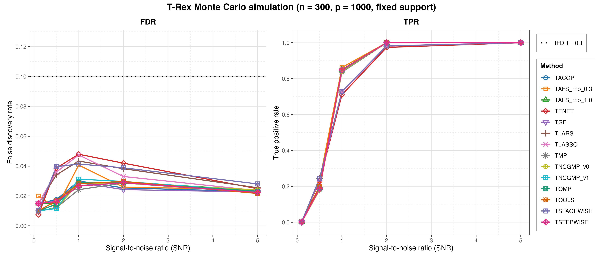
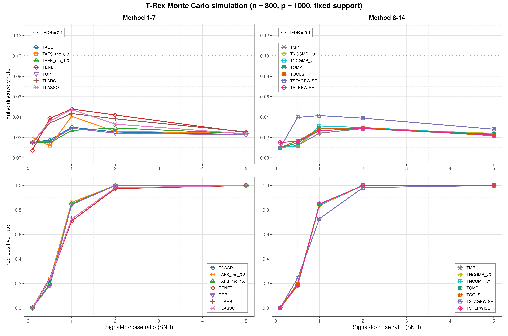

# Demo 02: Monte Carlo Simulation with Fixed Support

## Purpose

Evaluate the classical Terminating Random Experiments (T-Rex) false discovery rate (FDR) and true positive rate (TPR)
across a signal-to-noise ratio (SNR) sweep with a **fixed** true support, benchmarking all base solvers under a shared
data-generating process (DGP) and FDR target. The foundational empirical validation demo.

## Data-generating process

`dgp_gauss_snr` — independent and identically distributed (i.i.d.) Gaussian design, `y = X beta + eps` calibrated
to SNR. High-dimensional config: `n = 300`, `p = 1000`, `s = 10`, `tFDR = 0.1`. The true
support is drawn **once** before the loop via `make_support_random(s, p, seed = 24)`
and reused across every solver, SNR level, and Monte Carlo (MC) trial (it is not the first 10
features), and the coefficients are fixed at `beta_j = 1`. SNR sweep `{0.1, 0.5, 1.0, 2.0, 5.0}`,
`num_MC = 200` per solver x SNR.

The design columns are drawn independently, so the design carries no correlation
structure — the empirical column-correlation matrix is essentially the identity:


## What it computes

- `run_trex_02` runs the MC over `SOLVERS_DEFAULT` (the 14 shared base solvers:
  TLARS, TLASSO, TENET, TSTAGEWISE, TSTEPWISE, TOMP, TGP, TACGP, TMP, TAFS_rho_0.3,
  TAFS_rho_1.0, TNCGMP_v1, TNCGMP_v0, TOOLS) then over SNR.
- Base control: `K = 20`, `max_dummy_multiplier = 10`, `use_max_T_stop = TRUE`,
  `lloop_strategy = "STANDARD"`, `tloop_stagnation_stop = TRUE`,
  `tloop_max_stagnant_steps = 7`, `opt_threshold = 0.75`. Per-solver params are
  added by `.make_trex_ctrl`.
- Reports averaged FDR and TPR per solver x SNR (`track_L_T = FALSE`, so Avg L / Avg T
  are not computed here).

MC trials run in parallel over `num_cores` workers (first command-line argument, else
`TREX_NUM_WORKERS`, else 8).

## Results

`./generate_plots.sh` renders the tidy comma-separated values (CSV) file through the shared ggplot2 plotter
[`../trex_plt_utils.R`](../trex_plt_utils.R) into `simulation_results/plots/` as Portable Network Graphics (PNG) and
Portable Document Format (PDF) files. This port has no interactive `.html` output.

### Overview (all 14 solvers)

FDR and TPR versus SNR on a linear x-axis, every solver on one pair of panels:



*Left:* FDR stays far below the target `tFDR = 0.1` (black dotted line) at every
SNR level for every solver — the maximum over the whole table is only 0.0479
(TENET at SNR 1.0), and the least-angle regression (LARS) path solvers peak there while the greedy family
never exceeds 0.032, with TAFS_rho_0.3 (0.0407 at SNR 1.0) the one exception. *Right:* TPR climbs from
essentially zero at SNR 0.1 (0.0025 at best) to full recovery (1.0000) at SNR 5.0 for all 14 solvers. The
split at intermediate SNR is the usual one. At SNR 0.5 the LARS-path solvers
(TLARS/TLASSO/TENET/TSTAGEWISE, 0.230–0.245) lead the greedy family
(0.1805–0.1990, with TAFS_rho_0.3 level with TENET at 0.2300), and the ordering reverses
by SNR 1.0, where the greedy solvers reach 0.836–0.862 against 0.710–0.729 for
the LARS path. At SNR 2.0 every greedy solver is already at 1.0000 while the
LARS-path solvers sit at 0.974–0.983.

### Grouped 2x2 view (de-cluttered)

The same data with the solvers split into two halves (columns) and FDR/TPR on the
two rows, so each panel carries only ~7 curves. Both FDR panels share a y-scale:



## Running

```bash
Rscript R/trex_selector_methods/ad/trex_core/demo_trex_02_mc_sim_fixed_support/demo_trex_02_mc_sim_fixed_support.R
```

Results are written to this demo's own `simulation_results/` folder as a `.txt` table
and a tidy `.csv` (header `solver,metric,snr,value`), stem
`demo_trex_02_mc_sim_fixed_support_trex_results_n300_p1000_stagnation_window_7`.
Both files are re-saved after each completed solver (growing file), so an abort
mid-run keeps the solvers already finished. The script
sources `../../../support_generators.R`, `../../../simulation_utils.R`, and `../trex_sim_utils.R`.
