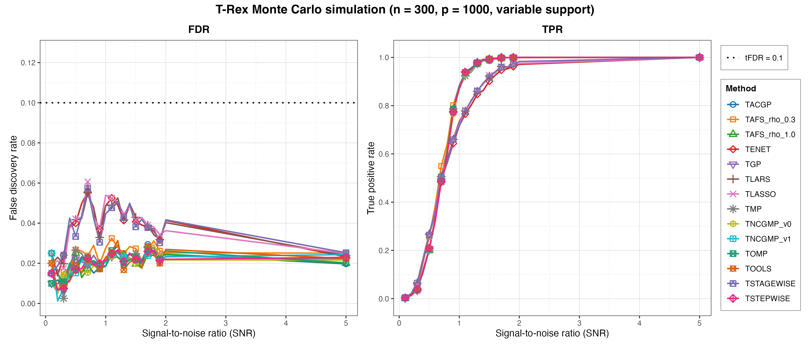
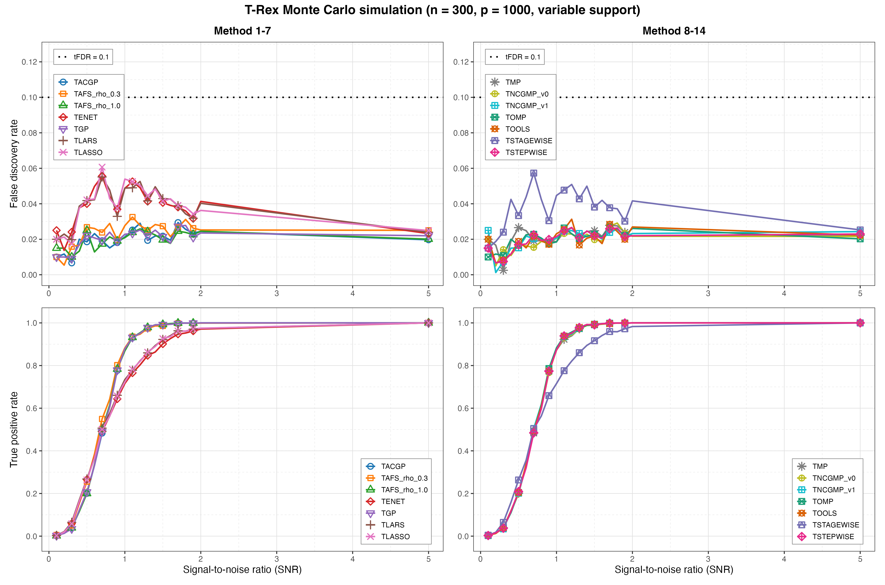

# Demo 03: Monte Carlo Simulation with Variable Support

## Purpose

Test robustness of classical Terminating Random Experiments (T-Rex) to the **location** of the active set. The support
indices are redrawn on every Monte Carlo (MC) trial while the cardinality stays fixed. Complements
the fixed-support study in Demo 02 and additionally tracks the dummy multiplier `L`
and stopping time `T`.

## Data-generating process

`dgp_gauss_snr` — independent and identically distributed (i.i.d.) Gaussian design, `y = X beta + eps` calibrated
to a signal-to-noise ratio (SNR). High-dimensional config: `n = 300`, `p = 1000`, `s = 10`, `tFDR = 0.1`. Each trial
redraws the support via `make_support_random(s, p, seed = trial_seed)`, and the coefficients
are fixed at `beta_j = 1` (`rnd_coef = FALSE`, while an isolated `rnorm(s)` stream is available
when `rnd_coef = TRUE`). Fine SNR grid `seq(0.1, 2.0, by = 0.1)` plus `5.0` (21 values),
`num_MC = 200` per solver x SNR.

Only the *location* of the active set varies. The design itself is unchanged from
Demo 02, with independent columns, so the empirical column-correlation matrix is
essentially the identity:


## What it computes

- `run_trex_03` runs the MC over the same 14 `SOLVERS_DEFAULT` base solvers as Demo 02,
  then over SNR.
- Base control: `K = 20`, `max_dummy_multiplier = 10`, `use_max_T_stop = TRUE`,
  `lloop_strategy = "HCONCAT"`, `tloop_stagnation_stop = TRUE`,
  `tloop_max_stagnant_steps = 5`.
- Reports the averaged false discovery rate (FDR), true positive rate (TPR), Avg L, and Avg T per solver x SNR
  (`track_L_T = TRUE`).

MC trials run in parallel over `num_cores` workers (first command-line argument, else
`TREX_NUM_WORKERS`, else 8).

## Results

`./generate_plots.sh` renders the tidy comma-separated values (CSV) file through the shared ggplot2 plotter
[`../trex_plt_utils.R`](../trex_plt_utils.R) into `simulation_results/plots/` as Portable Network Graphics (PNG) and
Portable Document Format (PDF) files. This port has no interactive `.html` output. Only the `FDR` and `TPR`
rows are plotted — the `AvgL` / `AvgT` rows stay in the `.txt` / `.csv` files.

### Overview (all 14 solvers)

FDR and TPR versus SNR on a linear x-axis over the fine 21-point grid, every
solver on one pair of panels:



*Left:* redrawing the support on every trial does not break FDR control — the
maximum over the entire table is 0.0607 (TLASSO at SNR 0.7), well under the target
`tFDR = 0.1` (black dotted line). The fine grid resolves a hump the coarse Demo 02
grid only hints at. The four least-angle regression (LARS) path solvers rise to 0.055–0.061 at SNR 0.7 and
then decay to 0.023–0.025 by SNR 5.0, while the greedy family stays flatter and
lower at every SNR from 0.4 to 2.0 (per-solver maxima 0.026–0.033, six of the ten reached at the top
of the fine grid at SNR 1.7–1.8 rather than at the hump). At SNR 5.0 both families meet at 0.020–0.025.
*Right:* with `num_MC = 200` the power curves are smooth — TLARS climbs from 0.0035 at SNR 0.1 to
0.9745 at SNR 2.0 and 1.0000 at SNR 5.0. The two families cross between SNR 0.7 and 0.8. The
LARS path leads below it and the greedy solvers lead above it (at SNR 1.0, TSTEPWISE 0.8735
against TLARS 0.7340).

### Grouped 2x2 view (de-cluttered)

The same data with the solvers split into two halves (columns) and FDR/TPR on the
two rows, so each panel carries only ~7 curves. Both FDR panels share a y-scale,
which makes the LARS-path hump and the flat greedy band directly comparable:



## Running

```bash
Rscript R/trex_selector_methods/ad/trex_core/demo_trex_03_mc_sim_variable_support/demo_trex_03_mc_sim_variable_support.R
```

Results are written to this demo's own `simulation_results/` folder as a `.txt` table
and a tidy `.csv` (header `solver,metric,snr,value`, with `FDR`/`TPR`/`AvgL`/`AvgT`
rows), stem `demo_trex_03_mc_sim_variable_support_trex_results_n300_p1000_stagnation_window_5`.
Both files are re-saved after each completed solver (growing file), so an abort
mid-run keeps the solvers already finished. The script sources
`../../../support_generators.R`, `../../../simulation_utils.R`, and
`../trex_sim_utils.R`.
