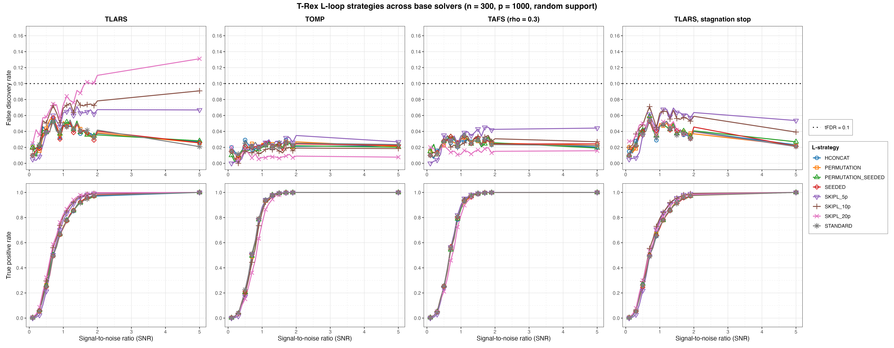
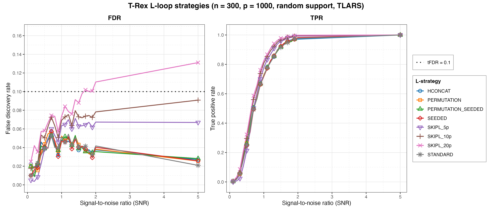
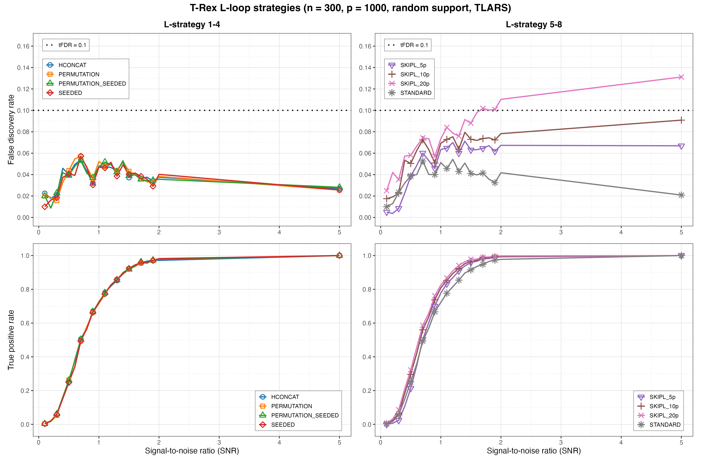
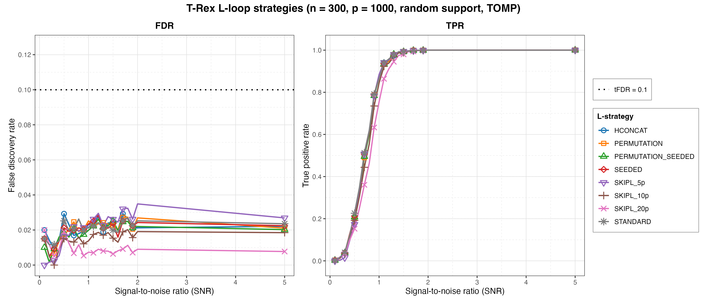
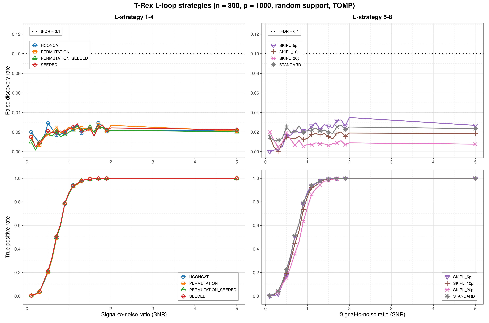
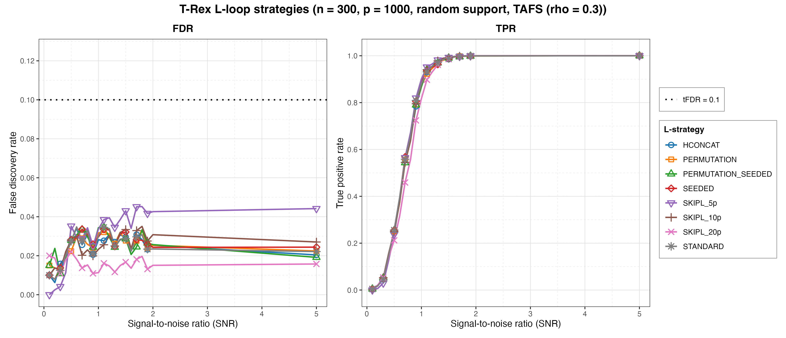
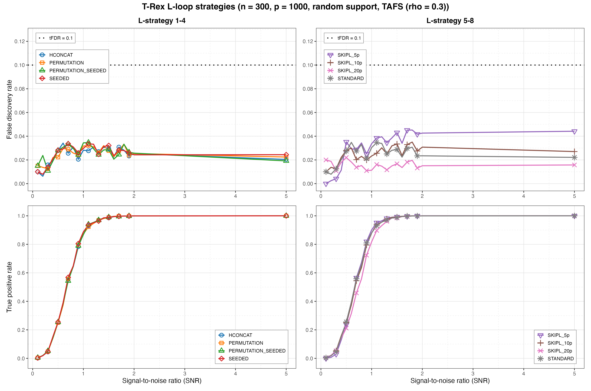
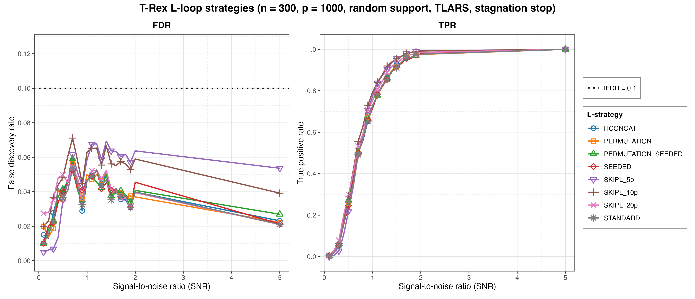
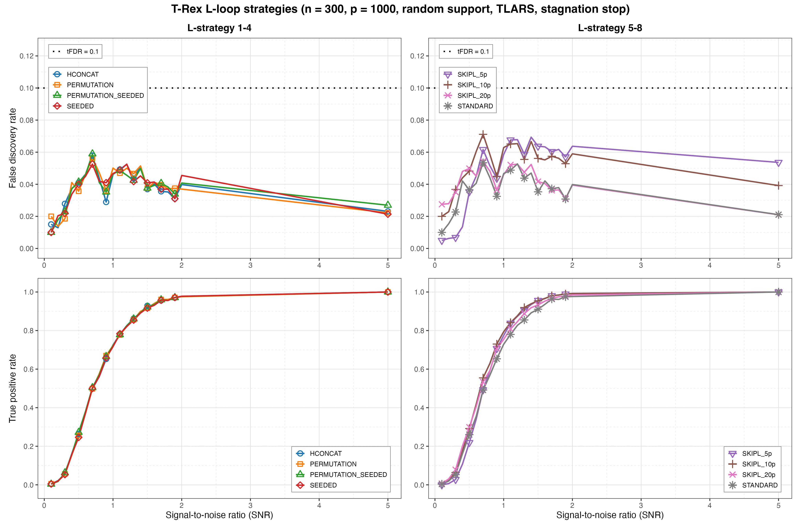

# Demo 04: L-Loop Strategy Comparison

## Purpose

Compare the Terminating Random Experiments (T-Rex) **L-loop strategies** — the mechanisms by which the dummy-variable
structure is generated/expanded across L-loop iterations — repeated across four
base solvers (**TLARS**, **TOMP**, **TAFS** with `rho_afs = 0.3`, and **TLARS_STAG**, which is TLARS with the T-loop
stagnation stop on). Shows how the strategy affects the false discovery rate (FDR), the true positive rate (TPR), and
the calibrated dummy multiplier `L` / stopping time `T`, and where the fixed-budget `SKIPL` FDR overshoot under TLARS
comes from.

## Data-generating process

`dgp_gauss_snr` — independent and identically distributed (i.i.d.) Gaussian design, `y = X beta + eps` calibrated
to a signal-to-noise ratio (SNR).
High-dimensional config: `n = 300`, `p = 1000`, `s = 10`, `tFDR = 0.1`, fixed
coefficients `beta_j = 1`. The support is a random size-`s` subset redrawn per trial
via `make_support_random(s, p, seed = trial_seed)` (the `block_support = TRUE`
contiguous-block variant is available but its call is commented out). SNR grid
`seq(0.1, 2.0, by = 0.1)` plus `5.0` (21 values), `num_MC = 200` per strategy x SNR.

The design is the suite's shared one — independent columns, so the empirical
column-correlation matrix is essentially the identity, and every effect below is
attributable to the dummy machinery rather than to design correlation:


## Strategies compared

`L_STRATEGIES` — **8 rows** (matches the 8-row reference study):

- STANDARD — fresh i.i.d. dummy matrix each L-loop iteration.
- HCONCAT — horizontally concatenated dummy columns.
- PERMUTATION — re-use the stored base dummy matrix via deterministic row
  permutations per experiment.
- PERMUTATION_SEEDED — seed-derived base + row permutations, nothing stored
  (bit-identical to PERMUTATION for the same seed).
- SEEDED — seed-derived i.i.d. draws per L-loop step, nothing stored (the storage-free twin of STANDARD).
- SKIPL_5p / SKIPL_10p / SKIPL_20p — skip the L-loop, fixed
  `L = max_dummy_multiplier * p` at 5p / 10p / 20p.

(The former `ONDEMAND` / `PERMUTATION_ONDEMAND` strategy names, and before
them `DIRECT` / `PERMUTATION_DIRECT`, were renamed to `SEEDED` /
`PERMUTATION_SEEDED`, and the old names are no longer accepted. The C++, Python and
R demos all use the current names.)

The solver sweep (`SOLVERS`) is the outer loop, and one `.txt` + `.csv` file pair is
written per solver. Shared control per solver x strategy: `K = 20`,
`use_max_T_stop = TRUE`, `opt_threshold = 0.75`, `tloop_max_stagnant_steps = 5`,
`parallel_rnd_experiments = FALSE`, `use_memory_mapping = FALSE`, `lloop_strategy` and
`max_dummy_multiplier` swept. The `tloop_stagnation_stop` option is left unset (AUTO — the
per-solver-family default, off for TLARS and on for TOMP and TAFS), except for TLARS_STAG, which sets it to `TRUE`
with the same window of 5. Reports averaged FDR, TPR, Avg L, Avg T per strategy
x SNR (`track_L_T = TRUE`). Monte Carlo (MC) trials run in parallel over
`num_cores` workers (first command-line argument, else `TREX_NUM_WORKERS`, else 8).

## Results: the fixed-budget FDR overshoot comes from the missing stagnation stop

At `SNR = 5` the four solvers separate sharply. `Avg T` is the calibrated
stopping time, `Avg L` the realized dummy multiplier:

| Strategy | `L` | TLARS `T` | TLARS FDR | TOMP `T` | TOMP FDR | TAFS `T` | TAFS FDR | TLARS_STAG `T` | TLARS_STAG FDR |
| --- | --- | --- | --- | --- | --- | --- | --- | --- | --- |
| STANDARD (adaptive) | 1p | 4.8 | 0.021 | 5.7 | 0.024 | 4.8 | 0.022 | 4.3 | 0.021 |
| SKIPL_5p | 5p | 25.2 | 0.067 | 6.1 | 0.027 | 6.3 | 0.044 | 7.1 | 0.054 |
| SKIPL_10p | 10p | 78.5 | 0.091 | 6.0 | 0.018 | 6.2 | 0.027 | 7.1 | 0.039 |
| SKIPL_20p | 20p | 145.9 | **0.131** | 6.0 | 0.008 | 6.1 | 0.016 | 7.1 | 0.021 |

TPR is 1.0 everywhere at this SNR, so the differences are pure false-discovery
cost. Only **TLARS** breaches `tFDR = 0.1`, and only once the L-loop is skipped
with the largest fixed budget. Under TOMP, TAFS and TLARS_STAG a larger `SKIPL` budget gives a *lower* FDR, not a
higher one. TLARS_STAG walks the same least-angle regression (LARS) path as TLARS, so the overshoot is not a property of
the LARS path. It comes from TLARS running without the stagnation stop. R draws its own random numbers from the
same seeds as the C++ demo, so these numbers agree with the C++ run within Monte Carlo noise, not exactly.

The cross-solver grid renders the same conclusion over the full SNR sweep — a 2x4
layout, rows = metric (FDR / TPR), columns = base solver (TLARS / TOMP / TAFS / TLARS with the stagnation stop),
with all eight L-loop strategies drawn in every panel. Colours are keyed to the
strategy, so a strategy can be tracked across solvers. The four FDR panels share
one y-scale and the four TPR panels share `[0, 1]`, so the columns are directly
comparable:



Reading the FDR row left to right, only the **TLARS** panel has curves that reach
the `tFDR = 0.1` line at all. There the five adaptive strategies (STANDARD,
HCONCAT, PERMUTATION, PERMUTATION_SEEDED, SEEDED) form a single tight band that
humps at SNR 0.7 (0.053–0.057) and then falls away to 0.021–0.028 at SNR 5.0.
The three `SKIPL` levels, in contrast, fan out in ascending order of budget. `SKIPL_5p`
stays under the line throughout (maximum 0.071 at SNR 1.4), `SKIPL_10p` tracks
above the adaptive band and stays under the line as well (0.091 at SNR 5.0), and
`SKIPL_20p` crosses it first at SNR 1.7 (0.102) and climbs to 0.131. In the
**TOMP** and **TAFS** panels the eight curves stay bunched near the bottom —
nothing exceeds 0.035 (TOMP, `SKIPL_5p` at SNR 2.0) or 0.045 (TAFS, `SKIPL_5p` at
SNR 1.8) anywhere on the grid — and the budget ordering *reverses*. At SNR 5.0 a
larger fixed `L` gives a *lower* FDR (TOMP 0.027 / 0.018 / 0.008 and TAFS
0.044 / 0.027 / 0.016 for 5p / 10p / 20p). The **TLARS_STAG** panel looks like the greedy ones, not like TLARS.
Its adaptive band matches the TLARS one (0.053–0.059 at SNR 0.7), while the `SKIPL` levels never exceed 0.071
(`SKIPL_10p` at SNR 0.7) and end in the same reversed order, 0.054 / 0.039 / 0.021 at SNR 5.0.

The TPR row shows why the FDR differences are the whole story at high SNR. Every strategy under every solver
reaches 1.0 by SNR 5.0, and the clearest power cost is `SKIPL_20p` lagging
the field through the mid-SNR range under the two greedy solvers (at SNR 0.9,
TOMP 0.633 and TAFS 0.724 against ≈ 0.78–0.81 for the adaptive strategies).
Under TLARS the same budget is instead *ahead* on power (0.762 against 0.663–0.670 at SNR 0.9), which is the
same deeper path that costs it the FDR control. TLARS_STAG gives part of that lead back (`SKIPL_20p` TPR 0.754
instead of 0.826 at SNR 1.0), and the gap closes again at high SNR. The adaptive strategies reach the same FDR and
TPR with and without the stop, at most 0.011 in FDR and 0.032 in TPR apart, which is Monte Carlo noise.

Library `09debc6` made SEEDED the storage-free twin of STANDARD. Its average `L` over the SNR grid under TLARS fell
from 3.55 to 3.18, next to STANDARD's 3.20, while its FDR and TPR stayed within Monte Carlo noise. This run also
brings in the corrected estimate of the false discovery proportion (FDP) of library `415484d`, which took `SKIPL_10p`
under TLARS from an FDR of 0.102 and `T` of 84.6 to 0.091 and 78.5, as it did in the C++ demo. The trial data are
seeded and the selector's dummies are not, so the other rows also move a little from run to run.

### Mechanism 1 — a larger dummy budget lets the T-loop run deeper

The T-loop stops when the dummy-based FDP estimate reaches the target. That
estimate rests on the exchangeability of the dummies with the null predictors.
If $T$ of the $L \cdot p$ dummies have entered the path, the expected number of
null *originals* that entered is

```math
\mathbb{E}[V] \;\approx\; T \cdot \frac{p - s}{L \cdot p},
```

so the estimated FDP cost of one dummy inclusion falls like $1/L$. Fixing the
budget at 20p instead of letting the L-loop choose it makes each dummy inclusion
roughly twenty times cheaper in the estimate, and the T-loop can therefore run
much further before it is stopped. That is exactly what the data shows. The
calibrated stopping time grows in step with the budget, `T = 5` (adaptive)
→ 25 → 79 → 146, while the adaptive L-loop converges to `Avg L ≈ 1.1`, i.e.
$L \cdot p \approx p$ dummies. This part is arithmetic, not yet an error — the
estimate only becomes wrong at the depth it unlocks, and only when nothing else stops the T-loop first.

### Mechanism 2 — at that depth the vote-level estimate loses its footing

Dummies are drawn **once per random experiment** $k = 1, \dots, K$ (one
$n \times L p$ matrix per experiment) before selection starts, and the T-loop then
merely varies the termination threshold over the already-computed path. Across
the $K$ experiments the dummy matrix changes, but $\boldsymbol{X}$ and
$\boldsymbol{y}$ do not — and that is where the symmetry between dummies and
null predictors ends:

- A **dummy column** exists in exactly one experiment. Its relative occurrence
  is bounded by $1/K$ by construction, and its inclusions are genuinely
  independent across experiments.
- A **null predictor** is the same column, with the same sample correlation to
  $\boldsymbol{y}$, in every experiment. If that correlation happens to be large
  it is large *every time*, so its inclusions across $k$ are strongly positively
  correlated rather than independent Bernoulli draws.

Selection is by vote — a predictor is kept when its relative occurrence
$\Phi_T(j)$ exceeds the threshold $v$ — so what matters is the distribution of
$\Phi_T$ over the null predictors, and the dummy statistics model it as
independent draws. The real distribution is over-dispersed. Most nulls sit near
zero while a few unlucky ones sit near one.

At the shallow stopping times the L-loop produces ($T \approx 5$) this is
harmless, because essentially no null predictor enters the path at all and there
is nothing to accumulate. At $T = 146$ roughly
$146 \cdot 990 / 20{,}000 \approx 7$ null predictors enter *per experiment*, drawn
again and again from the same unlucky tail, and a couple of them reach
$\Phi_T \approx 1$ and survive the vote. The observed FDR of 0.131 at TPR 1.0
corresponds to about 1.5 false discoveries on top of the 10 true ones.

Two corollaries follow, both visible in the data:

- **TOMP and TAFS are immune because they never get deep.** Their `Avg T`
  saturates near 6 regardless of the budget (TOMP 6.1 / 6.0 / 6.0 and TAFS 6.3 / 6.2 / 6.1 at SNR 5), since the
  tri-state `tloop_stagnation_stop = AUTO` resolves to `TRUE` for the greedy
  solver family and to `FALSE` for TLARS. TOMP and TAFS halt once the selected set stops
  changing, while TLARS keeps going until the FDP estimate alone stops it. TLARS_STAG shows that the stop, not the
  solver, is the brake. With the stop forced on, the same LARS path never runs past `Avg T` 12.8 and ends at 7.1
  at SNR 5, and its `SKIPL_20p` FDR drops from 0.131 to 0.021.
- **More signal makes it worse.** Since $\widehat{FDP} = \hat{V} / R$, a larger
  true-positive count inflates the denominator, so the estimate stays under
  target longer and the T-loop runs further. For TLARS at 20p the stopping time
  climbs 51 → 87 → 142 → 146 as SNR goes 0.1 → 1 → 2 → 5, with FDR tracking it
  0.025 → 0.074 → 0.110 → 0.131. The adaptive strategies show the healthy
  opposite, with `T` below 10 at every SNR and FDR *falling* from the SNR 0.7 hump to SNR 5.

### Reading

This is an empirical vindication of the L-loop. Its job is to find the
*smallest* dummy budget at which the T-loop can still terminate, which keeps the
path shallow and the estimator inside the regime where per-experiment
exchangeability also governs the vote. Over-provisioning dummies does not buy
safety — it removes the brake, unless the stagnation stop supplies one. `SKIPL` remains a legitimate (and cheaper)
shortcut whenever the stagnation stop is on, as it is by default for the greedy solvers and by choice for
TLARS_STAG. Without the stop a fixed budget must stay small.

### Per-solver figure sets

`./generate_plots.sh` also renders, for each base solver, the standard overview
(all eight strategies on one FDR | TPR pair, linear x-axis) and a
de-cluttered grouped 2x2 view that splits the strategies across two columns. In the
comma-separated values (CSV) output the "solver" column holds the strategy name, so the strategies are the legend.
All figures go to `simulation_results/plots/` as Portable Network Graphics (PNG) + Portable Document Format (PDF)
files (this port renders no interactive `.html` page).

**TLARS** — the only panel where the mechanism above is visible. The five
adaptive strategies overlap almost exactly, while the three `SKIPL` levels peel off
upwards in budget order and keep rising with SNR instead of decaying:





**TOMP** — all eight strategies collapse onto one band below 0.035, and the two
larger `SKIPL` levels sit at the *bottom* of it rather than the top:





**TAFS** (`rho_afs = 0.3`) — the same picture as TOMP, with `SKIPL_5p` the one
mildly elevated row (maximum 0.045 at SNR 1.8, still under half the target):





**TLARS_STAG** (TLARS with the stagnation stop on) — the LARS path with the brake. The adaptive strategies match the
TLARS panel, while the three `SKIPL` levels sit somewhat above them at mid SNR (at most 0.071) and fall back by
SNR 5.0 instead of rising:





## Running

```bash
Rscript R/trex_selector_methods/ad/trex_core/demo_trex_04_mc_sim_lloop_strategies/demo_trex_04_mc_sim_lloop_strategies.R
```

Results are written to this demo's own `simulation_results/data/` folder as a `.txt` table
and a tidy `.csv` (the "solver" column holds the strategy name), stems
`demo_trex_04_lloop_strategies_results_n300_p1000_{tlars,tomp,tafs,tlars_stag}_random_support`.
The script sources `../../../support_generators.R`, `../../../simulation_utils.R`, and
`../trex_sim_utils.R`.
