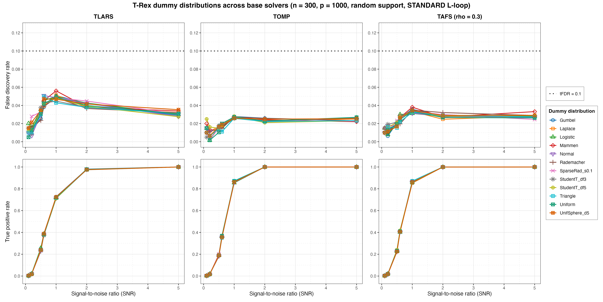
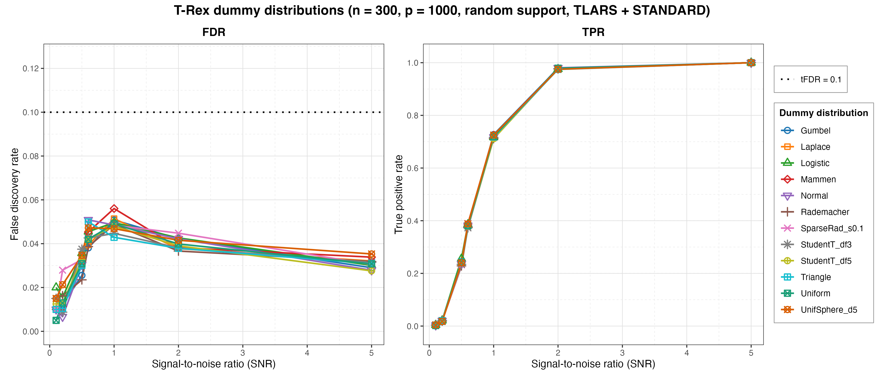
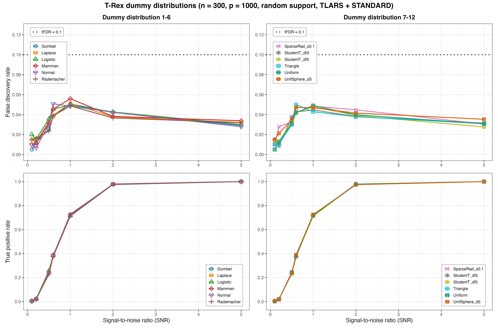
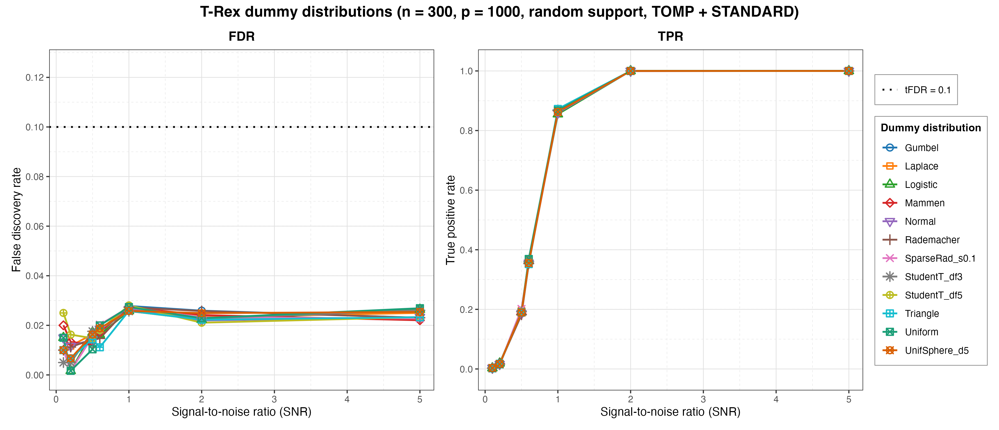
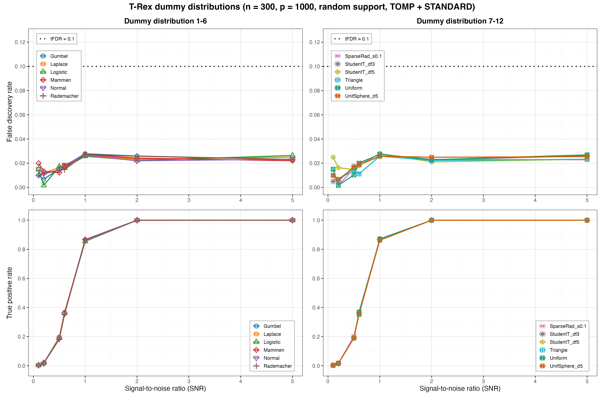
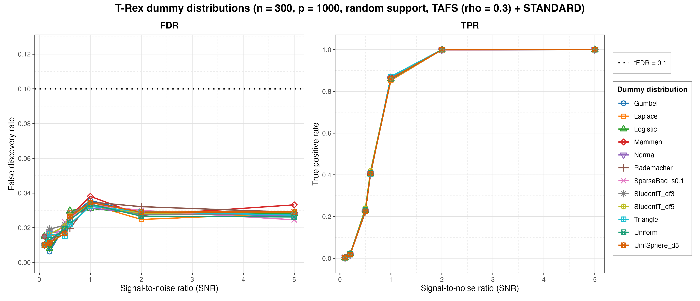
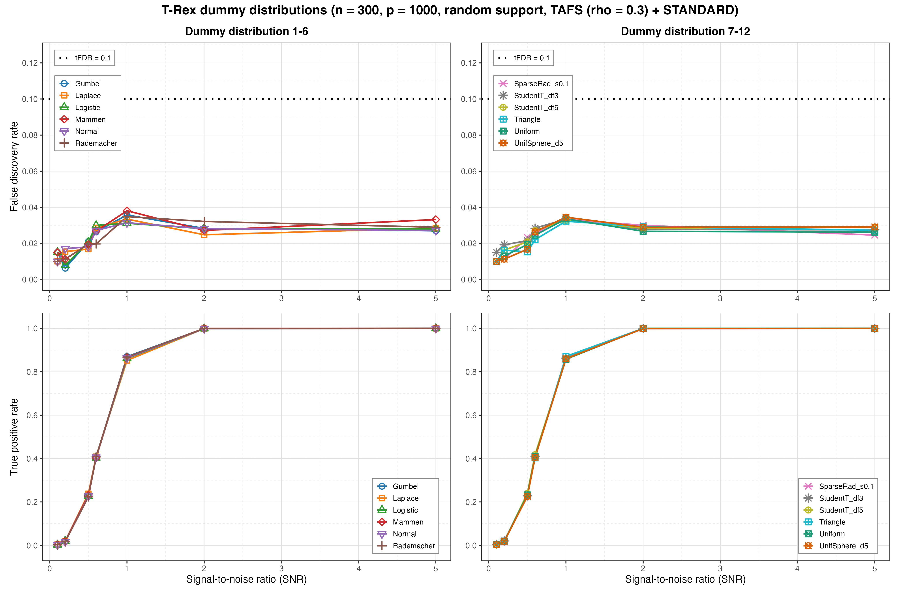

# Demo 05: Dummy Distribution Comparison

## Purpose

Compare the Terminating Random Experiments (T-Rex) **dummy distributions** — the distribution from which the injected
dummy (null) variables are drawn — across three base solvers
(**TLARS** — equiangular least-angle regression (LARS) path, and **TOMP** and **TAFS** with `rho_afs = 0.3` —
greedy forward selection), with the L-loop strategy fixed at **STANDARD**. Since dummies are centered and
L2-normalized before entering the solver, their *scale* is immaterial, so the demo probes
whether the *shape* (tail weight, discreteness, skewness, sparsity, cross-column
dependence) affects the false discovery rate (FDR), the true positive rate (TPR), and the calibrated dummy multiplier
`L` / stopping time `T`.

## Data-generating process

`dgp_gauss_snr` — independent and identically distributed (i.i.d.) Gaussian design, `y = X beta + eps` calibrated
to a signal-to-noise ratio (SNR).
High-dimensional config: `n = 300`, `p = 1000`, `s = 10`, `tFDR = 0.1`, fixed
coefficients `beta_j = 1`. The support is a random size-`s` subset redrawn per trial
via `make_support_random(s, p, seed = trial_seed)` (the `block_support = TRUE`
contiguous-block variant is available but its call is commented out). SNR grid
`{0.1, 0.2, 0.5, 0.6, 1.0, 2.0, 5.0}` (7 values, mirrors the current C++ grid),
`num_MC = 200` per solver x distribution x SNR.

The *design* is the suite's shared one and stays fixed across the sweep —
independent columns, empirical column-correlation essentially the identity — so
the only thing varying below is the distribution of the injected dummies:


The solver sweep (`SOLVERS`) is the outer loop, and one `.txt` + `.csv` file pair is
written per solver, with the lowercased solver name in the stem
(`..._{tlars,tomp,tafs}_random_support`).

## Distributions compared

`DISTRIBUTIONS` — **12 rows**, each built with `trex_dummy_distribution()` and passed
to `trex_control(dummy_distribution = ...)`:

- Normal — N(0, 1), the reference choice.
- Uniform — U(-sqrt(3), sqrt(3)), bounded with light tails.
- Rademacher — {-1, +1} equiprobable, discrete two-point.
- StudentT_df3 / StudentT_df5 — heavy tails (unit-variance scaled).
- Laplace — double exponential with heavier-than-normal tails.
- Gumbel — extreme-value, skewed (centered at 0).
- Triangle — bounded and symmetric, (-sqrt(6), 0, sqrt(6)).
- Logistic — tail weight between normal and Laplace.
- Mammen — asymmetric golden-ratio two-point distribution.
- SparseRad_s0.1 — constrained sparse Rademacher, sparsity `s = 0.1`.
- UnifSphere_d5 — uniform on the unit 5-sphere, so consecutive 5-column groups are
  dependent (norm constraint), a deliberate probe of the exchangeability axis.

**Note on UniformSphere**: the library requests dummies in multiples of `p`, so the
sphere dimension must divide `p`. The default `dim = 3` would throw at `p = 1000`,
hence `dim = 5`.

Shared control per solver x distribution: `K = 20`, `max_dummy_multiplier = 10`,
`use_max_T_stop = TRUE`, `opt_threshold = 0.75`, `lloop_strategy = "STANDARD"`,
`tloop_max_stagnant_steps = 5`, `parallel_rnd_experiments = FALSE`, `use_memory_mapping = FALSE`,
`dummy_distribution` swept. The `tloop_stagnation_stop` option is left unset (AUTO — the
per-solver-family default). Reports averaged FDR, TPR, Avg L, Avg T per distribution x
SNR (`track_L_T = TRUE`). Monte Carlo (MC) trials run in parallel over `num_cores`
workers (first command-line argument, else `TREX_NUM_WORKERS`, else 8).

## Expected pattern

The C++ reference run shows all i.i.d. unit-variance rows FDR-equivalent at or below
`tFDR` (isolated exceedances at very low SNR are small-`num_MC` noise), statistically
indistinguishable TPR, and no systematic deviation even for the dependent
UnifSphere_d5 rows.

## Results

This R run reproduces that pattern. `./generate_plots.sh` renders a cross-solver
comparison grid plus one figure set per base solver through the shared ggplot2
plotter [`../trex_plt_utils.R`](../trex_plt_utils.R), into
`simulation_results/plots/` as Portable Network Graphics (PNG) + Portable Document Format (PDF) files (this port
renders no interactive `.html` page).

### Cross-solver comparison grid

The headline figure — a 2x3 layout, rows = metric (FDR / TPR), columns = base
solver (TLARS / TOMP / TAFS), with all twelve dummy distributions drawn in every
panel. Colours are keyed to the distribution, so a distribution can be tracked
across solvers. The three FDR panels share one y-scale and the three TPR panels
share `[0, 1]`:



Within each column the twelve curves are essentially one thick line. At SNR 1.0
— at or next to the FDR peak for every solver — the entire twelve-distribution
FDR spread is 0.0429 (Triangle) to 0.0560 (Mammen) under TLARS, 0.0257
(StudentT_df3) to 0.0280 (StudentT_df5) under TOMP, and 0.0312 (Logistic) to 0.0381
(Mammen) under TAFS. Every value is well under the target `tFDR = 0.1`, and the
three solver ranges do not overlap, so the solver sets the level while the distribution adds a spread of at most
0.013. TPR at the same
point is equally tight (TLARS 0.7115–0.7270, TOMP 0.8550–0.8725, TAFS 0.8525–0.8710),
and every distribution reaches 1.0000 by SNR 5.0 under all three solvers. The
*level* is solver-dependent — TLARS carries the familiar FDR hump around SNR
0.6–1.0 while the greedy TOMP / TAFS run flatter and lower — but the choice of
dummy distribution moves nothing systematically, not even the deliberately
dependent **UnifSphere_d5** row (TLARS 0.0469, TOMP 0.0258, TAFS 0.0345 at SNR
1.0, all inside the range of the eleven independent rows). Given that dummies are centered and L2-normalized
before entering the solver, the demo concludes that the dummy distribution is
effectively a free parameter and that the Normal default is justified.

Note that the ranking of distributions is *not* stable across solvers — the
TLARS minimum (Triangle) is not the TOMP minimum (StudentT_df3) or the TAFS
minimum (Logistic), and the TOMP maximum (StudentT_df5) sits in the lower half under TLARS. Mammen tops both
TLARS and TAFS at SNR 1.0 but is mid-pack under TOMP and in the lower half under TLARS at SNR 2.0. With
`num_MC = 200` the residual spread is Monte Carlo noise, not an ordering.

### Per-solver figure sets

The usual overview (all twelve distributions on one FDR | TPR pair, linear
x-axis) plus a de-cluttered grouped 2x2 view that splits the distributions across
two columns. In the comma-separated values (CSV) output the "solver" column holds the distribution name, so the
distributions are the legend.

**TLARS**:





**TOMP**:





**TAFS** (`rho_afs = 0.3`):





The grouped views are the ones to read when the overview curves overlap. With the
twelve rows split across two columns on a shared y-scale, "no systematic
deviation" is easier to confirm than on a single crowded panel.

## Running

```bash
Rscript R/trex_selector_methods/ad/trex_core/demo_trex_05_mc_sim_dummy_distributions/demo_trex_05_mc_sim_dummy_distributions.R
```

Results are written to this demo's own `simulation_results/data/` folder as a `.txt` table
and a tidy `.csv` (the "solver" column holds the distribution name), stems
`demo_trex_05_dummy_distributions_results_n300_p1000_{tlars,tomp,tafs}_random_support`. The script sources
`../../../support_generators.R`, `../../../simulation_utils.R`, and `../trex_sim_utils.R`.
