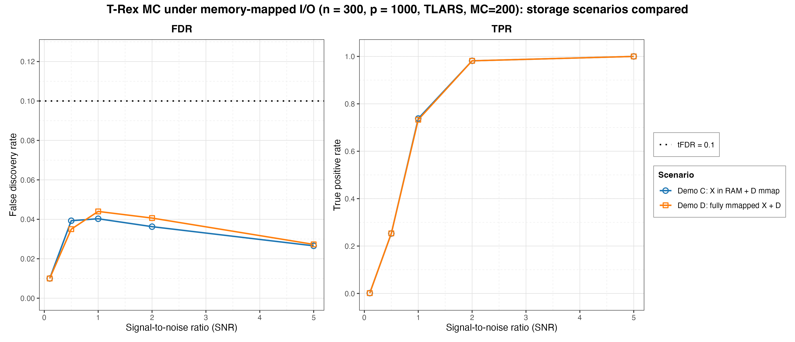
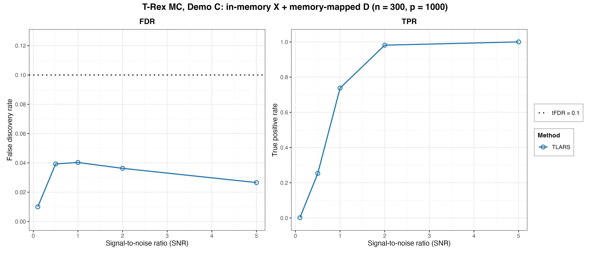
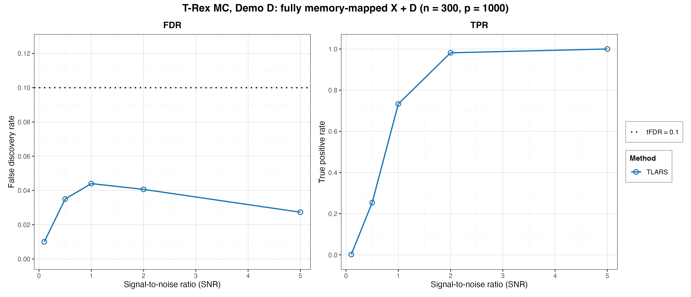

# Demo 07: Monte Carlo Simulation with Memory-Mapped Data

## Purpose

Validate Terminating Random Experiments (T-Rex) performance under memory-mapped (mmap) input/output (I/O) over many
Monte Carlo (MC) trials, extending the single-run patterns of Demo 06. Confirms that the storage medium is
transparent to the algorithm, leaving the false discovery rate (FDR) and the true positive rate (TPR) unchanged, and
that the per-trial mmap file lifecycle is exception-safe.

## Data-generating process

`dgp_gauss_snr` — independent and identically distributed (i.i.d.) Gaussian design, `y = X beta + eps` calibrated
to a signal-to-noise ratio (SNR).
High-dimensional config: `n = 300`, `p = 1000`, `s = 10`, `tFDR = 0.1`. The true
support is drawn once and shared across all trials via
`make_support_random(s, p, seed = 24)`, and the coefficients are fixed at `beta_j = 1`. SNR sweep
`{0.1, 0.5, 1.0, 2.0, 5.0}`, TLARS only. `num_MC = 200` for both parts. Control via
`make_mmap_trex_ctrl(solver = "TLARS", tloop_max_stagnant_steps = 7,
parallel_rnd_experiments = FALSE, opt_threshold = 0.75)`.

Both parts draw from the suite's shared i.i.d. Gaussian family — independent
columns, so the empirical column-correlation matrix is essentially the identity, and
only the storage medium differs between them:


## Parts

- Part A (`run_part_a`, header "Part C") — MC with in-memory `X` + `use_memory_mapping = TRUE`,
  which verifies the D-mmap + solver-serialization pipeline yields stable FDR/TPR over many runs.
- Part B (`run_part_b`, header "Part D") — MC with memory-mapped `X` + `use_memory_mapping = TRUE`.
  Here `.run_mc_trex_full_mmap` writes each trial's `X` to its own temporary mmap file and
  runs the selector **inside** the `execute_with_temp_mmap` callback (the backing file
  is unlinked on return, so the view must not escape). Each worker is its own R process
  with its own temp folder, so trials have no file conflicts (mirrors the C++ Resource
  Acquisition Is Initialization (RAII) `MmapFileGuard`).

Both report averaged FDR, TPR, Avg L, Avg T per SNR (`track_L_T = TRUE`). MC trials run
in parallel over `num_cores` workers (first command-line argument, else `TREX_NUM_WORKERS`, else 8).

## Results

`./generate_plots.sh` renders both comma-separated values (CSV) files through the shared ggplot2 plotter
[`../trex_plt_utils.R`](../trex_plt_utils.R) into `simulation_results/plots/` as Portable Network Graphics (PNG) and
Portable Document Format (PDF) files. This port has no interactive `.html` output. Only the `FDR` and `TPR`
rows are plotted — the `AvgL` / `AvgT` rows stay in the `.txt` / `.csv` files.

### Storage scenarios overlaid (headline figure)

Both parts run the identical sweep, so they belong on one pair of axes. The
question is whether the storage medium is visible in the *results*, and two curves
lying on top of each other answer it. The scenario takes the place of the "solver"
row the other demos sweep (the plotter's `--overlay` mode):



*Left:* FDR stays far below the target `tFDR = 0.1` under both pipelines across
the whole grid, peaking at only 0.0403 (Part C) / 0.0440 (Part D) at SNR 1.0 and
falling back to 0.0266 / 0.0273 at SNR 5.0. *Right:* the power curves are
indistinguishable — TPR climbs from 0.0015 in both at SNR 0.1 to
1.0000 in both at SNR 5.0, passing through 0.7380 / 0.7330 at SNR 1.0.

Across the five SNR levels the two pipelines never differ by more than 0.0044 in
FDR (at SNR 2.0) or 0.0050 in TPR (at SNR 1.0) — Monte Carlo noise at
`num_MC = 200`, not a systematic effect. This is the result the demo exists to
show. Memory-mapping `X` and `D` buys its memory savings without moving the
statistics. The curves are *not* expected to coincide exactly — the two scenarios
drive different data paths and the selector runs with `seed = -1` (hardware
entropy), so their trials are not bit-identical.

### Per-scenario overviews

The same data one part at a time, for reading a single pipeline's numbers off a
figure. A single TLARS row per part leaves the grouped 2x2 view nothing to
de-clutter, so it is skipped:





Both reproduce the Demo 02 TLARS row (fixed support, same SNR grid, same
stagnation window) to within Monte Carlo noise, which is the cross-check that the
mmap pipeline changes nothing statistically.

## Running

```bash
Rscript R/trex_selector_methods/ad/trex_core/demo_trex_07_mc_sim_mmap/demo_trex_07_mc_sim_mmap.R
```

Each part writes a `.txt` table and a tidy `.csv` (header `solver,metric,snr,value`) to
this demo's own `simulation_results/` folder, stems `d03_trex_mmap_demo_c_n300_p1000_sw7`
and `d03_trex_mmap_demo_d_n300_p1000_sw7`. The script sources `../../../support_generators.R`,
`../../../simulation_utils.R`, and `../trex_sim_utils.R`.
