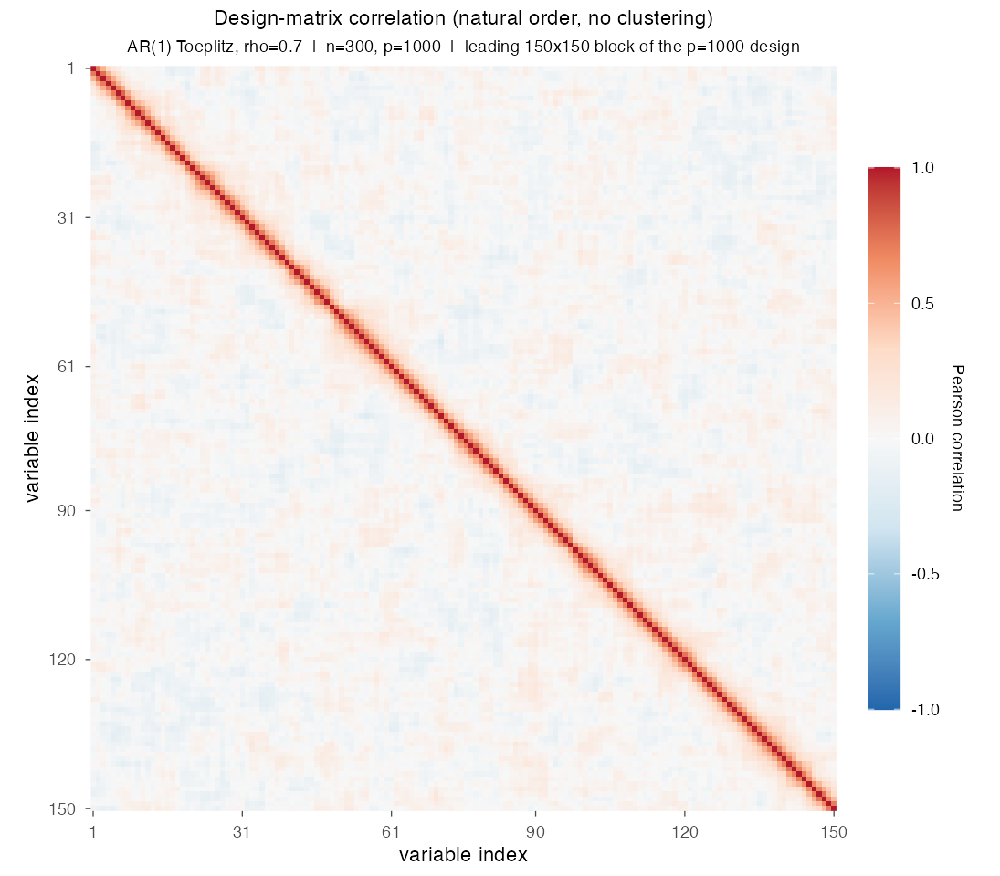
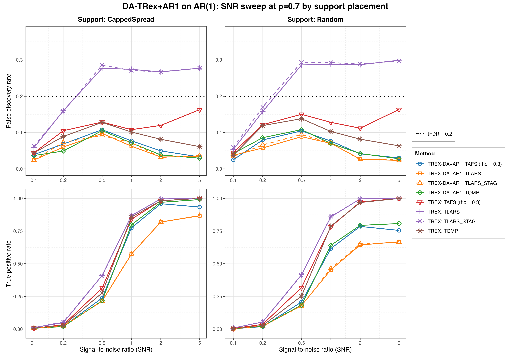
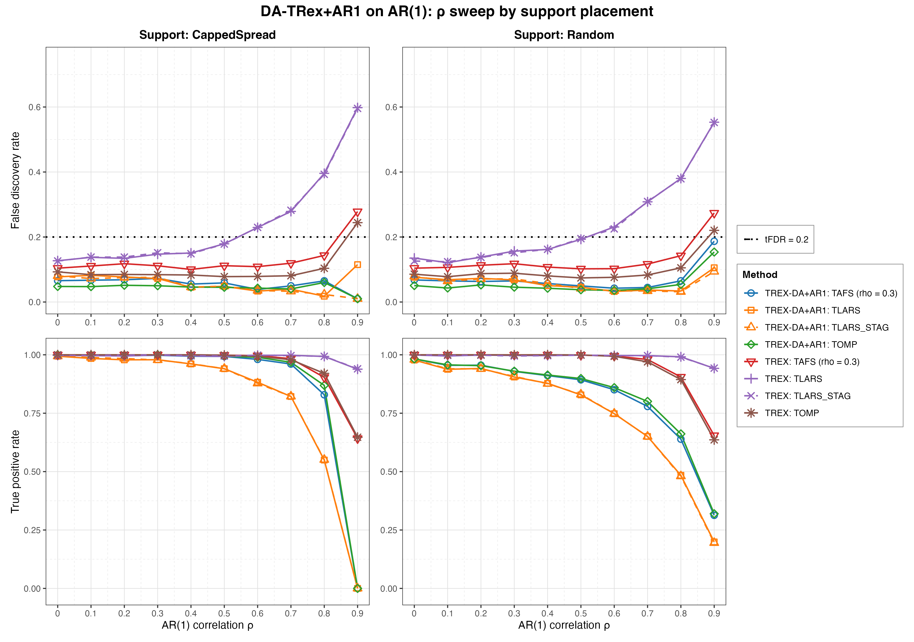
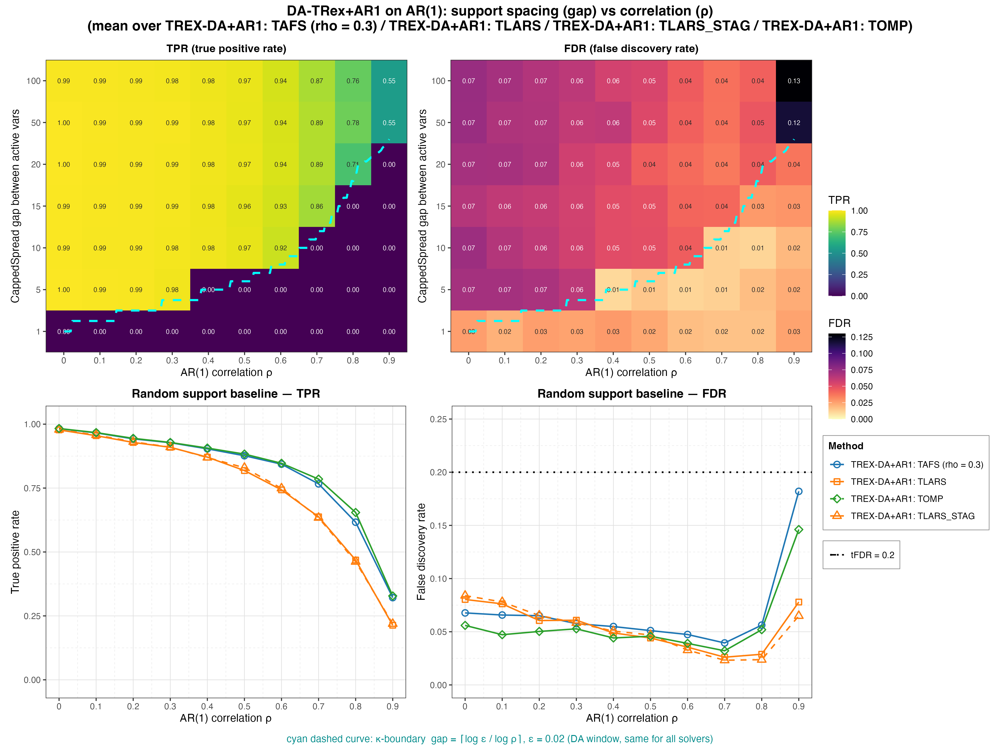

# Demo 01: DA-TRex+AR1 on AR(1) Toeplitz Data

The following demo presents Monte Carlo (MC) results for **DA-TRex+AR1**, the dependency-aware (DA) Terminating
Random Experiments (T-Rex) selector (DA-TRex) for autoregressive (AR) dependence of order one, AR(1). It compares the
selector with the **classical (no-DA) T-Rex selector** on AR(1) Toeplitz data ($n=300$, $p=1{,}000$, $s=10$,
amplitude $3.0$, target false discovery rate (FDR) $\mathrm{tFDR}=0.2$, $K=20$ random experiments, $\mathrm{MC}=200$
per grid point, and solvers TLARS / TAFS / TOMP, plus TLARS_STAG, TLARS with the T-loop stagnation stop, see the
[C++ suite README](../../../../../cpp/trex_selector_methods/ad/trex_da/README.md)).

R port of the C++ demo
[cpp/trex_selector_methods/ad/trex_da/demo_trex_da_01_mc_sim_ar1](../../../../../cpp/trex_selector_methods/ad/trex_da/demo_trex_da_01_mc_sim_ar1/README.md)
with the same data-generating process (DGP), control parameters, sweep axes, console summaries and result-file
naming. The numbers below are this R run's own results. R uses its own random number streams, so they differ from the
C++ and Python numbers within Monte Carlo noise, not exactly. A cell-by-cell comparison with the C++ run (200 trials
per cell on both sides, $z$ = difference divided by the combined Monte Carlo standard error) finds $|z| > 3$ in 5 of
the 1,152 FDR and true positive rate (TPR) cells of this demo. Over the whole DA-TRex suite it is 29 of 9,344 cells
(0.31 %), the rate that noise alone produces.

The greedy solvers use *exchangeable tie-breaking* (`exch_tie_alpha = 0.25` for TAFS/TOMP, `0` for TLARS and
TLARS_STAG). Look up `Exchangeable_Tie_Breaking_DA_TRex.md` in the TRex_Research documentation.
TAFS additionally runs with its adaptive forward-selection (AFS) correlation parameter `rho_afs = 0.3`
(`0` for TLARS, TLARS_STAG and TOMP), which is why the figures label it `TAFS (rho = 0.3)`.
With this fix, **all four DA solvers stay below the target in every cell of all three parts** (at most $0.19$),
including the greedy-solver cells at $\rho = 0.9$ that keep power. There the FDR of TAFS is $0.18$ at gap=100
(Part 3) and $0.19$ under Random support (Part 2), TOMP holds $0.15$ in both, and TAFS/TOMP also retain more power
than DA-TLARS (TPR $0.64$ and $0.67$ vs. $0.45$ at gap=100).

---

## Setup — data generating process and selector configuration

**Linear model.** Each Monte Carlo trial draws

```math
y = X\beta + \varepsilon, \qquad X \in \mathbb{R}^{n \times p},\; n = 300,\; p = 1{,}000,
```

where $\beta$ has $s = 10$ nonzero entries of amplitude $3.0$ on the support (placed by the `CappedSpread` or
`Random` policy, see the parts below) and $\varepsilon_i \stackrel{\text{iid}}{\sim} \mathcal{N}(0, \sigma^2)$ with
the noise variance calibrated to the target signal-to-noise ratio (SNR),
$\sigma^2 = \widehat{\mathrm{Var}}(X\beta) / \mathrm{SNR}$.

**Covariance model (AR(1) Toeplitz).** The generator `dgp_ar1_snr` in [`../trex_da_dgps.R`](../trex_da_dgps.R) draws
the rows of $X$ independent and identically distributed (i.i.d.) zero-mean Gaussian with autoregressive column
dependence,

```math
X_{i,1} = \eta_{i,1}, \qquad
X_{i,j} = \rho\, X_{i,j-1} + \sqrt{1-\rho^2}\; \eta_{i,j}, \qquad
\eta_{i,j} \stackrel{\text{iid}}{\sim} \mathcal{N}(0,1),
```

so that

```math
\Sigma_{jk} = \rho^{|j-k|}
```

Neighboring columns are the strongest-correlated, and the correlation decays geometrically with index distance.



Empirical Pearson correlation of an exemplary design drawn from this DGP (`dgp_ar1_snr`, $\rho = 0.7$, seed 2026), in
**natural variable order with no hierarchical clustering**. The red band fading off the diagonal is the
$\rho^{|j-k|}$ decay, and only the leading 150×150 block of the $p=1{,}000$ design is shown so that the band stays
legible. One figure per DGP lives in [`../dgp_corr_plots/`](../dgp_corr_plots/). Regenerate the whole suite with
[`../generate_corr_plots.sh`](../generate_corr_plots.sh) (shared plotter
[`../../../corr_plt_utils.R`](../../../corr_plt_utils.R)).

In the following we refer to a linear signal to noise ratio

```math
\mathrm{SNR} = \frac{\mathrm{Var}(X\beta)}{\sigma^2}
```

to assess the performance of the method.

**Selector call.** Each trial builds one selector per solver row through the shared helpers in
[`../da_sim_common.R`](../da_sim_common.R). For the TAFS row it reads

```r
ctrl <- trex_control(
  solver = "TAFS", K = 20L, max_dummy_multiplier = 10, use_max_T_stop = TRUE,
  dummy_distribution = trex_dummy_distribution(), lloop_strategy = "STANDARD",
  tloop_stagnation_stop = TRUE, tloop_max_stagnant_steps = 7,
  use_memory_mapping = FALSE, rho_afs = 0.3, exch_tie_alpha = 0.25
)
sel <- TRexDASelector$new(X, y, tFDR = 0.2, seed = -1L, verbose = FALSE,
                          da_control = trex_da_control(da_method = "AR1"),
                          control = ctrl)
sel$select()
```

`default_solvers("+AR1")` sets the per-solver values. TLARS runs with the stagnation stop off and
`exch_tie_alpha = 0`, TAFS and TOMP with the stop on and `exch_tie_alpha = 0.25`, and TLARS_STAG is TLARS with the
stop on. The stagnation window is 7 steps for every solver that uses it. The base (no-DA) rows build a plain
`TRexSelector` with the same control and no `da_control`. With `seed = -1L` the selector draws its seed from hardware
entropy, as a valid Monte Carlo estimate of the FDR requires.

---

## Running the Demo

```bash
Rscript R/trex_selector_methods/ad/trex_da/demo_trex_da_01_mc_sim_ar1/demo_trex_da_01_mc_sim_ar1.R      # full run
Rscript R/trex_selector_methods/ad/trex_da/demo_trex_da_01_mc_sim_ar1/demo_trex_da_01_mc_sim_ar1.R 8    # 8 workers
```

The three parts are toggled by the `RUN_PART_*` flags at the top of the file (all `TRUE`, mirroring the C++
`if (true)` toggles). Reduce `NUM_MC` to preview. Monte Carlo trials run in parallel over `num_cores` spawned R
worker processes (first command-line argument, else `TREX_NUM_WORKERS`, else 8, and `0` uses every core). Each
finished grid cell is appended to a cache in `simulation_results/cache/`, so a stopped run picks up where it stopped,
and a finished run removes the cache. Support indices are **1-based** (R convention, while the Python suite is
0-based). The script sources [`../trex_da_dgps.R`](../trex_da_dgps.R), [`../da_sim_common.R`](../da_sim_common.R),
`../../../support_generators.R` and `../../../mc_runtime.R`. With 8 workers the full run took about 2.2 hours on
library commit `09debc6`.

Afterwards, regenerate the figures from the comma-separated values (CSV) files with
[`generate_plots.sh`](generate_plots.sh), which drives the suite's ggplot2 plotter
[`../trex_da_plt_utils.R`](../trex_da_plt_utils.R) through `Rscript` (set `RSCRIPT` to use another R):

```bash
./generate_plots.sh                 # this demo's full figure set
./generate_plots.sh <other.csv>     # just that CSV (default FDR/TPR mode)
./generate_plots.sh --formats png   # extra args pass through to the plotter
```

---

## Output Files

Data tables are written to `simulation_results/data/` (`.txt` pretty-printed, `.csv` tidy long format):

- `da_trex_mc_da_ar1_snr_capped.txt` / `.csv`
- `da_trex_mc_da_ar1_snr_random.txt` / `.csv`
- `da_trex_mc_da_ar1_rho_capped.txt` / `.csv`
- `da_trex_mc_da_ar1_rho_random.txt` / `.csv`
- `da_trex_mc_da_ar1_gap_rho.txt` / `.csv`

Figures in Portable Network Graphics (PNG) and Portable Document Format (PDF) go to `simulation_results/plots/`.
The R plotter writes no interactive `.html` pages.

---

## Part 1 — SNR sweep (at $\rho = 0.7$)

DA-TRex+AR1 vs. base T-Rex over $\mathrm{SNR} \in \lbrace0.1, 0.2, 0.5, 1, 2, 5\rbrace$, CappedSpread vs. Random
support:



All four DA solvers stay below $\mathrm{tFDR}=0.2$ at every SNR (worst cell $0.108$, DA-TOMP at $\mathrm{SNR}=0.5$
under Random support). The base TLARS and TLARS_STAG rows violate the target from $\mathrm{SNR}=0.5$ on (FDR
$0.27\text{–}0.29$ CappedSpread and $0.29\text{–}0.30$ Random), while base TAFS and TOMP stay below it (at most
$0.16$). The DA cost in TPR appears from $\mathrm{SNR}=0.5$ on and is largest for TLARS, peaking at
$\mathrm{SNR}=1$ (DA $0.57$ vs. base $0.87$ CappedSpread, $0.45$ vs. $0.86$ Random). At $\mathrm{SNR}=2$ it is still
$0.82$ vs. $1.00$ (CappedSpread) and $0.64$ vs. $1.00$ under Random support, where the active variables are not kept
apart by construction. The greedy solvers pay less (TOMP $0.97$ vs. $0.98$ CappedSpread and $0.79$ vs.
$0.97$ Random). TLARS_STAG gives the same FDR and TPR as TLARS within Monte Carlo noise, in the DA rows and in the base
rows.

---

## Part 2 — $\rho$ sweep (at $\mathrm{SNR} = 2$)

DA-TRex+AR1 vs. base T-Rex over $\rho \in \lbrace0.0, 0.1, \dots, 0.9\rbrace$.



- **CappedSpread (max_gap = 20), left column:** the $\rho = 0.9$ point is the **collapse regime** for this support
  gap $20 < \kappa = 38$, so all active variables fall inside each other's correction windows, DA suppresses
  everything (TPR $\le 0.001$), and the small residual FDR values are rare lone-survivor events. The per-trial false
  discovery proportion (FDP) is then binary, hence the large standard deviation (sd) in the tables, with DA-TLARS at
  $0.115 \pm 0.320$, while TLARS_STAG and the greedy solvers sit at $0.010 \pm 0.100$.
- **Random support, right column:** most actives stay isolated, so power persists to $\rho = 0.9$
  (TPR $0.31\text{–}0.32$ for the greedy DA solvers) while FDR stays controlled ($0.15\text{–}0.19$). Base T-Rex
  TLARS crosses the target at $\rho = 0.6$ and climbs to $0.55$ (CappedSpread $0.60$), and at $\rho = 0.9$ even base
  TAFS and TOMP exceed it ($0.22\text{–}0.28$ over both placements).
- **TLARS_STAG:** same power as DA-TLARS, while its T-loop stops after at most $6.5$ steps on average, where DA-TLARS
  averages up to $T \approx 40$ at $\rho = 0.9$ (CappedSpread, $34$ under Random support). Its FDR is at most
  $0.094$ over both $\rho$ sweeps.

Against the previous run on library commit `44cf1ab`, TAFS and TOMP lose FDR in all three parts, in the DA rows and
in the base rows alike, while their TPR stays flat. Averaged over all cells of the three parts, the FDR of DA-TAFS
falls from $0.079$ to $0.055$ and that of DA-TOMP from $0.068$ to $0.045$, and the base rows fall from $0.143$ to
$0.124$ (TAFS) and from $0.117$ to $0.095$ (TOMP). The largest drop sits in this $\rho$ sweep, where DA-TAFS under
CappedSpread support falls from $0.091$ to $0.039$ at $\rho = 0.6$, about nine combined standard errors. The C++ and
Python runs show the same drop, so it is more than Monte Carlo noise. Library commit `415484d` removed the lower clamp
$\Phi' \geq 0$ from the FDP estimate, which makes the estimate larger, and it is the only library change between the
two runs on the path of TAFS and TOMP under the STANDARD L-loop. Both stop their T-loop on stagnation, so the larger
estimate raises the voting threshold instead of shortening the loop. TLARS runs without the stagnation stop, so there
the estimate can end the T-loop earlier. The base TLARS row keeps its FDR ($0.238$ to $0.233$) while its mean T-loop
length falls from $8.4$ to $7.0$ steps, most at $\rho = 0.9$ ($36.5$ to $16.8$ under CappedSpread support).
DA-TLARS and TLARS_STAG move much less ($0.064$ to $0.054$ and $0.057$ to $0.049$).

---

## Part 3 — 2D gap × $\rho$ study ($\mathrm{SNR} = 2$)

`CappedSpread(gap)` for gap $\in \lbrace100, 50, 20, 15, 10, 5, 1\rbrace$ plus a Random-support column, over the
full $\rho$ grid, per solver. The overlaid $\kappa$-boundary ($\kappa = \lceil \log \varepsilon / \log \rho \rceil$,
$\varepsilon = 0.02$) marks where active variables enter each other's DA correction windows, so below it TPR collapses
by construction.



- **Heatmaps (top row)** show the **mean over the four DA solvers** per (gap, $\rho$) cell. The cyan dashed curve is
  the DA correction-window threshold gap $= \lceil \log 0.02 / \log \rho \rceil$ ($\varepsilon = 0.02$ =
  `rho_thr_DA`, the `trex_da_control()` default), explained in the figure caption. It is a property of the correction
  itself, identical for all four solvers.
- **Random-support baseline (bottom row)** shows one line per method. There the TAFS FDR ends at $0.18$ at
  $\rho = 0.9$, close to the $0.19$ that Part 2 measures for this setting with other random draws, and TOMP ends at
  $0.15$ (Part 2 $0.15$). Both stay below the target.
- **TPR heatmap** — TPR collapses in exactly the cells with gap $\le \max(\kappa, 1)$, a structural property of the
  AR1 correction window, not a solver artifact. The window spans $|j-k| \le \kappa$, so at $\rho = 0.4$ the gap $= 5$
  column, equal to $\kappa = 5$, collapses as well. The selector computes the window from the AR(1) coefficient it
  estimates from the data, and the window is always at least one column wide, so the gap $= 1$ column collapses even
  at $\rho = 0$, where the printed $\kappa$ is $0$. At $\rho = 0.9$ the mean true positive proportion (TPP) drops
  from $0.55$ (gap $= 50/100$, above the boundary) to below $0.001$ at gap $= 20$.
- **FDR heatmap** — with the exchangeable tie-breaking, the wide-gap / $\text{high-}\rho$ corner
  (gap $= 100/50$, $\rho = 0.9$) stays controlled for TAFS ($0.18/0.15$) and TOMP ($0.15/0.14$), and the four-solver
  mean shown in the heatmap is $0.13/0.12$. The C++ README documents that these cells exceeded the target before the
  tie-breaking was added, driven by collinear shadows (distance-1 neighbors of true actives) that greedy
  winner-take-all selection let through the DA deflation.
- **TLARS_STAG below the boundary** — where the support gap is smaller than $\kappa$ and no true variable survives
  (gap $\le 20$ at $\rho = 0.9$), DA-TLARS still raises false alarms in $5.0\text{–}10.5\,\%$ of the runs, while
  TLARS_STAG stays at or below $1.5\,\%$. The long T-loop of DA-TLARS most likely gives null variables more chances
  to collect votes, which the stagnation stop cuts short.

---

## References

- Machkour, J., Muma, M., & Palomar, D. P., "FDR-Controlled Sparse Index Tracking with Autoregressive Stock
  Dependency Models", European Signal Processing Conference (EUSIPCO), 2024, pp. 2662–2666,
  [article page](https://ieeexplore.ieee.org/document/10715329).
