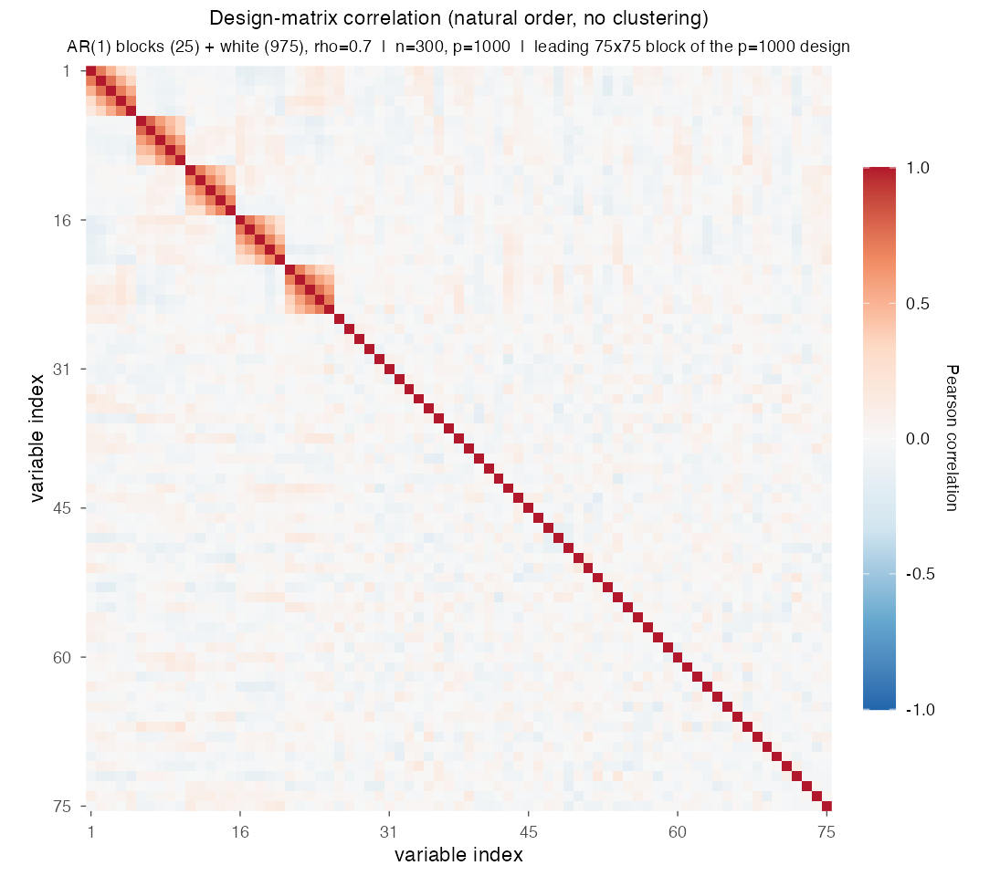
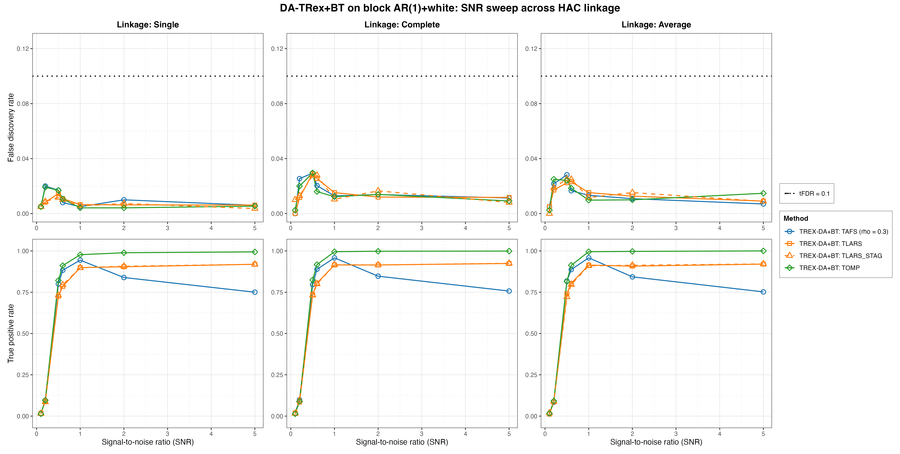
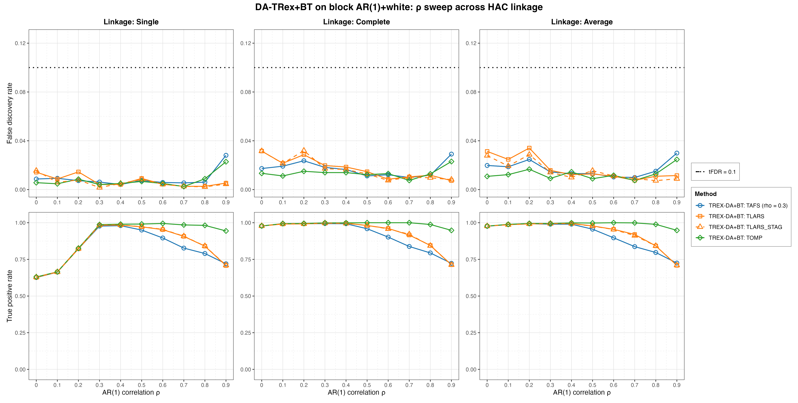
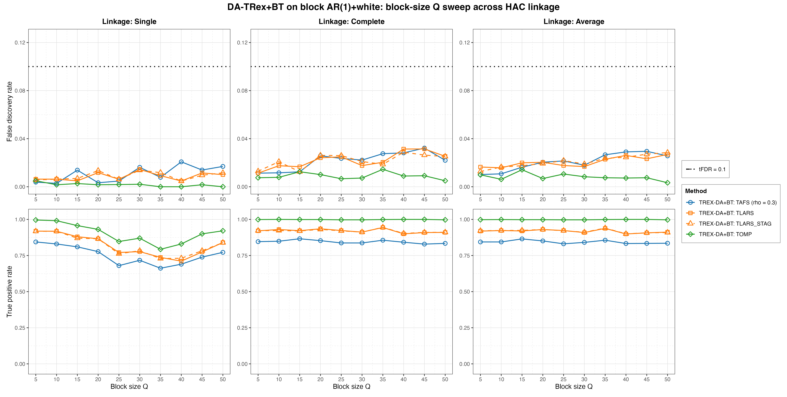
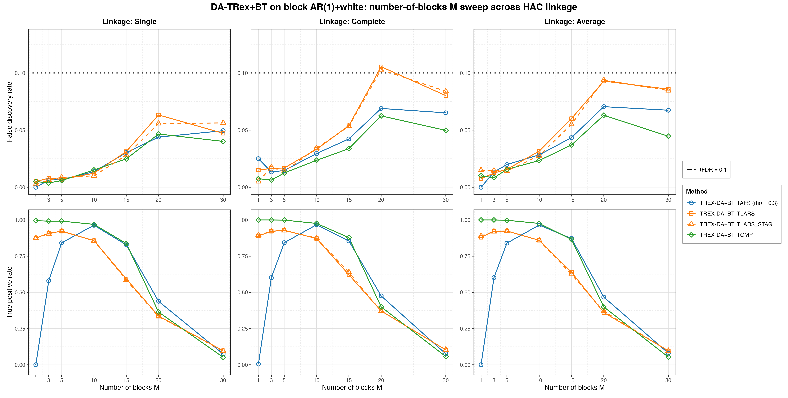

# Demo 02: DA-TRex+BT (Binary-Tree Dependency-Aware T-Rex) on Block AR(1) + White-Noise Data

Monte Carlo (MC) results for **DA-TRex+BT**, the dependency-aware (DA) Terminating Random Experiments (T-Rex)
selector (DA-TRex) with the binary-tree (BT) group design (`da_method = "BT"`). The design is block-diagonal, made of
autoregressive (AR) blocks of order one, AR(1), and diluted by a large block of independent and identically
distributed (i.i.d.) white-noise columns. The demo sweeps the signal-to-noise ratio (SNR), $\rho$, the block size $Q$
and the number of blocks $M$, each across the three hierarchical agglomerative clustering (HAC) linkage methods
(Single / Complete / Average). Common setup: $n=300$, $p_{\text{total}}=1{,}000$, amplitude $1.0$, target false
discovery rate (FDR) $\mathrm{tFDR}=0.1$, $K=20$ random experiments, $\mathrm{MC}=200$ per grid point, and solvers
TLARS / TAFS / TOMP, plus TLARS_STAG (TLARS with the T-loop stagnation stop on, window 7, see the
[C++ suite README](../../../../../cpp/trex_selector_methods/ad/trex_da/README.md)).

R port of the C++ demo
[cpp/trex_selector_methods/ad/trex_da/demo_trex_da_02_mc_sim_ar1_blocks_plus_white](../../../../../cpp/trex_selector_methods/ad/trex_da/demo_trex_da_02_mc_sim_ar1_blocks_plus_white/README.md)
with the same data-generating process (DGP), control parameters, sweep axes, console summaries and result-file
naming. The numbers below are this R run's own results. R uses its own random number streams, so they differ from the
C++ and Python numbers within Monte Carlo noise, not exactly. A cell-by-cell comparison with the C++ run (200 trials
per cell on both sides, $z$ = difference divided by the combined Monte Carlo standard error) finds $|z| > 3$ in 3 of
the 816 FDR and true positive rate (TPR) cells of this demo. Over the whole DA-TRex suite it is 29 of 9,344 cells
(0.31 %), the rate that noise alone produces. Against the previous run on library commit `44cf1ab` every cell moves
within Monte Carlo noise, and none moves by more than two combined standard errors.

The greedy solvers use *exchangeable tie-breaking* (`exch_tie_alpha = 0.25` for TAFS/TOMP, `0` for
TLARS/TLARS_STAG). See `Exchangeable_Tie_Breaking_DA_TRex.md` in the TRex_Research documentation.
TAFS additionally runs with its adaptive forward-selection (AFS) correlation parameter `rho_afs = 0.3`
(`0` for TLARS/TLARS_STAG/TOMP), which is why the figures label it `TAFS (rho = 0.3)`.

---

## Setup — the DA-TRex+BT selector

As in the other DA demos, the selector deflates each variable's ordinary relative occurrence
$\Phi_{T,L}(j)$ by a penalty built from its most similar competitor within a group of correlated
variables,

```math
\Phi^{\mathrm{BT}}_{T,L}(j) := \Psi^{\mathrm{BT}}_{T,L}(j) \cdot \Phi_{T,L}(j),
\qquad
\Psi^{\mathrm{BT}}_{T,L}(j) :=
\begin{cases}
\displaystyle \frac{1}{2 - \underset{j' \in \mathrm{Gr}(j)}{\min}
  \left| \Phi_{T,L}(j) - \Phi_{T,L}(j') \right|}\,,
& \mathrm{Gr}(j) \neq \emptyset \\[10pt]
\displaystyle 1/2, & \mathrm{Gr}(j) = \emptyset
\end{cases}
```

but, unlike the correlation-threshold group design of the nearest-neighbor (NN) variant DA-TRex+NN (Demo 07), the
**BT group design** obtains $\mathrm{Gr}(j)$ from a **binary tree**. Variables are clustered by HAC on the
dissimilarity $1 - |\mathrm{corr}(\boldsymbol x_j, \boldsymbol x_{j'})|$, and the dendrogram cut defines disjoint
variable groups. The **linkage method** (`hc_linkage` in `trex_da_control()`) sets the between-cluster distance
during agglomeration:

- **Single** — $d(A,B) = \min_{j \in A,\, j' \in B} d(j, j')$ (nearest member, prone to chaining),
- **Complete** — $d(A,B) = \max_{j \in A,\, j' \in B} d(j, j')$ (farthest member, compact clusters),
- **Average** — $d(A,B) = \underset{j \in A,\, j' \in B}{\operatorname{mean}}\, d(j, j')$
  (unweighted pair group method with arithmetic mean (UPGMA)).

Whether this choice materially changes the FDR or the TPR on a clean block design is this demo's core question, so
every sweep below is run once per linkage.

## Setup — data generating process (`dgp_ar1_block_white_snr`)

The generator in [`../trex_da_dgps.R`](../trex_da_dgps.R) concatenates $M$ statistically independent AR(1) blocks of
size $Q$ with a large block of white-noise columns. The within-block correlation follows the $Q \times Q$ Toeplitz
matrix

```math
\left[\boldsymbol{\Sigma}_{m}(\rho)\right]_{j,k} = \rho^{|j-k|},
\qquad m = 1, \ldots, M,
```

generated per block via the recursion $z_{j} = \rho\, z_{j-1} + \sqrt{1-\rho^{2}}\,\varepsilon_{j}$
with $z_1, \varepsilon_j \sim \mathcal{N}(0,1)$, so $p_{\text{ar}} = M \cdot Q$. The $(M+1)$-th block
holds $p_{\text{white}} = p_{\text{total}} - p_{\text{ar}}$ i.i.d. $\mathcal{N}(0,1)$ columns,
giving the block-diagonal total covariance

```math
\boldsymbol{\Sigma} =
\begin{bmatrix}
\boldsymbol{\Sigma}_1(\rho) & & & \\
& \ddots & & \\
& & \boldsymbol{\Sigma}_M(\rho) & \\
& & & \boldsymbol{I}_{p_{\text{white}}}
\end{bmatrix} \in \mathbb{R}^{p_{\text{total}} \times p_{\text{total}}},
\qquad p_{\text{total}} = p_{\text{ar}} + p_{\text{white}} = 1{,}000 \text{ fixed}.
```



Empirical Pearson correlation of an exemplary design drawn from this DGP (base point $M=5$, $Q=5$,
$\rho=0.7$, seed 2026), in **natural variable order with no hierarchical clustering**, cropped to the
leading 75×75 corner of the $p=1{,}000$ design. The five AR(1) blocks occupy the first
$p_{\text{ar}} = 25$ columns, and everything after them is the uncorrelated white padding (bare diagonal).
One figure per DGP lives in [`../dgp_corr_plots/`](../dgp_corr_plots/). Regenerate them with
[`../generate_corr_plots.sh`](../generate_corr_plots.sh) (shared plotter
[`../../../corr_plt_utils.R`](../../../corr_plt_utils.R)).

**Support (`OnePerBlock`).** The true support takes the first column of every AR(1) block,

```math
\mathcal{S} = \{s_1, \ldots, s_M\}, \qquad s_m = (m-1)Q + 1,
```

(1-based R indices, while the Python suite is 0-based), so $s = M$ and all actives lie in the AR part. The white block
is pure null padding that makes the problem high-dimensional ($p_{\text{total}} > n$).

**Linear model and SNR control.** Each trial draws $y = X\beta + \varepsilon$ with active amplitude
$\beta_{s_m} = 1.0$, $\varepsilon_i \stackrel{\text{iid}}{\sim} \mathcal{N}(0, \sigma^2)$, and
$\sigma^2 = \widehat{\mathrm{Var}}(X\beta)/\mathrm{SNR}$.

**Base parameters** (each sweep varies one dimension, ceteris paribus): $M=5$, $Q=5$
($p_{\text{ar}}=25$, $p_{\text{white}}=975$, $s=5$), $\rho=0.7$, $\mathrm{SNR}=2.0$, seed $2026$.

**Selector call.** Each trial builds one selector per solver row through the shared helpers in
[`../da_sim_common.R`](../da_sim_common.R). For the TAFS row under Complete linkage it reads

```r
ctrl <- trex_control(
  solver = "TAFS", K = 20L, max_dummy_multiplier = 10, use_max_T_stop = TRUE,
  dummy_distribution = trex_dummy_distribution(), lloop_strategy = "STANDARD",
  tloop_stagnation_stop = TRUE, tloop_max_stagnant_steps = 7,
  use_memory_mapping = FALSE, rho_afs = 0.3, exch_tie_alpha = 0.25
)
sel <- TRexDASelector$new(
  X, y, tFDR = 0.1, seed = -1L, verbose = FALSE,
  da_control = trex_da_control(da_method = "BT", hc_linkage = "Complete"),
  control = ctrl
)
sel$select()
```

`default_solvers("+BT")` sets the per-solver values. TLARS runs with the stagnation stop off and
`exch_tie_alpha = 0`, TAFS and TOMP with the stop on and `exch_tie_alpha = 0.25`, and TLARS_STAG is TLARS with the
stop on. This demo runs no base (no-DA) rows. With `seed = -1L` the selector draws its seed from hardware entropy.

---

## Running the Demo

```bash
Rscript R/trex_selector_methods/ad/trex_da/demo_trex_da_02_mc_sim_ar1_blocks_plus_white/demo_trex_da_02_mc_sim_ar1_blocks_plus_white.R      # full run
Rscript R/trex_selector_methods/ad/trex_da/demo_trex_da_02_mc_sim_ar1_blocks_plus_white/demo_trex_da_02_mc_sim_ar1_blocks_plus_white.R 8    # 8 workers
```

The four parts are toggled by the `RUN_PART_*` flags at the top of the file (all `TRUE`, mirroring the C++
`if (true)` toggles). Reduce `NUM_MC` to preview. Monte Carlo trials run in parallel over `num_cores` spawned R
worker processes (first command-line argument, else `TREX_NUM_WORKERS`, else 8, and `0` uses every core). Each
finished grid cell is appended to a cache in `simulation_results/cache/`, so a stopped run picks up where it stopped,
and a finished run removes the cache. The script sources [`../trex_da_dgps.R`](../trex_da_dgps.R),
[`../da_sim_common.R`](../da_sim_common.R), `../../../support_generators.R` and `../../../mc_runtime.R`. With 8
workers the full run took about 7.1 hours on library commit `09debc6`.

Afterwards, regenerate the figures from the comma-separated values (CSV) files with
[`generate_plots.sh`](generate_plots.sh), which drives the suite's ggplot2 plotter
[`../trex_da_plt_utils.R`](../trex_da_plt_utils.R) through `Rscript` (set `RSCRIPT` to use another R):

```bash
./generate_plots.sh                 # this demo's full figure set
./generate_plots.sh <other.csv>     # just that CSV (default FDR/TPR mode)
./generate_plots.sh --formats png   # extra args pass through to the plotter
```

---

## Output Files

Data tables are written to `simulation_results/data/` (24 files = 12 scenario stems, one
`.txt`+`.csv` pair each):

- `da_trex_mc_da_ar1_blocks_plus_white_snr_{Single,Complete,Average}.txt` / `.csv`
- `da_trex_mc_da_ar1_blocks_plus_white_rho_{Single,Complete,Average}.txt` / `.csv`
- `da_trex_mc_da_ar1_blocks_plus_white_Q_{Single,Complete,Average}.txt` / `.csv`
- `da_trex_mc_da_ar1_blocks_plus_white_M_{Single,Complete,Average}.txt` / `.csv`

Figures in Portable Network Graphics (PNG) and Portable Document Format (PDF) go to `simulation_results/plots/`, one
FDR/TPR overview per sweep × linkage plus one linkage-comparison grid (Single/Complete/Average columns) per sweep. The
four grids are embedded below. The R plotter writes no interactive `.html` pages.

---

## Part 1 — SNR sweep ($\mathrm{SNR} \in \lbrace0.1, 0.2, 0.5, 0.6, 1, 2, 5\rbrace$)

- **FDR is very tightly controlled.** It stays at or below $0.030$ in every linkage × solver × SNR cell, far below
  the (already stricter) $\mathrm{tFDR}=0.1$ target. With $975$ uncorrelated null columns diluting the design, there
  is little correlated structure for false discoveries to latch onto.
- From $\mathrm{SNR}=1$ on TOMP is essentially perfect (TPR $0.98\text{–}1.00$), while TLARS and TLARS_STAG plateau
  around $0.90\text{–}0.93$. TAFS peaks at $\mathrm{SNR}=1$ ($0.94\text{–}0.96$) and then *declines* to
  $0.75\text{–}0.76$ at $\mathrm{SNR}=5$, a notable non-monotonicity unique to TAFS in this design.
- The choice of linkage barely matters at the base point ($M=5$, $Q=5$, $\rho=0.7$). At $\mathrm{SNR}=2$ the TPR of
  each solver differs by at most $0.011$ between the three linkages.



---

## Part 2 — $\rho$ sweep ($\rho \in \lbrace0.0, 0.1, \ldots, 0.9\rbrace$)

- **This is where linkage matters most, at *low* $\rho$**. With Single linkage, TPR drops to
  $0.63\text{–}0.67$ for all solvers at $\rho \leq 0.1$, while Complete/Average hold $0.98\text{–}0.99$. At
  $\rho = 0.2$ Single linkage still trails ($0.82\text{–}0.83$ vs. $0.99$). With weak within-block correlation the
  Single-linkage cut groups variables by noise, while compact-cluster linkages are robust. From $\rho \geq 0.3$ the
  three linkages agree within $0.017$ in TPR.
- FDR stays controlled over the whole grid (max $0.034$, TLARS at $\rho=0.2$ under Average linkage).
  The mild uptick at $\rho=0.9$ is shared by TAFS/TOMP across linkages ($0.023\text{–}0.030$) but stays far under
  target.
- At high correlation TPR declines moderately ($\rho=0.9$: TLARS and TLARS_STAG $0.71$, TAFS $0.72\text{–}0.73$,
  TOMP $0.94\text{–}0.95$), because the within-block shadows become harder to separate.



---

## Part 3 — Block-size $Q$ sweep ($Q \in \lbrace5, 10, \ldots, 50\rbrace$)

Here $p_{\text{ar}} = 5Q$ and $p_{\text{white}} = 1{,}000 - 5Q$, while $s = M = 5$ stays fixed.

- FDR is controlled everywhere (max $0.032$, TAFS with Complete linkage at $Q = 45$).
- **Single linkage costs power as blocks grow**. From $Q = 15$ on its TPR falls below the other two linkages, most at
  $Q = 35\text{–}40$ (TLARS/TLARS_STAG $0.71\text{–}0.74$, TAFS $0.66\text{–}0.69$, TOMP $0.79\text{–}0.83$), and
  recovers partly at $Q = 45\text{–}50$ (TOMP $0.90\text{–}0.92$). Complete/Average stay flat across the whole grid
  (TOMP $\approx 1.0$, TLARS/TLARS_STAG $0.90\text{–}0.95$, TAFS $0.83\text{–}0.87$). A plausible reason is that
  longer in-block chains give Single linkage more chances to merge blocks with the white pool, although the gap
  shrinks again at $Q = 45\text{–}50$.



---

## Part 4 — Number-of-blocks $M$ sweep ($M \in \lbrace1, 3, 5, 10, 15, 20, 30\rbrace$, $s = M$)

- This is the stress dimension. Here $s = M$ grows while $n = 300$ and the amplitude ($1.0$) stay fixed,
  so the per-signal SNR shrinks. **TPR collapses once $M \gtrsim 20$** ($0.33\text{–}0.48$ at
  $M=20$, $0.05\text{–}0.10$ at $M=30$) for every solver and linkage.
- At $M=10$ and $M=15$ the greedy solvers clearly outlast TLARS (at $M=15$ TAFS/TOMP $0.83\text{–}0.88$ vs.
  TLARS/TLARS_STAG $0.59\text{–}0.64$).
- FDR stays at the target level throughout the collapse, so the selector fails *safe* (it selects little rather than
  selecting wrongly). The largest cell is TLARS at $0.105$ ($M=20$, Complete linkage), where TLARS_STAG reaches
  $0.103$. Both lie within one Monte Carlo standard error (both $0.009$) of the target, and every other cell
  stays at or below $0.094$.
- The $M=1$ column shows the TAFS edge case of the C++ and Python runs. TAFS finds the single active variable in at
  most $0.5\,\%$ of the runs (TPR $0.005$ under Complete linkage, $0$ under the other two), where TLARS and TLARS_STAG
  reach $0.88\text{–}0.90$ and TOMP $0.995\text{–}1.0$. TAFS still trails at $M=3$ ($0.58\text{–}0.60$ vs. at least
  $0.90$ for the other solvers).



---

## TLARS_STAG

TLARS_STAG (TLARS with the T-loop stagnation stop) matches TLARS in every sweep. Averaged over all $102$ cells,
its signed FDR and TPR shifts stay below $0.001$, and a single cell loses at most $0.019$ TPR
($\mathrm{SNR} = 0.5$, Average linkage). Its largest FDR increase, $0.010$ at $\mathrm{SNR} = 0.1$ under Complete
linkage, leaves the FDR at $0.010$. Its mean T-loop length stays at or below $7.5$ steps in every cell, where TLARS
runs to medians of $8.1\text{–}18.7$ steps per sweep and up to $69$ in the $M$ sweep. The figures draw TLARS_STAG
dashed in the TLARS colour.

---

## Interpretation

- **Demo 03** ([R folder](../demo_trex_da_03_mc_sim_ar1_blocks/)) uses the same block AR(1) core without the
  white-noise columns, with $n = 150$ and $\mathrm{tFDR} = 0.2$. The white padding, together with the larger $n$,
  keeps the FDR low here, also relative to the halved target. Outside the
  $M$ stress sweep it stays at or below $0.034$, while the R run of Demo 03 reaches $0.13$ already in its SNR sweep
  (TLARS_STAG at $\mathrm{SNR} = 0.6$, Complete linkage). The TPR at the base point stays high
  ($\mathrm{SNR} = 2$: TOMP $0.99\text{–}1.00$, TLARS $0.90\text{–}0.92$).
- The linkage question gets a two-sided answer. Linkage is irrelevant at the well-correlated base
  point, but **Single linkage is fragile** exactly where the block structure is weak (low $\rho$) or
  large (high $Q$). Complete or Average are the safer defaults for this DGP.
- The $M$ sweep shows a graceful power collapse as the signal budget is spread over more and more active variables,
  with the FDR held at the target level.
