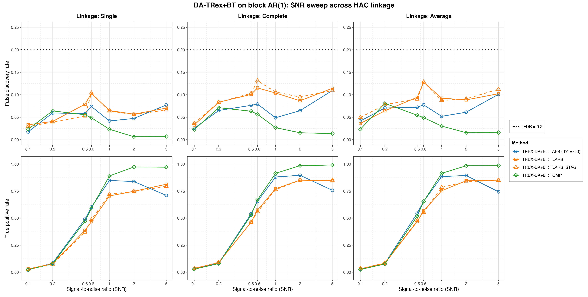
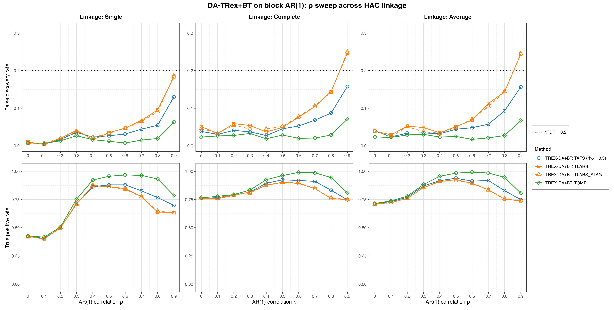
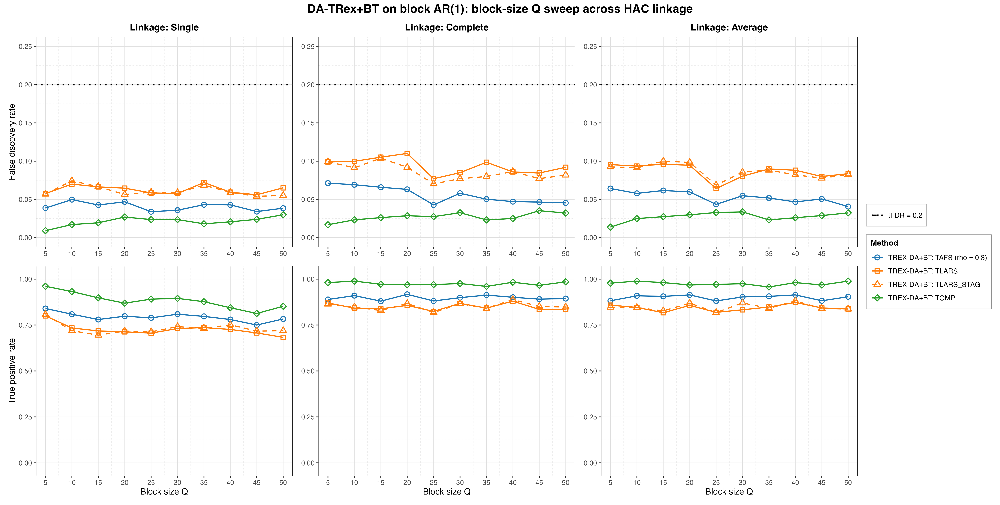
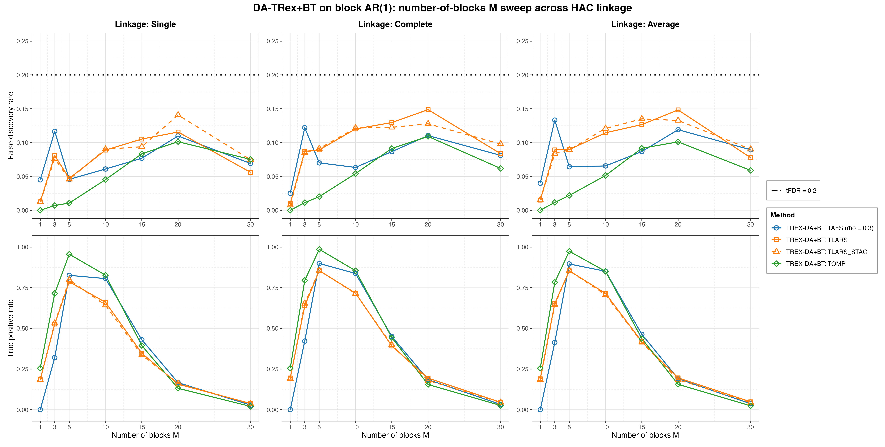

# Demo 03: DA-TRex+BT (Binary-Tree Dependency-Aware T-Rex) on Block-Diagonal AR(1) Data

Monte Carlo (MC) results for **DA-TRex+BT**, the Dependency-Aware (DA) Terminating Random Experiments (T-Rex)
selector (DA-TRex) with the Binary-Tree (BT) group design (`da_method = "BT"`), on a clean block-diagonal design whose
blocks follow the first-order autoregressive (AR) model AR(1), with no white-noise padding. The demo sweeps the
signal-to-noise ratio (SNR), $\rho$, block size $Q$, and number of blocks $M$, each across the three hierarchical
agglomerative clustering (HAC) linkage methods (Single / Complete / Average).
Common setup: $n=150$, amplitude $1.0$, target false discovery rate (FDR) $\mathrm{tFDR}=0.2$, $K=20$ random
experiments, $\mathrm{MC}=200$ per grid point, and solvers TLARS / TAFS / TOMP, plus TLARS_STAG (TLARS with the
T-loop stagnation stop on, window 7, see the
[C++ suite README](../../../../../cpp/trex_selector_methods/ad/trex_da/README.md)).

R port of the C++ demo
[cpp/trex_selector_methods/ad/trex_da/demo_trex_da_03_mc_sim_ar1_blocks](../../../../../cpp/trex_selector_methods/ad/trex_da/demo_trex_da_03_mc_sim_ar1_blocks/README.md)
with the same data-generating process (DGP), control parameters, sweep axes, console summaries, and result-file
naming. Indices are 1-based (R convention). The numbers below are this R run's own results. R draws its own random
numbers, so they differ from the C++ and Python runs within Monte Carlo noise, not exactly. A cell-by-cell comparison
with the C++ run, with $z$ the difference divided by the combined Monte Carlo standard error of the two 200-trial
means, finds $1$ cell with $|z| > 3$ among the 816 cells of this demo (FDR and TPR of every solver at every grid point).
Over the whole DA-TRex suite 29 of 9,344 cells (0.31 %) exceed $|z| > 3$, about the rate that noise alone produces.

The greedy solvers use *exchangeable tie-breaking* (`exch_tie_alpha = 0.25` for TAFS/TOMP, `0` for
TLARS/TLARS_STAG). See `Exchangeable_Tie_Breaking_DA_TRex.md` in the TRex_Research documentation.
TAFS additionally runs with its adaptive forward-selection (AFS) correlation parameter `rho_afs = 0.3`
(`0` for TLARS/TLARS_STAG/TOMP), which is why the figures label it `TAFS (rho = 0.3)`.

---

## Setup — the DA-TRex+BT selector

The selector deflates each variable's ordinary relative occurrence $\Phi_{T,L}(j)$ by the penalty
$\Psi_{T,L}^{\mathrm{BT}}(j) \in [1/2, 1]$ built from its most similar competitor within its
variable group,

```math
\Phi^{\mathrm{BT}}_{T,L}(j) := \Psi^{\mathrm{BT}}_{T,L}(j) \cdot \Phi_{T,L}(j),
```

where the **BT group design** obtains the groups $\mathrm{Gr}(j)$ from a **binary tree**. Variables
are clustered by HAC on the dissimilarity $1 - |\mathrm{corr}(\boldsymbol x_j, \boldsymbol x_{j'})|$ and the
dendrogram cut defines disjoint groups (see the
[Demo 02](../demo_trex_da_02_mc_sim_ar1_blocks_plus_white/README.md)
for the full penalty formula). The **linkage method** sets the between-cluster distance during agglomeration.
**Single** ($\min$) is prone to chaining, **Complete** ($\max$) builds compact clusters, and **Average** uses the mean,
the unweighted pair group method with arithmetic mean (UPGMA). Every sweep below runs once per linkage to probe its
influence.

Each Monte Carlo trial builds the selector through the TRexSelector class interface, here for TOMP at Average
linkage:

```r
library(TRexSelector)

ctrl <- trex_control(
  solver = "TOMP", K = 20L, max_dummy_multiplier = 10, use_max_T_stop = TRUE,
  lloop_strategy = "STANDARD", tloop_stagnation_stop = TRUE,
  tloop_max_stagnant_steps = 7, rho_afs = 0, exch_tie_alpha = 0.25
)
sel <- TRexDASelector$new(
  X, y, tFDR = 0.2, seed = -1L, verbose = FALSE,
  da_control = trex_da_control(da_method = "BT", hc_linkage = "Average"),
  control = ctrl
)
sel$select()
fdp <- trex_fdp(sel$selected_indices, true_support)
tpp <- trex_tpp(sel$selected_indices, true_support)
```

`default_solvers("+BT")` in [`../da_sim_common.R`](../da_sim_common.R) sets the per-solver fields. TLARS runs
without the stagnation stop and with `exch_tie_alpha = 0`, TAFS and TOMP run with the stop and
`exch_tie_alpha = 0.25`, and TLARS_STAG is TLARS with the stop on. The selector seed `-1L` draws the dummies from
hardware entropy in every trial.

## Setup — data generating process (`dgp_ar1_block_snr`)

The design consists of $M$ statistically independent AR(1) blocks of size $Q$ and nothing else.
Unlike Demo 02 there is no white-noise padding, so *every* column belongs to a correlated block and
$p = M \cdot Q$. The within-block correlation follows the $Q \times Q$ Toeplitz matrix

```math
\left[\boldsymbol{\Sigma}_{m}(\rho)\right]_{j,k} = \rho^{|j-k|},
\qquad m = 1, \ldots, M,
```

generated per block via the recursion $z_{j} = \rho\, z_{j-1} + \sqrt{1-\rho^{2}}\,\varepsilon_{j}$
with $z_1, \varepsilon_j \sim \mathcal{N}(0,1)$, giving the block-diagonal covariance

```math
\boldsymbol{\Sigma} =
\begin{bmatrix}
\boldsymbol{\Sigma}_1(\rho) & & \\
& \ddots & \\
& & \boldsymbol{\Sigma}_M(\rho)
\end{bmatrix} \in \mathbb{R}^{p \times p},
\qquad p = M \cdot Q.
```

At the base point the problem is *low-dimensional* ($p = 25 \ll n = 150$). The $Q$ sweep pushes it
past $p > n$ ($p = 250$ at $Q = 50$), and the $M$ sweep reaches $p = n = 150$ at $M = 30$.

The block core is exactly the one shown in **Demo 02**'s design-correlation heatmap
([`../dgp_corr_plots/da_ar1_block_white.png`](../dgp_corr_plots/da_ar1_block_white.png)), minus the
white padding that follows it. The `da_ar1_block` figure in
[`../dgp_corr_plots/`](../dgp_corr_plots/) renders the same generator at an illustrative
$p = 1{,}000$ with 5 blocks of 200, where the within-block $\rho^{|j-k|}$ decay makes the blocks all but
invisible. The $\text{small-}Q$ view of Demo 02 is the more informative picture for this demo's base point.

**Support (`OnePerBlock`).** Exactly one representative per AR(1) block, the block's first column
(`make_support_one_per_block()`),

```math
\mathcal{S} = \{s_1, \ldots, s_M\}, \qquad s_m = (m-1)Q + 1,
```

so $s = M$ and every block carries a signal.

**Linear model and SNR control.** Each trial draws $y = X\beta + \varepsilon$ with active amplitude
$\beta_{s_m} = 1.0$, $\varepsilon_i \stackrel{\text{iid}}{\sim} \mathcal{N}(0, \sigma^2)$, and
$\sigma^2 = \widehat{\mathrm{Var}}(X\beta)/\mathrm{SNR}$.

**Base parameters** (each sweep varies one dimension, ceteris paribus): $M=5$, $Q=5$ ($p=25$,
$s=5$), $\rho=0.7$, $\mathrm{SNR}=2.0$, seed $2026$.

---

## Running the Demo

```bash
demo=R/trex_selector_methods/ad/trex_da/demo_trex_da_03_mc_sim_ar1_blocks/demo_trex_da_03_mc_sim_ar1_blocks.R

Rscript "$demo"      # full run, TREX_NUM_WORKERS workers (default 8)
Rscript "$demo" 8    # 8 worker cores
```

The four parts are toggled by the `RUN_PART_*` flags at the top of the script (all `TRUE`). Reduce `NUM_MC` to
preview. Monte Carlo trials run in parallel on a parallel socket (PSOCK) cluster of spawned R worker processes
([`../../../mc_runtime.R`](../../../mc_runtime.R)). The worker count is the first command-line argument, else
`TREX_NUM_WORKERS`, else 8, and `0` uses every core. Every finished grid cell is appended to a cache in
`simulation_results/cache/`, so a stopped run resumes where it left off, and a completed run removes the cache. The
script also sources [`../trex_da_dgps.R`](../trex_da_dgps.R), [`../da_sim_common.R`](../da_sim_common.R), and
[`../../../support_generators.R`](../../../support_generators.R). The recorded run (library commit `09debc6`,
8 workers) took about 19 minutes.

Afterwards, regenerate the figures from the comma-separated values (CSV) files with
[`generate_plots.sh`](generate_plots.sh), which drives the suite's ggplot2 plotting module
[`../trex_da_plt_utils.R`](../trex_da_plt_utils.R) through `Rscript` (set `RSCRIPT` to use another R installation).

---

## Output Files

Data tables are written to `simulation_results/data/` (24 files = 12 scenario stems, one
`.txt`+`.csv` pair each):

- `da_trex_mc_da_ar1_blocks_snr_{Single,Complete,Average}.txt` / `.csv`
- `da_trex_mc_da_ar1_blocks_rho_{Single,Complete,Average}.txt` / `.csv`
- `da_trex_mc_da_ar1_blocks_Q_{Single,Complete,Average}.txt` / `.csv`
- `da_trex_mc_da_ar1_blocks_M_{Single,Complete,Average}.txt` / `.csv`

Figures go to `simulation_results/plots/`. Each sweep × linkage gets one overview of the FDR and the true positive
rate (TPR) as Portable Network Graphics (PNG) and Portable Document Format (PDF) files (the R port renders no
interactive `.html` page), and each sweep gets one linkage-comparison grid with Single/Complete/Average columns. The
four grids are embedded below.

---

## Part 1 — SNR sweep ($\mathrm{SNR} \in \lbrace0.1, 0.2, 0.5, 0.6, 1, 2, 5\rbrace$)

- **FDR stays under the $\mathrm{tFDR}=0.2$ target at every SNR** (worst cell $0.131$, TLARS_STAG at
  $\mathrm{SNR}=0.6$ under Complete linkage). It runs above the white-noise-diluted Demo 02 in all $84$ shared
  cells. Demo 02 stays at or below $0.030$ over its SNR sweep, at its stricter target of $0.1$ and twice the
  sample size, so the gap reflects the target and $n$ as well as the null structure. There most null variables are
  independent white-noise columns, while here every null variable shares a correlated block with a signal
  variable.
- TOMP has the highest TPR from $\mathrm{SNR}=1$ on ($0.97\text{–}0.99$ from $\mathrm{SNR}=2$), while TLARS and
  TLARS_STAG reach $0.75\text{–}0.85$. TAFS peaks at $\mathrm{SNR}=1\text{–}2$ ($0.84\text{–}0.90$) and then
  *declines* to $0.71\text{–}0.76$ at $\mathrm{SNR}=5$.
- Linkage matters from $\mathrm{SNR}=0.5$ on. Single linkage trails Complete and Average by up to $0.11$ TPR at
  $\mathrm{SNR}=0.5\text{–}0.6$ and in return runs at a lower FDR, most visibly for TLARS and TLARS_STAG (TLARS
  $0.057\text{–}0.103$ against $0.087\text{–}0.128$ from $\mathrm{SNR}=0.5$ on).



---

## Part 2 — $\rho$ sweep ($\rho \in \lbrace0.0, 0.1, \ldots, 0.9\rbrace$)

- **FDR stays below $0.06$ up to $\rho=0.5$, climbs from $\rho=0.6$ on (TOMP only at $\rho=0.9$), and TLARS
  breaks the target at $\rho=0.9$** under Complete and Average linkage ($0.246$ / $0.244$, both more than two
  standard errors above it), while Single linkage stays at $0.183$. TAFS remains controlled ($0.130\text{–}0.158$)
  and TOMP comfortably so ($0.064\text{–}0.071$). TLARS_STAG shows similar values ($0.250$ / $0.245$ / $0.186$),
  so the stagnation stop does not cure this violation. The block shadows of the signal variables get harder to
  deflate as the within-block correlation grows.
- **Single linkage loses power at low $\rho$**. Its TPR is $0.40\text{–}0.43$ at $\rho \leq 0.1$ against
  $0.71\text{–}0.78$ for Complete/Average. The gap narrows to at most $0.06$ at $\rho = 0.4\text{–}0.5$, and
  Single falls behind again at high $\rho$, most for TLARS and TLARS_STAG (TLARS $0.64$ against $0.74\text{–}0.76$ at
  $\rho \geq 0.8$).
- TPR peaks $\text{mid-}\rho$ and falls toward $\rho=0.9$. TOMP peaks at up to $0.99$ ($\rho = 0.6$) and ends
  at $0.79\text{–}0.81$, TAFS peaks at up to $0.94$ ($\rho = 0.5$) and ends at $0.698\text{–}0.749$, and TLARS and
  TLARS_STAG peak at up to $0.92\text{–}0.93$ ($\rho = 0.5$) and end at $0.63\text{–}0.75$.



---

## Part 3 — Block-size $Q$ sweep ($Q \in \lbrace5, 10, \ldots, 50\rbrace$, $p = 5Q$ grows to $250 > n$)

- FDR is comfortably controlled over the whole sweep (max $0.110$, TLARS under Complete linkage at
  $Q=20$) even as the design crosses into the high-dimensional regime ($p = 250 > n = 150$ at $Q=50$).
- Complete/Average linkage handle growing blocks well (TOMP $0.96\text{–}0.99$, TAFS $0.88\text{–}0.92$, TLARS and
  TLARS_STAG $0.82\text{–}0.89$ throughout), while **Single linkage loses power once blocks grow**. From $Q = 10$ on
  it trails them by $0.06\text{–}0.16$ TPR (TOMP $0.81\text{–}0.93$, TAFS $0.75\text{–}0.81$, TLARS and TLARS_STAG
  $0.68\text{–}0.75$). Demo 02's $Q$ sweep shows the same fragility, where Single trails by up to $0.22$.



---

## Part 4 — Number-of-blocks $M$ sweep ($M \in \lbrace1, 3, 5, 10, 15, 20, 30\rbrace$, $s = M$, $p = 5M$)

- This is the stress dimension. Here $s = M$ grows while $n = 150$ and the amplitude stay fixed. **TPR falls from
  $M = 10$ on and collapses for $M \gtrsim 20$** ($0.34\text{–}0.46$ at $M=15$, $0.13\text{–}0.20$ at $M=20$, at
  most $0.048$ at $M=30$, where $p = n$), while FDR stays below target throughout (max $0.149$, TLARS at
  $M=20$ under Complete linkage). The selector fails *safe*.
- The $M=1$ corner is degenerate ($p=5$, one active variable), so all solvers are weak (TPR $\leq 0.26$). TAFS never
  selects the active variable (TPR $0$), so its FDR of $0.025\text{–}0.045$ is the share of runs in which it selects
  a null variable. TOMP never selects a null variable there (FDR $0$).
- The best region is $M = 5\text{–}10$, where TOMP holds $0.83\text{–}0.99$ TPR at FDR $0.01\text{–}0.05$ and TAFS
  $0.81\text{–}0.90$ TPR.



---

## TLARS_STAG

TLARS_STAG (TLARS with the T-loop stagnation stop) matches TLARS in every sweep. Over all $102$ grid cells its mean
FDR and TPR changes stay below $0.002$, and a single cell loses at most $0.023$ TPR ($Q = 15$, Single linkage). Its
largest FDR increase, $0.025$ at $M = 20$ under Single linkage, stays well below target. Its mean T-loop length
stays at or below $7.2$ steps in every cell, where TLARS runs to a median of $31$ and up to $43$ steps. It also
inherits the TLARS violation at $\rho = 0.9$, so that violation does not come from the long T-loop. The figures draw
TLARS_STAG dashed in the TLARS colour.

---

## Interpretation

- Read this demo against **Demo 02**, which adds $975$ white-noise columns (at its base point) to the same block
  AR(1) core and runs at $n=300$ with the stricter target $\mathrm{tFDR}=0.1$. Here the realized FDR is higher in
  $397$ of the $408$ cells the two demos share, and the TPR is lower in $340$ of them, with TAFS under Complete and
  Average linkage on the $Q$ sweep as the main exception. The pure block design at half the sample size is the
  harder problem, although the two demos differ in more than the white padding.
- The linkage story is consistent across both demos. Here Complete and Average agree within $0.06$ TPR and $0.02$
  FDR in every cell, while Single linkage has a lower TPR than their mean in $133$ of the $136$ solver × grid-point
  comparisons. At the base point it costs TLARS, TLARS_STAG and TAFS $0.05\text{–}0.10$ TPR and TOMP
  $0.01\text{–}0.02$, and the cost grows to $0.16$ on the $Q$ sweep and $0.36$ at low $\rho$. Complete or Average
  are the safer defaults.
- On block designs **TOMP is the most robust solver**. It has the highest TPR *and* the lowest FDR in $79$
  of the $102$ grid cells, the exceptions lying at low SNR ($\leq 0.6$), weak correlation ($\rho \leq 0.1$), and
  $M \geq 10$. TAFS sits in between with its high-SNR power decline, and TLARS is the most FDR-fragile at strong
  within-block correlation, with or without the stagnation stop.
