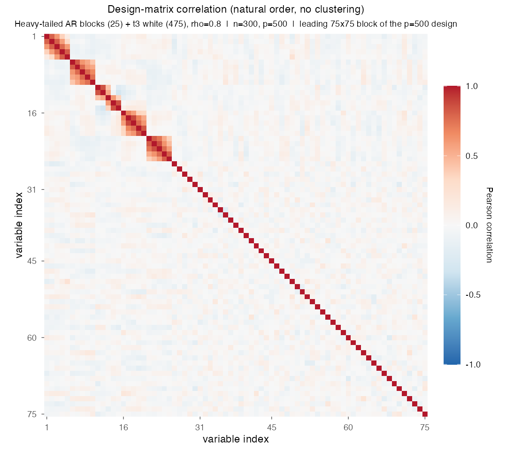
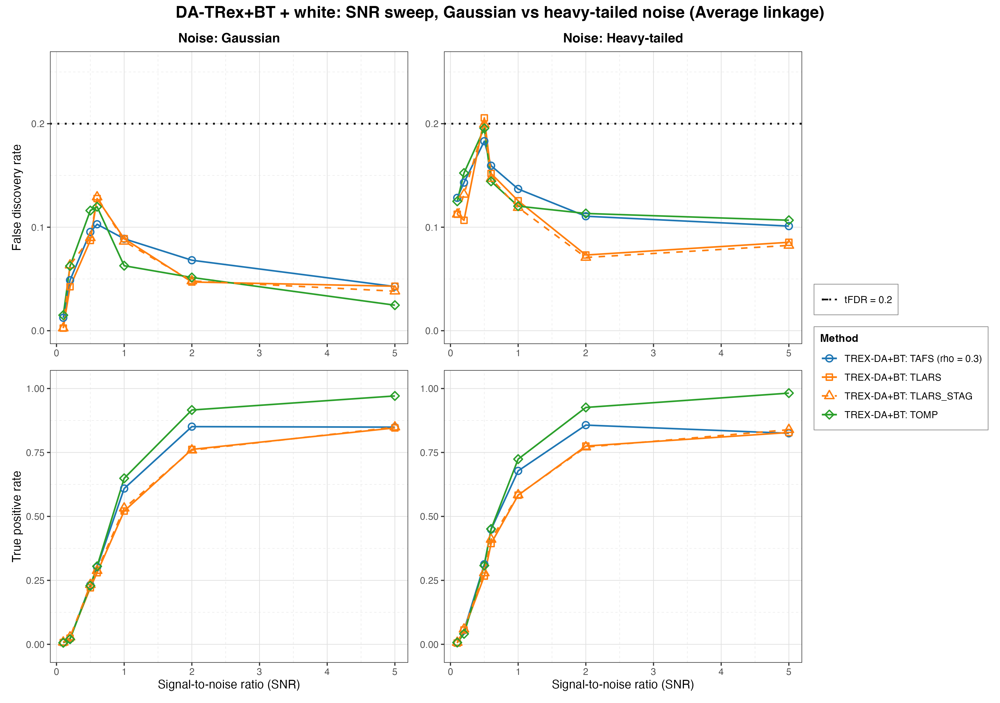
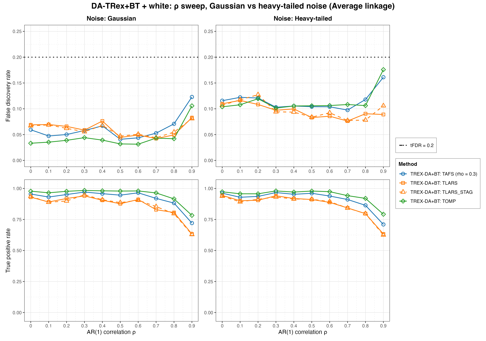
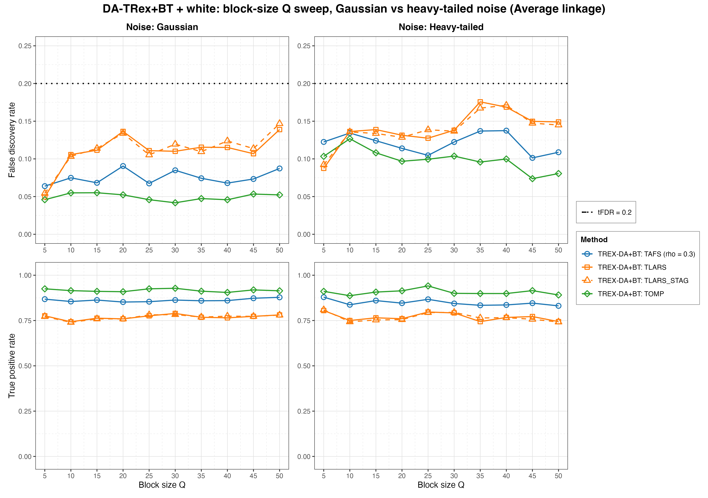
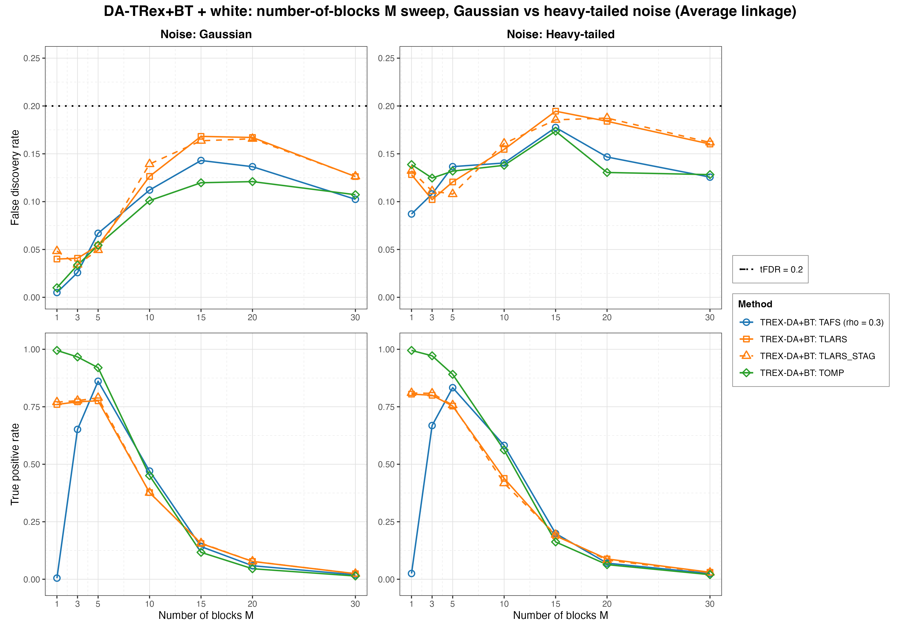
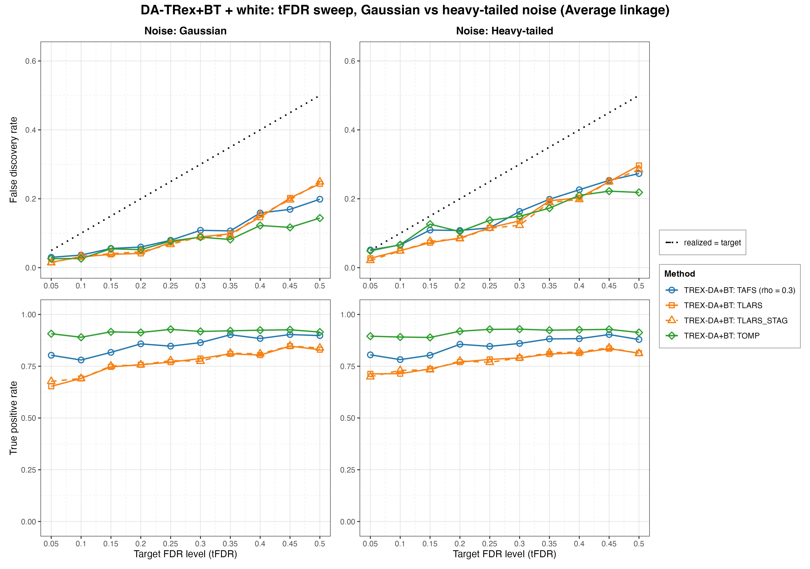

# Demo 05: DA-TRex+BT (Binary-Tree Dependency-Aware T-Rex) on Heavy-Tailed Block + White-Noise Data

Monte Carlo (MC) results for **DA-TRex+BT**, the dependency-aware (DA) Terminating Random Experiments (T-Rex)
selector (DA-TRex) with the binary-tree (BT) group design (`da_method = "BT"`), on the "combined effects" design of
heavy-tailed (multivariate $t_{\nu}$) first-order autoregressive (AR) Toeplitz blocks embedded in a
larger design padded with independent and identically distributed (i.i.d.) $\text{Student-}t$ white-noise columns. It
merges Demo 02's white-noise dilution with Demo 04's heavy-tailed robustness study and sweeps the signal-to-noise ratio
(SNR), $\rho$, block size $Q$, number of blocks $M$ and the target false discovery rate (FDR) level $\mathrm{tFDR}$,
each across two noise scenarios (Gaussian vs. heavy-tailed response noise) and the three hierarchical agglomerative
clustering (HAC) linkage methods. The common setup is $n=150$, $p_{\text{total}}=500$, amplitude $1.0$, $\nu=3$,
$\mathrm{tFDR}=0.2$ (except in the target FDR (tFDR) sweep), $K=20$ random experiments, $\mathrm{MC}=200$ per grid
point, and the solvers TLARS / TAFS / TOMP plus TLARS_STAG (TLARS with the T-loop stagnation stop on, window 7).

R port of the C++ demo
[cpp/trex_selector_methods/ad/trex_da/demo_trex_da_05_mc_sim_ht_blocks_plus_white](../../../../../cpp/trex_selector_methods/ad/trex_da/demo_trex_da_05_mc_sim_ht_blocks_plus_white/README.md)
with the same data-generating process (DGP), control parameters, sweep axes, console summaries and result-file naming.
The numbers below are this R run's own results. R draws its own random numbers, so they agree with the C++ and Python
runs within Monte Carlo noise, not exactly (see the comparison with C++ further below).

The solver pool is `default_solvers("+BT")` from [`../da_sim_common.R`](../da_sim_common.R). TLARS runs without the
T-loop stagnation stop, TAFS and TOMP run with it, and TLARS_STAG is TLARS with the stop switched on, all four with the
window `tloop_max_stagnant_steps = 7`. The greedy solvers use *exchangeable tie-breaking* (`exch_tie_alpha = 0.25` for
TAFS/TOMP, `0` for TLARS and TLARS_STAG) in every part, as in C++. TAFS runs with its adaptive forward-selection (AFS)
correlation parameter `rho_afs = 0.3` throughout (`0` for TLARS, TLARS_STAG and TOMP), which is why the figures label
it `TAFS (rho = 0.3)`.

---

## Setup — the DA-TRex+BT selector

The selector deflates each variable's ordinary relative occurrence $\Phi_{T,L}(j)$ by the penalty
$\Psi_{T,L}^{\mathrm{BT}}(j) \in [1/2, 1]$ built from its most similar competitor within its
variable group, with the groups obtained from a **binary tree**. HAC clustering runs on the dissimilarity
$1 - |\mathrm{corr}(\boldsymbol x_j, \boldsymbol x_{j'})|$, and the dendrogram is cut into disjoint groups
(see [Demo 02](../demo_trex_da_02_mc_sim_ar1_blocks_plus_white/README.md) for the full penalty
formula). Every sweep runs across the three HAC **linkage methods** (Single / Complete / Average).
For heavy-tailed data the *sample* correlations feeding the clustering are themselves noisier, so
linkage robustness is part of what this demo probes.

Each trial calls the TRexSelector selector with the linkage of the current loop.

```r
sel <- TRexDASelector$new(
  X, y, tFDR = tFDR, seed = -1L, verbose = FALSE,
  da_control = trex_da_control(da_method = "BT", hc_linkage = linkage),
  control = trex_control(solver = "TLARS", K = 20, max_dummy_multiplier = 10,
                         use_max_T_stop = TRUE, lloop_strategy = "STANDARD",
                         tloop_stagnation_stop = FALSE, tloop_max_stagnant_steps = 7,
                         use_memory_mapping = FALSE, rho_afs = 0, exch_tie_alpha = 0)
)
sel$select()
```

The `control` arguments shown are the TLARS row, and the other rows change only `solver`, `tloop_stagnation_stop`,
`rho_afs` and `exch_tie_alpha`. The selector seed `-1` draws from hardware entropy, so every trial runs its own random
experiments.

## Setup — data generating process (`dgp_ht_block_white_snr`)

The design concatenates $M$ statistically independent **heavy-tailed** blocks of size $Q$ with a
white-noise block. Each block starts from the $Q \times Q$ AR(1) Toeplitz correlation

```math
\left[\boldsymbol{\Sigma}_{m}(\rho)\right]_{j,k} = \rho^{|j-k|},
\qquad m = 1, \ldots, M,
```

and transforms the Gaussian draw into a **multivariate $t_{\nu}$** vector,

```math
\boldsymbol{X}_{i}^{(m)} = \frac{\boldsymbol{Z}_{i}^{(m)}}{\sqrt{U_{i}^{(m)} / \nu}},
\qquad
\boldsymbol{Z}^{(m)}_{i} \sim \mathcal{N}(\boldsymbol{0}, \boldsymbol{\Sigma}_{m}(\rho)),
\quad U_{i}^{(m)} \sim \chi^2_{\nu},
```

with all $\boldsymbol Z_{i}^{(m)}, U_{i}^{(m')}$ independent across blocks.
**Heavy-tail behavior.** When a block draws $U_i^{(m)}$ near zero, *all* $Q$ variables of that block
explode simultaneously (within-block tail dependence), while the other blocks are unaffected, so
extreme events are block-local. The remaining $p_{\text{white}} = p_{\text{total}} - M \cdot Q$
columns are i.i.d. $t_{\nu}$ white noise, so the full design is heavy-tailed but only the blocks are
correlated. The generator lives in [`../trex_da_dgps.R`](../trex_da_dgps.R).



Empirical Pearson correlation of an exemplary design drawn from this DGP ($M=5$, $Q=5$, $\rho=0.8$,
$\nu=3$, $p=500$, drawn at $n=300$ for a cleaner picture, seed 2026), in **natural variable order with
no hierarchical clustering**, cropped to the leading 75×75 corner. The five heavy-tailed blocks
occupy the first $p_{\text{ar}} = 25$ columns, and everything after them is $t_{\nu}$ white padding
(bare diagonal). Regenerate the per-DGP figures with
[`../generate_corr_plots.sh`](../generate_corr_plots.sh) (shared ggplot2 plotter
[`../../../corr_plt_utils.R`](../../../corr_plt_utils.R)).

**Noise scenarios.** The response is $y = X\beta + \varepsilon$ with

- `s1_Gauss`: $\varepsilon_i \stackrel{\text{iid}}{\sim} \mathcal{N}(0, \sigma^2)$, a heavy-tailed
  design with Gaussian noise,
- `s2_Heavy`: $\varepsilon_i \stackrel{\text{iid}}{\sim} t_{\nu}$, scaled to the variance $\sigma^2$, so heavy
  tails sit in *both* design and noise,

and $\sigma^2 = \widehat{\mathrm{Var}}(X\beta)/\mathrm{SNR}$ in both cases.

**Support (`OnePerBlock`).** One representative per heavy-tailed block, $s = M$, all actives in the
block part (amplitude $1.0$). Indices are 1-based (R convention), so the base support is `c(1, 6, 11, 16, 21)`.

**Base parameters** (each sweep varies one dimension, ceteris paribus): $M=5$, $Q=5$
($p_{\text{ar}}=25$, $p_{\text{white}}=475$, $s=5$), $\rho=0.8$, $\nu=3$, $\mathrm{SNR}=2.0$,
seed $2026$.

---

## Running the Demo

```bash
Rscript R/trex_selector_methods/ad/trex_da/demo_trex_da_05_mc_sim_ht_blocks_plus_white/demo_trex_da_05_mc_sim_ht_blocks_plus_white.R      # full run
Rscript R/trex_selector_methods/ad/trex_da/demo_trex_da_05_mc_sim_ht_blocks_plus_white/demo_trex_da_05_mc_sim_ht_blocks_plus_white.R 8    # 8 worker cores
```

The five parts are toggled by the `RUN_PART_*` flags at the top of the script (all `TRUE`, mirroring the cpp
`if (true)` toggles), and every part loops scenario × linkage. Reduce `NUM_MC` to preview. MC trials run in parallel
over `num_cores` spawned R worker processes (first command-line argument, else `TREX_NUM_WORKERS`, else 8, and `0`
uses every core). Every finished grid cell is cached in `simulation_results/cache/`, so a stopped run resumes where it
left off, and the cache is removed when the demo finishes. The script resolves its own directory and sources
[`../../../mc_runtime.R`](../../../mc_runtime.R), [`../../../support_generators.R`](../../../support_generators.R),
[`../trex_da_dgps.R`](../trex_da_dgps.R) and [`../da_sim_common.R`](../da_sim_common.R). The recorded run (library
commit `09debc6`, 8 workers) took about 3.3 hours.

Afterwards, regenerate the figures from the comma-separated values (CSV) files with
[`generate_plots.sh`](generate_plots.sh), which drives the suite's ggplot2 plotter
[`../trex_da_plt_utils.R`](../trex_da_plt_utils.R).

---

## Output Files

Data tables are written to `simulation_results/data/` (60 files = 30 scenario stems, one
`.txt`+`.csv` pair each):
`da_trex_mc_da_ht_blocks_plus_white_{snr,rho,Q,M,tFDR}_{s1_Gauss,s2_Heavy}_{Single,Complete,Average}.txt` / `.csv`.

Figures go to `simulation_results/plots/` as Portable Network Graphics (PNG) and Portable Document Format (PDF) files
(this port renders no interactive `.html` page). There is one FDR and true positive rate (TPR) overview per sweep ×
scenario × linkage, one linkage-comparison grid per sweep × scenario, and one **Gaussian-vs-heavy scenario grid** per
sweep (at Average linkage). The five scenario grids are this demo's core exhibits and are embedded below. The numbers
quoted below are read at Average linkage unless stated otherwise.

---

## Part 1 — SNR sweep ($\mathrm{SNR} \in \lbrace0.1, 0.2, 0.5, 0.6, 1, 2, 5\rbrace$)

- **Gaussian noise is comfortably controlled.** FDR peaks at $0.129$ (TLARS_STAG, $\mathrm{SNR}=0.6$) and
  falls to $0.025\text{–}0.043$ at $\mathrm{SNR}=5$, under the $\mathrm{tFDR}=0.2$ target everywhere and under
  every linkage (at most $0.133$, Complete linkage).
- **Heavy-tailed noise costs FDR, not power.** The `s2_Heavy` column sits $0.018\text{–}0.118$ higher ($0.066$ on
  average) and peaks at $0.206$ (TLARS, $\mathrm{SNR}=0.5$), where it touches the target (standard deviation (sd)
  $0.305$, less than half a standard error above it). TPR is higher than with Gaussian noise for
  every solver at $\mathrm{SNR}=0.5\text{–}1$, by up to $0.147$ (TAFS at $\mathrm{SNR}=0.6$, $0.449$ against
  $0.302$), and at most $0.024$ lower (TAFS at $\mathrm{SNR}=5$). This fits the scaled $t_{3}$ noise, which puts
  more of its mass near zero at the same variance.
- From $\mathrm{SNR}=2$ on, TPR is nearly scenario-independent, with TOMP at $0.916\text{–}0.982$, TAFS at
  $0.825\text{–}0.857$, and TLARS and TLARS_STAG at $0.759\text{–}0.849$.



---

## Part 2 — $\rho$ sweep ($\rho \in \lbrace0.0, 0.1, \ldots, 0.9\rbrace$)

- FDR stays flat up to $\rho = 0.8$ ($0.031\text{–}0.076$ with Gaussian noise, $0.076\text{–}0.127$ with heavy
  noise) and rises at $\rho = 0.9$, most for the greedy solvers, while remaining controlled throughout. The Gaussian
  scenario peaks at $0.123$ (TAFS) and the heavy scenario at $0.176$ (TOMP), both at $\rho = 0.9$. The heavy scenario
  sits $0.049$ higher on average ($0.006\text{–}0.081$ per cell).
- TPR holds up well to $\rho = 0.8$ (TOMP $0.92$ in both scenarios) and drops at $\rho = 0.9$
  (TOMP $0.783\text{–}0.792$, TAFS $0.710\text{–}0.721$, TLARS and TLARS_STAG $0.625\text{–}0.633$). This is the usual
  strong-correlation power cost, essentially identical across noise scenarios. At $\rho \le 0.2$ Single linkage costs
  power (TPR $0.542\text{–}0.658$ against $0.889\text{–}0.982$ under Complete and Average linkage), as in Demo 03.



---

## Part 3 — Block-size $Q$ sweep ($Q \in \lbrace5, 10, \ldots, 50\rbrace$)

The block part grows as $p_{\text{ar}} = 5Q$, while the white padding shrinks as $p_{\text{white}} = 500 - 5Q$.

- TPR is remarkably flat in $Q$ (TOMP $0.887\text{–}0.941$, TAFS $0.831\text{–}0.879$, TLARS and TLARS_STAG
  $0.740\text{–}0.809$ over both scenarios). Growing the correlated blocks inside a fixed $p_{\text{total}}$ barely
  affects power here.
- FDR stays controlled in the Gaussian scenario (at most $0.147$, TLARS_STAG at $Q=50$). The two least-angle
  regression (LARS) rows climb with $Q$ (TLARS from $0.050$ at $Q=5$ to $0.139$ at $Q=50$), while TOMP stays at
  $0.042\text{–}0.055$. The heavy scenario sits up to $0.072$ higher (TOMP at $Q=10$) and tops out at $0.176$ (TLARS
  at $Q=35$), or $0.193$ under Complete linkage (TLARS_STAG at $Q=35$), still under the target across the sweep.



---

## Part 4 — Number-of-blocks $M$ sweep ($M \in \lbrace1, 3, 5, 10, 15, 20, 30\rbrace$, $s = M$)

- The power collapse hits **earlier and harder than in the Gaussian Demo 03**. TPR is already down to
  $\leq 0.199$ at $M=15$, $\leq 0.088$ at $M=20$ and $\leq 0.030$ at $M=30$ (against $0.13\text{–}0.20$ at $M=20$
  in Demo 03). Spreading a fixed signal budget over many *heavy-tailed* blocks at $n=150$ is the hardest setting in
  this suite.
- During the collapse the realized FDR peaks at $M=15\text{–}20$, just under the target for TLARS and TLARS_STAG
  (TLARS $0.168$ Gaussian and $0.195$ heavy at $M=15$, TLARS_STAG $0.187$ heavy at $M=20$). Under Complete linkage
  TLARS crosses it once ($0.201$, heavy noise, $M=15$). With almost nothing selected, a single false discovery
  dominates the false discovery proportion (FDP), so these cells are high-variance (sd $0.21\text{–}0.27$).
- The $M=1$ corner separates the solvers sharply. TOMP finds the lone signal essentially always
  (TPR $0.990\text{–}1.000$ under all linkages), TLARS and TLARS_STAG $0.755\text{–}0.810$, and TAFS almost never
  ($\leq 0.030$), the same TAFS single-signal failure seen in Demos 03 and 04.



---

## Part 5 — tFDR sweep ($\mathrm{tFDR} \in \lbrace0.05, 0.10, \ldots, 0.50\rbrace$)

- Realized FDR **tracks at or below the target across the whole range** (the identity line is the
  reference in these panels). The only excess is at the strictest target ($\mathrm{tFDR}=0.05$) under heavy-tailed
  noise, where TAFS ($0.051$) and TOMP ($0.049$) sit on the target, less than $0.002$ above it under any linkage.
- The selector grows increasingly *conservative* as the target loosens. At $\mathrm{tFDR}=0.5$ TOMP realizes
  $0.144$ (Gaussian) and $0.218$ (heavy), which is $0.28\text{–}0.36$ below the target, while TLARS and TLARS_STAG
  stay closest ($0.24\text{–}0.25$ Gaussian, $0.29\text{–}0.30$ heavy). Single linkage is the most conservative
  (TLARS $0.091$ and $0.115$ at $\mathrm{tFDR}=0.5$). The TPR of TOMP saturates at $0.91\text{–}0.93$ from
  $\mathrm{tFDR}=0.2$ on, and TAFS gains only from $0.86$ to $0.88\text{–}0.90$, so loosening the target beyond $0.2$
  buys little power.

Against the previous run on library commit `44cf1ab` this sweep holds the one systematic move, and it comes from the
corrected FDP estimate. Library commit `415484d` removed the lower clamp $\Phi' \geq 0$, which makes the estimate
larger, so the realized FDR falls from a target of about $0.35$ upward, while targets up to $0.30$ and the other
sweeps at $\mathrm{tFDR}=0.2$ move only by noise. The C++ and Python runs show the same drop. Averaged over the six
scenario × linkage cells at $\mathrm{tFDR}=0.5$ the FDR falls from $0.303$ to $0.222$ for TLARS, from $0.294$ to
$0.220$ for TLARS_STAG, from $0.266$ to $0.199$ for TAFS and from $0.196$ to $0.155$ for TOMP. The TPR of the same
cells does not pay for it, because it moves only within noise ($0.821$ to $0.832$, $0.822$ to $0.832$, $0.889$ to
$0.888$ and $0.917$ to $0.915$).



---

## TLARS_STAG

TLARS_STAG (TLARS with the T-loop stagnation stop) matches TLARS in every sweep. Averaged over a sweep's cells, TPR
changes by at most $0.002$ and FDR by at most $0.001$. The largest single-cell differences are $-0.025$ in TPR
($M=15$, heavy noise, Complete linkage) and $+0.025$ in FDR ($\mathrm{SNR}=0.2$, heavy noise), both within $1.8$
combined standard errors, so they are Monte Carlo noise. Its mean T-loop length is at most $7.1$ steps, while TLARS
runs to a median of $11.5$ and up to $42$ steps. No solver exceeds the target by more than half a standard error in
any cell.

---

## Agreement with the C++ run

A cell-by-cell comparison with the C++ run (200 trials each, $z$ = difference divided by the combined MC standard
error) finds $15$ of the $2{,}112$ FDR and TPR cells with $|z| > 3$. Eleven of them are the TPR of TLARS and
TLARS_STAG at $Q = 5$ (Part 3) and at $\mathrm{tFDR} = 0.05$ (Part 5), where R lies $0.075\text{–}0.098$ above C++
(for example TLARS_STAG in the Q sweep, heavy noise, Average linkage, $Q = 5$ with C++ $0.732$, Python $0.763$ and R
$0.809$). They are only a few independent deviations. The three linkages share the same data, TLARS and TLARS_STAG
mostly walk the same path, and in every language the $Q = 5$ and $\mathrm{tFDR} = 0.05$ cells are the first grid
point of their sweeps and run on the same 200 data sets. Python lies between C++ and R in each of them, which is
consistent with Monte Carlo noise (the C++ run a little low, R a little high). Three more are TPR cells of the same
two solvers in the $\rho$ sweep with Gaussian noise ($\rho = 0$ under Complete linkage and $\rho = 0.3$ under Single
linkage), where R lies $0.049\text{–}0.071$ above C++. The fifteenth cell is the FDR of TLARS_STAG at $Q = 50$
(heavy noise, Average linkage), where C++ reports $0.207$ against $0.158$ in Python and $0.145$ in R. Over the whole
suite 29 of $9{,}344$ cells ($0.31\,\%$) exceed $|z| = 3$, the rate noise alone produces.

---

## Interpretation

- Read as the "combined effects" check against **Demo 03** (Gaussian, no white noise), **Demo 02**
  (Gaussian, with white noise), and **Demo 04** (heavy-tailed, no white noise). The white-noise
  padding again *helps* FDR control (TLARS realizes $0.047$ at $\mathrm{SNR}=2$ in the Gaussian scenario here against
  $0.162$ in Demo 04, although Demo 04 also has far fewer variables, $p = 25$ against $500$), while heavy-tailed
  *response* noise adds an FDR offset on top (mean over all cells $0.113$
  against $0.071$ with Gaussian noise). The two effects partially offset, and every base-parameter cell stays under
  the target (at most $0.137$).
- Heavy tails cost no power (mean TPR $0.708$ against $0.699$). Their price is paid in FDR (the `s2_Heavy` offset,
  plus the high-variance cells in the $M$-collapse).
- Solver ranking matches the block-design pattern. **TOMP is strongest** (highest TPR in 222 of the 264 sweep cells,
  and the lowest FDR in 83 of the 132 Gaussian-noise cells). TLARS is weakest in power (lowest TPR of TLARS, TAFS and
  TOMP in 219 of 264 cells) and the only solver above the default target of $0.2$ (twice with heavy noise, once under
  Average and once under Complete linkage). TAFS sits in between but is unusable in the single-signal corner.
