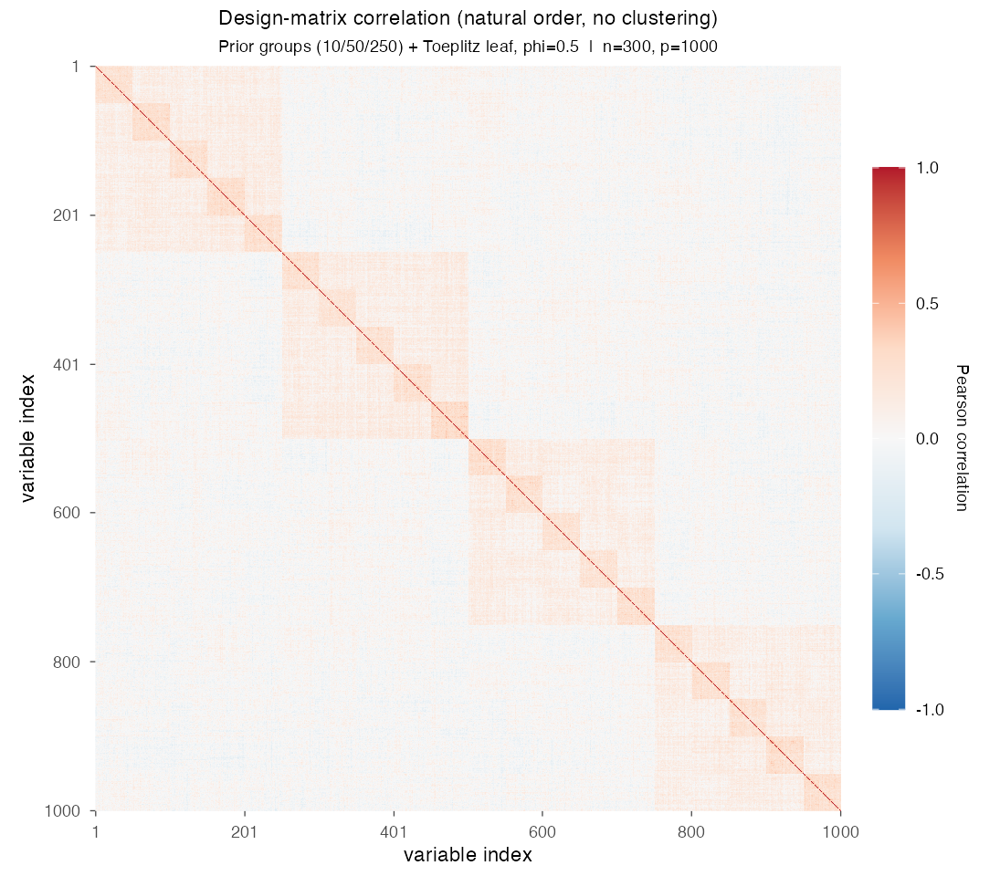
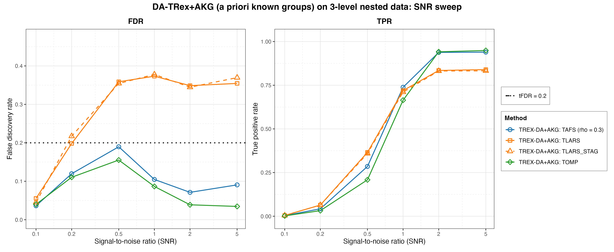

# Demo 06: DA-TRex+AKG (A Priori Known Groups) on Multi-Level Nested Data

Monte Carlo (MC) results for **DA-TRex+AKG**, the dependency-aware (DA) Terminating Random Experiments (T-Rex)
selector (DA-TRex) with **a priori known groups (AKG)**. The true group structure is supplied to the selector
as a hard **constraint** on its dependency tree (constrained sub-clustering), instead of letting hierarchical
agglomerative clustering (HAC) discover the structure from scratch.
The data-generating process (DGP) is a three-level nested latent-factor model with a non-exchangeable
Toeplitz leaf layer.
The common setup is $n=300$, $p=1{,}000$, $s=10$, `Random` support, amplitude $3.0$, target false discovery rate (FDR)
$\mathrm{tFDR}=0.2$, $K=20$ random experiments, $\mathrm{MC}=200$ per grid point, the solvers TLARS / TAFS / TOMP plus
TLARS_STAG (TLARS with the T-loop stagnation stop on, window 7), and a signal-to-noise ratio (SNR) sweep
$\mathrm{SNR} \in \lbrace0.1, 0.2, 0.5, 1, 2, 5\rbrace$.

R port of the C++ demo
[cpp/trex_selector_methods/ad/trex_da/demo_trex_da_06_mc_sim_groups](../../../../../cpp/trex_selector_methods/ad/trex_da/demo_trex_da_06_mc_sim_groups/README.md)
with the same DGP, control parameters, sweep axis, console summaries and result-file naming. The numbers
below are this R run's own results. R draws its own random numbers, so they agree with the C++ and Python runs within
Monte Carlo noise, not exactly. A cell-by-cell comparison with the C++ run (200 trials each) finds none of the 48 FDR
and true positive rate (TPR) cells more than three combined MC standard errors apart. Over the whole suite 29 of
$9{,}344$ cells ($0.31\,\%$) lie that far apart, about the rate noise alone produces.

The solver pool is `default_solvers()` from [`../da_sim_common.R`](../da_sim_common.R), without a variant tag. TLARS
runs without the T-loop stagnation stop, TAFS and TOMP run with it, and TLARS_STAG is TLARS with the stop switched on,
all four with the window `tloop_max_stagnant_steps = 7`. The greedy solvers use *exchangeable tie-breaking*
(`exch_tie_alpha = 0.25` for TAFS/TOMP, `0` for TLARS and TLARS_STAG). See `Exchangeable_Tie_Breaking_DA_TRex.md` in
the TRex_Research documentation. TAFS additionally runs with its adaptive forward-selection (AFS) correlation
parameter `rho_afs = 0.3` (`0` for the others), which is why the figures label it `TAFS (rho = 0.3)`.

---

## Setup — the DA-TRex+AKG selector (constrained sub-clustering)

The known three-level hierarchy is passed via `trex_da_control(prior_groups = groups)`, where `groups` is the list of
three label vectors `(seq_len(p) - 1L) %/% 10L`, `%/% 50L` and `%/% 250L` built by `make_group_structure()`. The core
routes on `prior_groups` being non-empty, so `da_method` is then irrelevant. Each trial runs

```r
sel <- TRexDASelector$new(
  X, y, tFDR = tFDR, seed = -1L, verbose = FALSE,
  da_control = trex_da_control(prior_groups = groups),
  control = trex_control(solver = "TLARS", K = 20, max_dummy_multiplier = 10,
                         use_max_T_stop = TRUE, lloop_strategy = "STANDARD",
                         tloop_stagnation_stop = FALSE, tloop_max_stagnant_steps = 7,
                         use_memory_mapping = FALSE, rho_afs = 0, exch_tie_alpha = 0)
)
sel$select()
```

with the TLARS row shown, while the other rows change only `solver`, `tloop_stagnation_stop`, `rho_afs` and
`exch_tie_alpha`. The `PRIOR_GROUPS` method treats the labels as **merge constraints**, not as deflation
neighbourhoods:

1. the **finest common refinement** of the supplied levels (here the groups of 10) partitions the
   variables, so two variables can only ever share a deflation neighbourhood if they share a group
   on every level,
2. **HAC runs within each constraint group** (`hc_linkage`, default `"Single"`, correlation distance), so merges
   across group boundaries are structurally impossible,
3. the calibration **rho grid is data-driven**, with the pooled within-group dendrogram heights
   subsampled to `hc_grid_length` grid points (the default `0` selects $\min(20, p) = 20$), terminated by the
   conservative $\rho = 1$ singleton anchor (every neighbourhood empty $\Rightarrow$ the paper's
   maximal penalty $\Psi = 1/2$ everywhere),
4. the binary-tree (BT) style occurrence deflation and 3D $(T, v, \rho)$ calibration (see
   [Demo 02](../demo_trex_da_02_mc_sim_ar1_blocks_plus_white/README.md) for the penalty formula)
   run unchanged on these tight within-group neighbourhoods.

**Why not use the raw groups as neighbourhoods?** That was the earlier behaviour, and it
fails by design, because the nearest-partner penalty
$\Psi_j = 1/(2 - \min_{j' \in \mathrm{Gr}(j)} |\Phi_j - \Phi_{j'}|)$ presumes tight, near-exchangeable
neighbourhoods. Inside a 10/50/250-member group nearly every variable has *some*
member with an almost identical occurrence, so the denominator of $\Psi_j$ tends to $2$ uniformly and the
shadow/active ranking is left invariant. The full analysis, including the archived results of the old behaviour,
is in `TRex_Research/documentation/Prior_Groups_Deflation_Mismatch_DA_TRex.md` (§1–§8 the
mismatch, §9 this resolution).

**Relation to BT.** The method is now exactly "BT, tightened by prior knowledge". It uses the same
machinery, but the tree can never merge across known group boundaries, so actives are never deflated against
unrelated variables. The BT reference run in the C++ README shows that the constraints buy power, not a different
failure mode. The figures label the method `TREX-DA+AKG: <solver>` (applied at plot time via the plotter's
`--relabel` flag, so the comma-separated values (CSV) files keep the raw `TREX-DA:` labels the demo writes).

## Setup — data generating process (`dgp_groups_toeplitz_leaf`)

Each predictor is a sum of nested latent factors plus a correlated leaf term,

```math
X_{i,j} = \sum_{x=1}^{L-1} \sqrt{\rho_x - \rho_{x+1}}\; f_{g_x(j)}
        + \sqrt{\rho_0 - \rho_1}\; u_{g_0(j),\,j}
        + \sqrt{1-\rho_0}\;\eta_{i,j},
```

where the coarser levels $x \geq 1$ use one standard-normal latent factor per group, and the finest
level ($x = 0$) uses a **Toeplitz-correlated leaf block**. Within each finest group the leaf
variables $u_r$ satisfy $\mathrm{Cov}(u_r, u_s) = \phi^{|r-s|}$ with $\phi_{\text{leaf}} = 0.5$,
so even the members of a finest-level group are *not* exchangeable. The generator lives in
[`../trex_da_dgps.R`](../trex_da_dgps.R).

- **Three nested grouping levels** over $p = 1{,}000$, with groups of $10$ on the finest level $x = 0$
  ($100$ groups), groups of $50$ on level $x = 1$ ($20$ groups) and groups of $250$ on level $x = 2$ ($4$ groups).
- **Cumulative correlation masses** (fine → coarse): $\rho = \lbrace0.55, 0.25, 0.10\rbrace$. The group of 250
  contributes $0.10$ of each variable's variance, the group of 50 another $0.15$ and the Toeplitz leaf of the group
  of 10 another $0.30$, while $0.45$ is idiosyncratic. Two members of the same group of 10 therefore correlate at
  $0.25 + 0.30 \cdot 0.5^{|r-s|}$, that is $0.25\text{–}0.40$, members of the same group of 50 at $0.25$ and members
  of the same group of 250 at $0.10$.
- The support holds $s = 10$ active variables drawn by the `Random` policy per trial (`make_support_random`,
  1-based indices), the amplitude is $3.0$, and $y = X\beta + \varepsilon$ with
  $\sigma^2 = \widehat{\mathrm{Var}}(X\beta)/\mathrm{SNR}$.



Empirical Pearson correlation of an exemplary design drawn from this DGP (groups of 10/50/250,
$\rho = \lbrace0.55, 0.25, 0.10\rbrace$, $\phi = 0.5$, $n=300$, seed 2026), in **natural variable order with no
hierarchical clustering**. The nested block structure is visible as squares within squares.
Regenerate the per-DGP figures with [`../generate_corr_plots.sh`](../generate_corr_plots.sh)
(shared ggplot2 plotter [`../../../corr_plt_utils.R`](../../../corr_plt_utils.R)).

---

## Running the Demo

```bash
Rscript R/trex_selector_methods/ad/trex_da/demo_trex_da_06_mc_sim_groups/demo_trex_da_06_mc_sim_groups.R      # full run
Rscript R/trex_selector_methods/ad/trex_da/demo_trex_da_06_mc_sim_groups/demo_trex_da_06_mc_sim_groups.R 8    # 8 worker cores
```

Reduce `NUM_MC` to preview. MC trials run in parallel over `num_cores` spawned R worker processes (first
command-line argument, else `TREX_NUM_WORKERS`, else 8, and `0` uses every core). Every finished grid cell is cached
in `simulation_results/cache/`, so a stopped run resumes where it left off, and the cache is removed when the demo
finishes. The script resolves its own directory and sources [`../../../mc_runtime.R`](../../../mc_runtime.R),
[`../../../support_generators.R`](../../../support_generators.R), [`../trex_da_dgps.R`](../trex_da_dgps.R) and
[`../da_sim_common.R`](../da_sim_common.R). The recorded run (library commit `09debc6`, 8 workers) took about
13 minutes.

Afterwards, regenerate the figure from the CSV file with
[`generate_plots.sh`](generate_plots.sh), which drives the suite's ggplot2 plotter
[`../trex_da_plt_utils.R`](../trex_da_plt_utils.R).

---

## Output Files

Data tables are written to `simulation_results/data/`:

- `da_trex_mc_da_groups_toeplitz_leaf.txt` / `.csv`

The figure goes to `simulation_results/plots/` as Portable Network Graphics (PNG) and Portable Document Format (PDF)
files (this port renders no interactive `.html` page).

---

## Results — SNR sweep

- **The greedy solvers are controlled at every grid point and win on power once the signal is clear**. TOMP
  reaches a TPR of $0.949$ with FDR down to $0.035\text{–}0.039$ at $\mathrm{SNR}=2\text{–}5$, and TAFS reaches a TPR
  of $0.940$ with FDR $0.071\text{–}0.105$ from $\mathrm{SNR}=1$ on. Below that, TLARS has the higher TPR ($0.366$
  against $0.285$ for TAFS and $0.209$ for TOMP at $\mathrm{SNR}=0.5$), bought with an FDR of about $0.36$.
- Both greedy solvers have a **high-variance excursion in the low-SNR transition region**. At
  $\mathrm{SNR}=0.5$ TAFS realizes $0.190$, just under the $\mathrm{tFDR}=0.2$ target (standard deviation (sd)
  $0.206$), and TOMP $0.155$ (sd $0.256$), with TPR still only $0.209\text{–}0.285$ there. With so few selections per
  trial the false discovery proportion (FDP) takes coarse values, so these cells carry a Monte Carlo standard error
  of about $0.016$, three to four times that at $\mathrm{SNR} \geq 2$.
- **TLARS remains the outlier of the suite**. Its FDR is $0.349\text{–}0.373$ from $\mathrm{SNR}=0.5$ on
  (against the $\mathrm{tFDR}=0.2$ target) and **flat in SNR**, with a TPR of $0.84$ at $\mathrm{SNR}=5$. At
  $\mathrm{SNR}=0.2$ it already sits at the target ($0.198$, sd $0.318$) while finding almost nothing (TPR below
  $0.07$).
- **TLARS_STAG shows the same violation** ($0.345\text{–}0.378$ from $\mathrm{SNR}=0.5$ on) with nearly the same
  power (TPR $0.83$ at $\mathrm{SNR}=5$), although its T-loop stops after $4.0\text{–}4.6$ steps on average instead of
  TLARS' $5.9\text{–}8.5$. The leak therefore does not come from a long T-loop, which supports the structural
  explanation below.

Against the previous run on library commit `44cf1ab`, TAFS and TOMP lose $0.015\text{–}0.019$ of FDR at
$\mathrm{SNR}=2$ and $5$ while their TPR stays flat. All three language trees show the same drop, so it is more than
Monte Carlo noise. The corrected FDP estimate of library commit `415484d` causes it, because it is the only library
change on the path of the two solvers. Both stop their T-loop on stagnation, so the larger estimate raises the voting
threshold instead of shortening the loop.



---

## Interpretation — why does TLARS still fail although the groups are known?

With the constrained sub-clustering, the deflation operates on tight, data-driven neighbourhoods
inside the true groups, the structure the nearest-partner penalty

```math
\Psi_j = \frac{1}{2 - \min_{j' \in \mathrm{Gr}(j)} |\Phi_j - \Phi_{j'}|}
```

was designed for. What it *cannot* repair is the penalty's **pairwise symmetry**. It deflates a
shadow and its nearest neighbour (typically the true active) by the same factor, leaving their
*ranking* invariant. Whether the ranking is decided correctly is therefore up to the solver's
occurrence profile.

- **Greedy solvers thrive** at moderate within-group correlation ($0.25\text{–}0.40$ inside a group of 10, far
  from Demo 01's near-collinear $0.9$). Winner-take-all in-group competition reliably crowns the *true*
  active once the signal is clear. Their low FDR is consistent with shadows that finish near $\Phi = 0$ and never
  reach the voting threshold.
- **The least-angle regression (LARS) path distributes credit**. After an active enters, its group siblings still
  carry residual correlation with $y$ and collect *intermediate* occurrences, distinct from both the
  active's high $\Phi$ and the bulk at $\approx 0$, which is exactly the profile a symmetric pairwise
  penalty cannot separate. The dummy-calibrated $\widehat{\mathrm{FDP}}$ cannot see them either
  (dummies are uncorrelated with $X$), so they are selected. The FDR plateau, *flat in SNR*,
  is consistent with a structural leak. Shadows inherit signal through the shared group factors and rise
  together with the actives.
- Together with Demo 01 this brackets the design space. *Mutual deflation* handles the
  near-collinear regime (where LARS naturally produces ties and the greedy solvers needed the
  `exch_tie_alpha` fix), while *winner-take-all* handles the moderate-correlation regime (where
  the graded credit-sharing of LARS defeats the deflation). TLARS on moderate multi-level correlation
  falls into the gap between the two mechanisms, with or without prior knowledge (the run without prior groups is
  the BT reference run in the C++ README, since the R port has none).

**Follow-ups worth running** are (a) an *asymmetric* penalty (gap-to-leader instead of
nearest-partner), the one §7 candidate the constrained sub-clustering does not subsume,
(b) a sweep of the finest mass $\rho_0$ toward $0.9$, where TLARS should *recover* as the fine groups approach
exchangeability and mutual deflation kicks in, and (c) per-trial occurrence histograms per solver
to verify the "intermediate shadow occurrence" picture directly.
