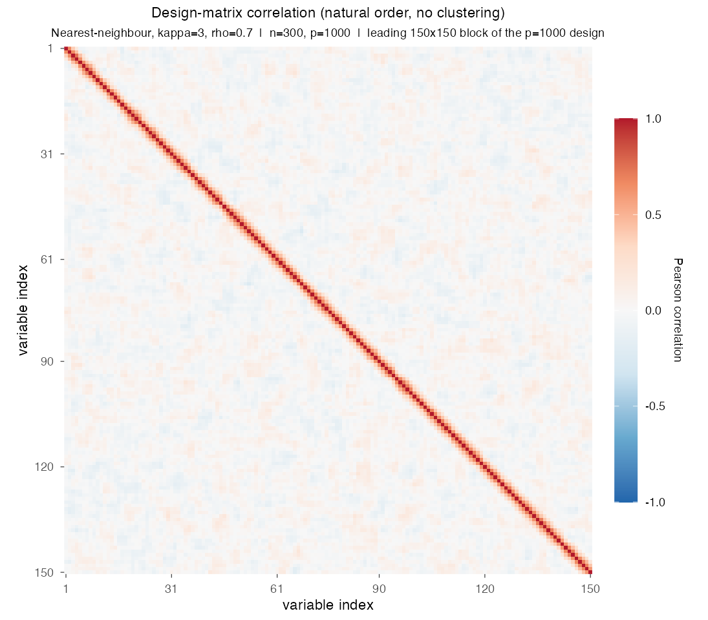
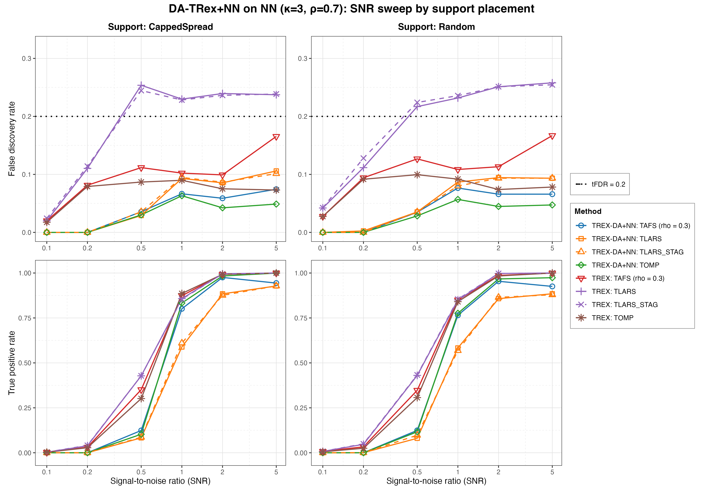
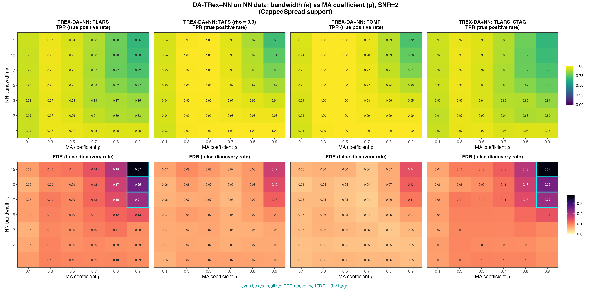
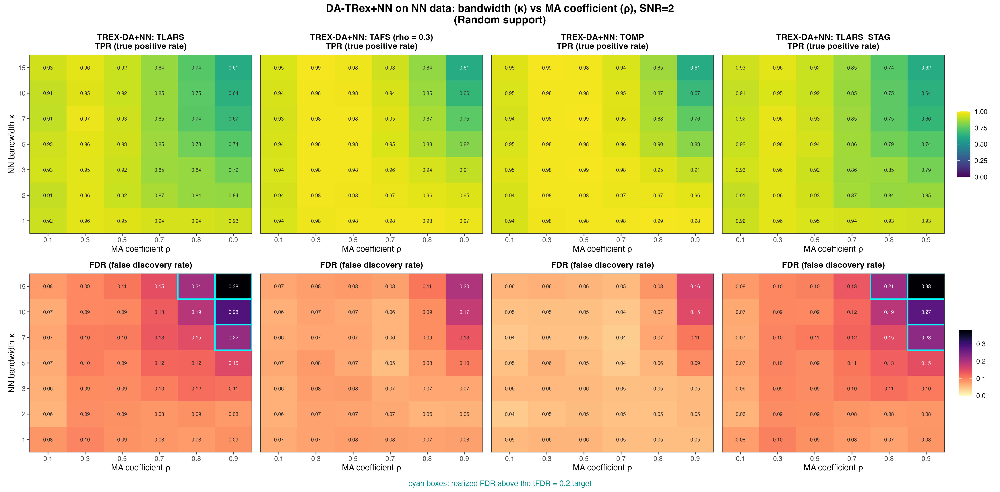
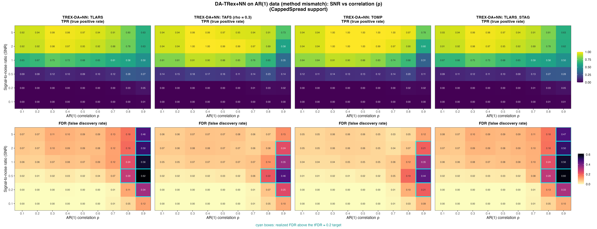
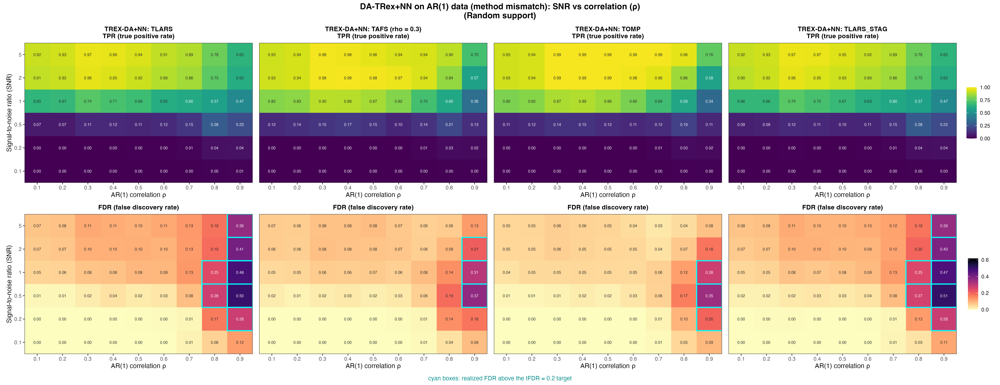

# Demo 07: DA-TRex+NN (Nearest-Neighbor Dependency-Aware T-Rex) on Banded Data + AR(1) Method-Mismatch Study

Monte Carlo (MC) results for **DA-TRex+NN** — the dependency-aware (DA) Terminating Random Experiments (T-Rex)
selector (DA-TRex) with the nearest-neighbor (NN) group design (`da_method = "NN"`) — on banded moving-average (MA)
data of order $\kappa$, MA($\kappa$), which is the correctly specified case, plus a **method-mismatch stress test**
that applies the same NN correction to data from the first-order autoregressive (AR) model AR(1).
Common setup: $n=300$, $p=1{,}000$, $s=10$, amplitude $3.0$, target false discovery rate (FDR) $\mathrm{tFDR}=0.2$,
$K=20$ random experiments, $\mathrm{MC}=200$ per grid point, and solvers TLARS / TAFS / TOMP plus TLARS_STAG, which
is TLARS with the T-loop stagnation stop on (window 7). Part 1 additionally runs the classical no-DA T-Rex baseline.

R port of the C++ demo
[cpp/trex_selector_methods/ad/trex_da/demo_trex_da_07_mc_sim_nn](../../../../../cpp/trex_selector_methods/ad/trex_da/demo_trex_da_07_mc_sim_nn/README.md)
— same data-generating processes (DGPs), control parameters, sweep axes, console summaries, and result-file naming.
The AR(1) mismatch study was its own demo (03b) in the legacy R numbering, and it is Part 3 here. The numbers below
come from the R run against library commit `09debc6` (200 MC trials per cell, 8 workers, 6.7 h). R draws its own
random numbers, so its cells agree with C++ and Python up to Monte Carlo noise, not exactly. Of the 1,728 FDR and true
positive rate (TPR) cells compared with the C++ run, none lies more than three combined Monte Carlo standard errors
away. Over the whole suite it is 29 of 9,344 cells (0.31 %), the rate noise alone produces.

The greedy solvers use *exchangeable tie-breaking* (`exch_tie_alpha = 0.25` for TAFS/TOMP, `0` for TLARS
and TLARS_STAG) in every part, as in C++. TAFS and TOMP run with the T-loop stagnation stop, TLARS without it.
TAFS runs with its adaptive forward-selection (AFS) correlation parameter `rho_afs = 0.3` throughout (`0` for
TLARS/TOMP), which is why the figures label it `TAFS (rho = 0.3)`.

---

## Setup — the DA-TRex+NN selector

The DA-TRex+NN selector deflates each variable's ordinary relative occurrence $\Phi_{T,L}(j)$ by a penalty
built from its most similar competitor within a group of correlated variables,

```math
\Phi^{\mathrm{NN}}_{T,L}(j, \rho_{\text{thr}}) := \Psi^{\mathrm{NN}}_{T,L}(j, \rho_{\text{thr}}) \cdot \Phi_{T,L}(j),
\qquad
\Psi^{\mathrm{NN}}_{T,L}(j, \rho_{\text{thr}}) :=
\begin{cases}
\displaystyle \frac{1}{2 - \underset{j' \in \mathrm{Gr}(j, \rho_{\text{thr}})}{\min}
  \left| \Phi_{T,L}(j) - \Phi_{T,L}(j') \right|}\,,
& \mathrm{Gr}(j, \rho_{\text{thr}}) \neq \emptyset \\[10pt]
\displaystyle 1/2, & \mathrm{Gr}(j, \rho_{\text{thr}}) = \emptyset
\end{cases}
```

with the **NN group design**, in which every variable correlated with $j$ beyond a threshold joins its group,

```math
\mathrm{Gr}(j, \rho_{\text{thr}}) := \left\{ j' \in \{1, \ldots, p\} \setminus \{j\} :
\left|\mathrm{corr}(\boldsymbol{x}_j, \boldsymbol{x}_{j'})\right| \geq \rho_{\text{thr}} \right\}.
```

Unlike the `BT` (binary-tree) design, these groups may overlap arbitrarily. A true active whose group members
all carry clearly *lower* occurrences keeps $\Psi \approx 1$ (no penalty), while a collinear shadow whose
occurrence resembles its group's leader is deflated toward $1/2$. Selection then thresholds
$\widehat{\mathcal{A}} = \lbrace j : \Phi_{T,L}^{\mathrm{NN}}(j, \rho_{\text{thr}}) > v \rbrace$ as usual.

In R every trial builds and runs the selector as

```r
sel <- TRexDASelector$new(X, y, tFDR = 0.2, seed = -1,
                          da_control = trex_da_control(da_method = "NN"),
                          control = trex_control(...))
sel$select()
```

with `seed = -1` (hardware entropy) as in all MC demos. The four solver rows come from
`default_solvers("+NN")` in [`../da_sim_common.R`](../da_sim_common.R), and the shared control is `K = 20`,
`max_dummy_multiplier = 10`, `use_max_T_stop = TRUE`, `lloop_strategy = "STANDARD"` and
`tloop_max_stagnant_steps = 7`. The base rows of Part 1 build the plain `TRexSelector` with the same control.

## Setup — data generating processes

**NN / MA($\kappa$) model (Parts 1–2, `dgp_nn_snr`).** The $j$-th predictor is a causal convolution of
independent and identically distributed (i.i.d.) standard-normal innovations $\eta$ across columns (a
finite-impulse-response filter of length $\kappa+1$),

```math
X_{i,j} = \sum_{l=0}^{\kappa} \theta_l\, \eta_{i,j+l},
\qquad
\theta_l = c\,\rho^{\,l},
\qquad
c = \Bigl(\textstyle\sum_{m=0}^{\kappa} \rho^{2m}\Bigr)^{-1/2},
```

i.e. the coefficients follow a geometric path with common ratio $\rho$ and are normalized to unit variance.
The resulting covariance is **banded Toeplitz**. For column distance $d = |j-k| \leq \kappa$,

```math
\Sigma_{jk} = c^2 \rho^{d} \sum_{l=0}^{\kappa-d} \rho^{2l},
\qquad
\Sigma_{jk} = 0 \;\text{ for } |j-k| > \kappa,
```

so correlation decays roughly geometrically *inside* the band and **cuts off exactly at bandwidth $\kappa$** —
the hallmark difference to AR(1), whose correlation never truly vanishes. (Note that "nearest-neighbor" classically
refers to a banded *precision* matrix. The MA($\kappa$) model instead has a banded *covariance* and a dense
precision. $\rho$ here is the common ratio of the filter, not the lag-1 autocorrelation, although for
$\kappa \gg 1$ the correlation at distance $d$ approaches $\rho^d$.)



Empirical Pearson correlation of an exemplary design drawn from `dgp_nn_snr` ($\kappa=3$, $\rho=0.7$,
seed 2026), in **natural variable order — no hierarchical clustering**, cropped to the leading 150 columns so the
band stays legible. It shows a narrow red band of width $\kappa$ around the diagonal and only sampling noise beyond
it.
Regenerate the per-DGP figures with [`../generate_corr_plots.sh`](../generate_corr_plots.sh) (shared plotter
[`../../../corr_plt_utils.R`](../../../corr_plt_utils.R)).

**AR(1) model (Part 3, `dgp_ar1_snr` — same DGP as Demo 01).**

```math
X_{i,j} = \rho\, X_{i,j-1} + \sqrt{1-\rho^2}\; \eta_{i,j},
\qquad
\Sigma_{jk} = \rho^{|j-k|},
```

geometrically decaying but *unbanded* correlation — deliberately mismatched to the NN correction's finite-range
group design.

**Linear model and signal-to-noise ratio (SNR) control.** Each trial draws $y = X\beta + \varepsilon$ with
$\varepsilon_i \stackrel{\text{iid}}{\sim} \mathcal{N}(0, \sigma^2)$ and
$\sigma^2 = \widehat{\mathrm{Var}}(X\beta)/\mathrm{SNR}$. The $s=10$ active coefficients (amplitude $3.0$) are
placed by two support policies:

- **CappedSpread**: deterministic even spacing, $\text{gap} = \min(\lfloor p/s \rfloor, \text{max\_gap}=20)$,
  i.e. support $\lbrace1, 21, 41, \ldots, 181\rbrace$ (1-based R indices) — fixed across trials,
- **Random**: drawn uniformly without replacement, redrawn each trial.

---

## Running

```bash
Rscript R/trex_selector_methods/ad/trex_da/demo_trex_da_07_mc_sim_nn/demo_trex_da_07_mc_sim_nn.R      # full run
Rscript R/trex_selector_methods/ad/trex_da/demo_trex_da_07_mc_sim_nn/demo_trex_da_07_mc_sim_nn.R 8    # 8 workers
```

The three parts are toggled by the `RUN_PART_*` flags at the top of the script (all `TRUE`, mirroring the cpp
`if (true)` toggles). Reduce `NUM_MC` to preview. MC trials run in parallel over `num_cores` worker processes
(first command-line argument, else `TREX_NUM_WORKERS`, else 8, and `0` uses every core). Every finished grid cell is
kept in `simulation_results/cache/cells.tsv`, so a stopped run continues where it stopped, and a finished run
removes the cache. The script sources `../../../mc_runtime.R`, `../../../support_generators.R`, the consolidated
`../trex_da_dgps.R`, and the shared `../da_sim_common.R`.

Afterwards, regenerate the figures from the comma-separated values (CSV) files with
[`generate_plots.sh`](generate_plots.sh), which drives the shared ggplot2 plotter
[`../trex_da_plt_utils.R`](../trex_da_plt_utils.R).

---

## Output Files

Data tables are written to `simulation_results/data/` (`.txt` pretty-printed, `.csv` tidy long format):

- `da_trex_mc_da_nn_snr_capped.txt` / `.csv`, `da_trex_mc_da_nn_snr_random.txt` / `.csv` (Part 1)
- `da_trex_mc_da_nn_kappa_rho.txt` / `.csv` (Part 2, two-support 2D schema)
- `da_trex_mc_da_nn_ar_snr_rho.txt` / `.csv` (Part 3, two-support 2D schema)

Figures go to `simulation_results/plots/` as Portable Network Graphics (PNG) and Portable Document Format (PDF)
files with the same names as in the Python suite (this port renders no interactive `.html` page). The 2D CSVs are
rendered by the plotter's `sweep2d` mode.

---

## Part 1 — SNR sweep on NN data ($\kappa = 3$, $\rho = 0.7$)

DA-TRex+NN vs. base T-Rex over $\mathrm{SNR} \in \lbrace0.1, 0.2, 0.5, 1, 2, 5\rbrace$, CappedSpread vs. Random support:

- All four DA solvers stay below $\mathrm{tFDR}=0.2$ at every SNR (worst cell $0.106$, DA-TLARS at
  $\mathrm{SNR}=5$, CappedSpread, with DA-TLARS_STAG at $0.101$ in the same cell). Base T-Rex TLARS violates from
  $\mathrm{SNR}=0.5$ on with both support placements (FDR $0.22\text{–}0.26$), and base TLARS_STAG does the same
  ($0.22\text{–}0.25$). Base TAFS stays below the target (at most $0.17$, at $\mathrm{SNR}=5$), and base TOMP stays
  at or below $0.10$.
- From $\mathrm{SNR}=2$ on, the DA cost in TPR is modest and concentrates in DA-TLARS ($0.88$ with CappedSpread
  and $0.86$ with Random support vs. base $1.00$ at $\mathrm{SNR}=2$), while DA-TAFS/TOMP reach
  $0.93\text{–}1.00$ from $\mathrm{SNR}=2$ on. DA-TAFS gives a little power back between $\mathrm{SNR}=2$ and $5$
  ($0.98$ to $0.94$ with CappedSpread, $0.95$ to $0.93$ with Random support).
- DA-TLARS runs its T-loop almost to the cap ($T \approx 129\text{–}144$ of $150$), while TLARS_STAG stops after
  about $8$ steps with nearly the same FDR and TPR (within $0.007$ and $0.022$).
- The two support placements behave nearly identically, and no FDR or TPR value differs between them by more than
  $0.06$. The CappedSpread actives (spacing 20) sit far outside each other's bands of width $\kappa=3$, while Random
  placements put two actives within $\kappa$ of each other in about a quarter of the trials, without a visible cost.



---

## Part 2 — 2D $\kappa \times \rho$ sweep on NN data ($\mathrm{SNR} = 2$)

Per-solver TPR/FDR heatmaps over $\kappa \in \lbrace1,2,3,5,7,10,15\rbrace$ (band width) $\times$
$\rho \in \lbrace0.1, 0.3, 0.5, 0.7, 0.8, 0.9\rbrace$ (filter common ratio). FDR cells above the target are outlined
in cyan.

- **FDR control holds almost everywhere**. Violations appear only in the top-right corner ($\rho \geq 0.8$ *and*
  $\kappa \geq 7$), where the effective correlation neighborhood is both wide and strong. Only TLARS and TLARS_STAG
  violate, in the same seven cells ($\rho = 0.9$ at $\kappa = 7, 10, 15$ with both placements, plus $\kappa = 15$,
  $\rho = 0.8$ with Random support). TLARS is hit hardest ($0.37$ with CappedSpread and $0.38$ with Random support
  at $\kappa=15$, $\rho=0.9$), while TAFS and TOMP stay controlled everywhere (at most $0.195$ and $0.158$, both at
  $\kappa=15$, $\rho=0.9$ with Random support).
- Group sizes grow with $\kappa$, so once the band is wide *and* strongly correlated the residual shadow
  discoveries accumulate — the NN analogue of Demo 01's gap-vs-window story, but entering through the band
  width rather than the support spacing.
- **TPR degrades gracefully** toward the same corner, down to $0.61\text{–}0.72$ for every solver at
  $\kappa = 15$, $\rho = 0.9$. At $\rho \leq 0.5$ every solver keeps at least $0.90$ for every $\kappa$, and the
  narrowest band $\kappa = 1$ keeps at least $0.91$ at every $\rho$.
- TLARS_STAG gives the same heatmaps as TLARS. Averaged over the 84 cells, its FDR is $0.001$ lower and its TPR
  the same within $0.001$, and the largest single-cell change is $0.012$ in FDR.

Against the previous run on library commit `44cf1ab`, DA-TAFS and DA-TOMP lose FDR in all three parts while their
TPR stays flat. Averaged over all cells, the FDR of DA-TAFS falls from $0.086$ to $0.070$ and that of DA-TOMP from
$0.072$ to $0.056$, most in this $\kappa \times \rho$ sweep ($0.104$ to $0.078$ and $0.086$ to $0.059$). The largest
single drop is DA-TOMP at $\kappa = 10$, $\rho = 0.5$ with CappedSpread support ($0.091$ to $0.046$, about eight
combined standard errors). The base TAFS and TOMP rows of Part 1 move the same way ($0.109$ to $0.101$ and $0.086$ to
$0.074$), and the C++ and Python runs show the same drop. Library commit `415484d` removed the lower clamp
$\Phi' \geq 0$ from the false discovery proportion (FDP) estimate, which makes the estimate larger, and it is the
only library change between the two runs on the path of TAFS and TOMP under the STANDARD L-loop. Both stop their
T-loop on stagnation, so the larger estimate raises the voting threshold instead of shortening the loop. DA-TLARS and
TLARS_STAG move much less ($0.111$ to $0.105$ and $0.109$ to $0.104$).





---

## Part 3 — 2D SNR $\times$ $\rho$ sweep on AR(1) data (method mismatch)

The same DA-TRex+NN selector applied to AR(1) data over $\mathrm{SNR} \in \lbrace0.1, \ldots, 5\rbrace$ $\times$
$\rho \in \lbrace0.1, \ldots, 0.9\rbrace$:

- **Up to $\rho = 0.7$ the mismatch is benign**. FDR stays below the target for all solvers, SNRs and both
  placements (worst cell $0.132$, TLARS at $\mathrm{SNR}=1$, $\rho=0.7$, Random support) — the NN groups capture
  enough of the (rapidly decaying) AR(1) neighborhood to deflate the nearby shadows.
- **At $\rho = 0.8\text{–}0.9$ control breaks down sharply** (up to $0.62$ for TLARS at $\mathrm{SNR}=0.5$,
  $\rho=0.9$, CappedSpread, with TAFS $0.46$ and TOMP $0.44$ in the same cell). AR(1) correlation beyond the
  effective NN window leaks through as false discoveries, exactly the failure mode the finite-range group design
  cannot see (a plausible reading the data do not test directly). TLARS and TLARS_STAG violate in the same $14$
  cells. TAFS violates in $8$ cells (one of them at $\rho=0.8$) and TOMP in $7$, all at $\rho=0.9$. TOMP is the most
  robust as the SNR grows (at most $0.21$ from $\mathrm{SNR}=2$ on and $0.08\text{–}0.12$ at $\mathrm{SNR}=5$,
  $\rho=0.9$), while TLARS stays at $0.36\text{–}0.50$ there.
- Read this against [Demo 01](../demo_trex_da_01_mc_sim_ar1/README.md) (same AR(1) data, correctly specified `AR1`
  correction). The $\rho$ sweep of its R run (Part 2, $\mathrm{SNR}=2$) keeps every DA FDR at or below $0.19$,
  while DA-TRex+NN at the same SNR reaches $0.41\text{–}0.50$ for TLARS at $\rho=0.9$. The matched correction pays
  for its control at $\rho=0.9$ with most of its power (TPR at most $0.32$), while DA-TRex+NN keeps
  $0.57\text{–}0.63$. The gap between the two quantifies the price of the wrong dependency model — negligible at
  moderate correlation, large in the strong-correlation regime.




