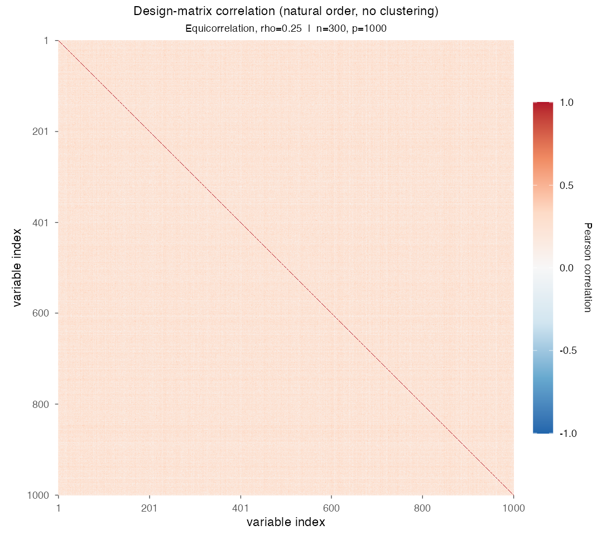
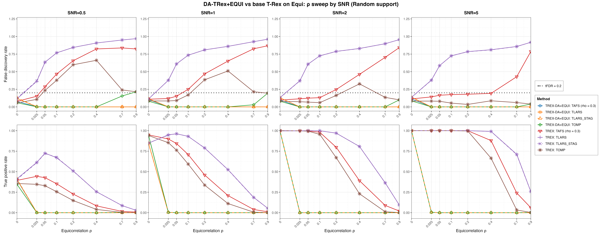

# Demo 08: DA-TRex+EQUI on Equicorrelated (EQUI) Data — 2D SNR × ρ Sweep

Monte Carlo (MC) results for **DA-TRex+EQUI** — the dependency-aware (DA) Terminating Random Experiments (T-Rex)
selector (DA-TRex) with the equicorrelation (EQUI) correction — vs. the **classical (no-DA) T-Rex selector** on
equicorrelated data. The demo runs one 2D sweep. For each signal-to-noise ratio (SNR) column in
$\lbrace0.5, 1, 2, 5\rbrace$, it runs a full $\rho$ sweep over $\lbrace0, 0.025, 0.05, 0.1, 0.2, 0.4, 0.7, 0.9\rbrace$,
dense near $0$ to locate the DA suppression cliff. Common configuration: $n=300$, $p=1{,}000$, $s=10$, amplitude
$3.0$, target false discovery rate (FDR) $\mathrm{tFDR}=0.2$, $K=20$ random experiments, $\mathrm{MC}=200$ per grid
point, `Random` support with a full redraw per trial, and solvers TLARS / TAFS / TOMP with *exchangeable
tie-breaking* (`exch_tie_alpha = 0.25` for the greedy solvers TAFS/TOMP, `0` for the path solver TLARS), plus
TLARS_STAG (TLARS with the T-loop stagnation stop on, window 7), each with its base (no-DA) T-Rex comparison row —
8 method rows per grid point. TAFS additionally runs with its adaptive forward-selection (AFS) correlation parameter
`rho_afs = 0.3` (`0` for TLARS/TOMP), which is why the figures label it `TAFS (rho = 0.3)`.

R port of the C++ demo
[cpp/trex_selector_methods/ad/trex_da/demo_trex_da_08_mc_sim_equi_and_bt](../../../../../cpp/trex_selector_methods/ad/trex_da/demo_trex_da_08_mc_sim_equi_and_bt/README.md)
— same data-generating process (DGP), control parameters, sweep axes, console summaries, and result-file naming (the
folder keeps the cpp name "equi_and_bt", because earlier revisions also carried binary-tree (BT) sweeps on
block-equicorrelated data, dropped as redundant since the BT method is exercised on better-suited block designs in
Demos 02–05). The numbers below come from the R run against library commit `09debc6` (200 MC trials per cell,
8 workers, 4.0 h). R draws its own random numbers, so its cells agree with C++ and Python up to Monte Carlo noise, not
exactly. Of the 512 FDR and true positive rate (TPR) cells compared with the C++ run, none lies more than three
combined Monte Carlo standard errors away. Over the whole suite it is 29 of 9,344 cells (0.31 %), the rate noise alone
produces.

> **Purpose.** Equicorrelation is the stress case of the `trex_da` framework — every column loads
> on one shared factor, so there is no "distance" to exploit the way the first-order autoregressive (AR) model AR(1)
> has, and **individual variable selection is structurally infeasible for any method**. The 2D layout shows the three
> facts that make this demo worth keeping: (1) the DA suppression cliff sits at very small $\rho$,
> (2) it is SNR-independent — signal strength never rescues it, and (3) at $\rho = 0$ everything
> works, anchoring the comparison. DA-EQUI fails *safe* (selects nothing), while base T-Rex fails
> *unsafe* (FDR far above target).

---

## Setup — data generating process

### Sparse linear model and SNR control

Each Monte Carlo trial draws

```math
\boldsymbol{y} = \boldsymbol{X} \boldsymbol{\beta} + \boldsymbol{\varepsilon},
\qquad \boldsymbol{\varepsilon} \sim \mathcal{N}(0,\,\sigma^2 \boldsymbol{I}_n),
\quad \boldsymbol{\varepsilon} \perp \boldsymbol{X},
```

with a **sparse coefficient vector** $\boldsymbol\beta \in \mathbb{R}^p$ whose support and
sparsity level are

```math
\mathcal{S} = \operatorname{supp}(\boldsymbol{\beta}) = \{j : \beta_j \neq 0\},
\qquad s = |\mathcal{S}| = 10 \ll p,
```

all active coefficients set to amplitude $3.0$, support placed by the `Random` policy with a full
redraw per trial (1-based R indices). The noise variance is calibrated to the target signal-to-noise
ratio,

```math
\mathrm{SNR} = \frac{\operatorname{Var}(\boldsymbol{X} \boldsymbol{\beta})}{\sigma^{2}},
\qquad \sigma^2 = \widehat{\operatorname{Var}}(\boldsymbol{X}\boldsymbol{\beta}) / \mathrm{SNR}.
```

### Equicorrelation (`dgp_equi_snr`)

$n$ observations on $p$ predictors are generated through a **single latent factor model**,

```math
X_{i,j} = \sqrt{\rho}\, f_i + \sqrt{1-\rho}\, \eta_{i,j},
\qquad f_i \overset{\text{i.i.d.}}{\sim} \mathcal{N}(0,1),
\quad \eta_{i,j} \overset{\text{i.i.d.}}{\sim} \mathcal{N}(0,1),
```

with all variables mutually independent. Each row

```math
\boldsymbol{x}_i = (X_{i,1},\ldots,X_{i,p})^\top
```

is then an independent and identically distributed (i.i.d.) draw from a zero-mean Gaussian with **compound
symmetry** covariance

```math
\boldsymbol{\Sigma}_{\text{equi}} =
(1 - \rho) \, \boldsymbol{I}_p + \rho \, \mathbf{1}_p \mathbf{1}_p^{\top},
\qquad [\boldsymbol{\Sigma}_{\text{equi}}]_{jj} = 1 \;\forall j,
```

valid for $\rho \in \left(-\tfrac{1}{p-1},\, 1\right)$ (the demo uses $\rho \in [0, 0.9]$). The
eigenstructure is fully explicit:

```math
\begin{aligned}
\lambda_1 &= 1 + (p-1)\rho && \text{multiplicity 1 (eigenvector } \mathbf{1}_p/\sqrt{p}) \\
\lambda_2 &= 1 - \rho && \text{multiplicity } p-1
\end{aligned}
```

When $\rho \leq \rho_{\text{thr\_DA}}$ the single factor is negligible. As $\rho \to 1$ the $p-1$
minor eigenvalues collapse to zero, the predictor matrix becomes rank-1, and the regression is
unidentifiable — unlike AR(1), the correlation is *uniform* across all variable pairs, so there is
no isolation of actives by index distance. The shared factor puts every variable inside every
other variable's DA correction set, and the correction deflates all candidates at once.



Empirical Pearson correlation of an exemplary design drawn from this DGP ($\rho = 0.25$, $n=300$,
$p=1{,}000$, seed 2026), in **natural variable order — no hierarchical clustering**. It shows a uniform positive
wash over the *entire* matrix, with no structure to localize. Regenerate the per-DGP figures with
[`../generate_corr_plots.sh`](../generate_corr_plots.sh) (shared plotter
[`../../../corr_plt_utils.R`](../../../corr_plt_utils.R)).

### Selector call

In R every trial builds and runs the selector as

```r
sel <- TRexDASelector$new(X, y, tFDR = 0.2, seed = -1,
                          da_control = trex_da_control(da_method = "EQUI"),
                          control = trex_control(...))
sel$select()
```

with `seed = -1` (hardware entropy) as in all MC demos, and the base rows build the plain `TRexSelector` with the
same control. The four solver rows come from `default_solvers("+EQUI")` in [`../da_sim_common.R`](../da_sim_common.R),
and the shared control is `K = 20`, `max_dummy_multiplier = 10`, `use_max_T_stop = TRUE`,
`lloop_strategy = "STANDARD"` and `tloop_max_stagnant_steps = 7`, with the stagnation stop on for TAFS, TOMP and
TLARS_STAG and off for TLARS.

### Sweep design

- **Outer loop (SNR columns)**: $\mathrm{SNR} \in \lbrace0.5, 1, 2, 5\rbrace$, one output file pair per
  column, disjoint seed blocks per column (statistically independent columns).
- **Inner sweep ($\rho$)**: $\rho \in \lbrace0, 0.025, 0.05, 0.1, 0.2, 0.4, 0.7, 0.9\rbrace$ — front-loaded
  at small $\rho$, where the suppression cliff is expected (the legacy 1D sweeps bracket it only
  as "somewhere in $(0, 0.1]$").

---

## Reference behavior (previous runs)

- **Legacy runs of the R package from the Comprehensive R Archive Network (CRAN)** (`Results_trex_da_02_equi.md`,
  $n=150$, $p=500$, $s=5$) showed total suppression at every grid point except $\rho = 0$, as the
  [C++ README](../../../../../cpp/trex_selector_methods/ad/trex_da/demo_trex_da_08_mc_sim_equi_and_bt/README.md#reference-behavior-previous-runs)
  details.
- **C++ 2D sweep** (the direct reference for this port) finds the same cliff position and the same
  base-T-Rex failure pattern at $n=300$, $p=1{,}000$.

---

## Running

```bash
Rscript R/trex_selector_methods/ad/trex_da/demo_trex_da_08_mc_sim_equi_and_bt/demo_trex_da_08_mc_sim_equi_and_bt.R      # full run
Rscript R/trex_selector_methods/ad/trex_da/demo_trex_da_08_mc_sim_equi_and_bt/demo_trex_da_08_mc_sim_equi_and_bt.R 8    # 8 workers
```

Reduce `NUM_MC` to preview. MC trials run in parallel over `num_cores` worker processes (first command-line
argument, else `TREX_NUM_WORKERS`, else 8, and `0` uses every core). Every finished grid cell is kept in
`simulation_results/cache/cells.tsv`, so a stopped run continues where it stopped, and a finished run removes the
cache. The script sources `../../../mc_runtime.R`, `../../../support_generators.R`, the consolidated
`../trex_da_dgps.R`, and the shared `../da_sim_common.R`.

Afterwards, regenerate the figure from the comma-separated values (CSV) files with
[`generate_plots.sh`](generate_plots.sh), which drives the shared ggplot2 plotter
[`../trex_da_plt_utils.R`](../trex_da_plt_utils.R).

---

## Output Files

Data tables are written to `simulation_results/data/` (`.txt` pretty-printed, `.csv` tidy long
format), one pair per SNR column:

- `da_trex_mc_da_equi_rho_snr0p5.txt` / `.csv`
- `da_trex_mc_da_equi_rho_snr1.txt` / `.csv`
- `da_trex_mc_da_equi_rho_snr2.txt` / `.csv`
- `da_trex_mc_da_equi_rho_snr5.txt` / `.csv`

The `.txt` tables print $\rho$ with two decimals, so $0.025$ shows as `0.03` there, while the `.csv` files keep the
exact grid value. The single figure goes to `simulation_results/plots/` as Portable Network Graphics (PNG) and
Portable Document Format (PDF) files (this port renders no interactive `.html` page):

- `da_trex_mc_da_equi_rho_snr_grid.png` / `.pdf` — a 2×4 grid with rows = FDR / TPR,
  columns = SNR, and x-axis = $\rho$ on a square-root scale so the dense $\text{low-}\rho$ cliff region stays
  readable.
  (One-off per-CSV overviews can still be produced on demand via
  `./generate_plots.sh <csv>`.)

---

## Results (MC = 200, library commit `09debc6`)



- **The DA suppression cliff sits at the first nonzero grid point, $\rho = 0.025$, in every SNR
  column.** At $\rho = 0$ all four DA solvers are controlled (FDR $0.06\text{–}0.14$) with the power
  the SNR allows (TPR $0.35\text{–}0.41$ at SNR $0.5$, $0.85\text{–}0.95$ at SNR $1$, at least $0.997$ at
  SNR $2/5$). At $\rho = 0.025$ they are already dead (TPR $\leq 0.005$, FDR $\leq 0.003$, DA-TLARS runs into the
  cap of $T = 150$ dummies in almost every run), and from $\rho = 0.05$ on DA-TLARS, DA-TAFS and DA-TLARS_STAG
  select nothing, while DA-TOMP keeps its TPR at or below $0.0025$. **Signal strength never moves the cliff** — it
  only changes how much power is lost at it. DA-EQUI works only where no correction is needed.
- **Base T-Rex TLARS fails unsafe from the same grid point.** Its FDR is $0.36\text{–}0.38$ at
  $\rho = 0.025$ and climbs monotonically to $0.92\text{–}0.97$ at $\rho = 0.9$ in every column. At
  SNR $5$, $\rho = 0.4$ it finds essentially all actives (TPR $0.99$) buried in garbage
  (FDR $0.81$).
- **High-SNR nuance on the greedy base side.** At SNR $= 5$, base TOMP is FDR-controlled at
  *every* $\rho$ (FDR $\leq 0.09$) with full power through $\rho = 0.2$ (TPR $\geq 0.996$, and $0.67$ at
  $\rho = 0.4$), and base TAFS sits just under the limit from $\rho = 0.05$ to $0.4$ (FDR $0.17\text{–}0.19$)
  before it breaks at $\rho = 0.7$ ($0.43$). At lower SNR both violate early. At SNR $0.5$ both exceed the target
  from $\rho = 0.05$ on, and at SNR $1$ base TAFS does from $\rho = 0.1$ on and base TOMP at
  $\rho = 0.2\text{–}0.7$. So for moderate equicorrelation and strong signal, plain greedy T-Rex (TOMP) is the
  most reliable selector, while the DA-EQUI correction selects almost nothing there.
- **TLARS_STAG matches TLARS in both rows.** With the stagnation stop, FDR and TPR differ from TLARS by at most
  $0.01$, while the T-loop of the DA row stops after at most $8$ steps instead of running into the cap of
  $150$, and the base row's median $T$ drops from $51$ to $10$.
- **DA-TOMP raises false alarms at high $\rho$ and low SNR.** At SNR $0.5$ its FDR is $0.155$ at $\rho = 0.7$ and
  $0.215$ at $\rho = 0.9$, while it finds essentially no true variable there (TPR $\leq 0.0025$). At $\rho = 0.9$
  the rate falls with the SNR to $0.195$, $0.10$ and $0.04$ at SNR $1$, $2$ and $5$. In all these cells the
  per-run false discovery proportion (FDP) is either $0$ or $1$, so `sd_FDR` matches
  $\sqrt{\mathrm{FDR}\,(1 - \mathrm{FDR})}$. The C++ README explains this
  [false-alarm plateau of DA-TOMP](../../../../../cpp/trex_selector_methods/ad/trex_da/demo_trex_da_08_mc_sim_equi_and_bt/README.md#the-false-alarm-plateau-of-da-tomp)
  (a lone winner passes the EQUI correction, and exchangeable tie-breaking holds its rate near the target), and its
  [check with 1,000 runs per cell](../../../../../cpp/trex_selector_methods/ad/trex_da/demo_trex_da_08_mc_sim_equi_and_bt/README.md#check-with-1000-runs-per-cell)
  finds $0.163$ at $\rho = 0.7$ and $0.206$ at $\rho = 0.9$. The R values lie close to both, within one standard
  error ($0.03$ at 200 runs). The C++ run itself drew $0.230$ at $\rho = 0.7$, $0.075$ above R, which is about two
  combined standard errors in a cell whose per-run FDP is only $0$ or $1$.

Against the previous run on library commit `44cf1ab`, the greedy solvers lose FDR where they still select, while
their TPR stays flat. At $\mathrm{SNR} = 2\text{–}5$ and $\rho \leq 0.1$ the FDR of base TOMP falls from $0.106$ to
$0.073$ on average and that of base TAFS from $0.158$ to $0.133$. The largest drop is base TOMP at SNR $5$ and
$\rho = 0.1$ ($0.096$ to $0.054$, about seven combined standard errors). At $\rho = 0$, the only grid point where the
DA rows keep power, DA-TOMP falls from $0.096$ to $0.076$ and DA-TAFS from $0.115$ to $0.099$. The C++ and Python runs
show the same drop. Library commit `415484d` removed the lower clamp $\Phi' \geq 0$ from the FDP estimate, which
makes the estimate larger, and it is the only library change between the two runs on the path of TAFS and TOMP under
the STANDARD L-loop. Both stop their T-loop on stagnation, so the larger estimate raises the voting threshold instead
of shortening the loop. TLARS runs without the stagnation stop, so there the estimate can end the T-loop earlier. The
base TLARS row keeps its FDR ($0.676$ to $0.670$ on average) while its mean T-loop length falls from $87$ to $69$
steps, most at $\rho = 0.1\text{–}0.4$ (at SNR $2$ and $\rho = 0.1$ from $90$ to $45$ steps).

**Bottom line.** Equicorrelation defeats individual variable selection for the DA framework.
DA-EQUI fails *safe* (selects essentially nothing for any $\rho \geq 0.025$, regardless of SNR, apart from the
false-alarm plateau of DA-TOMP above), while base T-Rex TLARS fails *unsafe* (FDR up to $0.97$). The demo's value
is documenting this boundary of the method precisely.
