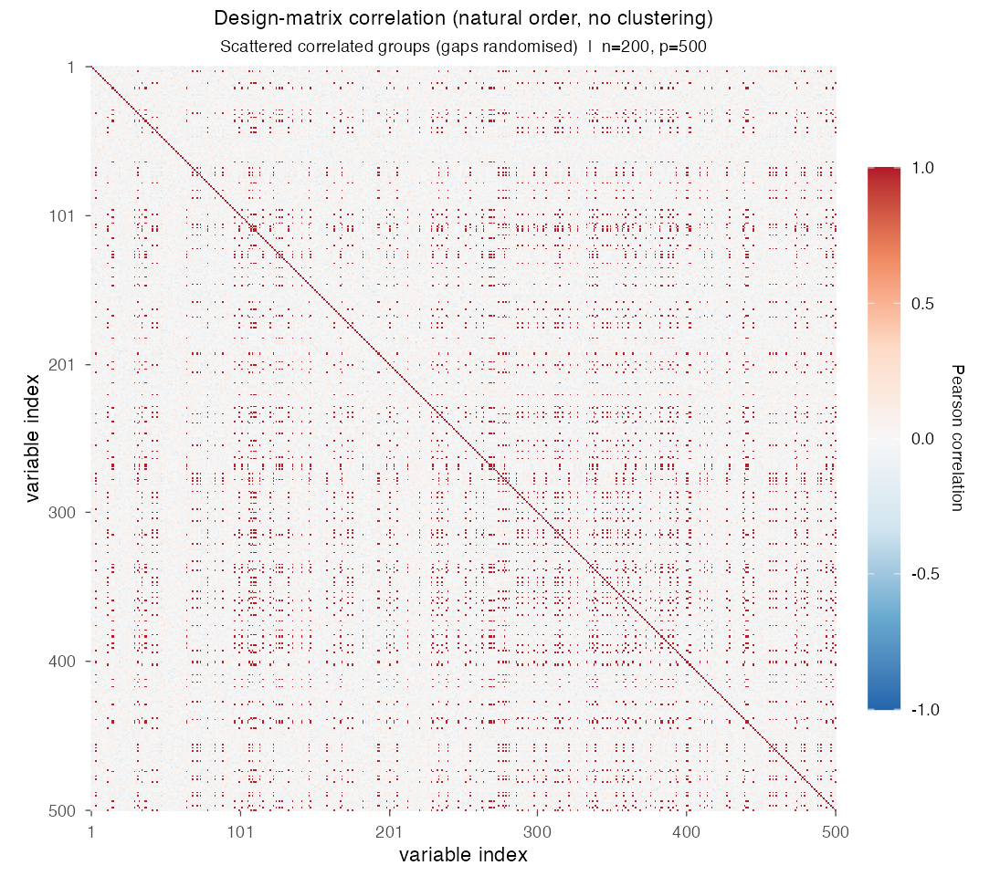
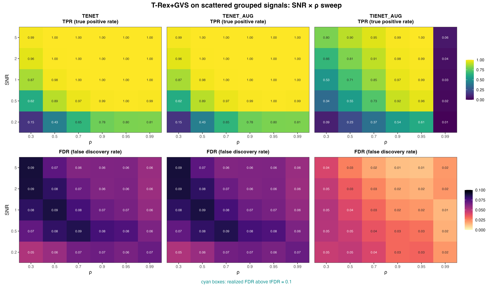

# Demo 02: T-Rex+GVS on Scattered Blocks

## Purpose

Test whether spatially **scattering** the members of a correlated group across the design matrix, rather than
keeping them contiguous, affects the group recovery of the Terminating Random Experiments (T-Rex) selector with
Grouped Variable Selection (GVS), T-Rex+GVS. This isolates the effect of column layout from the effect of correlation
strength, since the underlying group structure is otherwise identical to
[Demo 01](../demo_trex_gvs_01_mc_sim_hastie_en_blocks/README.md). Selection and evaluation are per variable (see
[What is actually measured](../../../../../cpp/trex_selector_methods/ad/trex_gvs/README.md#what-is-actually-measured-in-these-demos)).

R port of the C++ demo
[cpp/trex_selector_methods/ad/trex_gvs/demo_trex_gvs_02_mc_sim_scattered_blocks](../../../../../cpp/trex_selector_methods/ad/trex_gvs/demo_trex_gvs_02_mc_sim_scattered_blocks/README.md)
with the same data-generating process (DGP), control parameters, sweep grid and result-file naming, built on the
`TRexGVSSelector` class of `TRexSelector`. Indices are 1-based (R convention). The numbers below are this R run's
own results. R draws its own random numbers, so they differ from the C++ and
[Python](../../../../../Python/trex_selector_methods/ad/trex_gvs/demo_trex_gvs_02_mc_sim_scattered_blocks/README.md)
runs within Monte Carlo (MC) noise, not exactly. A cell-by-cell comparison with the C++ run, with $z$ the difference
divided by the combined Monte Carlo standard error of the two 200-trial means, finds no cell with $|z| > 3$ among the
180 cells of this demo (false discovery rate (FDR) and true positive rate (TPR) of every method at every grid point).
Over the whole T-Rex+GVS suite no cell of 1,710 has $|z| > 3$.

---

## Data Generation Parameters (`dgp_scattered_grouped_snr`)

The demo considers again the linear model

```math
\boldsymbol{y} = \boldsymbol{X}\boldsymbol{\beta} + \boldsymbol{\epsilon},
\qquad \boldsymbol{\epsilon} \sim \mathcal{N}(\boldsymbol{0}, \sigma_{\varepsilon}^2 \boldsymbol{I}_n)
```

- $\boldsymbol{y} \in \mathbb{R}^n$ is the response vector.
- $\boldsymbol{X} \in \mathbb{R}^{n \times p}$ is the design matrix.
- $\boldsymbol{\beta} \in \mathbb{R}^p$ is the coefficient vector, with $s$ nonzero entries.
- $\boldsymbol{\epsilon}$ is the noise vector with independent and identically distributed (i.i.d.) Gaussian entries.
- $\sigma_{\varepsilon}^2$ is the noise variance, calibrated to achieve a target linear signal-to-noise ratio (SNR).
- $n = 200$, $p = 500$, $s = 150$.

The design matrix $\boldsymbol{X}$ is generated from a latent-factor model with three active groups,

```math
X_{ij} = Z_{i,\,g(j)} + \sigma_x\, \xi_{ij}, \qquad \xi_{ij} \sim \mathcal{N}(0,1).
```

- `n_groups` correlated groups of `group_size` variables each (here 3 groups of 50 variables, matching Demo 01's
  Hastie design).
- Group membership is a **random partition of the columns** instead of contiguous blocks, so group members can be
  spread arbitrarily across the $p$ columns. Trial $k$ draws a fresh partition, design and response with seed
  $2026 + k - 1$.
- All grouped variables are active with $\beta_j = 3$, while the 350 background columns are i.i.d.
  $\mathcal{N}(0,1)$ with $\beta_j = 0$.
- The within-group correlation is $\rho = 1/(1 + \sigma_x^2)$, the same convention as Demo 01, and the noise
  variance is calibrated from the sample variance of $\boldsymbol{X}\boldsymbol{\beta}$ as there.



Empirical Pearson correlation of an exemplary design drawn from `dgp_scattered_grouped_snr` ($n=200$, $p=500$,
seed 2026, default $\sigma_x = \sqrt{0.01}$), in **natural variable order with no hierarchical clustering**. The same
three 50-variable groups as Demo 01 are present, but the random partition scatters their members across the design,
so the contiguous diagonal blocks of Demo 01 dissolve into a speckle of isolated high-correlation entries. One figure
per DGP lives in [`../dgp_corr_plots/`](../dgp_corr_plots/). Regenerate the whole suite with
[`../generate_corr_plots.sh`](../generate_corr_plots.sh) (shared ggplot2 plotter
[`../../../corr_plt_utils.R`](../../../corr_plt_utils.R)).

---

## Control Parameters

```text
K = 20                          # Random experiments per T-loop iteration
tFDR = 0.1                      # Target FDR
corr_max = 0.98                 # HAC auto-clustering correlation threshold
hc_linkage = Single             # Single-linkage HAC
lambda2_method = CV_1SE_CCD     # Elastic-net penalty selection, EN rows (TENET, TENET_AUG)
lambda2_method = CV_1SE_IEN_CCD # IEN rows (TIENET_AUG)
cv_dfmax_ratio = 1.0            # IEN support cap 1.0 * n_train = 180 (default 0.8 gives 144)
MC = 200                        # Monte Carlo repetitions per grid point
```

## Selector Setup in R

Each Monte Carlo trial builds the selector through the TRexSelector class interface, here for TIENET_AUG:

```r
library(TRexSelector)

ctrl <- trex_control(
  solver = "TIENET_AUG", K = 20L, max_dummy_multiplier = 10, use_max_T_stop = TRUE,
  lloop_strategy = "HCONCAT", tloop_stagnation_stop = TRUE,
  tloop_max_stagnant_steps = 5, use_memory_mapping = FALSE
)
sel <- TRexGVSSelector$new(
  X, y, tFDR = 0.1, seed = trial_seed, verbose = FALSE,
  gvs_control = trex_gvs_control(
    gvs_type = "IEN", corr_max = 0.98, hc_linkage = "Single",
    lambda2_method = "CV_1SE_IEN_CCD", cv_dfmax_ratio = 1.0, cv_seed = trial_seed
  ),
  control = ctrl
)
sel$select()
fdp <- trex_fdp(sel$selected_indices, true_support)
tpp <- trex_tpp(sel$selected_indices, true_support)
```

`.gvs_select()` in [`../../../simulation_utils.R`](../../../simulation_utils.R) builds this selector in every trial
and sets every control field explicitly, so no R default can diverge from the C++ reference. The two TENET rows use
the base solver `"TLARS"` with `gvs_type = "EN"`, `en_solver = "TENET"` or `"TENET_AUG"` and
`lambda2_method = "CV_1SE_CCD"`. The selector seed and the cross-validation fold seed are the trial seed, so every
cell is reproducible.

---

## Methods Compared

Three T-Rex+GVS solver variants: **TENET** (elastic net (EN)) [[3]](#references), **TENET_AUG** (row-augmented
elastic net) [[1]](#references), and **TIENET_AUG** (informed elastic net (IEN)) [[2]](#references). All use
single-linkage hierarchical agglomerative clustering (HAC) grouping. TENET and TENET_AUG select $\lambda_2$ with
`CV_1SE_CCD`, and TIENET_AUG with `CV_1SE_IEN_CCD`, the rule built for the IEN geometry, with its support cap raised
to $180$ variables (see [Demo 01](../demo_trex_gvs_01_mc_sim_hastie_en_blocks/README.md), Part 2), as in the C++ and
Python demos. The TIENET_AUG row leaves `en_solver` at the library default, which the IEN path ignores.

---

## The Sweep

A single **2-D SNR $\times$ $\rho$ grid**, over
$\mathrm{SNR} \in \lbrace0.2, 0.5, 1, 2, 5\rbrace$ and
$\rho \in \lbrace0.30, 0.50, 0.70, 0.90, 0.95, 0.99\rbrace$
(with $\sigma_x = \sqrt{(1-\rho)/\rho}$), 200 MC trials per cell. The grid is set in `PRESET` at the top of the
script.

---

## Output Files

Written to `simulation_results/data/`:

- `gvs_scattered_grouped_2d.txt` / `.csv` — mean false discovery proportion (FDP) / true positive proportion (TPP)
  over the SNR $\times$ $\rho$ grid.

The file names and comma-separated values (CSV) schema match the C++ and Python demos. Figures in Portable Network
Graphics (PNG) and Portable Document Format (PDF) go to `simulation_results/plots/`, with the same file names as the
Python suite.

---

## Running the Demo

```bash
dir=R/trex_selector_methods/ad/trex_gvs/demo_trex_gvs_02_mc_sim_scattered_blocks

Rscript "$dir/demo_trex_gvs_02_mc_sim_scattered_blocks.R"      # full run, TREX_NUM_WORKERS workers (default 8)
Rscript "$dir/demo_trex_gvs_02_mc_sim_scattered_blocks.R" 8    # 8 worker cores
"$dir/generate_plots.sh"                                       # render the figure below from the saved CSV
```

Reduce `num_MC` in `CFG` and the grids in `PRESET` for a quick preview. Monte Carlo trials run in parallel on a
parallel socket (PSOCK) cluster of spawned R worker processes ([`../../../mc_runtime.R`](../../../mc_runtime.R)).
The worker count is the first command-line argument, else `TREX_NUM_WORKERS`, else 8, and `0` uses every core. Every
finished grid cell is appended to a cache in `simulation_results/cache/`, so a stopped run resumes where it left off,
and a completed run removes the cache. The script also sources [`../trex_gvs_dgps.R`](../trex_gvs_dgps.R),
[`../trex_gvs_sim_common.R`](../trex_gvs_sim_common.R) (2-D sweep driver and result writers),
[`../../../simulation_utils.R`](../../../simulation_utils.R) (the `.run_mc_scattered()` runner and the
`.gvs_select()` adapter) and [`../../../support_generators.R`](../../../support_generators.R). The recorded run
(library commit `44cf1ab`, 8 workers) took about 2.9 hours. The TIENET_AUG rows come from a rerun of that solver
alone on library commit `09debc6`, with the same trial seeds.

Afterwards, regenerate the figure from the CSV file with [`generate_plots.sh`](generate_plots.sh), which drives the
suite's ggplot2 plotting module [`../trex_gvs_plt_utils.R`](../trex_gvs_plt_utils.R) through `Rscript` (set
`RSCRIPT` to use another R installation).

---

## Simulation Results

The numbers and figure below are this R run's own results (200 MC trials per cell). They agree with the
[C++ reference](../../../../../cpp/trex_selector_methods/ad/trex_gvs/demo_trex_gvs_02_mc_sim_scattered_blocks/README.md#simulation-results)
up to Monte Carlo noise (see [Purpose](#purpose)).

- **TENET** and **TENET_AUG** are identical in every cell and keep the FDR below the $\mathrm{tFDR} = 0.1$ target
  everywhere ($0.052\text{–}0.089$, no cyan violation outlines). Their TPR is at least $0.984$ from
  $\mathrm{SNR} \ge 1$ for $\rho \ge 0.5$, and it climbs $0.87 \to 0.96 \to 0.99$ over
  $\mathrm{SNR} \in \lbrace1, 2, 5\rbrace$ in the weakest column $\rho = 0.30$.
- **TIENET_AUG** is markedly more conservative. Its FDR stays at or below $0.051$, under the TENET value in all 30
  cells, and it has less power, most of all at low $\rho$ ($0.526$ at $\mathrm{SNR}=1$, $\rho=0.3$ against $0.87$
  for TENET). From $\mathrm{SNR} = 1$ on it reaches a TPR of $0.968\text{–}0.998$ for $\rho = 0.9\text{–}0.95$,
  against $0.845\text{–}0.952$ at $\rho = 0.7$ and $0.526\text{–}0.801$ at $\rho = 0.3$. Its power collapses in the
  extreme $\rho = 0.99$ column (TPR at most $0.062$, about 9 of the 150 active variables), the only column above
  `corr_max = 0.98`, where HAC merges each group into one cluster and plausibly only a few variables per group are
  selected, as in Demo 01.
- Scattering the group members leaves the FDR and TPR pattern of Demo 01's contiguous blocks unchanged within Monte
  Carlo noise. Over the 120 distinct cells (FDR and TPR of TENET and TIENET_AUG at every grid point) the largest gap
  is $0.013$ in TPR (TENET at $\mathrm{SNR}=0.2$, $\rho=0.7$, $0.654$ here against $0.667$) and $0.013$ in FDR
  (TIENET_AUG at $\mathrm{SNR}=1$, $\rho=0.99$, $0.015$ against $0.028$). No cell differs by more than two combined
  Monte Carlo standard errors (largest $|z| = 1.98$, TENET's FDR at $\mathrm{SNR}=1$, $\rho=0.9$). Both demos use
  the same trial seeds, but they draw their designs differently, so the comparison holds approximately.
- HAC clusters the columns on the distance 1 − |correlation|, which does not depend on column order. Below
  $\rho = 0.99$ the within-group correlation stays under `corr_max = 0.98` and the fixed cut leaves every variable in
  its own cluster, so only the $\rho = 0.99$ column tests group *discovery*. There the largest gap to Demo 01 is
  $|z| = 1.94$ (the TIENET_AUG FDR cell above), so the scattered layout does not change it.

TPR (top) and FDR (bottom) heatmaps over the SNR $\times$ $\rho$ grid, one column per solver.
FDR cells above the $\mathrm{tFDR} = 0.1$ target would be outlined in cyan.



---

## References

1. Machkour, J., Muma, M., & Palomar, D. P., "False Discovery Rate Control for Grouped Variable Selection
   in High-Dimensional Linear Models using the T-Knock Filter.", European Signal Processing Conference (EUSIPCO), 2022,
   pp. 892–896, European Association for Signal Processing (EURASIP).
   [DOI-Link](https://doi.org/10.23919/EUSIPCO55093.2022.9909883)
2. Machkour, J., Muma, M., & Palomar, D. P., "The Informed Elastic Net for Fast Grouped Variable Selection and
   FDR Control in Genomics Research.", Workshop on Computational Advances in Multi-Sensor Adaptive Processing (CAMSAP),
   2023, pp. 466–470, Institute of Electrical and Electronics Engineers (IEEE).
   [DOI-Link](https://doi.org/10.1109/CAMSAP58249.2023.10403489)
3. Zou, H., & Hastie, T. (2005). "Regularization and variable selection via the elastic net." *Journal of the Royal
   Statistical Society: Series B (Statistical Methodology)*, 67(2), pp. 301–320.
   [DOI-Link](https://doi.org/10.1111/j.1467-9868.2005.00503.x)
