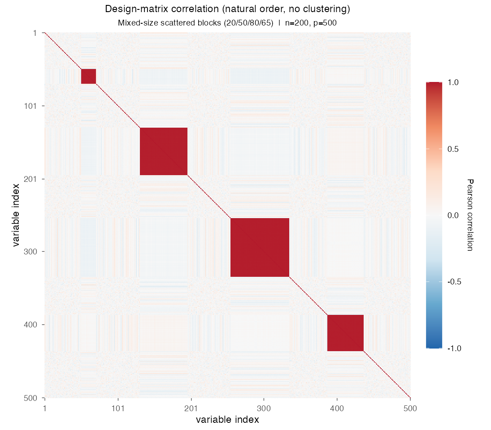
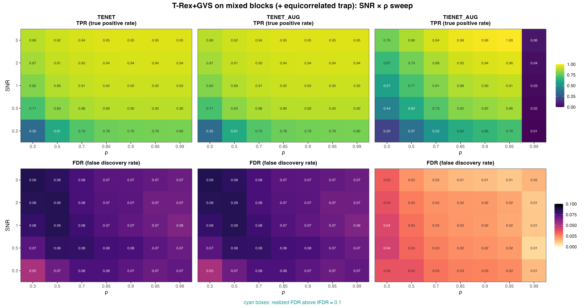

# Demo 03: T-Rex+GVS on Mixed Blocks

## Purpose

Evaluate the Terminating Random Experiments (T-Rex) selector with Grouped Variable Selection (GVS), T-Rex+GVS, on a
more realistic grouped design.
 Four contiguous equicorrelated blocks of unequal size are placed in **random order** with **random noise gaps**
 between and around them, and one of them is an **inactive equicorrelated trap block**.
 The design stresses whether the pipeline can recover the active blocks without selecting a null block that shares
 their correlation structure.
 Selection and evaluation are per variable (see
 [What is actually measured](../../../../../cpp/trex_selector_methods/ad/trex_gvs/README.md#what-is-actually-measured-in-these-demos)
 in the C++ suite README).

This is the R port of the C++ demo
[demo_trex_gvs_03_mc_sim_mixed_blocks](../../../../../cpp/trex_selector_methods/ad/trex_gvs/demo_trex_gvs_03_mc_sim_mixed_blocks/README.md),
using the `TRexGVSSelector` class of the TRexSelector package. It keeps the data-generating process (DGP), the
control parameters, the sweep grid, the console tables and the result-file naming of the C++ demo. Indices are 1-based
(R convention).

---

## Data Generation Parameters (`dgp_mixed_blocks_snr`)

We consider again the linear model:

```math
\boldsymbol{y} = \boldsymbol{X}\boldsymbol{\beta} + \boldsymbol{\epsilon},
\qquad \boldsymbol{\epsilon} \sim \mathcal{N}(\boldsymbol{0}, \sigma_{\varepsilon}^2 \boldsymbol{I}_n)
```

- $\boldsymbol{y} \in \mathbb{R}^n$ is the response vector.
- $\boldsymbol{X} \in \mathbb{R}^{n \times p}$ is the design matrix.
- $\boldsymbol{\beta} \in \mathbb{R}^p$ is the coefficient vector, with $s$ nonzero entries.
- $\boldsymbol{\epsilon}$ is the noise vector, independent and identically distributed (i.i.d.) normal.
- $\sigma_{\varepsilon}^2$ is the noise variance, calibrated to achieve a target linear signal-to-noise ratio (SNR),
  $\sigma_{\varepsilon}^2 = \widehat{\mathrm{Var}}(\boldsymbol{X}\boldsymbol{\beta}) / \mathrm{SNR}$.
- $n = 200$, $p = 500$, $s = 150$ (the sum of the three active blocks).

Each block of the design matrix $\boldsymbol{X}$ follows the equicorrelated latent-factor model:

```math
X_{ij} = Z_{i,\,g(j)} + \sigma_x\, \xi_{ij}, \qquad Z_{i,\,g(j)},\ \xi_{ij} \sim \mathcal{N}(0,1),
```

- Four contiguous blocks of sizes $\lbrace20, 50, 80, 65\rbrace$ (215 grouped columns in total).
- **The blocks of sizes 20, 50 and 80 are active** ($\beta_j = 3$), while **the block of size 65 is an inactive trap**
  ($\beta_j = 0$) with the same equicorrelated structure as the active blocks.
- The blocks are placed in a **random order** with **random-width noise gaps** filled with i.i.d.
  $\mathcal{N}(0,1)$ background columns. The 285 noise columns fill five gap slots (before, between and after the
  blocks). Each of the three inner gaps gets one column, and a multinomial draw with equal slot probabilities spreads
  the remaining 282, so no two blocks touch.
- Every Monte Carlo trial draws a new block order and new gaps, because the DGP is seeded with the trial seed.
- Within-block correlation $\rho = 1/(1 + \sigma_x^2)$, the same convention as Demo 01.



Empirical Pearson correlation of an exemplary design drawn from `dgp_mixed_blocks_snr` ($n=200$, $p=500$, seed 2026,
default $\sigma_x = \sqrt{0.01}$, so $\rho \approx 0.99$), in **natural variable order without hierarchical
clustering**. The four solid diagonal squares are the blocks, separated by the white-noise gaps. In this draw the
20-variable block sits at columns 51–70, the inactive 65-variable trap at 131–195, the 80-variable block at 255–334
and the 50-variable block at 387–436. The trap cannot be told apart from the active blocks by its correlation
structure alone, which is the point of this demo. One figure per DGP lives in
[`../dgp_corr_plots/`](../dgp_corr_plots/). Regenerate the whole suite with
[`../generate_corr_plots.sh`](../generate_corr_plots.sh), which drives the shared ggplot2 plotter
[`../../../corr_plt_utils.R`](../../../corr_plt_utils.R).

---

## Control Parameters

```text
K = 20                          # Random experiments per T-loop iteration
tFDR = 0.1                      # Target FDR
corr_max = 0.98                 # HAC auto-clustering correlation threshold
hc_linkage = "Single"           # Single-linkage HAC
lambda2_method = "CV_1SE_CCD"   # Elastic-net penalty selection, EN rows (TENET, TENET_AUG)
lambda2_method = "CV_1SE_IEN_CCD"  # IEN rows (TIENET_AUG)
cv_dfmax_ratio = 1.0            # IEN support cap 1.0 * n_train = 180 (default 0.8 gives 144)
num_MC = 200                    # Monte Carlo repetitions per grid point
seed = 2026                     # Trial k uses seed + k - 1
```

---

## Methods Compared

Three T-Rex+GVS solver variants: **TENET** (elastic net (EN)) [[3]](#references), **TENET_AUG** (row-augmented
elastic net) [[1]](#references), and **TIENET_AUG** (informed elastic net (IEN)) [[2]](#references). All use
single-linkage hierarchical agglomerative clustering (HAC) to form the groups. TENET and TENET_AUG select
$\lambda_2$ with `CV_1SE_CCD` (cross-validation with the one-standard-error rule, solved by coordinate descent), and
TIENET_AUG with `CV_1SE_IEN_CCD`, the rule built for the IEN geometry, with its support cap raised to $180$
variables (see [Demo 01](../demo_trex_gvs_01_mc_sim_hastie_en_blocks/README.md), Part 2), as in the C++ and Python
demos.

- **TENET**: `GVS_type = "EN"`, `en_solver = "TENET"`
- **TENET_AUG**: `GVS_type = "EN"`, `en_solver = "TENET_AUG"`
- **TIENET_AUG**: `GVS_type = "IEN"`, `lambda2_method = "CV_1SE_IEN_CCD"`, `cv_dfmax_ratio = 1.0` (`en_solver` is
  left at the library default and ignored on the IEN path)

Each Monte Carlo trial builds the selector through the TRexSelector class interface, here for TENET_AUG:

```r
library(TRexSelector)

ctrl <- trex_control(
  solver = "TLARS", K = 20L, max_dummy_multiplier = 10, use_max_T_stop = TRUE,
  lloop_strategy = "HCONCAT", tloop_stagnation_stop = TRUE,
  tloop_max_stagnant_steps = 5, use_memory_mapping = FALSE
)
sel <- TRexGVSSelector$new(
  X, y, tFDR = 0.1, seed = trial_seed, verbose = FALSE,
  gvs_control = trex_gvs_control(
    gvs_type = "EN", corr_max = 0.98, hc_linkage = "Single",
    en_solver = "TENET_AUG", lambda2_method = "CV_1SE_CCD", cv_seed = trial_seed
  ),
  control = ctrl
)
sel$select()
fdp <- trex_fdp(sel$selected_indices, true_support)
tpp <- trex_tpp(sel$selected_indices, true_support)
```

The adapter `.gvs_select()` in [`../../../simulation_utils.R`](../../../simulation_utils.R) sets every control field
explicitly, so no R default can diverge from the C++ reference. The TIENET_AUG row passes `gvs_type = "IEN"` with the
base solver `"TIENET_AUG"`, which runs the augmented IEN solver of the C++ and Python demos. The selector seed and the
cross-validation fold seed both equal the trial seed.

---

## The Sweep

A single **2-D SNR $\times$ $\rho$ grid**, over
$\mathrm{SNR} \in \lbrace0.2, 0.5, 1, 2, 5\rbrace$ and
$\rho \in \lbrace0.30, 0.50, 0.70, 0.85, 0.90, 0.95, 0.99\rbrace$
(with $\sigma_x = \sqrt{(1-\rho)/\rho}$), 200 Monte Carlo (MC) trials per cell. The seven $\rho$ levels span weak to
near-collinear within-block correlation.

---

## Output Files

Written to `simulation_results/data/`:

- `gvs_mixed_blocks_2d.txt` / `.csv`, the mean false discovery proportion (FDP) and true positive proportion (TPP)
  over the SNR $\times$ $\rho$ grid. The comma-separated values (CSV) file also carries the standard deviation of
  every mean.

The file names and the CSV schema (`method,metric,row_label,col_label,mean,sd`) match the C++ and Python demos.
Figures in Portable Network Graphics (PNG) and Portable Document Format (PDF) go to `simulation_results/plots/`,
produced by [`generate_plots.sh`](generate_plots.sh).

---

## Running the Demo

```bash
demo=R/trex_selector_methods/ad/trex_gvs/demo_trex_gvs_03_mc_sim_mixed_blocks/demo_trex_gvs_03_mc_sim_mixed_blocks.R

Rscript "$demo"      # full run, TREX_NUM_WORKERS workers (default 8)
Rscript "$demo" 8    # 8 worker cores
```

Monte Carlo trials run in parallel on a parallel socket (PSOCK) cluster of spawned R worker processes
([`../../../mc_runtime.R`](../../../mc_runtime.R)). The worker count is the first command-line argument, else
`TREX_NUM_WORKERS`, else 8, and `0` uses every core. Every finished grid cell is appended to a cache in
`simulation_results/cache/`, so a stopped run resumes where it left off, and a completed run removes the cache. The
script also sources [`../trex_gvs_dgps.R`](../trex_gvs_dgps.R), [`../trex_gvs_sim_common.R`](../trex_gvs_sim_common.R),
[`../../../support_generators.R`](../../../support_generators.R) and
[`../../../simulation_utils.R`](../../../simulation_utils.R). For a quick smoke test, reduce `num_MC` and the grids
at the top of the script. The recorded run (library commit `44cf1ab`, 8 workers) took about 3.5 hours, partly slowed
by a library build that ran at the same time. The TIENET_AUG rows come from a rerun of that solver alone on library
commit `09debc6`, with the same trial seeds.

Afterwards, regenerate the figure from the CSV file with [`generate_plots.sh`](generate_plots.sh), which drives the
suite's ggplot2 plotting module [`../trex_gvs_plt_utils.R`](../trex_gvs_plt_utils.R) through `Rscript` (set `RSCRIPT`
to use another R installation).

---

## Simulation Results

The numbers and figure below are this R run's own results (200 MC trials per cell). R draws its own random numbers, so
they agree with the
[C++ reference](../../../../../cpp/trex_selector_methods/ad/trex_gvs/demo_trex_gvs_03_mc_sim_mixed_blocks/README.md#simulation-results)
up to Monte Carlo noise, not exactly. A cell-by-cell comparison with the C++ run, with $z$ the difference divided by
the combined Monte Carlo standard error of the two 200-trial means, finds no cell with $|z| > 3$ among the 210 cells
of this demo (false discovery rate (FDR) and true positive rate (TPR) of every solver at every grid point). Over the
whole T-Rex+GVS suite no cell of 1,710 has $|z| > 3$.

- **TENET** and **TENET_AUG** are numerically identical in every cell, means and standard deviations alike, so the
  first two columns of the figure coincide. They keep the FDR below target everywhere ($0.053\text{–}0.086$, no cyan
  outlines), so the inactive trap block does not push the FDR over target.
- Their TPR rises with SNR in every $\rho$ column and peaks at $0.951$ ($\mathrm{SNR} = 5$, $\rho \ge 0.95$). It
  stays below 1 even there, so on average about 7 of the 150 active variables are missed. The per-variable data do
  not show which block the missed variables belong to.
- Stronger within-block correlation helps up to $\rho = 0.85$ and then saturates. At $\mathrm{SNR} = 0.2$ the TPR
  climbs from $0.345$ at $\rho = 0.3$ to $0.777$ at $\rho = 0.85$, and at $\mathrm{SNR} = 1$ from $0.816$ to $0.921$.
  Between $\rho = 0.85$ and $0.99$ it changes by at most $0.02$ in every row.
- At $\mathrm{SNR} \ge 1$ the FDR drifts down with $\rho$, from $0.081\text{–}0.086$ at $\rho \le 0.5$ to
  $0.064\text{–}0.068$ at $\rho = 0.99$. At $\mathrm{SNR} = 0.2$ it instead rises from $0.053$ at $\rho = 0.3$ to
  $0.076$ at $\rho = 0.7\text{–}0.85$.
- The FDP spread grows with $\rho$ up to $\rho = 0.95$ at every SNR and dips at $\rho = 0.99$. Its standard deviation
  is $0.029\text{–}0.038$ at $\rho = 0.3$ and $0.057\text{–}0.074$ at $\rho \ge 0.85$, so at strong correlation the
  FDP varies more from run to run. A plausible reading is that correlated null variables, such as the trap block,
  then enter or leave the selection together. The data do not record which variables are false discoveries.
- **TIENET_AUG** is far more conservative. Its FDR is $0.008\text{–}0.043$ and lies below TENET's in all 35 cells.
  Below $\rho = 0.99$ its TPR trails TENET's at low $\rho$ and SNR (by up to $0.271$, at $\mathrm{SNR} = 0.5$,
  $\rho = 0.3$), but lies above it in five of the six cells with $\mathrm{SNR} \ge 2$ and $\rho = 0.85\text{–}0.95$
  (up to $0.996$ against $0.951$ at $\mathrm{SNR} = 5$, $\rho = 0.95$).
- In the extreme $\rho = 0.99$ column the TPR of TIENET_AUG collapses to $0.008\text{–}0.059$, rising with SNR. This
  is the only grid value above the clustering threshold. The single-linkage HAC step joins variables only through pairs
  whose sample correlation reaches $0.98$ in absolute value (`corr_max`). With $n = 200$, two block members rarely
  get there at $\rho \le 0.95$ and usually do at $\rho = 0.99$. A plausible reading is that the HAC step forms the
  true blocks as groups only in this column, and that the IEN collapse is tied to that grouping. The data do not
  record the groups.
- The random gaps and the random block order test whether the grouping and selection are invariant to block
  *placement*. The TPR rises with SNR here as in the contiguous design of
  [Demo 01](../demo_trex_gvs_01_mc_sim_hastie_en_blocks/README.md), but from $\mathrm{SNR} = 1$ on it stays lower. At
  $\mathrm{SNR} \ge 2$ and $\rho \ge 0.9$ Demo 01's TENET finds every active variable in every run (TPR $1$), while
  this demo reaches $0.938\text{–}0.951$. The two demos also differ in block sizes and the trap block, so the data
  cannot attribute this gap to placement alone.

TPR (top) and FDR (bottom) heatmaps over the SNR $\times$ $\rho$ grid, one column per solver.
FDR cells above the $\mathrm{tFDR} = 0.1$ target would be outlined in cyan.



---

## References

1. Machkour, J., Muma, M., & Palomar, D. P., "False Discovery Rate Control for Grouped Variable Selection
   in High-Dimensional Linear Models using the T-Knock Filter.", European Signal Processing Conference (EUSIPCO), 2022,
    pp. 892–896, European Association for Signal Processing (EURASIP).
    [DOI-Link](https://doi.org/10.23919/EUSIPCO55093.2022.9909883)
2. Machkour, J., Muma, M., & Palomar, D. P., "The Informed Elastic Net for Fast Grouped Variable Selection and
   FDR Control in Genomics Research.", Workshop on Computational Advances in Multi-Sensor Adaptive Processing (CAMSAP),
    2023, pp. 466–470, Institute of Electrical and Electronics Engineers (IEEE).
    [DOI-Link](https://doi.org/10.1109/CAMSAP58249.2023.10403489)
3. Zou, H., & Hastie, T. (2005). "Regularization and variable selection via the elastic net." *Journal of the Royal
   Statistical Society: Series B (Statistical Methodology)*, 67(2), pp. 301–320.
   [DOI-Link](https://doi.org/10.1111/j.1467-9868.2005.00503.x)
