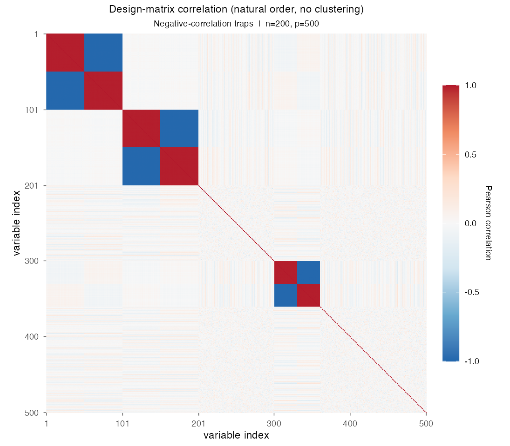
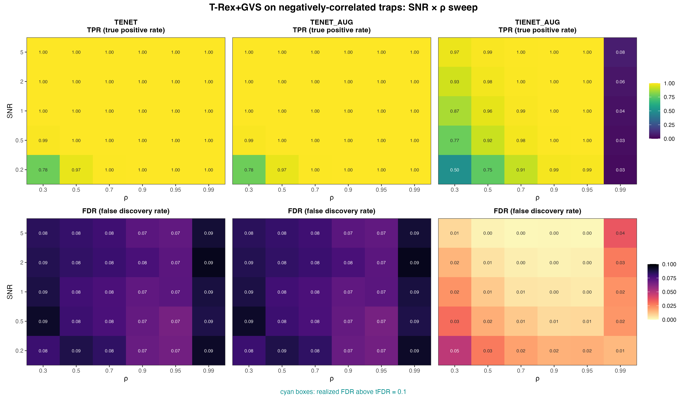

# Demo 04: T-Rex+GVS on Negative-Correlation Traps

## Purpose

Test whether the Terminating Random Experiments (T-Rex) selector with Grouped Variable Selection (GVS), T-Rex+GVS,
can recover an
 **active group with negative within-group correlation structure**
 while **excluding two spatially separated inactive trap groups** that share the same sign-flipped correlation
 pattern.
 This stresses the grouping logic's ability to distinguish signal from confounding correlation geometry, rather
 than just correlation strength.
 Selection and evaluation are per variable (see
 [What is actually measured](../../../../../cpp/trex_selector_methods/ad/trex_gvs/README.md#what-is-actually-measured-in-these-demos)
 in the C++ suite README).

This is the R port of the C++ demo
[demo_trex_gvs_04_mc_sim_neg_traps](../../../../../cpp/trex_selector_methods/ad/trex_gvs/demo_trex_gvs_04_mc_sim_neg_traps/README.md),
using the `TRexGVSSelector` class of the TRexSelector package. It keeps the data-generating process (DGP), the
control parameters, the sweep grid, the console tables and the result-file naming of the C++ demo. Indices are 1-based
(R convention).

---

## Data Generation Parameters (`dgp_neg_traps_snr`)

We consider again the linear model:

```math
\boldsymbol{y} = \boldsymbol{X}\boldsymbol{\beta} + \boldsymbol{\epsilon},
\qquad \boldsymbol{\epsilon} \sim \mathcal{N}(\boldsymbol{0}, \sigma_{\varepsilon}^2 \boldsymbol{I}_n)
```

- $\boldsymbol{y} \in \mathbb{R}^n$ is the response vector.
- $\boldsymbol{X} \in \mathbb{R}^{n \times p}$ is the design matrix.
- $\boldsymbol{\beta} \in \mathbb{R}^p$ is the coefficient vector, with $s$ nonzero entries.
- $\boldsymbol{\epsilon}$ is the noise vector, independent and identically distributed (i.i.d.) normal.
- $\sigma_{\varepsilon}^2$ is the noise variance, calibrated to achieve a target linear signal-to-noise ratio (SNR),
  $\sigma_{\varepsilon}^2 = \widehat{\mathrm{Var}}(\boldsymbol{X}\boldsymbol{\beta}) / \mathrm{SNR}$.
- $n = 200$, $p = 500$, $s = 100$.

Each correlated group is built from a shared latent factor, with one half of the group loading **positively** and
 the other half loading **negatively** on it:

```math
X_{ij} = \pm Z_{i,\,g(j)} + \sigma_x\, \xi_{ij}, \qquad Z_{i,\,g(j)},\ \xi_{ij} \sim \mathcal{N}(0,1),
```

- **Active group $G_1$** (columns 1–100): positive half (1–50) with $\beta_j = +3$, and negative half (51–100),
  loading $-Z_1$, with $\beta_j = -3$.
- **Trap 1** (columns 101–200): the same sign-flipped structure as $G_1$ on its own factor $Z_2$, but $\beta_j = 0$.
- **Noise 1** (columns 201–300): i.i.d. $\mathcal{N}(0,1)$ background.
- **Trap 2** (columns 301–360): a second, smaller (60-column) sign-flipped trap on $Z_3$, $\beta_j = 0$.
- **Noise 2** (columns 361–500): i.i.d. background.
- Within-group correlation $\rho = 1/(1 + \sigma_x^2)$, the same convention as Demo 01, in magnitude, because half
  the loadings are sign-flipped. Two members of the same half correlate at $+\rho$ and two members of opposite halves
  at $-\rho$.



Empirical Pearson correlation of an exemplary design drawn from `dgp_neg_traps_snr` ($n=200$, $p=500$, seed 2026,
default $\sigma_x = \sqrt{0.01}$, so $\rho \approx 0.99$), in **natural variable order without hierarchical
clustering**. Each sign-flipped group shows as a $2 \times 2$ checkerboard, dark red within each half and dark blue
between the halves. These are the active group $G_1$ (columns 1–100), Trap 1 (101–200) and the smaller Trap 2
(301–360). The traps cannot be told apart from the active group by their correlation structure alone. One figure per
DGP lives in [`../dgp_corr_plots/`](../dgp_corr_plots/). Regenerate the whole suite with
[`../generate_corr_plots.sh`](../generate_corr_plots.sh), which drives the shared ggplot2 plotter
[`../../../corr_plt_utils.R`](../../../corr_plt_utils.R).

---

## Control Parameters

```text
K = 20                          # Random experiments per T-loop iteration
tFDR = 0.1                      # Target FDR
corr_max = 0.98                 # HAC auto-clustering correlation threshold
hc_linkage = "Single"           # Single-linkage HAC
lambda2_method = "CV_1SE_CCD"   # Elastic-net penalty selection, EN rows (TENET, TENET_AUG)
lambda2_method = "CV_1SE_IEN_CCD"  # IEN rows (TIENET_AUG)
cv_dfmax_ratio = 1.0            # IEN support cap 1.0 * n_train = 180 (default 0.8 gives 144)
num_MC = 200                    # Monte Carlo repetitions per grid point
seed = 2026                     # Trial k uses seed + k - 1
```

---

## Methods Compared

Three T-Rex+GVS solver variants: **TENET** (elastic net (EN)) [[3]](#references), **TENET_AUG** (row-augmented
elastic net) [[1]](#references), and **TIENET_AUG** (informed elastic net (IEN)) [[2]](#references). All use
single-linkage hierarchical agglomerative clustering (HAC) to form the groups. TENET and TENET_AUG select
$\lambda_2$ with `CV_1SE_CCD` (cross-validation with the one-standard-error rule, solved by coordinate descent), and
TIENET_AUG with `CV_1SE_IEN_CCD`, the rule built for the IEN geometry, with its support cap raised to $180$
variables (see [Demo 01](../demo_trex_gvs_01_mc_sim_hastie_en_blocks/README.md), Part 2), as in the C++ and Python
demos.

- **TENET**: `GVS_type = "EN"`, `en_solver = "TENET"`
- **TENET_AUG**: `GVS_type = "EN"`, `en_solver = "TENET_AUG"`
- **TIENET_AUG**: `GVS_type = "IEN"`, `lambda2_method = "CV_1SE_IEN_CCD"`, `cv_dfmax_ratio = 1.0` (`en_solver` is
  left at the library default and ignored on the IEN path)

Each Monte Carlo trial builds the selector through the TRexSelector class interface, here for TIENET_AUG:

```r
library(TRexSelector)

ctrl <- trex_control(
  solver = "TIENET_AUG", K = 20L, max_dummy_multiplier = 10, use_max_T_stop = TRUE,
  lloop_strategy = "HCONCAT", tloop_stagnation_stop = TRUE,
  tloop_max_stagnant_steps = 5, use_memory_mapping = FALSE
)
sel <- TRexGVSSelector$new(
  X, y, tFDR = 0.1, seed = trial_seed, verbose = FALSE,
  gvs_control = trex_gvs_control(
    gvs_type = "IEN", corr_max = 0.98, hc_linkage = "Single",
    lambda2_method = "CV_1SE_IEN_CCD", cv_dfmax_ratio = 1.0, cv_seed = trial_seed
  ),
  control = ctrl
)
sel$select()
fdp <- trex_fdp(sel$selected_indices, true_support)
tpp <- trex_tpp(sel$selected_indices, true_support)
```

The adapter `.gvs_select()` in [`../../../simulation_utils.R`](../../../simulation_utils.R) sets every control field
explicitly, so no R default can diverge from the C++ reference. The two EN rows use the base solver `"TLARS"` with
`gvs_type = "EN"` and pass `en_solver = "TENET"` or `"TENET_AUG"` with `lambda2_method = "CV_1SE_CCD"`. The IEN row
needs the base solver `"TIENET_AUG"` to run the augmented IEN solver of the C++ and Python demos. The selector seed
and the cross-validation fold seed both equal the trial seed.

---

## The Sweep

A single **2-D SNR $\times$ $\rho$ grid**, over
$\mathrm{SNR} \in \lbrace0.2, 0.5, 1, 2, 5\rbrace$ and
$\rho \in \lbrace0.30, 0.50, 0.70, 0.90, 0.95, 0.99\rbrace$
(with $\sigma_x = \sqrt{(1-\rho)/\rho}$), 200 Monte Carlo (MC) trials per cell.

---

## Output Files

Written to `simulation_results/data/`:

- `gvs_Neg-Traps_2d.txt` / `.csv`, the mean false discovery proportion (FDP) and true positive proportion (TPP) over
  the SNR $\times$ $\rho$ grid. The comma-separated values (CSV) file also carries the standard deviation of every
  mean.

The file names and the CSV schema (`method,metric,row_label,col_label,mean,sd`) match the C++ and Python demos.
Figures in Portable Network Graphics (PNG) and Portable Document Format (PDF) go to `simulation_results/plots/`,
produced by [`generate_plots.sh`](generate_plots.sh).

---

## Running the Demo

```bash
demo=R/trex_selector_methods/ad/trex_gvs/demo_trex_gvs_04_mc_sim_neg_traps/demo_trex_gvs_04_mc_sim_neg_traps.R

Rscript "$demo"      # full run, TREX_NUM_WORKERS workers (default 8)
Rscript "$demo" 8    # 8 worker cores
```

Monte Carlo trials run in parallel on a parallel socket (PSOCK) cluster of spawned R worker processes
([`../../../mc_runtime.R`](../../../mc_runtime.R)). The worker count is the first command-line argument, else
`TREX_NUM_WORKERS`, else 8, and `0` uses every core. Every finished grid cell is appended to a cache in
`simulation_results/cache/`, so a stopped run resumes where it left off, and a completed run removes the cache. The
script also sources [`../trex_gvs_dgps.R`](../trex_gvs_dgps.R), [`../trex_gvs_sim_common.R`](../trex_gvs_sim_common.R),
[`../../../support_generators.R`](../../../support_generators.R) and
[`../../../simulation_utils.R`](../../../simulation_utils.R). For a quick smoke test, reduce `num_MC` in `CFG` at the
top of the script and the grids in `sim_neg_traps_part1()`. The recorded run (library commit `44cf1ab`, 8 workers)
took about 2.9 hours. The TIENET_AUG rows come from a rerun of that solver alone on library commit `09debc6`, with
the same trial seeds.

Afterwards, regenerate the figure from the CSV file with [`generate_plots.sh`](generate_plots.sh), which drives the
suite's ggplot2 plotting module [`../trex_gvs_plt_utils.R`](../trex_gvs_plt_utils.R) through `Rscript` (set `RSCRIPT`
to use another R installation).

---

## Simulation Results

The numbers and figure below are this R run's own results (200 MC trials per cell). R draws its own random numbers, so
they agree with the
[C++ reference](../../../../../cpp/trex_selector_methods/ad/trex_gvs/demo_trex_gvs_04_mc_sim_neg_traps/README.md#simulation-results)
up to Monte Carlo noise, not exactly. A cell-by-cell comparison with the C++ run, with $z$ the difference divided by
the combined Monte Carlo standard error of the two 200-trial means, finds no cell with $|z| > 3$ among the 180 cells
of this demo (false discovery rate (FDR) and true positive rate (TPR) of every solver at every grid point). Over the
whole T-Rex+GVS suite no cell of 1,710 has $|z| > 3$.

- **TENET** and **TENET_AUG** are numerically identical in every cell, means and standard deviations alike, so the
  first two columns of the figure coincide. Both recover the active sign-flipped group almost completely. The TPR is
  at least $0.967$ everywhere except the $\mathrm{SNR}=0.2$, $\rho=0.3$ cell ($0.778$), and in 23 of the 30 cells
  every active variable is found in every run (TPR exactly $1$).
- The FDR stays below the $\mathrm{tFDR} = 0.1$ target in every cell ($0.066\text{–}0.095$, no cyan outlines). It
  falls from $0.080\text{–}0.092$ at $\rho = 0.3$ to $0.066\text{–}0.077$ at $\rho = 0.9\text{–}0.95$ and jumps
  back to $0.087\text{–}0.095$ in the $\rho = 0.99$ column, the highest column on average. The highest cell,
  $0.095$ at $\mathrm{SNR} = 2$ and $\rho = 0.99$, lies less than one Monte Carlo standard error ($0.007$) below the
  target. This column runs close enough to $0.1$ for single cells of other runs to cross it, as two cells of the
  Python run do.
- The two spatially separated traps are a stronger test of false-group exclusion than a single trap. The FDR does
  not creep up with SNR in any column. From $\mathrm{SNR} = 0.2$ to $\mathrm{SNR} = 5$ it changes by less than
  $0.006$ in every column, within Monte Carlo noise, and in the $\rho = 0.99$ column it moves between $0.087$ and
  $0.095$ without a trend. So the false selections do not grow as the signal strengthens.
- The FDP spread, in contrast, grows with $\rho$. Its standard deviation is $0.043\text{–}0.055$ at $\rho = 0.3$ and
  $0.092\text{–}0.109$ at $\rho \ge 0.9$, so at strong correlation the FDP varies much more from run to run. A
  plausible reading is that correlated trap variables then enter or leave the selection together. The data do not
  record which variables are false discoveries.
- The HAC step clusters on the dissimilarity $1 - |\mathrm{corr}|$, so the two halves of a group, correlated at
  about $-\rho$, look as close as two members of one half. At $\rho = 0.99$ the sign-flipped active group can
  therefore merge into a *single* group rather than split into its halves. For $n = 200$ the sample correlation of
  two group members rarely reaches the cut at `corr_max` $= 0.98$ when $\rho \le 0.95$, yet at $\rho = 0.9$ and
  $0.95$ the TPR rounds to $1.000$ at every SNR, as at $\rho = 0.99$. A plausible reading is that the near-complete
  recovery does not hinge on the grouping. The data do not record the groups.
- **TIENET_AUG** is far more conservative, with an FDR of at most $0.048$ ($\mathrm{SNR} = 0.2$, $\rho = 0.3$),
  below TENET's in all 30 cells. Away from $\rho = 0.99$ it reaches a TPR of at least $0.98$ from
  $\mathrm{SNR} = 0.5$ at $\rho \ge 0.7$ and from $\mathrm{SNR} = 2$ at $\rho = 0.5$, while at $\rho = 0.3$ it climbs
  from $0.500$ to $0.972$. At each of the 25 grid points it shares with
  [Demo 03](../demo_trex_gvs_03_mc_sim_mixed_blocks/README.md) below $\rho = 0.99$, its TPR here is the higher one.
  Away from $\rho = 0.99$ it trails TENET most at low SNR and weak correlation ($0.500$ against $0.778$ at
  $\mathrm{SNR} = 0.2$, $\rho = 0.3$).
- In the extreme $\rho = 0.99$ column the TPR of TIENET_AUG collapses to $0.026\text{–}0.078$, rising with SNR. This
  is the only column where its FDR rises with SNR, from $0.015$ to $0.036$, while elsewhere it falls with SNR, to at
  most $0.016$ from $\mathrm{SNR} = 2$ (at most $0.006$ for $\rho \ge 0.5$). The same collapse appears in the
  positively correlated blocks of Demo 03 (TPR $0.008\text{–}0.059$), so the sign flips are not needed to trigger it.

TPR (top) and FDR (bottom) heatmaps over the SNR $\times$ $\rho$ grid, one column per solver.
FDR cells above the $\mathrm{tFDR} = 0.1$ target would be outlined in cyan.



---

## References

1. Machkour, J., Muma, M., & Palomar, D. P., "False Discovery Rate Control for Grouped Variable Selection
   in High-Dimensional Linear Models using the T-Knock Filter.", European Signal Processing Conference (EUSIPCO), 2022,
    pp. 892–896, European Association for Signal Processing (EURASIP).
    [DOI-Link](https://doi.org/10.23919/EUSIPCO55093.2022.9909883)
2. Machkour, J., Muma, M., & Palomar, D. P., "The Informed Elastic Net for Fast Grouped Variable Selection and
   FDR Control in Genomics Research.", Workshop on Computational Advances in Multi-Sensor Adaptive Processing (CAMSAP),
    2023, pp. 466–470, Institute of Electrical and Electronics Engineers (IEEE).
    [DOI-Link](https://doi.org/10.1109/CAMSAP58249.2023.10403489)
3. Zou, H., & Hastie, T. (2005). "Regularization and variable selection via the elastic net." *Journal of the Royal
   Statistical Society: Series B (Statistical Methodology)*, 67(2), pp. 301–320.
   [DOI-Link](https://doi.org/10.1111/j.1467-9868.2005.00503.x)
