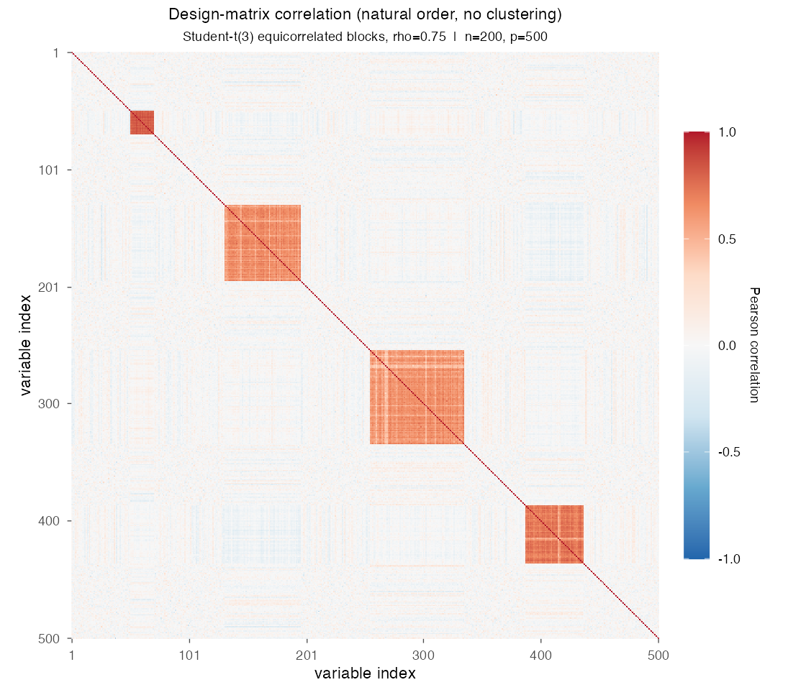
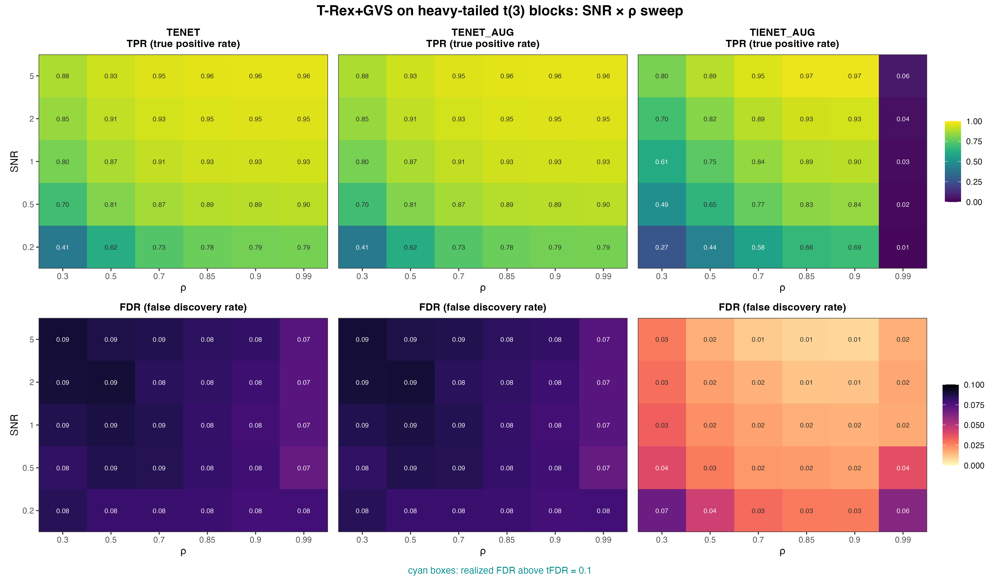

# Demo 05: T-Rex+GVS on Heavy-Tailed (Student-t(3)) Blocks

## Purpose

Stress-test the Terminating Random Experiments (T-Rex) selector with grouped variable selection (GVS), T-Rex+GVS,
on non-Gaussian data. The demo reuses the four-block active/trap geometry of
[Demo 03](../demo_trex_gvs_03_mc_sim_mixed_blocks/README.md) (Mixed Blocks), but every random component of the
data-generating process (DGP) is drawn from a scaled Student-t(3) distribution instead of a Gaussian. This covers the
latent factors, the within-block perturbations, the gap columns and the response noise, so the demo tests robustness
to heavy-tailed departures from the Gaussian assumption. Selection and evaluation are per variable (see
[What is actually measured](../../../../../cpp/trex_selector_methods/ad/trex_gvs/README.md#what-is-actually-measured-in-these-demos)
in the C++ suite README).

This is the R port of the C++ demo
[demo_trex_gvs_05_mc_sim_t3_blocks](../../../../../cpp/trex_selector_methods/ad/trex_gvs/demo_trex_gvs_05_mc_sim_t3_blocks/README.md),
using the `TRexGVSSelector` class of `TRexSelector`. It keeps the DGP, control parameters, sweep, console
summaries and result-file naming of the C++ demo. Indices are 1-based (R convention).

---

## Data Generation Parameters (`dgp_t3_equi_blocks_snr`)

The linear model carries heavy-tailed rather than Gaussian noise,

```math
\boldsymbol{y} = \boldsymbol{X}\boldsymbol{\beta} + \sigma_{\varepsilon}\, \boldsymbol{\epsilon},
\qquad \epsilon_i \sim t(3)/\sqrt{3}
```

- $\boldsymbol{y} \in \mathbb{R}^n$ is the response vector.
- $\boldsymbol{X} \in \mathbb{R}^{n \times p}$ is the design matrix.
- $\boldsymbol{\beta} \in \mathbb{R}^p$ is the coefficient vector, with $s$ nonzero entries.
- $\boldsymbol{\epsilon}$ is the noise vector, independent and identically distributed (i.i.d.) $t(3)/\sqrt{3}$, a
  Student-t distribution with 3 degrees of freedom rescaled to unit variance.
- $\sigma_{\varepsilon}^2$ is the noise variance, calibrated to a target signal-to-noise ratio (SNR) as
  $\sigma_{\varepsilon}^2 = \widehat{\mathrm{Var}}(\boldsymbol{X}\boldsymbol{\beta}) / \mathrm{SNR}$.
- $n = 200$, $p = 500$, $s = 150$ (the sum of the three active blocks).

Unlike Demos 01–04, the design matrix uses the **unit-variance** equicorrelated form, parameterized directly by
$\rho$ rather than through $\sigma_x$,

```math
X_{ij} = \sqrt{\rho}\, Z_{i,\,g(j)} + \sqrt{1-\rho}\, \xi_{ij},
\qquad Z_{\cdot,k},\, \xi_{ij} \sim t(3)/\sqrt{3},
```

where $g(j)$ is the block of column $j$.

- Same four-block geometry as Demo 03, with sizes $\lbrace20, 50, 80, 65\rbrace$ (215 grouped columns in total).
- **Blocks 1–3 are active** ($\beta_j = 3$), while **block 4 is an inactive heavy-tailed trap** ($\beta_j = 0$).
- Each trial shuffles the block order and spreads the 285 remaining columns as gaps around the blocks, with at least
  one gap column between two blocks. The gap columns are i.i.d. $t(3)/\sqrt{3}$ as well.
- Both the latent factors $Z_{\cdot,k}$ and the within-block perturbations $\xi_{ij}$ are $t(3)/\sqrt{3}$, so the
  heavy tails enter the design matrix as well as the response.



Empirical Pearson correlation of an exemplary design drawn from this DGP (`dgp_t3_equi_blocks_snr`, $n=200$,
$p=500$, $\rho = 0.75$, seed 2026), in **natural variable order without hierarchical clustering**. The four squares on
the diagonal are the blocks of sizes $\lbrace20, 50, 80, 65\rbrace$ in the random order of this draw. Pale lines cross
the blocks where a single column correlates visibly less with the rest of its block than the nominal $0.75$. A
plausible reading is that the $t(3)$ tails make the empirical correlation a noisier estimate of its population value.
One figure per DGP lives in [`../dgp_corr_plots/`](../dgp_corr_plots/). Regenerate the whole suite with
[`../generate_corr_plots.sh`](../generate_corr_plots.sh) (shared plotter
[`../../../corr_plt_utils.R`](../../../corr_plt_utils.R)).

---

## Control Parameters

```text
K = 20                          # Random experiments per T-loop iteration
tFDR = 0.1                      # Target FDR
corr_max = 0.98                 # HAC auto-clustering correlation threshold
hc_linkage = "Single"           # Single-linkage HAC
lambda2_method = "CV_1SE_CCD"   # Elastic-net penalty selection, EN rows (TENET, TENET_AUG)
lambda2_method = "CV_1SE_IEN_CCD"  # IEN rows (TIENET_AUG)
cv_dfmax_ratio = 1.0            # IEN support cap 1.0 * n_train = 180 (default 0.8 gives 144)
df = 3                          # Student-t degrees of freedom
num_MC = 200                    # Monte Carlo repetitions per grid point
seed = 2026                     # Base seed, trial k uses 2026 + k - 1
```

---

## Methods Compared

Three T-Rex+GVS solver variants are compared. **TENET** runs the elastic net (EN) [[3]](#references),
**TENET_AUG** its row-augmented form [[1]](#references), and **TIENET_AUG** the informed elastic net (IEN)
[[2]](#references). All three use single-linkage hierarchical agglomerative clustering (HAC) grouping. TENET and
TENET_AUG select $\lambda_2$ with `CV_1SE_CCD`, and TIENET_AUG with `CV_1SE_IEN_CCD`, the rule built for the IEN
geometry, with its support cap raised to $180$ variables (see
[Demo 01](../demo_trex_gvs_01_mc_sim_hastie_en_blocks/README.md), Part 2), as in the C++ and Python demos. The
script lists them in `GVS_METHODS`.

- **TENET**: `GVS_type = "EN"`, `en_solver = "TENET"`
- **TENET_AUG**: `GVS_type = "EN"`, `en_solver = "TENET_AUG"`
- **TIENET_AUG**: `GVS_type = "IEN"`, `lambda2_method = "CV_1SE_IEN_CCD"`, `cv_dfmax_ratio = 1.0`, with `en_solver`
  left at the library default, which the IEN path ignores

Each Monte Carlo (MC) trial builds the selector through the shared adapter `.gvs_select()` in
[`../../../simulation_utils.R`](../../../simulation_utils.R), here for TENET:

```r
library(TRexSelector)

ctrl <- trex_control(
  solver = "TLARS", K = 20L, max_dummy_multiplier = 10, use_max_T_stop = TRUE,
  lloop_strategy = "HCONCAT", tloop_stagnation_stop = TRUE,
  tloop_max_stagnant_steps = 5, use_memory_mapping = FALSE
)
sel <- TRexGVSSelector$new(
  X, y, tFDR = 0.1, seed = trial_seed, verbose = FALSE,
  gvs_control = trex_gvs_control(
    gvs_type = "EN", corr_max = 0.98, hc_linkage = "Single", en_solver = "TENET",
    lambda2_method = "CV_1SE_CCD", cv_seed = trial_seed
  ),
  control = ctrl
)
sel$select()
fdp <- trex_fdp(sel$selected_indices, true_support)
tpp <- trex_tpp(sel$selected_indices, true_support)
```

TENET_AUG changes only `en_solver`. TIENET_AUG sets `gvs_type = "IEN"` and the base solver `"TIENET_AUG"`, so its
rows run the augmented IEN solver as in C++ and Python, and it passes `lambda2_method = "CV_1SE_IEN_CCD"` with
`cv_dfmax_ratio = 1.0`. The trial seed $2026 + k - 1$ of trial $k$ seeds the DGP, the selector and the
cross-validation folds.

---

## The Sweep

A single **2-D SNR $\times$ $\rho$ grid**, over
$\mathrm{SNR} \in \lbrace0.2, 0.5, 1, 2, 5\rbrace$ and
$\rho \in \lbrace0.30, 0.50, 0.70, 0.85, 0.90, 0.99\rbrace$, with 200 MC trials per cell. Here $\rho$ enters the DGP
directly (no $\sigma_x$ reparameterization).

---

## Output Files

The run writes `gvs_t3_blocks_2d.txt` and `gvs_t3_blocks_2d.csv` to `simulation_results/data/`. They hold the mean
false discovery proportion (FDP) and true positive proportion (TPP) of each method over the SNR $\times$ $\rho$ grid,
and the comma-separated values (CSV) file adds their standard deviations. The file names and the CSV schema match the
C++ and Python demos.

Figures in Portable Network Graphics (PNG) and Portable Document Format (PDF) go to `simulation_results/plots/`,
with the same file names as in the Python suite.

---

## Running the Demo

```bash
demo=R/trex_selector_methods/ad/trex_gvs/demo_trex_gvs_05_mc_sim_t3_blocks/demo_trex_gvs_05_mc_sim_t3_blocks.R

Rscript "$demo"      # full run, TREX_NUM_WORKERS workers (default 8)
Rscript "$demo" 8    # 8 worker cores
```

Monte Carlo trials run in parallel on a parallel socket (PSOCK) cluster of spawned R worker processes
([`../../../mc_runtime.R`](../../../mc_runtime.R)). The worker count is the first command-line argument, else
`TREX_NUM_WORKERS`, else 8, and `0` uses every core. Every finished grid cell is appended to a cache in
`simulation_results/cache/`, so a stopped run resumes where it left off, and a completed run removes the cache. The
script also sources [`../../../support_generators.R`](../../../support_generators.R),
[`../../../simulation_utils.R`](../../../simulation_utils.R), [`../trex_gvs_dgps.R`](../trex_gvs_dgps.R) and
[`../trex_gvs_sim_common.R`](../trex_gvs_sim_common.R). The recorded run (library commit `44cf1ab`, 8 workers) took
about 2.8 hours. The TIENET_AUG rows come from a rerun of that solver alone on library commit `09debc6`, with the
same trial seeds. For a quick smoke test, reduce `num_MC` in `CFG` and the grids in `PRESET` at the top of the
script.

Afterwards, regenerate the figure from the CSV file with [`generate_plots.sh`](generate_plots.sh), which drives the
suite's ggplot2 plotting module [`../trex_gvs_plt_utils.R`](../trex_gvs_plt_utils.R) through `Rscript` (set `RSCRIPT`
to use another R installation).

---

## Simulation Results

The numbers and figure below are this R run's own results (200 MC trials per cell). The false discovery rate (FDR) and
the true positive rate (TPR) of a cell are the means of FDP and TPP over its trials. R draws its own random numbers,
so the results agree with the
[C++ reference](../../../../../cpp/trex_selector_methods/ad/trex_gvs/demo_trex_gvs_05_mc_sim_t3_blocks/README.md#simulation-results)
and the
[Python port](../../../../../Python/trex_selector_methods/ad/trex_gvs/demo_trex_gvs_05_mc_sim_t3_blocks/README.md#simulation-results)
up to Monte Carlo noise, not exactly. A cell-by-cell comparison with the C++ run, with $z$ the difference divided by
the combined Monte Carlo standard error of the two 200-trial means, finds no cell with $|z| > 3$ among the 180 cells
of this demo (FDR and TPR of every solver at every grid point). Over the whole T-Rex+GVS suite no cell of 1,710 has
$|z| > 3$.

- Despite the $t(3)$ tails, FDR control holds throughout. **TENET** and **TENET_AUG** return identical numbers
  (means and standard deviations agree in every cell) and stay in the $0.070\text{–}0.090$ band, below the
  $\mathrm{tFDR} = 0.1$ target in every cell, while their TPR rises from $0.41$ ($\mathrm{SNR} = 0.2$, $\rho = 0.3$)
  to $0.96$ ($\mathrm{SNR} = 5$, $\rho = 0.99$).
- Against the Gaussian [Demo 03](../demo_trex_gvs_03_mc_sim_mixed_blocks/README.md) at the same SNR and $\rho$ (its
  R run), the heavy tails leave TENET's TPR almost unchanged. Apart from the corner $\mathrm{SNR} = 0.2$,
  $\rho = 0.3$, where the $t(3)$ design is $0.060$ ahead, the two differ by at most $0.021$. The $t(3)$ TPR is lower
  at $\rho = 0.3$ from $\mathrm{SNR} = 0.5$ on (by $0.015\text{–}0.021$) and higher by $0.007\text{–}0.012$ at
  $\rho \ge 0.85$ from $\mathrm{SNR} = 1$ on. TENET's FDR is higher at all 30 grid points, by $0.001\text{–}0.031$,
  and still stays below target. In this R run the heavy tails therefore cost TENET a little FDR margin rather than
  power.
- **TIENET_AUG** is the most conservative of the three, with an FDR below TENET's in all 30 cells. Outside the
  $\rho = 0.99$ column its FDR falls with SNR, from $0.027\text{–}0.068$ at $\mathrm{SNR} = 0.2$ to
  $0.008\text{–}0.028$ at $\mathrm{SNR} = 5$. Its TPR lies below TENET's at low $\rho$ but peaks at $0.974$
  ($\mathrm{SNR} = 5$, $\rho = 0.9$), above the TENET value of $0.960$ there and in the $\rho = 0.85$ cell ($0.972$
  against $0.958$). In the $\rho = 0.99$ column its power collapses (TPR $0.014\text{–}0.063$, rising with SNR, on
  average 2.1 to 9.4 of the 150 active variables). Its FDR there is $0.062$ at $\mathrm{SNR} = 0.2$, $0.039$ at
  $\mathrm{SNR} = 0.5$ and at most $0.019$ from $\mathrm{SNR} = 1$ on.
- This is the pattern of the Gaussian equicorrelated designs. In the R runs of Demos 01–03, too, TIENET_AUG has a
  lower FDR than TENET at every grid point, mostly at a lower TPR, and collapses only at $\rho = 0.99$, while
  elsewhere its TPR reaches $0.999$ in Demo 01, $0.998$ in Demo 02 and $0.996$ in Demo 03. The heavy tails keep this
  pattern and do not cost TIENET_AUG power against Demo 03. From $\mathrm{SNR} = 1$ on, its TPR at $\rho \le 0.9$
  lies above Demo 03 in 11 of the 15 cells (by $-0.014$ to $+0.044$), while its FDR is higher at only 10 of the 30
  grid points (by at most $0.048$).

TPR (top) and FDR (bottom) heatmaps over the SNR $\times$ $\rho$ grid, one column per solver.
FDR cells above the $\mathrm{tFDR} = 0.1$ target would be outlined in cyan (none are here).



---

## References

1. Machkour, J., Muma, M., & Palomar, D. P., "False Discovery Rate Control for Grouped Variable Selection
   in High-Dimensional Linear Models using the T-Knock Filter.", European Signal Processing Conference (EUSIPCO), 2022,
   pp. 892–896, European Association for Signal Processing (EURASIP).
   [DOI-Link](https://doi.org/10.23919/EUSIPCO55093.2022.9909883)
2. Machkour, J., Muma, M., & Palomar, D. P., "The Informed Elastic Net for Fast Grouped Variable Selection and
   FDR Control in Genomics Research.", Workshop on Computational Advances in Multi-Sensor Adaptive Processing (CAMSAP),
   2023, pp. 466–470, Institute of Electrical and Electronics Engineers (IEEE).
   [DOI-Link](https://doi.org/10.1109/CAMSAP58249.2023.10403489)
3. Zou, H., & Hastie, T. (2005). "Regularization and variable selection via the elastic net." *Journal of the Royal
   Statistical Society: Series B (Statistical Methodology)*, 67(2), pp. 301–320.
   [DOI-Link](https://doi.org/10.1111/j.1467-9868.2005.00503.x)
