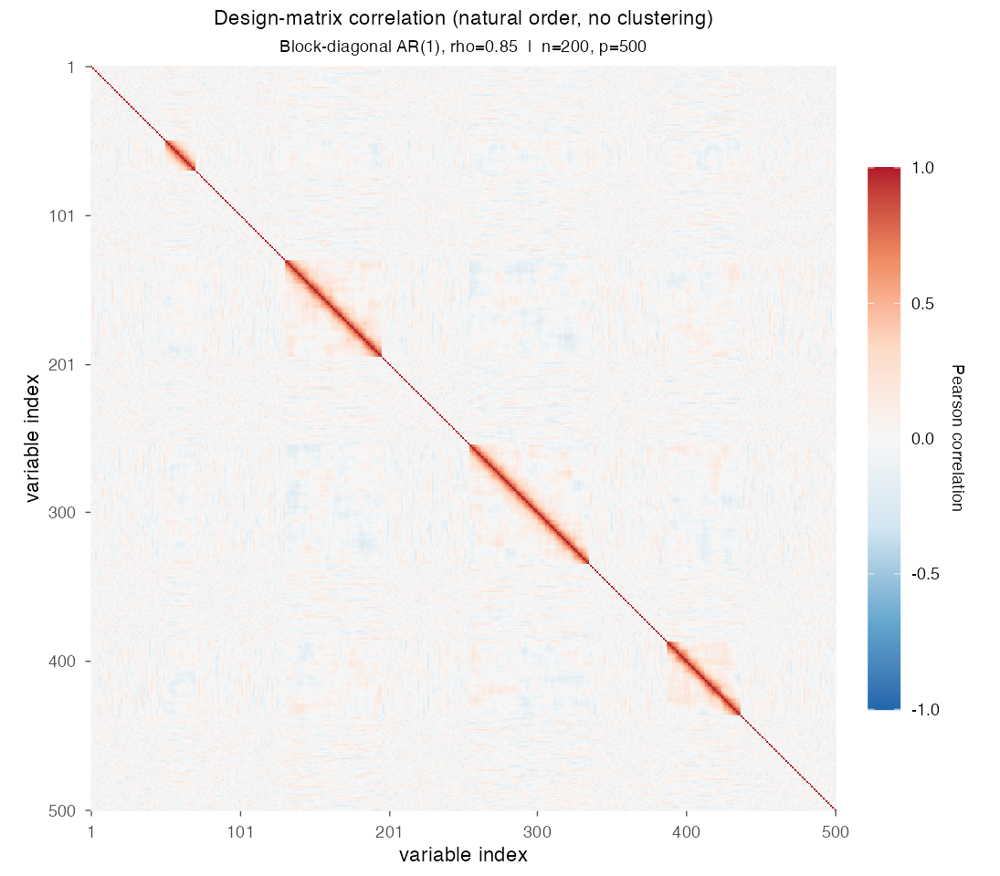
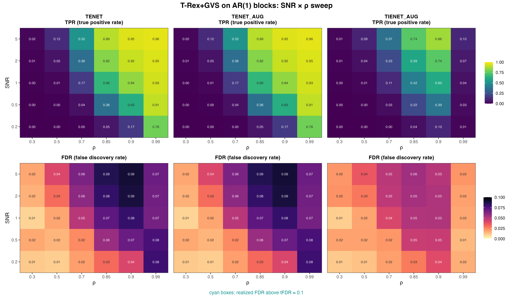

# Demo 06: T-Rex+GVS on AR(1) Blocks

## Purpose

Evaluate the Terminating Random Experiments (T-Rex) selector with grouped variable selection (GVS), T-Rex+GVS, when
the within-block correlation follows a **first-order autoregressive (AR(1)) time-series structure** instead of
equicorrelation. The demo uses the four-block active/trap geometry of
[Demo 03](../demo_trex_gvs_03_mc_sim_mixed_blocks/README.md), but replaces its shared-latent-factor equicorrelated
model with an AR(1) Toeplitz covariance within each block, so it tests robustness to decaying correlation patterns.
Selection and evaluation are per variable (see
[What is actually measured](../../../../../cpp/trex_selector_methods/ad/trex_gvs/README.md#what-is-actually-measured-in-these-demos)
in the C++ suite README).

This is the R port of the C++ demo
[demo_trex_gvs_06_mc_sim_ar1_blocks](../../../../../cpp/trex_selector_methods/ad/trex_gvs/demo_trex_gvs_06_mc_sim_ar1_blocks/README.md),
using the `TRexGVSSelector` class of `TRexSelector`. It keeps the data-generating process (DGP), control
parameters, sweep, console summaries and result-file naming of the C++ demo. Indices are 1-based (R convention).

---

## Data Generation Parameters (`dgp_ar1_blocks_snr`)

The data follow the linear model

```math
\boldsymbol{y} = \boldsymbol{X}\boldsymbol{\beta} + \boldsymbol{\epsilon},
\qquad \boldsymbol{\epsilon} \sim \mathcal{N}(\boldsymbol{0}, \sigma_{\varepsilon}^2 \boldsymbol{I}_n)
```

- $\boldsymbol{y} \in \mathbb{R}^n$ is the response vector.
- $\boldsymbol{X} \in \mathbb{R}^{n \times p}$ is the design matrix.
- $\boldsymbol{\beta} \in \mathbb{R}^p$ is the coefficient vector, with $s$ nonzero entries.
- $\boldsymbol{\epsilon}$ is the noise vector, independent and identically distributed (i.i.d.) normal.
- $\sigma_{\varepsilon}^2$ is the noise variance, calibrated to a target signal-to-noise ratio (SNR) as
  $\sigma_{\varepsilon}^2 = \widehat{\mathrm{Var}}(\boldsymbol{X}\boldsymbol{\beta}) / \mathrm{SNR}$.
- $n = 200$, $p = 500$, $s = 150$ (the sum of the three active blocks).

Unlike Demos 01–05, the within-block structure is **not** equicorrelated. Each block $k$ follows an AR(1) Toeplitz
covariance,

```math
\Sigma_k(i,j) = \rho^{\lvert i-j \rvert},
```

generated as $X_{\text{block}} = Z U$, where $Z$ has i.i.d. $\mathcal{N}(0,1)$ entries and $U$ is the upper-triangular
Cholesky factor of $\Sigma_k$ returned by `chol()`, so that $U^\top U = \Sigma_k$.

- Same four-block geometry as Demo 03, with sizes $\lbrace20, 50, 80, 65\rbrace$ (215 grouped columns in total).
- **Blocks 1–3 are active** ($\beta_j = 3$), while **block 4 is an inactive AR(1) trap** ($\beta_j = 0$).
- Each trial shuffles the block order and spreads the 285 remaining columns as gaps around the blocks, with at least
  one gap column between two blocks. The gap columns are i.i.d. $\mathcal{N}(0,1)$.
- The correlation between two variables of the same block decays with their column distance, so a block no longer
  behaves like a single tight cluster. Variables at opposite ends of a large block can be nearly uncorrelated.



Empirical Pearson correlation of an exemplary design drawn from this DGP (`dgp_ar1_blocks_snr`, $n=200$, $p=500$,
$\rho = 0.85$, seed 2026), in **natural variable order without hierarchical clustering**. Instead of the solid squares
of the equicorrelated demos, each block shows as a **band that fades off the diagonal** with the $\rho^{|i-j|}$ decay.
In the two large blocks the band dies out well before the block ends. At this $\rho$ even neighboring columns stay below
`corr_max = 0.98`, so the fixed cut of the hierarchical agglomerative clustering (HAC) leaves every variable in its own
cluster. One figure per DGP lives in [`../dgp_corr_plots/`](../dgp_corr_plots/). Regenerate the whole suite with
[`../generate_corr_plots.sh`](../generate_corr_plots.sh) (shared plotter
[`../../../corr_plt_utils.R`](../../../corr_plt_utils.R)).

---

## Control Parameters

```text
K = 20                          # Random experiments per T-loop iteration
tFDR = 0.1                      # Target FDR
corr_max = 0.98                 # HAC auto-clustering correlation threshold
hc_linkage = "Single"           # Single-linkage HAC
lambda2_method = "CV_1SE_CCD"   # Elastic-net penalty selection, EN rows (TENET, TENET_AUG)
lambda2_method = "CV_1SE_IEN_CCD"  # IEN rows (TIENET_AUG)
cv_dfmax_ratio = 1.0            # IEN support cap 1.0 * n_train = 180 (default 0.8 gives 144)
num_MC = 200                    # Monte Carlo repetitions per grid point
seed = 2026                     # Base seed, trial k uses 2026 + k - 1
```

---

## Methods Compared

Three T-Rex+GVS solver variants are compared. **TENET** runs the elastic net (EN) [[3]](#references),
**TENET_AUG** its row-augmented form [[1]](#references), and **TIENET_AUG** the informed elastic net (IEN)
[[2]](#references). All three use single-linkage HAC grouping. TENET and TENET_AUG select $\lambda_2$ with
`CV_1SE_CCD`, and TIENET_AUG with `CV_1SE_IEN_CCD`, the rule built for the IEN geometry, with its support cap raised
to $180$ variables (see [Demo 01](../demo_trex_gvs_01_mc_sim_hastie_en_blocks/README.md), Part 2), as in the C++ and
Python demos. The script lists them in `GVS_METHODS`.

- **TENET**: `GVS_type = "EN"`, `en_solver = "TENET"`
- **TENET_AUG**: `GVS_type = "EN"`, `en_solver = "TENET_AUG"`
- **TIENET_AUG**: `GVS_type = "IEN"`, `lambda2_method = "CV_1SE_IEN_CCD"`, `cv_dfmax_ratio = 1.0`, with `en_solver`
  left at the library default, which the IEN path ignores

Each Monte Carlo (MC) trial builds the selector through the shared adapter `.gvs_select()` in
[`../../../simulation_utils.R`](../../../simulation_utils.R), here for TENET:

```r
library(TRexSelector)

ctrl <- trex_control(
  solver = "TLARS", K = 20L, max_dummy_multiplier = 10, use_max_T_stop = TRUE,
  lloop_strategy = "HCONCAT", tloop_stagnation_stop = TRUE,
  tloop_max_stagnant_steps = 5, use_memory_mapping = FALSE
)
sel <- TRexGVSSelector$new(
  X, y, tFDR = 0.1, seed = trial_seed, verbose = FALSE,
  gvs_control = trex_gvs_control(
    gvs_type = "EN", corr_max = 0.98, hc_linkage = "Single", en_solver = "TENET",
    lambda2_method = "CV_1SE_CCD", cv_seed = trial_seed
  ),
  control = ctrl
)
sel$select()
fdp <- trex_fdp(sel$selected_indices, true_support)
tpp <- trex_tpp(sel$selected_indices, true_support)
```

TENET_AUG changes only `en_solver`. TIENET_AUG sets `gvs_type = "IEN"` and the base solver `"TIENET_AUG"`, so its
rows run the augmented IEN solver as in C++ and Python, and it passes `lambda2_method = "CV_1SE_IEN_CCD"` with
`cv_dfmax_ratio = 1.0`. The trial seed $2026 + k - 1$ of trial $k$ seeds the DGP, the selector and the
cross-validation folds.

---

## The Sweep

A single **2-D SNR $\times$ $\rho$ grid**, over
$\mathrm{SNR} \in \lbrace0.2, 0.5, 1, 2, 5\rbrace$ and
$\rho \in \lbrace0.30, 0.50, 0.70, 0.85, 0.90, 0.99\rbrace$, with 200 MC trials per cell. Here $\rho$ is the AR(1)
coefficient of the within-block Toeplitz covariance, so it sets how fast the correlation decays with column distance
rather than a uniform within-block correlation level.

---

## Output Files

The run writes `gvs_ar1_blocks_2d.txt` and `gvs_ar1_blocks_2d.csv` to `simulation_results/data/`. They hold the mean
false discovery proportion (FDP) and true positive proportion (TPP) of each method over the SNR $\times$ $\rho$ grid,
and the comma-separated values (CSV) file adds their standard deviations. The file names and the CSV schema match the
C++ and Python demos.

Figures in Portable Network Graphics (PNG) and Portable Document Format (PDF) go to `simulation_results/plots/`,
with the same file names as in the Python suite.

---

## Running the Demo

```bash
demo=R/trex_selector_methods/ad/trex_gvs/demo_trex_gvs_06_mc_sim_ar1_blocks/demo_trex_gvs_06_mc_sim_ar1_blocks.R

Rscript "$demo"      # full run, TREX_NUM_WORKERS workers (default 8)
Rscript "$demo" 8    # 8 worker cores
```

Monte Carlo trials run in parallel on a parallel socket (PSOCK) cluster of spawned R worker processes
([`../../../mc_runtime.R`](../../../mc_runtime.R)). The worker count is the first command-line argument, else
`TREX_NUM_WORKERS`, else 8, and `0` uses every core. Every finished grid cell is appended to a cache in
`simulation_results/cache/`, so a stopped run resumes where it left off, and a completed run removes the cache. The
script also sources [`../../../support_generators.R`](../../../support_generators.R),
[`../../../simulation_utils.R`](../../../simulation_utils.R), [`../trex_gvs_dgps.R`](../trex_gvs_dgps.R) and
[`../trex_gvs_sim_common.R`](../trex_gvs_sim_common.R). The recorded run (library commit `44cf1ab`, 8 workers) took
about 3.1 hours. The TIENET_AUG rows come from a rerun of that solver alone on library commit `09debc6`, with the
same trial seeds. For a quick smoke test, reduce `num_MC` in `CFG` and the grids in `PRESET` at the top of the
script.

Afterwards, regenerate the figure from the CSV file with [`generate_plots.sh`](generate_plots.sh), which drives the
suite's ggplot2 plotting module [`../trex_gvs_plt_utils.R`](../trex_gvs_plt_utils.R) through `Rscript` (set `RSCRIPT`
to use another R installation).

---

## Simulation Results

The numbers and figure below are this R run's own results (200 MC trials per cell). The false discovery rate (FDR) and
the true positive rate (TPR) of a cell are the means of FDP and TPP over its trials. R draws its own random numbers,
so the results agree with the
[C++ reference](../../../../../cpp/trex_selector_methods/ad/trex_gvs/demo_trex_gvs_06_mc_sim_ar1_blocks/README.md#simulation-results)
and the
[Python port](../../../../../Python/trex_selector_methods/ad/trex_gvs/demo_trex_gvs_06_mc_sim_ar1_blocks/README.md#simulation-results)
up to Monte Carlo noise, not exactly. A cell-by-cell comparison with the C++ run, with $z$ the difference divided by
the combined Monte Carlo standard error of the two 200-trial means, finds no cell with $|z| > 3$ among the 180 cells
of this demo (FDR and TPR of every solver at every grid point). Over the whole T-Rex+GVS suite no cell of 1,710 has
$|z| > 3$.

- The FDR stays under control everywhere (no cyan cells). **TENET** and **TENET_AUG** return identical numbers
  (means and standard deviations agree in every cell). Their FDR is $0.009\text{–}0.018$ at $\rho = 0.3$, rises
  column by column to a peak of $0.090$ ($\mathrm{SNR} = 5$, $\rho = 0.9$), just below the $\mathrm{tFDR} = 0.1$
  target, and is $0.066\text{–}0.080$ at $\rho = 0.99$. The FDR of **TIENET_AUG** peaks at $0.055$, and from
  $\rho = 0.7$ on it lies below TENET's in every cell.
- **Up to $\rho = 0.9$ the TPR recovers much more slowly with SNR than in the equicorrelated demos.** At
  $\mathrm{SNR} = 5$, TENET's TPR runs $0.016 / 0.12 / 0.52 / 0.89 / 0.95 / 0.96$ across
  $\rho \in \lbrace0.3, 0.5, 0.7, 0.85, 0.9, 0.99\rbrace$, so the $\text{low-}\rho$ columns barely lift off zero. At
  $\rho = 0.5$ and $\mathrm{SNR} = 5$ it reaches $0.12$ here, against $0.92$ in the R run of the equicorrelated Demo 03.
  The AR(1) decay keeps only nearby columns of a block strongly correlated, so the active columns share no common factor
  and plausibly each carries too little of the signal on its own at $n = 200$. The HAC grouping is not the cause,
  because below $\rho = 0.99$ neighboring columns stay under `corr_max = 0.98` and the fixed cut leaves every variable
  in its own cluster, here as in Demo 03. The C++ and Python runs show the same gap. Full recovery needs both a high
  $\rho$ and a high SNR, and only the $\rho = 0.99$ column starts high ($0.78$ already at $\mathrm{SNR} = 0.2$).
- **TIENET_AUG** has less power than the TENET variants, as in most cells of the other block demos. It gains power
  with SNR (from $0.10$ to $0.86$ at $\rho = 0.9$, against $0.95$ for TENET at $\mathrm{SNR} = 5$). In the
  $\rho = 0.99$ column, the only one where neighboring columns exceed `corr_max = 0.98` and single-linkage HAC chains
  each block into one cluster, its TPR stays far below TENET's at $0.011\text{–}0.104$, rising with SNR, on average
  1.6 to 15.7 of the 150 active variables. Its FDR there is $0.015\text{–}0.022$. At $\rho \le 0.5$, where every
  method stays at a TPR of at most $0.12$, TIENET_AUG trails TENET by at most $0.026$.
- The $\rho$ axis is the most informative view of this demo. Recovery degrades sharply as $\rho$ decreases and the
  AR(1) decay becomes steeper. At $\mathrm{SNR} = 2$, TENET's TPR falls from $0.95$ at $\rho = 0.99$ to $0.82$ at
  $0.85$, $0.36$ at $0.7$ and $0.049$ at $0.5$.

TPR (top) and FDR (bottom) heatmaps over the SNR $\times$ $\rho$ grid, one column per solver.
FDR cells above the $\mathrm{tFDR} = 0.1$ target would be outlined in cyan (none are here).



---

## References

1. Machkour, J., Muma, M., & Palomar, D. P., "False Discovery Rate Control for Grouped Variable Selection
   in High-Dimensional Linear Models using the T-Knock Filter.", European Signal Processing Conference (EUSIPCO), 2022,
   pp. 892–896, European Association for Signal Processing (EURASIP).
   [DOI-Link](https://doi.org/10.23919/EUSIPCO55093.2022.9909883)
2. Machkour, J., Muma, M., & Palomar, D. P., "The Informed Elastic Net for Fast Grouped Variable Selection and
   FDR Control in Genomics Research.", Workshop on Computational Advances in Multi-Sensor Adaptive Processing (CAMSAP),
   2023, pp. 466–470, Institute of Electrical and Electronics Engineers (IEEE).
   [DOI-Link](https://doi.org/10.1109/CAMSAP58249.2023.10403489)
3. Zou, H., & Hastie, T. (2005). "Regularization and variable selection via the elastic net." *Journal of the Royal
   Statistical Society: Series B (Statistical Methodology)*, 67(2), pp. 301–320.
   [DOI-Link](https://doi.org/10.1111/j.1467-9868.2005.00503.x)
