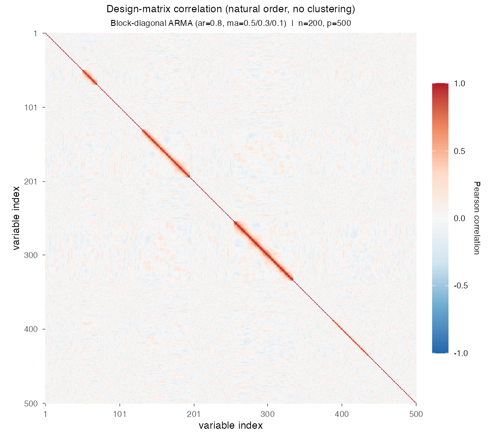
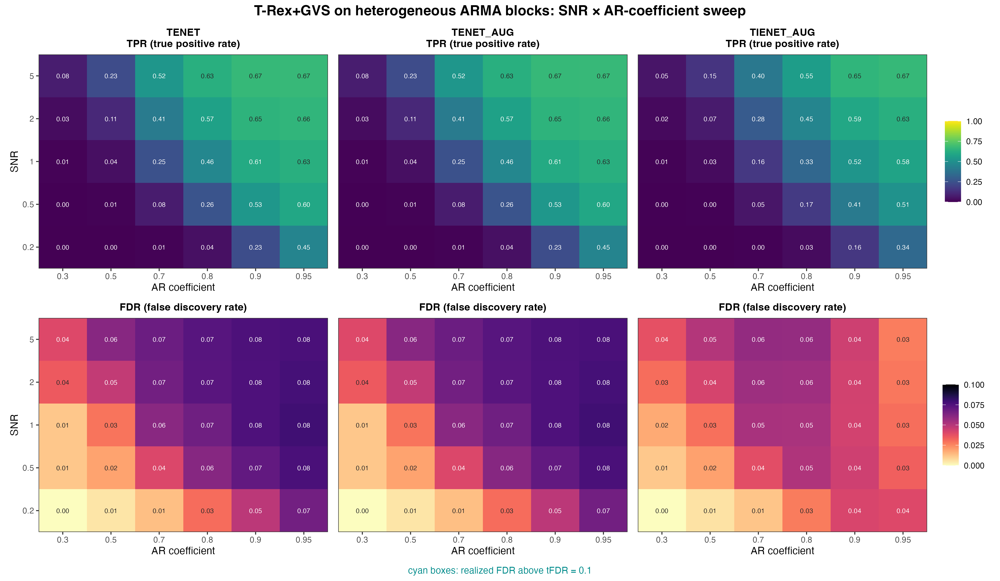

# Demo 07: T-Rex+GVS on Heterogeneous ARMA Blocks

## Purpose

Stress-test the Terminating Random Experiments (T-Rex) selector with grouped variable selection (GVS), T-Rex+GVS,
when different blocks follow **different time-series structures** rather than a single uniform correlation model.
This is the most heterogeneous of the four-block scenarios. Each block has its own autoregressive moving-average
(ARMA) specification, which tests whether the selector can still recover grouped signal when "the group correlation
model" is not one fixed thing. Selection and evaluation are per variable (see
[What is actually measured](../../../../../cpp/trex_selector_methods/ad/trex_gvs/README.md#what-is-actually-measured-in-these-demos)
in the C++ suite README).

This is the R port of the C++ demo
[demo_trex_gvs_07_mc_sim_arma_blocks](../../../../../cpp/trex_selector_methods/ad/trex_gvs/demo_trex_gvs_07_mc_sim_arma_blocks/README.md),
using the `TRexGVSSelector` class of `TRexSelector`. It keeps the data-generating process (DGP), control
parameters, sweep, console summaries and result-file naming of the C++ demo. Indices are 1-based (R convention).

---

## Data Generation Parameters (`dgp_arma_blocks_snr`)

The data follow the linear model

```math
\boldsymbol{y} = \boldsymbol{X}\boldsymbol{\beta} + \boldsymbol{\epsilon},
\qquad \boldsymbol{\epsilon} \sim \mathcal{N}(\boldsymbol{0}, \sigma_{\varepsilon}^2 \boldsymbol{I}_n)
```

- $\boldsymbol{y} \in \mathbb{R}^n$ is the response vector.
- $\boldsymbol{X} \in \mathbb{R}^{n \times p}$ is the design matrix.
- $\boldsymbol{\beta} \in \mathbb{R}^p$ is the coefficient vector, with $s$ nonzero entries.
- $\boldsymbol{\epsilon}$ is the noise vector, independent and identically distributed (i.i.d.) normal.
- $\sigma_{\varepsilon}^2$ is the noise variance, calibrated to a target signal-to-noise ratio (SNR) as
  $\sigma_{\varepsilon}^2 = \widehat{\mathrm{Var}}(\boldsymbol{X}\boldsymbol{\beta}) / \mathrm{SNR}$.
- $n = 200$, $p = 500$, $s = 150$ (the sum of the three active blocks).

The design matrix keeps the four-block geometry of Demos 03, 05 and 06 (sizes $\lbrace20, 50, 80, 65\rbrace$, 215
grouped columns in total), but **each block follows a distinct ARMA process**. In every row, the columns of a block
are one realization of its process, so for a stationary process the correlation between two columns of a block is
the autocorrelation at their column distance. The helper `.sim_arma()` generates each realization by direct
recursion after a burn-in of 100 steps, as the C++ generator does (it does not call `arima.sim` and does not enforce
stationarity), and every block column is then standardized to unit empirical variance.

- **Block 1** (20 vars, active, $\beta_j = 3$): first-order autoregressive (AR(1)), $\phi_1 = \texttt{ar\_coef}$.
- **Block 2** (50 vars, active): moving-average (MA(3)), $\theta = (0.5, 0.3, 0.1)$.
- **Block 3** (80 vars, active): ARMA(2,1), $\phi = (\tfrac{5}{6}\,\texttt{ar\_coef}, \tfrac{1}{6}\,\texttt{ar\_coef})$,
  $\theta = 0.5$.
- **Block 4** (65 vars, inactive trap): AR(1), $\phi_1 = \texttt{ar\_coef}$, structurally identical to Block 1.
- Each trial shuffles the block order and spreads the 285 remaining columns as gaps around the blocks, with at least
  one gap column between two blocks. The gap columns are i.i.d. $\mathcal{N}(0,1)$.

Unlike Demo 06, the sweep parameter here is `ar_coef` (shared by the AR(1) and ARMA(2,1) blocks), **not** $\rho$. The
MA(3) block has no AR component at all, so it does not respond to the sweep.

The two AR coefficients of the ARMA(2,1) block keep a ratio of 5 to 1 and sum to `ar_coef`, so the block is stationary
for every `ar_coef` in $(0, 1)$. The former $\phi = (\texttt{ar\_coef}, \texttt{ar\_coef}/5)$ summed to
$1.2 \cdot \texttt{ar\_coef}$ and turned the block explosive for `ar_coef` $\ge 5/6$, so at $0.9$ and $0.95$ its
columns were nearly collinear.



Empirical Pearson correlation of an exemplary design drawn from this DGP (`dgp_arma_blocks_snr`, $n=200$, $p=500$,
`ar_coef` $=0.8$, seed 2026), in **natural variable order without hierarchical clustering**. The heterogeneity is
visible directly. The ARMA(2,1) block (80 vars) and the two AR(1) blocks (20 and 65 vars, active and trap) carry
decaying bands of similar width, and the MA(3) block (50 vars) is nearly a bare diagonal, since its correlation
vanishes beyond lag 3. One figure per DGP lives in [`../dgp_corr_plots/`](../dgp_corr_plots/). Regenerate the whole
suite with [`../generate_corr_plots.sh`](../generate_corr_plots.sh) (shared plotter
[`../../../corr_plt_utils.R`](../../../corr_plt_utils.R)).

---

## Control Parameters

```text
K = 20                          # Random experiments per T-loop iteration
tFDR = 0.1                      # Target FDR
corr_max = 0.98                 # HAC auto-clustering correlation threshold
hc_linkage = "Single"           # Single-linkage HAC
lambda2_method = "CV_1SE_CCD"   # Elastic-net penalty selection, EN rows (TENET, TENET_AUG)
lambda2_method = "CV_1SE_IEN_CCD"  # IEN rows (TIENET_AUG)
cv_dfmax_ratio = 1.0            # IEN support cap 1.0 * n_train = 180 (default 0.8 gives 144)
num_MC = 200                    # Monte Carlo repetitions per grid point
seed = 2026                     # Base seed, trial k uses 2026 + k - 1
```

---

## Methods Compared

Three T-Rex+GVS solver variants are compared. **TENET** runs the elastic net (EN) [[3]](#references),
**TENET_AUG** its row-augmented form [[1]](#references), and **TIENET_AUG** the informed elastic net (IEN)
[[2]](#references). All three use single-linkage hierarchical agglomerative clustering (HAC) grouping. TENET and
TENET_AUG select $\lambda_2$ with `CV_1SE_CCD`, and TIENET_AUG with `CV_1SE_IEN_CCD`, the rule built for the IEN
geometry, with its support cap raised to $180$ variables (see
[Demo 01](../demo_trex_gvs_01_mc_sim_hastie_en_blocks/README.md), Part 2), as in the C++ and Python demos. The
script lists them in `GVS_METHODS`.

- **TENET**: `GVS_type = "EN"`, `en_solver = "TENET"`
- **TENET_AUG**: `GVS_type = "EN"`, `en_solver = "TENET_AUG"`
- **TIENET_AUG**: `GVS_type = "IEN"`, `lambda2_method = "CV_1SE_IEN_CCD"`, `cv_dfmax_ratio = 1.0`, with `en_solver`
  left at the library default, which the IEN path ignores

Each Monte Carlo (MC) trial builds the selector through the shared adapter `.gvs_select()` in
[`../../../simulation_utils.R`](../../../simulation_utils.R), here for TENET:

```r
library(TRexSelector)

ctrl <- trex_control(
  solver = "TLARS", K = 20L, max_dummy_multiplier = 10, use_max_T_stop = TRUE,
  lloop_strategy = "HCONCAT", tloop_stagnation_stop = TRUE,
  tloop_max_stagnant_steps = 5, use_memory_mapping = FALSE
)
sel <- TRexGVSSelector$new(
  X, y, tFDR = 0.1, seed = trial_seed, verbose = FALSE,
  gvs_control = trex_gvs_control(
    gvs_type = "EN", corr_max = 0.98, hc_linkage = "Single", en_solver = "TENET",
    lambda2_method = "CV_1SE_CCD", cv_seed = trial_seed
  ),
  control = ctrl
)
sel$select()
fdp <- trex_fdp(sel$selected_indices, true_support)
tpp <- trex_tpp(sel$selected_indices, true_support)
```

TENET_AUG changes only `en_solver`. TIENET_AUG sets `gvs_type = "IEN"` and the base solver `"TIENET_AUG"`, so its
rows run the augmented IEN solver as in C++ and Python, and it passes `lambda2_method = "CV_1SE_IEN_CCD"` with
`cv_dfmax_ratio = 1.0`. The trial seed $2026 + k - 1$ of trial $k$ seeds the DGP, the selector and the
cross-validation folds.

---

## The Sweep

A single **2-D SNR $\times$ `ar_coef` grid**, over
$\mathrm{SNR} \in \lbrace0.2, 0.5, 1, 2, 5\rbrace$ and
`ar_coef` $\in \lbrace0.30, 0.50, 0.70, 0.80, 0.90, 0.95\rbrace$
(the AR coefficient shared by the AR(1) and ARMA(2,1) blocks, labeled `ac=` in the result tables), with 200 MC trials
per cell. Because the MA(3) block carries no AR component, only three of the four blocks respond to the `ar_coef`
axis.

---

## Output Files

The run writes `gvs_arma_blocks_2d.txt` and `gvs_arma_blocks_2d.csv` to `simulation_results/data/`. They hold the mean
false discovery proportion (FDP) and true positive proportion (TPP) of each method over the SNR $\times$ `ar_coef`
grid, and the comma-separated values (CSV) file adds their standard deviations. The file names and the CSV schema
match the C++ and Python demos.

Figures in Portable Network Graphics (PNG) and Portable Document Format (PDF) go to `simulation_results/plots/`,
with the same file names as in the Python suite.

---

## Running the Demo

```bash
demo=R/trex_selector_methods/ad/trex_gvs/demo_trex_gvs_07_mc_sim_arma_blocks/demo_trex_gvs_07_mc_sim_arma_blocks.R

Rscript "$demo"      # full run, TREX_NUM_WORKERS workers (default 8)
Rscript "$demo" 8    # 8 worker cores
```

Monte Carlo trials run in parallel on a parallel socket (PSOCK) cluster of spawned R worker processes
([`../../../mc_runtime.R`](../../../mc_runtime.R)). The worker count is the first command-line argument, else
`TREX_NUM_WORKERS`, else 8, and `0` uses every core. Every finished grid cell is appended to a cache in
`simulation_results/cache/`, so a stopped run resumes where it left off, and a completed run removes the cache. The
script also sources [`../../../support_generators.R`](../../../support_generators.R),
[`../../../simulation_utils.R`](../../../simulation_utils.R), [`../trex_gvs_dgps.R`](../trex_gvs_dgps.R) and
[`../trex_gvs_sim_common.R`](../trex_gvs_sim_common.R). The recorded run (library commit `61fd84c`, 8 workers) took
about 2.4 hours. The TIENET_AUG rows come from a rerun of that solver alone on library commit `09debc6`, with the
same trial seeds. For a quick smoke test, reduce `num_MC` in `CFG` and the grids in `PRESET` at the top of the
script.

Afterwards, regenerate the figure from the CSV file with [`generate_plots.sh`](generate_plots.sh), which drives the
suite's ggplot2 plotting module [`../trex_gvs_plt_utils.R`](../trex_gvs_plt_utils.R) through `Rscript` (set `RSCRIPT`
to use another R installation).

---

## Simulation Results

The numbers and figure below are this R run's own results (200 MC trials per cell). The false discovery rate (FDR) and
the true positive rate (TPR) of a cell are the means of FDP and TPP over its trials. R draws its own random numbers,
so the results agree with the
[C++ reference](../../../../../cpp/trex_selector_methods/ad/trex_gvs/demo_trex_gvs_07_mc_sim_arma_blocks/README.md#simulation-results)
and the
[Python port](../../../../../Python/trex_selector_methods/ad/trex_gvs/demo_trex_gvs_07_mc_sim_arma_blocks/README.md#simulation-results)
up to Monte Carlo noise, not exactly. A cell-by-cell comparison with the C++ run, with $z$ the difference divided by
the combined Monte Carlo standard error of the two 200-trial means, finds no cell with $|z| > 3$ among the 180 cells
of this demo (FDR and TPR of every solver at every grid point, largest $|z| = 2.68$). R's FDR lies above the C++ value
at 25 of the 30 grid points for TENET and at 28 for TIENET_AUG, by $0.004$ on average, and Python lies above C++ at 21
for both. Every grid point reuses the same trial seeds, so the cells of one run are correlated and a shared sign is
weaker evidence than it would be for independent cells. Over the whole T-Rex+GVS suite no cell of 1,710 has
$|z| > 3$.

- **TENET** and **TENET_AUG** return identical numbers (means and standard deviations agree in every cell) and keep
  the FDR below the $\mathrm{tFDR} = 0.1$ target in every cell (at most $0.079$, no cyan outlines). Their FDR grows
  with `ar_coef`, from at most $0.040$ at `ar_coef` $= 0.3$ to $0.067\text{–}0.079$ at $0.95$. The trap block (AR(1),
  same `ar_coef` as the active AR(1) block) is structurally similar to an active block and is the main test of
  false-group exclusion here. The FDR stays below target despite it, although the demo does not record which false
  discoveries fall into the trap.
- Their TPR rises with both SNR and `ar_coef`. At $\mathrm{SNR} = 5$ it climbs from $0.078$ at `ar_coef` $= 0.3$ to
  $0.669$ at $0.9$ and $0.670$ at $0.95$, and at $\mathrm{SNR} = 0.2$ from $0.000$ to $0.451$. The ceiling of about
  two thirds matches 100 of the 150 active variables, the size of the AR(1) and ARMA(2,1) blocks together. A plausible
  reading is that the MA(3) block, whose correlation vanishes beyond lag 3 and does not follow the sweep, stays mostly
  unselected, but the demo records no per-block rates.
- **TIENET_AUG** is more conservative, with an FDR of at most $0.058$, below TENET's at 25 of the 30 grid points (the
  other five lie at `ar_coef` $\le 0.5$ and $\mathrm{SNR} \le 1$). At `ar_coef` $\ge 0.9$ and $\mathrm{SNR} = 5$ it
  nearly matches the TPR of TENET ($0.653\text{–}0.669$ against $0.669\text{–}0.670$). From $\mathrm{SNR} = 0.5$ on
  its FDR peaks at `ar_coef` $= 0.7\text{–}0.8$ and falls again toward $0.95$ (at most $0.044$ at `ar_coef`
  $\ge 0.9$ and $\mathrm{SNR} \ge 2$), while the FDR of TENET keeps rising there.
- Against Demo 06 (uniform AR(1) blocks, R run), the ARMA design has the higher TPR at low coefficients and the lower
  ceiling. At coefficients up to $0.7$ it gives the higher TENET TPR at 14 of the 15 shared grid points ($0.229$
  against $0.119$ at $0.5$ and $\mathrm{SNR} = 5$, for example). A plausible reading is that its 80-variable ARMA(2,1)
  block is more strongly correlated at short lags than an AR(1) block with the same coefficient (lag-1
  autocorrelation $0.59$, $0.71$ and $0.83$ against $0.3$, $0.5$ and $0.7$), because its MA term adds correlation. At
  a coefficient of $0.9$ and $\mathrm{SNR} \ge 0.5$, in contrast, Demo 06 reaches $0.63\text{–}0.95$ against
  $0.53\text{–}0.67$ here, and its top TENET TPR is $0.961$ against $0.670$.
- With the former explosive ARMA(2,1) block (see the DGP section), the TENET TPR leveled off at $0.55\text{–}0.60$
  from `ar_coef` $= 0.8$ on, and the TIENET_AUG TPR collapsed to $0.006\text{–}0.007$ from `ar_coef` $= 0.9$ on.
  Both effects came from the nearly collinear block, and the stationary block shows neither.

TPR (top) and FDR (bottom) heatmaps over the SNR $\times$ `ar_coef` grid, one column per solver
(row axis = SNR, column axis = AR coefficient). FDR cells above the $\mathrm{tFDR} = 0.1$ target
would be outlined in cyan (none are here).



---

## References

1. Machkour, J., Muma, M., & Palomar, D. P., "False Discovery Rate Control for Grouped Variable Selection
   in High-Dimensional Linear Models using the T-Knock Filter.", European Signal Processing Conference (EUSIPCO), 2022,
   pp. 892–896, European Association for Signal Processing (EURASIP).
   [DOI-Link](https://doi.org/10.23919/EUSIPCO55093.2022.9909883)
2. Machkour, J., Muma, M., & Palomar, D. P., "The Informed Elastic Net for Fast Grouped Variable Selection and
   FDR Control in Genomics Research.", Workshop on Computational Advances in Multi-Sensor Adaptive Processing (CAMSAP),
   2023, pp. 466–470, Institute of Electrical and Electronics Engineers (IEEE).
   [DOI-Link](https://doi.org/10.1109/CAMSAP58249.2023.10403489)
3. Zou, H., & Hastie, T. (2005). "Regularization and variable selection via the elastic net." *Journal of the Royal
   Statistical Society: Series B (Statistical Methodology)*, 67(2), pp. 301–320.
   [DOI-Link](https://doi.org/10.1111/j.1467-9868.2005.00503.x)
