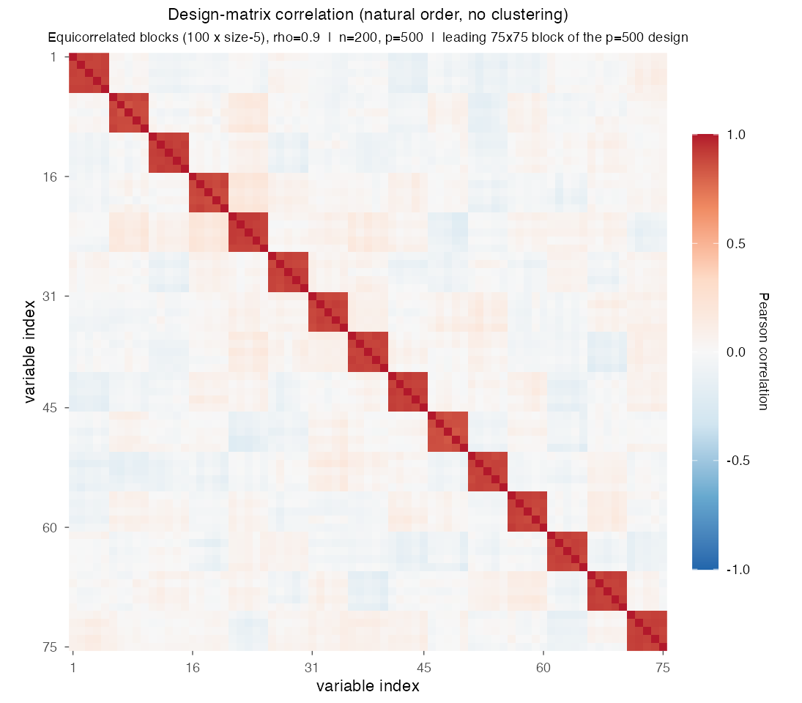
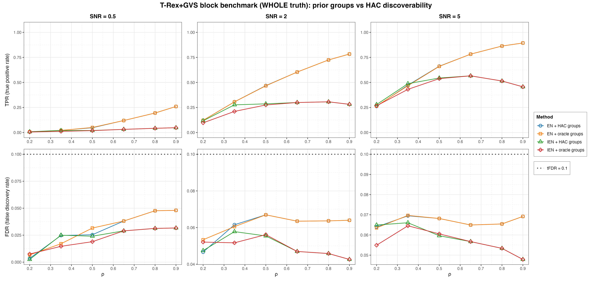
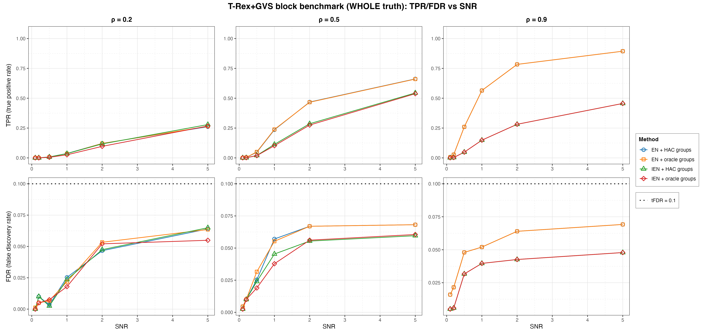
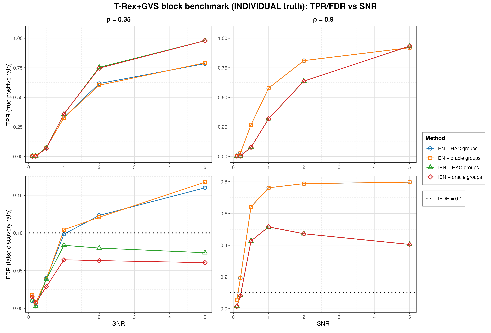

# Demo 08: T-Rex+GVS Block Benchmark — Value of Prior Group Information

## Purpose

Quantify what **prior group knowledge is actually worth** to the Terminating Random Experiments (T-Rex) selector with
Grouped Variable Selection (GVS), T-Rex+GVS, as a function of how easily the groups could have been discovered from
the data anyway. Four method variants factorize the question into elastic net (EN) vs. informed elastic net (IEN),
each run once with groups discovered by hierarchical agglomerative clustering (HAC) and once with the true ("oracle")
groups from the data-generating process (DGP). The headline sweep moves the within-block correlation $\rho$ across
the HAC discoverability boundary set by `corr_max = 0.5`. Below it the clustered methods see near-singletons and the
oracle prior is the only source of group structure, while above it HAC rediscovers the blocks and the prior becomes
redundant. Selection and evaluation are per variable (see
[What is actually measured](../../../../../cpp/trex_selector_methods/ad/trex_gvs/README.md#what-is-actually-measured-in-these-demos)
in the C++ suite README).

R port of the C++ demo
[cpp/trex_selector_methods/ad/trex_gvs/demo_trex_gvs_08_mc_sim_block_bench](../../../../../cpp/trex_selector_methods/ad/trex_gvs/demo_trex_gvs_08_mc_sim_block_bench/README.md)
with the same DGP, control parameters, sweep grids, console tables and result-file naming, built on the
`TRexGVSSelector` class of `TRexSelector`. Indices are 1-based (R convention). The numbers below are this R run's own
results. R draws its own random numbers, so they differ from the C++ and
[Python](../../../../../Python/trex_selector_methods/ad/trex_gvs/demo_trex_gvs_08_mc_sim_block_bench/README.md) runs
within Monte Carlo (MC) noise, not exactly. A cell-by-cell comparison with the C++ run, with $z$ the difference divided
by the combined Monte Carlo standard error of the two 200-trial means, finds no cell with $|z| > 3$ among the 384 cells
of this demo (coordinate true positive rate (TPR) and false discovery rate (FDR) of every method at every grid point,
288 for the whole-block truth and 96 for the individual-variable truth). The largest is $|z| = 2.82$, for IEN with HAC
groups under whole-block truth at $\rho = 0.2$ and a signal-to-noise ratio (SNR) of 2 (TPR $0.117$ in R vs. $0.094$ in
C++). The largest single differences are $0.032$ in TPR and $0.067$ in FDR, the latter for EN with HAC groups under
individual-variable truth at $\rho = 0.9$, $\mathrm{SNR} = 0.5$ ($0.642$ vs. $0.575$). Over the whole T-Rex+GVS suite no
cell of 1,710 has $|z| > 3$. The $\lambda_2$ picks agree as well. Cell by cell, the R mean $\lambda_2$ lies within a
factor of $1.25$ of the C++ one in 92 of the 96 IEN cells and in 46 of the 48 EN cells, with a median ratio of $1.01$
and $1.00$.

---

## Data Generation Parameters (`dgp_block_equicorr`)

The demo considers the linear model

```math
\boldsymbol{y} = \boldsymbol{X}\boldsymbol{\beta} + \boldsymbol{\epsilon},
\qquad \boldsymbol{\epsilon} \sim \mathcal{N}(\boldsymbol{0}, \sigma_{\varepsilon}^2 \boldsymbol{I}_n)
```

- $\boldsymbol{y} \in \mathbb{R}^n$ is the response vector.
- $\boldsymbol{X} \in \mathbb{R}^{n \times p}$ is the design matrix.
- $\boldsymbol{\beta} \in \mathbb{R}^p$ is the coefficient vector, with $s$ nonzero entries.
- $\boldsymbol{\epsilon}$ is the noise vector with independent and identically distributed (i.i.d.) Gaussian entries.
- $\sigma_{\varepsilon}^2$ is the noise variance, calibrated to achieve a target linear signal-to-noise ratio (SNR).
- $n = 200$, $p = 500$, and $s$ depends on the truth scenario below.

The design matrix consists of $G = 100$ equal-size blocks of `block_size` $= 5$ variables each, drawn from the
unit-variance equicorrelated latent-factor model

```math
X_{ij} = \sqrt{\rho}\, Z_{i,g(j)} + \sqrt{1-\rho}\, \xi_{ij},
\qquad Z_{\cdot,k},\ \xi_{ij} \sim \mathcal{N}(0,1).
```

- `n_active_blocks` $= 10$ blocks are chosen at random per trial, and each receives a random-sign coefficient
  $\beta = \pm 3$.
- The DGP exports `prior_groups`, the exact generating block of every column as contiguous labels $1, \ldots, G$
  (columns 1–5 form group 1, columns 6–10 group 2, and so on), which the oracle variants pass to
  `trex_gvs_control(groups = ...)`.



Empirical Pearson correlation of an exemplary design drawn from this DGP (`dgp_block_equicorr`, $n=200$, $p=500$,
$\rho = 0.9$, seed 2026), in **natural variable order with no hierarchical clustering**. Only the leading
$75 \times 75$ corner is shown, because 100 blocks of 5 columns are sub-pixel over the full $p = 500$. The chain of
tiny $5 \times 5$ squares along the diagonal is the block structure the oracle prior encodes exactly and HAC has to
rediscover. At $\rho = 0.9$ it does, but at $\rho \le 0.35$ the same blocks fall below the `corr_max` $= 0.5$ cut and
dissolve into singletons. One figure per DGP lives in [`../dgp_corr_plots/`](../dgp_corr_plots/). Regenerate the
whole suite with [`../generate_corr_plots.sh`](../generate_corr_plots.sh) (shared ggplot2 plotter
[`../../../corr_plt_utils.R`](../../../corr_plt_utils.R)).

### Truth scenarios

The DGP's `scenario` argument picks one of three truth scenarios, whole active blocks (WHOLE), one individual active
variable per block (INDIVIDUAL) or a representative subset of 2–3 active variables per block (REPRESENTATIVE). This
benchmark, like the C++ one, runs the first two.

- **WHOLE** (headline) — all 5 variables of each active block are active, $s = 50$. This matches the grouped-selection
  premise of the T-Rex+GVS papers — active groups are fully active — so coordinate-level FDR and TPR are the right
  metrics.
- **INDIVIDUAL** (cautionary appendix) — exactly 1 of the 5 variables per active block is active, $s = 10$. The four
  null siblings of each active variable are exchangeable with it up to the $(1-\rho)$ idiosyncratic component, so
  no selector that aggregates evidence across correlated variables can control the coordinate-level FDR here. This
  scenario is included to show that failure mode explicitly, not as a benchmark to win.

---

## Four Methods Compared

The four variants are EN with HAC groups (M1), EN with oracle groups (M2), IEN with HAC groups (M3) and IEN with
oracle groups (M4).

| Method | `gvs_type` | Groups |
| --- | --- | --- |
| **M1 (EN + HAC)** | EN [[1]](#references) | discovered per trial via single-linkage HAC at `corr_max` |
| **M2 (EN + oracle)** | EN [[1]](#references) | true `prior_groups` from the DGP |
| **M3 (IEN + HAC)** | IEN [[2]](#references) | discovered per trial via single-linkage HAC at `corr_max` |
| **M4 (IEN + oracle)** | IEN [[2]](#references) | true `prior_groups` from the DGP |

The saved tables label the rows `M1(EN-C)`, `M2(EN-O)`, `M3(IE-C)` and `M4(IE-O)`, and the figures label them
EN + HAC groups, EN + oracle groups, IEN + HAC groups and IEN + oracle groups.

The group information enters the two solvers differently. The EN variants use it **only** to draw group-correlated
dummy (random-experiment) columns, while IEN additionally ties the group members together through its
group-indicator row augmentation — and those indicator rows are tiled across the dummy layers as well, so every
variable's group-aligned dummies share its group geometry. The oracle prior can therefore matter more — in either
direction — for IEN than for EN.

The two tracks also choose $\lambda_2$ differently. The EN variants cross-validate it on the original
$(\boldsymbol{X}, \boldsymbol{y})$ with the ridge-shaped rule `CV_1SE_CCD`, so their penalty is identical for the
clustered and oracle groups. At $\mathrm{SNR} \le 0.5$ this cross-validation lands on large values (WHOLE cell
means from $1.6 \times 10^6$ to $8.7 \times 10^6$ in the R run), which the C++ README traces to a flat
cross-validation curve.
The IEN variants use the IEN-geometry rule `CV_1SE_IEN_CCD`, which cross-validates $\lambda_2$ jointly with
$\lambda_1$ on the group structure the variant is given, so the clustered and oracle runs get different penalties
(mean $0.39$ vs. $0.14$ at $\rho = 0.35$, $\mathrm{SNR} = 5$). Its $\lambda_1$ path stops at
$0.8\, n_{\mathrm{train}} = 144$ selected variables, well above the $s \le 50$ true variables here. Demos 01–07 use
the same rule for their IEN rows, with the cap raised to $n_{\mathrm{train}} = 180$ because most of them have
$s = 150$ (see [Demo 01](../demo_trex_gvs_01_mc_sim_hastie_en_blocks/README.md)). Here the IEN rule also returns
boundary picks, which the library reports on the console and keeps. The R workers discard their console output, so
the R run has no count of them, and the C++ README gives the count for the C++ run.

---

## Control Parameters

```text
K = 20                # Random experiments per T-loop iteration
tFDR = 0.1            # Target FDR
corr_max = 0.5        # HAC discoverability boundary (cut height 1 - corr_max)
hc_linkage = Single   # Single-linkage HAC
lambda2_method        # CV_1SE_CCD (EN rows M1/M2), CV_1SE_IEN_CCD (IEN rows M3/M4)
b = 3.0               # Nonzero coefficient magnitude (random sign per block)
num_MC = 200          # Monte Carlo repetitions per grid cell
```

Seeds are staggered per grid cell (`cell_base_seed = base_seed + cell_index * num_MC` with `base_seed = 2026` and
`cell_index = (i_rho - 1) * n_snr + (i_snr - 1)` over the scenario's own $\rho$ grid), so each
$(\rho, \mathrm{SNR})$ cell draws from a distinct seed band. Trial `mc` uses the seed `cell_base_seed + mc - 1` for
the DGP and for all four selectors, so the four methods see identical data within a trial.

## Selector Setup in R

Each Monte Carlo trial builds the four selectors through the TRexSelector class interface, here for M4:

```r
library(TRexSelector)

ctrl <- trex_control(
  solver = "TIENET_AUG", K = 20L, max_dummy_multiplier = 10, use_max_T_stop = TRUE,
  lloop_strategy = "HCONCAT", tloop_stagnation_stop = TRUE,
  tloop_max_stagnant_steps = 5, use_memory_mapping = FALSE
)
sel <- TRexGVSSelector$new(
  dat$X, dat$y, tFDR = 0.1, seed = trial_seed, verbose = FALSE,
  gvs_control = trex_gvs_control(
    gvs_type = "IEN", corr_max = 0.5, hc_linkage = "Single",
    lambda2_method = "CV_1SE_IEN_CCD", groups = dat$prior_groups
  ),
  control = ctrl
)
sel$select()
fdp <- trex_fdp(sel$selected_indices, dat$true_support)
tpp <- trex_tpp(sel$selected_indices, dat$true_support)
```

M3 drops `groups`, so HAC forms the groups. The EN variants M1 and M2 pass `gvs_type = "EN"`,
`en_solver = "TENET_AUG"` and `lambda2_method = "CV_1SE_CCD"`, with `solver = "TLARS"` in `trex_control()`. The
oracle variants hand the true labels to `groups`, because T-Rex+GVS reads that field, while `prior_groups` is
reserved for the dependency-aware T-Rex (DA-TRex). Every control field is set explicitly as in the C++
`make_gvs_trex_control()`, because the R `AUTO` default would switch the stagnation stop off for the EN rows. The
selector seed is the trial seed, and the cross-validation seed stays at its default, derived from the selector seed.

---

## The Sweep

- **WHOLE**: a 2-D $\rho \times \mathrm{SNR}$ grid over $\rho \in \lbrace0.2, 0.35, 0.5, 0.65, 0.8, 0.9\rbrace$ and
  $\mathrm{SNR} \in \lbrace0.1, 0.2, 0.5, 1, 2, 5\rbrace$, 200 MC trials per cell. The $\rho$ grid deliberately
  brackets `corr_max` $= 0.5$, because single-linkage merges within-block pairs at distance $\approx 1 - \rho$, so
  for $\rho \le 0.35$ almost every merge lies above the fixed cut height $1 -$ `corr_max` $= 0.5$. Hardly any group
  survives the cut there (purity at most $0.0002$, $M = 500$ groups at $\rho = 0.2$ and $M \approx 495$ at
  $\rho = 0.35$). The point $\rho = 0.5$ sits on the boundary (purity $0.57$, $M \approx 179\text{–}180$), while
  $\rho \ge 0.65$ is fully discovered (purity $1.0$, $M = 100$). Holding `corr_max` fixed while $\rho$ varies models
  a **mis-specified discovery threshold** — the practical situation where the true correlation level is unknown —
  not a limitation of the clustering itself, which recovers these blocks whenever the cut is set below the
  within-block correlation.
- **INDIVIDUAL**: the same SNR grid at the low/high pair $\rho \in \lbrace0.35, 0.9\rbrace$.

---

## Metrics Reported

The primary metrics are the usual **coordinate-level FDR/TPR** — the quantities the T-Rex selector actually controls
and targets. The saved tables additionally report block-level and grouping diagnostics:

- **`blk_hit`** — share of active blocks with at least one selected variable (a block-level TPR), or
  **`full_blk`** — share of active blocks recovered in their entirety (WHOLE tables).
- **`block_FDR`** — share of hit blocks that are truly null.
- **`purity`** — share of true blocks whose members all land in one discovered group ($1.0$ by construction for
  oracle runs).
- **`T_stop`**, **`M_found`** — selector diagnostics.

> The block-level numbers are **descriptive diagnostics only**. T-Rex+GVS as implemented controls the FDR of the
> selected variables and is not designed to control a block-level FDR, so no target and no guarantee attach to
> `block_FDR`, and a value above $\mathrm{tFDR}$ does not indicate a loss of FDR control. A block-level error rate
> is a different quantity with its own definition of a false discovery (cf.
> [the group-FDR discussion](../../../../../cpp/trex_selector_methods/ad/trex_gvs/README.md#what-is-actually-measured-in-these-demos)).

The grouping diagnostics come straight from the fitted selector. Its `max_clusters` field gives `M_found`, and its
`groups` field holds the per-variable cluster labels, from which `purity` is computed for HAC and oracle runs alike.
The comma-separated values (CSV) files also carry the share of trials whose selection equals the true support
(`mean_exact_sup`), the share of null blocks with a selection (`mean_null_act`) and the mean $\lambda_2$
(`mean_lambda2`, from the selector's `lambda2_used` field).

---

## Output Files

Written to `simulation_results/data/`, one pair per truth scenario:

- `gvs_block_bench_whole.txt` / `.csv`
- `gvs_block_bench_individual.txt` / `.csv`

Each `.txt` reproduces the console grid tables, and each `.csv` holds one row per method and $(\rho, \mathrm{SNR})$
cell with all aggregates. The file names and CSV schemas match the C++ and Python demos. Figures in Portable Network
Graphics (PNG) and Portable Document Format (PDF) go to `simulation_results/plots/`, with the same file names as the
Python suite.

---

## Running the Demo

```bash
dir=R/trex_selector_methods/ad/trex_gvs/demo_trex_gvs_08_mc_sim_block_bench

Rscript "$dir/demo_trex_gvs_08_mc_sim_block_bench.R"      # full run, TREX_NUM_WORKERS workers (default 8)
Rscript "$dir/demo_trex_gvs_08_mc_sim_block_bench.R" 8    # 8 worker cores
"$dir/generate_plots.sh"                                  # render the figures below from the saved CSVs
```

Both scenarios run in the same invocation and print one grid table per scenario, per $\rho$ value. Reduce `num_MC`
in `CFG` and the grids for a quick preview. Monte Carlo trials run in parallel on a parallel socket (PSOCK) cluster
of spawned R worker processes ([`../../../mc_runtime.R`](../../../mc_runtime.R)). The worker count is the first
command-line argument, else `TREX_NUM_WORKERS`, else 8, and `0` uses every core. Every finished grid cell is appended
to a cache in `simulation_results/cache/`, so a stopped run resumes where it left off, and a completed run removes
the cache. The script also sources [`../trex_gvs_dgps.R`](../trex_gvs_dgps.R) and
[`../trex_gvs_sim_common.R`](../trex_gvs_sim_common.R) (grid-table and result writers), while the block runner and
the block metrics live in the demo script itself. The recorded run (library commit `44cf1ab`, 8 workers) took about
8.9 hours.

Afterwards, regenerate the figures from the CSV files with [`generate_plots.sh`](generate_plots.sh), which drives the
suite's ggplot2 plotting module [`../trex_gvs_plt_utils.R`](../trex_gvs_plt_utils.R) through `Rscript` (set
`RSCRIPT` to use another R installation).

---

## Simulation Results

The numbers and figures below are this R run's own results (200 MC trials per cell). They agree with the
[C++ reference](../../../../../cpp/trex_selector_methods/ad/trex_gvs/demo_trex_gvs_08_mc_sim_block_bench/README.md#simulation-results)
up to Monte Carlo noise (see [Purpose](#purpose)).

### WHOLE truth — value of the prior vs. $\rho$ (headline)

- **FDR is controlled everywhere**. The realized coordinate-level FDR never exceeds $0.070$ against the
  $\mathrm{tFDR} = 0.1$ target, for all four methods across the entire grid.
- **For the EN variants the prior is inert**. M1 and M2 differ by at most $0.005$ TPR at every grid point and are
  identical from $\rho = 0.65$ on. Since EN consumes the group information only through the dummy correlation
  structure, knowing the true groups neither helps nor hurts it here.
- **For IEN the oracle prior costs some power below the boundary.** There the `corr_max` $= 0.5$ cut sits above the
  within-block correlation, so clustered IEN works with almost only per-variable rows, while the oracle variant gets
  the true 5-member groups. At $\rho = 0.35$ clustered IEN reaches TPR $0.099$, $0.276$ and $0.488$ at
  $\mathrm{SNR} = 1$, $2$ and $5$, against $0.063$, $0.211$ and $0.431$ for oracle IEN, a gap of more than five Monte
  Carlo standard errors in each of the three cells. At $\rho = 0.2$ the gap is at most $0.020$ ($0.117$ vs. $0.097$
  at $\mathrm{SNR} = 2$), and at the boundary ($\rho = 0.5$, purity $0.57$) at most $0.011$ ($0.113$ vs. $0.102$ at
  $\mathrm{SNR} = 1$). From $\rho \ge 0.65$ both IEN variants are numerically identical because HAC recovers exactly
  the true blocks.
- **The IEN-geometry $\lambda_2$ rule keeps most of the oracle power.** The IEN rule picks a smaller $\lambda_2$ for
  the oracle groups ($0.14$ vs. $0.39$ at $\rho = 0.35$, $\mathrm{SNR} = 5$). The C++ README documents the earlier
  setup, in which both IEN variants shared the ridge-shaped `CV_1SE_CCD` and oracle IEN lost most of its power. In
  this run the oracle T-loop still stops about two steps earlier ($12.8$ vs. $14.9$ steps at $\rho = 0.35$,
  $\mathrm{SNR} = 5$, and $11.5$ vs. $13.4$ at $\mathrm{SNR} = 2$). A plausible reading is a weaker form of the same
  effect. The 5-member ties still couple each active variable with its group-aligned dummies, which keeps the false
  discovery proportion (FDP) estimate higher and ends the T-loop sooner.
- **From the boundary on IEN stays more conservative than EN.** For $\rho \ge 0.5$ IEN reaches TPR at most
  $0.566$ ($\rho = 0.65$, $\mathrm{SNR} = 5$) against up to $0.894$ for EN ($\rho = 0.9$, $\mathrm{SNR} = 5$), at
  FDR at most $0.061$. Above the boundary IEN power does not grow with $\rho$ at $\mathrm{SNR} \ge 2$. At
  $\mathrm{SNR} = 5$ it falls from $0.566$ at $\rho = 0.65$ to $0.456$ at $\rho = 0.9$, while its T-loop stops
  sooner ($10.4$ to $6.8$ steps), and at $\mathrm{SNR} = 2$ clustered IEN stays between $0.28$ and $0.31$ from
  $\rho = 0.35$ on.
- **IEN hits blocks but rarely completes them.** At $\rho = 0.9$, $\mathrm{SNR} = 5$ it hits every active block
  (block hit rate $1.000$) but selects only about $2.3$ of the 5 members on average (TPR $0.456$), and `full_blk`
  stays at most $0.0385$ for IEN across the grid, against up to $0.81$ for EN. A plausible reading is that the group
  ties make IEN pick representatives of a block rather than the whole block.
- **The block-level FDR exceeds the coordinate-level FDR** in 108 of the 144 whole-block cells (it is equal or slightly
  lower only at $\mathrm{SNR} \le 0.2$). `block_FDR` reaches $0.18$ for EN ($\rho = 0.5$, $\mathrm{SNR} = 5$) and $0.14$
  for IEN ($\rho = 0.35$, $\mathrm{SNR} = 5$), while the coordinate FDR stays at most $0.070$. A plausible reading is
  that a false selection usually lands alone in a null block, while the true selections share the 10 active blocks, so
  null blocks weigh more in the block count. T-Rex+GVS is not designed to control the block-level FDR, so no
  guarantee attaches to this number.

TPR (top) and FDR (bottom) vs. $\rho$, one panel per SNR $\in \lbrace0.5, 2, 5\rbrace$, one line per method.
The dotted black line marks the $\mathrm{tFDR} = 0.1$ target.



- The supplementary vs.-SNR view below shows the same data at three discoverability regimes ($\rho = 0.2$
  undiscoverable, $0.5$ partial, $0.9$ fully discovered). The EN pair overlaps in every panel, and EN recovery grows
  with both SNR and $\rho$ (TPR $0.261$, $0.662$ and $0.894$ at $\mathrm{SNR} = 5$). A plausible reading is that
  stronger within-block correlation concentrates the block signal on fewer effective directions, which helps
  whole-block recovery. IEN rises with SNR too but sits below EN at $\rho = 0.5$ and $0.9$.



### INDIVIDUAL truth — cautionary appendix

- **Coordinate-level FDR control collapses by construction once siblings correlate strongly.** At $\rho = 0.9$ the
  EN methods realize FDR $0.76\text{–}0.80$ from $\mathrm{SNR} = 1$ on ($0.64$ at $\mathrm{SNR} = 0.5$, target
  $0.1$), close to the $0.8$ that selecting every member of each hit block gives (four null siblings per active
  variable). IEN sits at $0.41\text{–}0.52$ from $\mathrm{SNR} = 1$ on, with TPR rising to $0.933$ at
  $\mathrm{SNR} = 5$. Oracle and clustered variants are identical here — no amount of correct group knowledge
  identifies *which* exchangeable member is active.
- At the weaker $\rho = 0.35$ the violation is mild for EN. Its FDR reaches the target around $\mathrm{SNR} = 1$
  ($0.098$ clustered, $0.104$ oracle) and climbs to $0.16\text{–}0.17$ at $\mathrm{SNR} = 5$. Both IEN variants keep
  FDR below the target (at most $0.084$ clustered and $0.064$ oracle from $\mathrm{SNR} = 1$ on) and reach TPR
  $0.979$ at $\mathrm{SNR} = 5$, against $0.785\text{–}0.792$ for EN. IEN also recovers the exact support in
  $38.5\,\%$ of the trials at $\mathrm{SNR} = 5$, and EN in none. A plausible reading is that the group ties
  concentrate the selection on one representative per block.
- Oracle IEN gives the lower FDR in all three cells from $\mathrm{SNR} = 1$ on ($0.061\text{–}0.064$ vs.
  $0.074\text{–}0.084$ clustered). Each single gap is below two Monte Carlo standard errors, but the sign is the same
  in every cell.
- The block-level diagnostics in the saved tables stay small (`block_FDR` at most $0.14$ at $\rho = 0.9$ for EN
  and at most $0.056$ for IEN), so the method still finds the right *blocks* while the coordinate-level FDR fails.
  T-Rex+GVS is not designed to control a block-level FDR, so this value is descriptive and carries no guarantee.

TPR (top) and FDR (bottom) vs. SNR, one panel per $\rho \in \lbrace0.35, 0.9\rbrace$. Note the different FDR
axis scales.



---

## References

1. Machkour, J., Muma, M., & Palomar, D. P., "False Discovery Rate Control for Grouped Variable Selection
   in High-Dimensional Linear Models using the T-Knock Filter.", European Signal Processing Conference (EUSIPCO), 2022,
   pp. 892–896, European Association for Signal Processing (EURASIP).
   [DOI-Link](https://doi.org/10.23919/EUSIPCO55093.2022.9909883)
2. Machkour, J., Muma, M., & Palomar, D. P., "The Informed Elastic Net for Fast Grouped Variable Selection and
   FDR Control in Genomics Research.", Workshop on Computational Advances in Multi-Sensor Adaptive Processing (CAMSAP),
   2023, pp. 466–470, Institute of Electrical and Electronics Engineers (IEEE).
   [DOI-Link](https://doi.org/10.1109/CAMSAP58249.2023.10403489)
