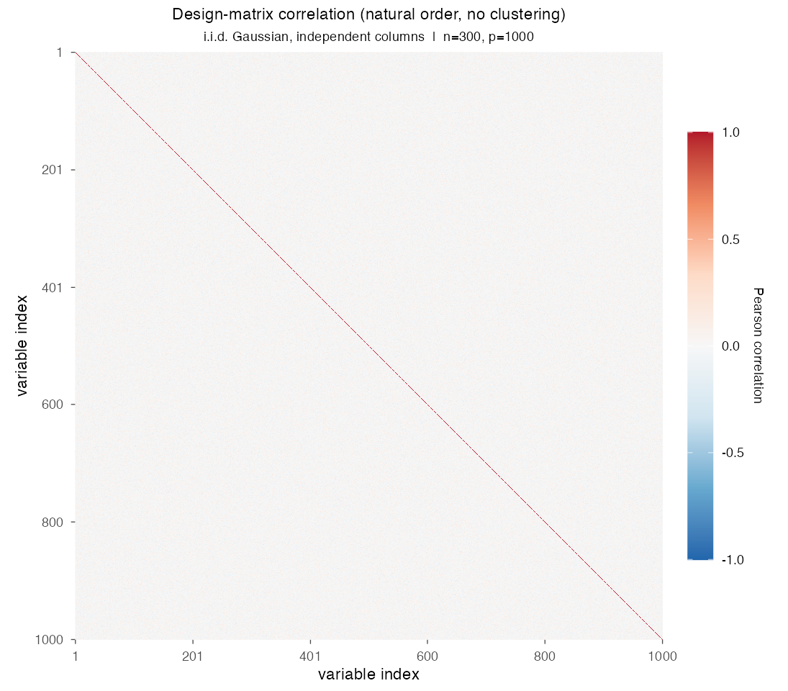
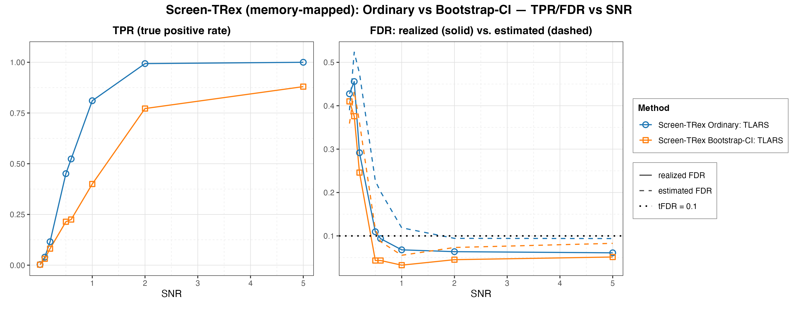

# Demo 02: Screen-TRex with Memory-Mapped Dummy Matrices

## Purpose

The demo shows that the **memory-mapped Screen-TRex workflow** reproduces the in-memory baseline while keeping the
dummy (D) matrices on disk instead of in random-access memory (RAM).
The study is the same experiment as [Demo 01](../demo_trex_scr_01_mc_sim_screen_trex/README.md), with the same
independent and identically distributed (i.i.d.) Gaussian design, the same signal-to-noise ratio (SNR) sweep and the
same two thresholding rules, the **Ordinary** majority vote and the **Bootstrap-CI** rule built on a bootstrap
confidence interval (CI). The single change is `trex_control(use_memory_mapping = TRUE)`.
The point of this demo is therefore *equivalence at a lower memory footprint*, not a different statistical regime,
because memory mapping is what makes very large $p$ feasible on machines that cannot hold the dummy matrices in RAM.
Screening returns a *candidate set*, and the false discovery rate (FDR) and the true positive rate (TPR) are evaluated
on the individual selected variables (see
[What is actually measured](../../../../../cpp/trex_selector_methods/ad/trex_screening/README.md#what-is-actually-measured-in-these-demos)
in the C++ suite README).

This is the R port of the C++ demo
[demo_trex_scr_02_mc_sim_screen_trex_mmap](../../../../../cpp/trex_selector_methods/ad/trex_screening/demo_trex_scr_02_mc_sim_screen_trex_mmap/README.md),
using the `TRexScreeningSelector` class of the TRexSelector package. It keeps the data-generating process (DGP), the
control parameters, the sweep grid, the console tables and the result-file naming of the C++ demo. Indices are 1-based
(R convention). As in the C++ source, the design matrix `X` still lives in RAM. Only the dummy matrices move to disk,
and the library manages those temporary files in its own scratch directories, so the script has nothing to clean up.

---

## Data Generation Parameters (`dgp_iid_snr`)

We consider the linear model:

```math
\boldsymbol{y} = \boldsymbol{X}\boldsymbol{\beta} + \boldsymbol{\epsilon},
\qquad \boldsymbol{\epsilon} \sim \mathcal{N}(\boldsymbol{0}, \sigma_{\varepsilon}^2 \boldsymbol{I}_n)
```

- $\boldsymbol{y} \in \mathbb{R}^n$ is the response vector.
- $\boldsymbol{X} \in \mathbb{R}^{n \times p}$ is the design matrix.
- $\boldsymbol{\beta} \in \mathbb{R}^p$ is the coefficient vector, with $s$ nonzero entries.
- $\boldsymbol{\epsilon}$ is the noise vector, i.i.d. normal.
- $\sigma_{\varepsilon}^2$ is the noise variance, calibrated to achieve a target linear SNR.
- $n = 300$, $p = 1{,}000$, $s = 10$ (high-dimensional, $p > n$).

The design matrix has **no correlation structure**:

```math
X_{ij} \sim \mathcal{N}(0,1) \quad \text{i.i.d.}
```

- The active support is drawn uniformly at random *per Monte Carlo (MC) trial*, so the results are not tied to one
  support pattern. The support draw uses its own random number generator (RNG) seed, the trial seed plus `500000`, so it
  stays independent of the design and noise draws.
- All active coefficients are $\beta_j = 1$.
- Noise calibration
  $\sigma_{\varepsilon} = \sqrt{\lVert \boldsymbol{X}\boldsymbol{\beta} \rVert^2 / (n \cdot \mathrm{SNR})}$, and the
  response is centred to mean zero.



Empirical Pearson correlation of an exemplary design drawn from `dgp_iid_snr` ($n=300$, $p=1{,}000$, seed 2026), in
**natural variable order without hierarchical clustering**. The design is identical to Demo 01's, and only the unit
diagonal stands out. One figure per DGP lives in [`../dgp_corr_plots/`](../dgp_corr_plots/). Regenerate the whole
suite with [`../generate_corr_plots.sh`](../generate_corr_plots.sh), which drives the shared ggplot2 plotter
[`../../../corr_plt_utils.R`](../../../corr_plt_utils.R).

---

## Control Parameters

```text
K = 20                        # Random experiments per T-loop iteration
max_dummy_multiplier = 10     # Passed on, screening pins the dummy count to p
use_max_T_stop = TRUE         # Passed on, screening runs a single T-loop step
lloop_strategy = "STANDARD"   # L-loop strategy
use_memory_mapping = TRUE     # Dummy (D) matrices backed by on-disk files, not RAM
R_boot = 1000                 # Bootstrap replicates (Bootstrap-CI rule only)
ci_grid_step = 0.001          # Bootstrap-CI threshold grid granularity
solver = "TLARS"              # T-Rex solver backend
NUM_MC = 200                  # Monte Carlo repetitions per grid point
```

Screen-TRex has **no target-FDR parameter**. Unlike the classical Terminating Random Experiments (T-Rex) selector,
screening thresholds the voting statistic instead of calibrating to a user-specified level.

---

## Methods Compared

Two Screen-TRex thresholding rules [[1]](#references), both with `trex_method = "TREX"`:

- **Screen-TRex Ordinary: TLARS** selects $\lbrace j : \Phi_j > 0.5 \rbrace$, a simple majority vote of the random
  experiments (`use_bootstrap_CI = FALSE`).
- **Screen-TRex Bootstrap-CI: TLARS** builds a bootstrap CI band around the estimated FDR curve
  (`R_boot = 1000` replicates) and picks its threshold from that band (`use_bootstrap_CI = TRUE`).

Both report an **estimated FDR** alongside the realized FDR and TPR. Each Monte Carlo trial builds the selector through
the TRexSelector class interface, here for the Ordinary rule:

```r
library(TRexSelector)

ctrl <- trex_control(
  solver = "TLARS", K = 20L, max_dummy_multiplier = 10L, use_max_T_stop = TRUE,
  lloop_strategy = "STANDARD", use_memory_mapping = TRUE
)
sel <- TRexScreeningSelector$new(
  X, y, seed = -1L, verbose = FALSE,
  screen_control = trex_screen_control(trex_method = "TREX", use_bootstrap_CI = FALSE),
  control = ctrl
)
sel$select()
fdp <- trex_fdp(sel$selected_indices, true_support)
tpp <- trex_tpp(sel$selected_indices, true_support)
est <- sel$estimated_FDR
```

`make_scr_trex_ctrl(use_memory_mapping = TRUE)` and `run_mc_screen()` in
[`../trex_scr_sim_utils.R`](../trex_scr_sim_utils.R) build exactly this per trial. `R_boot` and `ci_grid_step` stay at
the defaults of `trex_screen_control()`, which equal the values the C++ and Python demos set. The selector seed `-1L`
draws the dummies from hardware entropy in every trial.

---

## The Sweep

A single **SNR sweep** over $\mathrm{SNR} \in \lbrace0.01, 0.1, 0.2, 0.5, 0.6, 1, 2, 5\rbrace$, 200 MC trials per
point, with a fresh design, support and noise draw in every trial. The `si`-th SNR value uses
`base_seed = 24 + (si - 1) * 1000`, and trial `mc = 0, ..., 199` uses `base_seed + mc`, the same seed labels as the
C++ source. The seeds do not depend on the method or the storage, so both rules here and both rules of Demo 01 screen
the same 200 datasets at each SNR point. Only the memory-mapped dummy storage and the selectors' own random draws
differ from Demo 01.

---

## Output Files

Written to `simulation_results/data/`:

- `scr_screen_trex_mmap_snr_n300_p1000.txt` / `.csv`, the FDR, the TPR and the estimated FDR per method and SNR
  level. The comma-separated values (CSV) file is a tidy long table with the columns `method,metric,SNR,value`.

The file names and the CSV schema match the C++ and Python demos. Figures in Portable Network Graphics (PNG) and
Portable Document Format (PDF) go to `simulation_results/plots/`, produced by [`generate_plots.sh`](generate_plots.sh).

---

## Running the Demo

```bash
dir=R/trex_selector_methods/ad/trex_screening/demo_trex_scr_02_mc_sim_screen_trex_mmap
demo=$dir/demo_trex_scr_02_mc_sim_screen_trex_mmap.R

Rscript "$demo"      # full run, TREX_NUM_WORKERS workers (default 8)
Rscript "$demo" 8    # 8 worker cores
```

Monte Carlo trials run in parallel on a parallel socket (PSOCK) cluster of spawned R worker processes
([`../../../mc_runtime.R`](../../../mc_runtime.R)). The worker count is the first command-line argument, else
`TREX_NUM_WORKERS`, else 8, and `0` uses every core. Every worker process runs its own selector with its own
memory-mapped dummy files. Every finished grid cell is appended to a cache in `simulation_results/cache/`, so a stopped
run resumes where it left off, and a completed run removes the cache. The script also sources
[`../trex_scr_sim_utils.R`](../trex_scr_sim_utils.R). For a quick smoke test, reduce `NUM_MC` and `SNR_GRID` at the
top of the script. The recorded run (library commit `44cf1ab`, 8 workers) took about 2 minutes.

Afterwards, regenerate the figure from the CSV file with [`generate_plots.sh`](generate_plots.sh), which drives the
suite's ggplot2 plotting module [`../trex_scr_plt_utils.R`](../trex_scr_plt_utils.R) through `Rscript` (set `RSCRIPT`
to use another R installation).

---

## Simulation Results

The numbers and figure below are this R run's own results (200 MC trials per grid point). R draws its own random
numbers, so they agree with the
[C++ reference](../../../../../cpp/trex_selector_methods/ad/trex_screening/demo_trex_scr_02_mc_sim_screen_trex_mmap/README.md#simulation-results)
up to Monte Carlo noise, not exactly. The screening tables store only the 200-trial means, without standard
deviations, so agreement is judged by size. The mean absolute difference from the C++ run is $0.022$ in the FDR,
$0.010$ in the TPR and $0.014$ in the estimated FDR, against $0.017$, $0.017$ and $0.024$ between the Python and C++
runs. Both rules screen the same 200 datasets per SNR point, so a deviation at one point repeats in both series and
stems from one dataset realization.

- **Memory mapping changes the memory footprint, not the statistical behaviour.** Across the sweep the memory-mapped
  curves track the in-memory Demo 01 curves of this port closely. For $\mathrm{SNR} \ge 0.5$ the largest FDR
  difference is $0.012$ (Bootstrap-CI at $\mathrm{SNR} = 0.6$, $0.043$ here against $0.031$ in Demo 01), and the
  Ordinary rule's TPR curves agree within $0.014$ ($0.811$ against $0.815$ at $\mathrm{SNR} = 1$, and $1.000$ in both
  at $\mathrm{SNR} = 5$). It is the same procedure on the same statistics, only the D matrices live on disk.
- **Exact equality is not expected.** The two demos screen identical datasets, but both use nondeterministic selector
  seeds (`seed = -1L` draws from hardware entropy), so they draw different random experiments. The residual gaps fit
  the selectors' own randomness and give no sign of a problem in the memory-mapped path. For $\mathrm{SNR} \ge 0.5$
  the Bootstrap-CI rule shows the widest of them (TPR $0.880$ here against $0.850$ in Demo 01 at $\mathrm{SNR} = 5$,
  and $0.772$ against $0.798$ at $\mathrm{SNR} = 2$). A plausible reading is that its threshold is itself a bootstrap
  estimate and adds a second layer of sampling variability.
- **The baseline conclusions carry over unchanged.** Screening is not FDR-controlling at low SNR. At
  $\mathrm{SNR} \le 0.2$ the realized FDR runs between $0.25$ and $0.46$ with a TPR below $0.12$. Both rules become
  reliable from $\mathrm{SNR} = 0.5$, where the Ordinary rule's FDR falls to $0.110$ and settles at
  $0.061\text{–}0.068$ for $\mathrm{SNR} \ge 1$, while its TPR climbs from $0.451$ to $1.000$.
- **The excess at $\mathrm{SNR} = 0.1$ travels with the datasets.** There the FDR of both rules lies above the C++
  run, by $0.092$ for Ordinary ($0.456$ against $0.364$) and $0.063$ for Bootstrap-CI. These are the same 200
  datasets that give the excess at this point in Demo 01. An in-memory rerun of the Ordinary rule on them gives
  $0.464$ and $0.458$ again, while three fresh seed bands give $0.367\text{–}0.434$. The datasets of one band thus
  move the FDR by about $0.1$, so the excess is no evidence of a method difference.
- **Bootstrap-CI remains the conservative rule, with lower FDR and clearly less power.** Its FDR stays at or below
  $0.051$ for $\mathrm{SNR} \ge 0.5$, less than half the Ordinary rule's up to $\mathrm{SNR} = 1$ ($0.033$ against
  $0.068$ at $\mathrm{SNR} = 1$). The price is a TPR of $0.880$ against $1.000$ at $\mathrm{SNR} = 5$ and a wide
  mid-sweep gap ($0.400$ against $0.811$ at $\mathrm{SNR} = 1$).
- **The internal FDR estimate is conservative here.** For $\mathrm{SNR} \ge 0.5$ it sits *above* the realized FDR for
  both rules (for example $0.119$ against $0.068$ for Ordinary at $\mathrm{SNR} = 1$), so it over-states the error
  rate rather than hiding it. At the lowest SNR points it is unreliable in both directions, below the realized FDR at
  $\mathrm{SNR} = 0.01$ ($0.390$ against $0.428$ for Ordinary) and above it at $\mathrm{SNR} = 0.2$ ($0.475$ against
  $0.292$).

TPR (left) and FDR (right) against SNR, one line per thresholding rule. On the FDR panel the solid line is the
realized FDR and the dashed line the procedure's own estimated FDR. The dotted line at $0.1$ is a visual reference
only, since screening has no target FDR.



---

## References

1. Machkour, J., Muma, M., & Palomar, D. P., "False Discovery Rate Control for Fast Screening of
   Large-Scale Genomics Biobanks.", IEEE Statistical Signal Processing Workshop (SSP), 2023,
    pp. 666–670, IEEE.
    [DOI-Link](https://doi.org/10.1109/SSP53291.2023.10207957)
