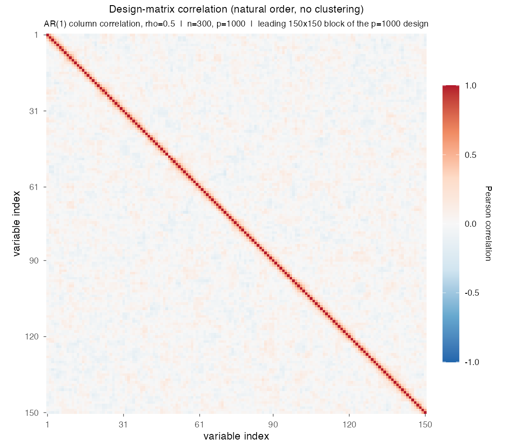
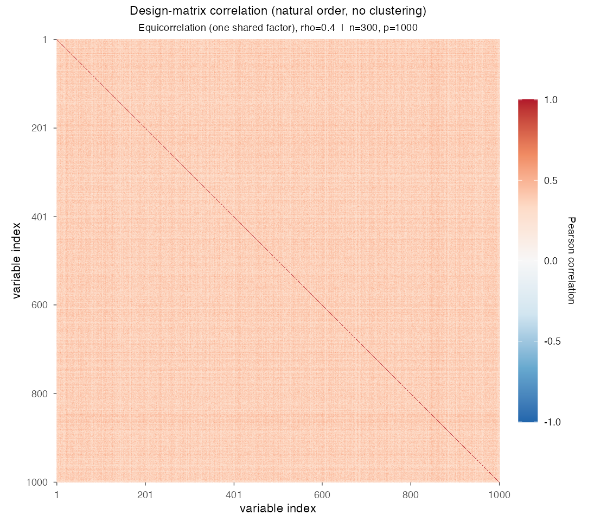
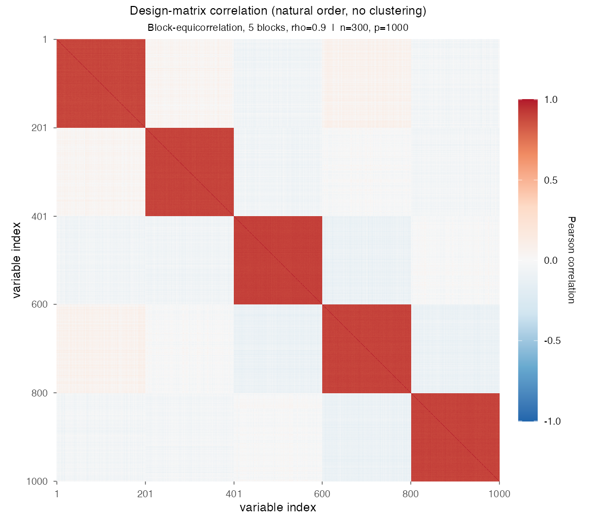
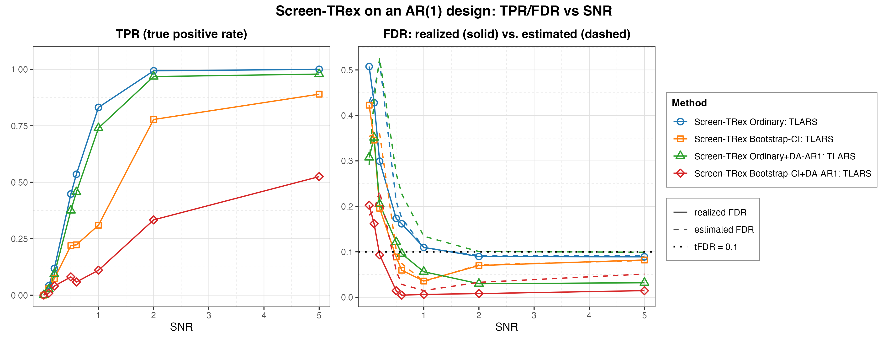
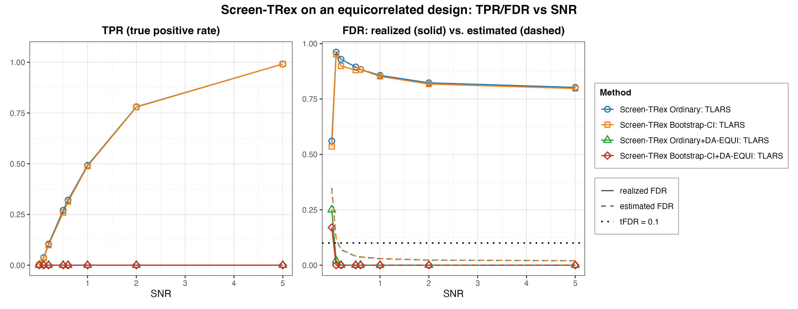
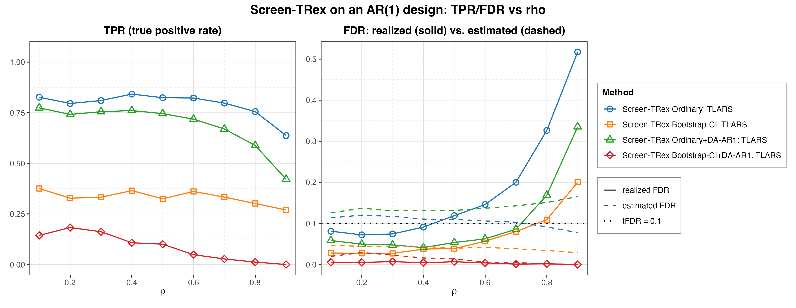
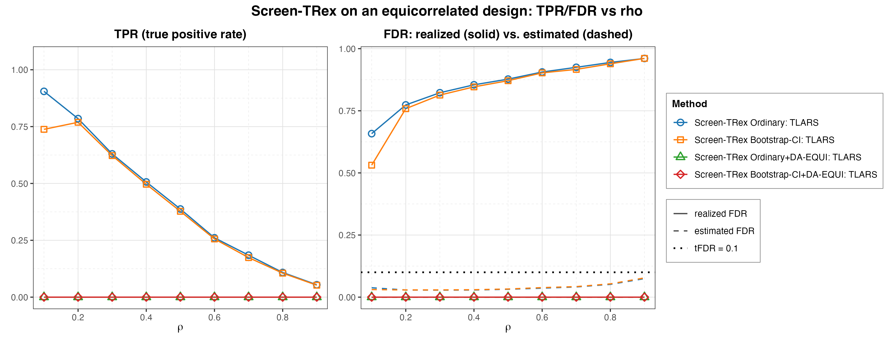
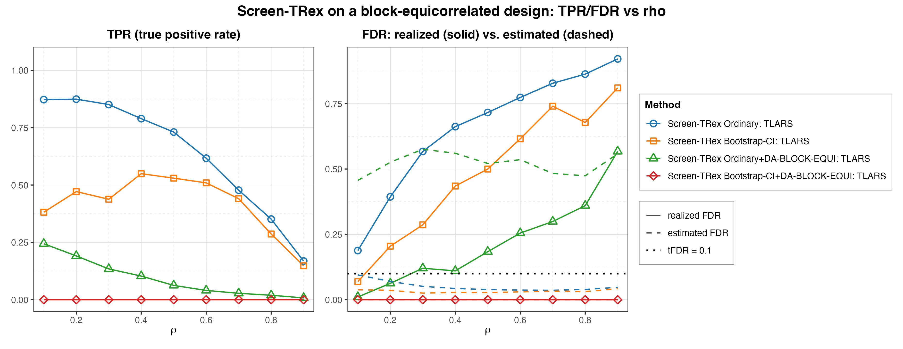

# Demo 03: Screen-TRex under Correlated Designs

## Purpose

The demo measures what **predictor correlation does to Screen-TRex**, and whether the **dependency-aware (DA)** variants
repair the damage.
Three correlation structures are put in front of the screener, first-order autoregressive (AR(1)), equicorrelated and
block-equicorrelated. In each case the plain Ordinary rule and the Bootstrap-CI rule, built on a bootstrap confidence
interval (CI), are compared against their DA counterparts, which deflate the vote share of every variable that
resembles a correlated neighbour.
Demo 01 established the independent and identically distributed (i.i.d.) baseline that the results here are read
against.
Screening returns a *candidate set*, and the false discovery rate (FDR) and the true positive rate (TPR) are evaluated
on the individual selected variables (see
[What is actually measured](../../../../../cpp/trex_selector_methods/ad/trex_screening/README.md#what-is-actually-measured-in-these-demos)
in the C++ suite README).

This is the R port of the C++ demo
[demo_trex_scr_03_mc_sim_correlated](../../../../../cpp/trex_selector_methods/ad/trex_screening/demo_trex_scr_03_mc_sim_correlated/README.md),
using the `TRexScreeningSelector` class of the TRexSelector package. It keeps the data-generating processes (DGPs),
the control parameters, the sweep grids, the console tables and the result-file naming of the C++ demo. Indices are
1-based (R convention).

---

## Data Generation Parameters (`dgp_ar1`, `dgp_equi`, `dgp_block_equi`)

We consider the linear model:

```math
\boldsymbol{y} = \boldsymbol{X}\boldsymbol{\beta} + \boldsymbol{\epsilon},
\qquad \boldsymbol{\epsilon} \sim \mathcal{N}(\boldsymbol{0}, \sigma_{\varepsilon}^2 \boldsymbol{I}_n)
```

- $\boldsymbol{y} \in \mathbb{R}^n$ is the response vector.
- $\boldsymbol{X} \in \mathbb{R}^{n \times p}$ is the design matrix.
- $\boldsymbol{\beta} \in \mathbb{R}^p$ is the coefficient vector, with $s$ nonzero entries.
- $\boldsymbol{\epsilon}$ is the noise vector, i.i.d. normal.
- $\sigma_{\varepsilon}^2$ is the noise variance, calibrated to achieve a target linear signal-to-noise ratio (SNR).
- $n = 300$, $p = 1{,}000$, $s = p_1 = 10$ (high-dimensional, $p > n$).

Three correlation structures are used. **AR(1)**, a decaying-correlation chain:

```math
x_j = \rho\, x_{j-1} + \sqrt{1 - \rho^2}\, w_j
\qquad \Longrightarrow \qquad
\mathrm{corr}(x_j, x_{j'}) = \rho^{|j - j'|}
```

**Equicorrelated**, one shared latent factor $z$ driving every column, so *all* pairs correlate equally:

```math
x_j = \sqrt{\rho}\, z + \sqrt{1 - \rho}\, w_j
\qquad \Longrightarrow \qquad
\mathrm{corr}(x_j, x_{j'}) = \rho \quad \forall\, j \neq j'
```

**Block-equicorrelated**, the same construction but with one latent factor $z_k$ per block, so columns correlate at
$\rho$ *within* a block and are independent across blocks. Five contiguous blocks of 200 columns each are used.

- All columns are **standardised to zero mean and unit variance** after generation, which leaves the column
  correlations, and so the meaning of $\rho$, unchanged.
- $\boldsymbol{\beta}$ has $p_1 = 10$ **evenly spaced** active entries (`make_beta()`), all of equal magnitude
  ($\beta_j = 1$ for the AR(1) parts, $\beta_j = 3$ for the equicorrelated and block-equicorrelated parts, as in the C++
  source). The design and the noise are drawn afresh in every Monte Carlo (MC) trial.
- Noise calibration
  $\sigma_{\varepsilon} = \sqrt{\lVert \boldsymbol{X}\boldsymbol{\beta} \rVert^2 / (n \cdot \mathrm{SNR})}$, and the
  response is centred to mean zero.







Empirical Pearson correlation of exemplary designs from the three DGPs with $n=300$, $p=1{,}000$ and seed 2026, in
**natural variable order without hierarchical clustering**. The AR(1) panel ($\rho = 0.5$) is cropped to the first 150
columns so the narrow decaying band around the diagonal stays visible at print size. The equicorrelated panel
($\rho = 0.4$) is uniformly correlated everywhere (one shared factor), and the block panel ($\rho = 0.9$) shows the
five independent $200 \times 200$ blocks. One figure per DGP lives in [`../dgp_corr_plots/`](../dgp_corr_plots/).
Regenerate the whole suite with [`../generate_corr_plots.sh`](../generate_corr_plots.sh), which drives the shared
ggplot2 plotter [`../../../corr_plt_utils.R`](../../../corr_plt_utils.R).

---

## Control Parameters

```text
K = 20                        # Random experiments per T-loop iteration
max_dummy_multiplier = 10     # Passed on, screening pins the dummy count to p
use_max_T_stop = TRUE         # Passed on, screening runs a single T-loop step
lloop_strategy = "STANDARD"   # L-loop strategy
rho_thr_DA = 0.02             # DA skip threshold, sets the DA-AR1 window (library default)
n_blocks = 5                  # Blocks assumed by the DA-BLOCK-EQUI variant (library default)
R_boot = 1000                 # Bootstrap replicates (Bootstrap-CI rule only)
ci_grid_step = 0.001          # Bootstrap-CI threshold grid granularity
solver = "TLARS"              # T-Rex solver backend
NUM_MC = 200                  # Monte Carlo repetitions per grid point
```

`trex_screen_control()` of the R binding exposes `use_bootstrap_CI`, `R_boot`, `ci_grid_step` and `trex_method`, but not
`rho_thr_DA` or `n_blocks`. Both therefore run at the library defaults, $0.02$ and $5$, which are the values the C++ and
Python demos set explicitly, so the DA-BLOCK-EQUI variant assumes the five blocks of the block DGP.

Screen-TRex has **no target-FDR parameter**. Unlike the classical Terminating Random Experiments (T-Rex) selector,
screening thresholds the voting statistic instead of calibrating to a user-specified level.

---

## Methods Compared

Every part compares four methods, the two thresholding rules of Demo 01, plain and dependency-aware [[1]](#references):

- **Screen-TRex Ordinary: TLARS**, the majority vote $\lbrace j : \Phi_j > 0.5 \rbrace$ with no correlation handling
  (`trex_method = "TREX"`).
- **Screen-TRex Bootstrap-CI: TLARS**, a bootstrap CI band around the estimated FDR curve
  (`R_boot = 1000` replicates), with no correlation handling.
- **Screen-TRex Ordinary+DA / Bootstrap-CI+DA: TLARS**, the same two rules on top of a **dependency-aware** adjustment
  (`trex_method = "TREX_DA_AR1"`, `"TREX_DA_EQUI"` or `"TREX_DA_BLOCK_EQUI"`), defined below.

The DA adjustment deflates each vote share before the threshold is applied,

```math
\Phi'_j = \frac{\Phi_j}{2 - \min_{k \in \mathcal{N}(j),\, k \neq j} |\Phi_j - \Phi_k|},
```

where the neighbourhood $\mathcal{N}(j)$ holds the variables within the AR(1) window, all variables (EQUI), or the
variables of the same block (BLOCK-EQUI). A variable whose vote share matches a correlated neighbour's is divided by
up to 2, so a cluster of near-duplicate predictors cannot inflate the selection on its own. The EQUI and BLOCK-EQUI
adjustments are skipped when the estimated correlation does not exceed `rho_thr_DA = 0.02`, while for AR1 the
threshold sets the window half-width $\kappa = \lceil \log 0.02 / \log \hat\rho \rceil$.

The DA variant is always matched to the design that generated the data, so this demo reports the **best case for
DA**, not a misspecification study. All methods also report an **estimated FDR** alongside the realized FDR and TPR.
Under correlation the gap between the two becomes the main story.

Each Monte Carlo trial builds the selector through the TRexSelector class interface, here for Ordinary+DA-AR1:

```r
library(TRexSelector)

ctrl <- trex_control(
  solver = "TLARS", K = 20L, max_dummy_multiplier = 10L, use_max_T_stop = TRUE,
  lloop_strategy = "STANDARD", use_memory_mapping = FALSE
)
sel <- TRexScreeningSelector$new(
  X, y, seed = -1L, verbose = FALSE,
  screen_control = trex_screen_control(trex_method = "TREX_DA_AR1", use_bootstrap_CI = FALSE),
  control = ctrl
)
sel$select()
fdp <- trex_fdp(sel$selected_indices, true_support)
tpp <- trex_tpp(sel$selected_indices, true_support)
est <- sel$estimated_FDR
```

`methods_for()` in the script lists the four methods per part, and `make_scr_trex_ctrl()` and `run_mc_screen()` in
[`../trex_scr_sim_utils.R`](../trex_scr_sim_utils.R) build exactly this per trial. The selector seed `-1L` draws the
dummies from hardware entropy in every trial.

---

## The Five Parts

| Part | Design | Fixed | Sweep | DA variant |
| :--- | :----- | :---- | :---- | :--------- |
| 1 | AR(1) | $\rho = 0.5$ | SNR $\in \lbrace0.01, 0.1, 0.2, 0.5, 0.6, 1, 2, 5\rbrace$ | DA-AR1 |
| 2 | Equicorrelated | $\rho = 0.4$ | same SNR grid | DA-EQUI |
| 3 | AR(1) | SNR $= 1$ | $\rho \in \lbrace0.1, \dots, 0.9\rbrace$ | DA-AR1 |
| 4 | Equicorrelated | SNR $= 1$ | $\rho \in \lbrace0.1, \dots, 0.9\rbrace$ | DA-EQUI |
| 5 | Block-equicorrelated (5 blocks) | SNR $= 1$ | $\rho \in \lbrace0.1, \dots, 0.9\rbrace$ | DA-BLOCK-EQUI |

Parts 1–2 ask *how much signal is needed at a fixed correlation level*, while Parts 3–5 ask *how much correlation the
screener survives at a fixed signal level*. Every grid point runs 200 MC trials. The `vi`-th grid value of a sweep uses
`base_seed = 42 + (vi - 1) * 1000`, and trial `mc = 0, ..., 199` uses `base_seed + mc`, the same seed labels as the C++
source. The seeds do not depend on the method, so the four methods of one sweep screen the same 200 datasets at each
grid point.

---

## Output Files

Written to `simulation_results/data/`, each as `.txt` (human-readable table) and `.csv` (tidy long):

- `scr_ar1_snr_n300_p1000_rho0.50`, Part 1, AR(1), SNR sweep.
- `scr_equi_snr_n300_p1000_rho0.40`, Part 2, equicorrelated, SNR sweep.
- `scr_ar1_rho_n300_p1000_snr1.00`, Part 3, AR(1), $\rho$ sweep.
- `scr_equi_rho_n300_p1000_snr1.00`, Part 4, equicorrelated, $\rho$ sweep.
- `scr_block_equi_rho_n300_p1000_blocks5_snr1.00`, Part 5, block-equicorrelated, $\rho$ sweep.

Each file holds the FDR, the TPR and the estimated FDR per method and grid point. The comma-separated values (CSV)
files have the columns `method,metric,SNR,value` (Parts 1–2) or `method,metric,rho,value` (Parts 3–5). The file
names and the CSV schema match the C++ and Python demos. Figures in Portable Network Graphics (PNG) and Portable
Document Format (PDF) go to `simulation_results/plots/`, produced by [`generate_plots.sh`](generate_plots.sh).

---

## Running the Demo

```bash
demo=R/trex_selector_methods/ad/trex_screening/demo_trex_scr_03_mc_sim_correlated/demo_trex_scr_03_mc_sim_correlated.R

Rscript "$demo"      # full run, TREX_NUM_WORKERS workers (default 8)
Rscript "$demo" 8    # 8 worker cores
```

Monte Carlo trials run in parallel on a parallel socket (PSOCK) cluster of spawned R worker processes
([`../../../mc_runtime.R`](../../../mc_runtime.R)). The worker count is the first command-line argument, else
`TREX_NUM_WORKERS`, else 8, and `0` uses every core. Every finished grid cell is appended to a cache in
`simulation_results/cache/`, so a stopped run resumes where it left off, and a completed run removes the cache. The
script also sources [`../trex_scr_sim_utils.R`](../trex_scr_sim_utils.R). For a quick smoke test, reduce `NUM_MC`,
`SNR_GRID` and `RHO_GRID` at the top of the script. This is the longest of the four non-biobank demos, with five
parts $\times$ four methods $\times$ 8–9 grid points $\times$ 200 trials. The recorded run (library commit `44cf1ab`,
8 workers) took about 22 minutes.

Afterwards, regenerate the figures from the CSV files with [`generate_plots.sh`](generate_plots.sh), which drives the
suite's ggplot2 plotting module [`../trex_scr_plt_utils.R`](../trex_scr_plt_utils.R) through `Rscript` (set `RSCRIPT`
to use another R installation).

---

## Simulation Results

The numbers and figures below are this R run's own results (200 MC trials per grid point). R draws its own random
numbers, so they agree with the
[C++ reference](../../../../../cpp/trex_selector_methods/ad/trex_screening/demo_trex_scr_03_mc_sim_correlated/README.md#simulation-results)
up to Monte Carlo noise, not exactly. The screening tables store only the 200-trial means, without standard
deviations, so agreement is judged by size. Over the five tables the mean absolute difference from the C++ run is
$0.003\text{–}0.018$ per table in the FDR and the TPR, against $0.004\text{–}0.019$ between the Python and C++ runs.
The four methods of a sweep screen the same 200 datasets per grid point, so a deviation at one point repeats across
the methods and stems from one dataset realization.

The design also holds its own replicate check. Part 1 at $\mathrm{SNR} = 1$ and Part 3 at $\rho = 0.5$ run the same
AR(1) configuration on different seeds, as do Part 2 at $\mathrm{SNR} = 1$ and Part 4 at $\rho = 0.4$ for the
equicorrelated design. The two dataset draws agree within $0.015$ in every FDR and TPR value of the four methods.

### Part 1 — AR(1) Design, SNR Sweep ($\rho = 0.5$)

- **AR(1) correlation costs FDR, not power.** At $\rho = 0.5$ the Ordinary rule's FDR falls from $0.51$ to $0.089$
  across the sweep while its TPR climbs from $0.001$ to $1.000$, so all ten active variables are recovered in every
  trial at $\mathrm{SNR} = 5$. For $\mathrm{SNR} \ge 0.5$ the TPR matches the i.i.d. Demo 01 within $0.017$, while the
  FDR runs $0.03\text{–}0.07$ higher ($0.110$ against $0.066$ at $\mathrm{SNR} = 1$). The two demos also differ in the
  support placement (evenly spaced here, random there), so the data cannot attribute this gap to the correlation alone.
- **DA lowers the error rate at a modest power cost.** Ordinary+DA-AR1 roughly halves the plain Ordinary FDR at
  $\mathrm{SNR} = 1$ ($0.056$ against $0.110$) and cuts it to about a third at $\mathrm{SNR} = 2\text{–}5$ ($0.030$
  against $0.090$ at $\mathrm{SNR} = 2$). It gives up $0.092$ TPR at $\mathrm{SNR} = 1$ ($0.740$ against $0.832$) and
  $0.02\text{–}0.03$ at $\mathrm{SNR} \ge 2$.
- **Plain Bootstrap-CI sits in between.** For $\mathrm{SNR} \ge 0.5$ its FDR is $0.036\text{–}0.089$, at a TPR of
  $0.22$ at $\mathrm{SNR} = 0.5$ that rises to $0.890$ at $\mathrm{SNR} = 5$.
- **Bootstrap-CI+DA-AR1 is extremely conservative.** Its FDR never exceeds $0.015$ once $\mathrm{SNR} \ge 0.5$, but
  its TPR stays at or below $0.334$ up to $\mathrm{SNR} = 2$ and reaches only $0.525$ at $\mathrm{SNR} = 5$. It buys
  near-zero false discoveries by leaving about half of the true signal on the table. The three ports spread widely in
  that top cell (C++ $0.430$, Python $0.360$), so its exact level is uncertain.
- **The internal estimate is still well-behaved here.** For $\mathrm{SNR} \ge 0.5$ it tracks the realized FDR of the
  two plain rules within $0.04$ and never lies more than $0.002$ below it. For the DA rules it sits above the realized
  FDR (Ordinary+DA-AR1 $0.134$ estimated against $0.056$ realized at $\mathrm{SNR} = 1$). The equicorrelated parts
  below show where this breaks.

TPR (left) and FDR (right) against SNR, one line per method. On the FDR panel the solid line is the realized FDR and
the dashed line the procedure's own estimated FDR. The dotted line at $0.1$ is a visual reference only, since
screening has no target FDR.



### Part 2 — Equicorrelated Design, SNR Sweep ($\rho = 0.4$)

- **Equicorrelation breaks screening outright.** Even at a moderate $\rho = 0.4$, the Ordinary rule's FDR sits between
  $0.80$ and $0.96$ for every $\mathrm{SNR} \ge 0.1$, so four out of five selections are false. It is still $0.802$ at
  $\mathrm{SNR} = 5$, where the TPR has reached $0.992$. More signal recovers the true variables but does *not* clean
  up the candidate set.
- **Plain Bootstrap-CI is no better.** Its FDR stays at $0.80\text{–}0.95$ for $\mathrm{SNR} \ge 0.1$, and its TPR
  stays within $0.011$ of the Ordinary rule's.
- **DA-EQUI selects nothing.** From $\mathrm{SNR} = 0.2$ on both DA-EQUI rules return empty sets in every trial
  (FDR $=$ TPR $= 0$). Below that their few selections are almost all false. Ordinary+DA-EQUI has an FDR of $0.250$ at
  $\mathrm{SNR} = 0.01$ and $0.020$ at $\mathrm{SNR} = 0.1$, with a single true discovery in those 400 trials. The
  [C++ README](../../../../../cpp/trex_selector_methods/ad/trex_screening/demo_trex_scr_03_mc_sim_correlated/README.md#simulation-results)
  traces this to tied vote shares. Screen-TRex runs a single step ($T = 1$), so the shares are coarse and dozens of
  variables reach exactly $\Phi_j = 1$, the ten active ones together with the nulls that share their factor. Each of
  them has a twin with the same share, the adjustment divides it by $2 - 0 = 2$, and $\Phi_j' = 0.5$ fails the strict
  majority rule $\Phi_j' > 0.5$. The reference R package TRexSelector (`screen_trex()`) uses the same adjustment and
  rule and selects nothing on identical data as well. Under equicorrelation the DA-EQUI variants therefore carry no
  information.
- **A non-monotone artifact at the bottom of the sweep.** The realized Ordinary FDR is *lower* at
  $\mathrm{SNR} = 0.01$ ($0.561$) than at $\mathrm{SNR} = 0.1$ ($0.962$). This is not a sweet spot, because at
  $\mathrm{SNR} = 0.01$ the rule finds almost nothing true (TPR $0.002$). Low-SNR FDR numbers must be read alongside
  the TPR.
- **The FDR estimate has already come apart.** For $\mathrm{SNR} \ge 0.1$ the plain rules report
  $0.020\text{–}0.121$ while the realized FDR is $0.80\text{–}0.96$, a factor of 8 to 40 too low, in the optimistic
  direction.

TPR (left) and FDR (right) against SNR, one line per method. Solid is the realized FDR, dashed the estimated FDR.



### Part 3 — AR(1) Design, $\rho$ Sweep (SNR $= 1$)

- **Degradation is gradual and only bites at high $\rho$.** The Ordinary rule holds its FDR at $0.072\text{–}0.091$ up
  to $\rho = 0.4$, then it deteriorates to $0.119$, $0.146$, $0.200$, $0.327$ and finally $0.517$ at $\rho = 0.9$. The
  TPR stays between $0.795$ and $0.842$ up to $\rho = 0.7$ and drops to $0.756$ at $\rho = 0.8$ and $0.637$ at
  $\rho = 0.9$.
- **DA-AR1 buys roughly one step of the $\rho$ grid.** Ordinary+DA-AR1 lowers the FDR at every $\rho$ ($0.335$
  against $0.517$ at $\rho = 0.9$, and $0.169$ against $0.327$ at $\rho = 0.8$) at a cost of $0.05\text{–}0.22$ TPR,
  the cost mostly growing with $\rho$. It is a real improvement, but it delays the failure rather than preventing it.
- **Bootstrap-CI+DA-AR1 keeps the FDR near zero by declining to select.** Its FDR stays within
  $0.000\text{–}0.007$ across the *entire* $\rho$ range, nominally the best result in this demo, but its TPR falls
  from $0.183$ at $\rho = 0.2$ to $0.049$ at $\rho = 0.6$. At $\rho = 0.9$ it selects nothing in any of the 200
  trials. A near-zero FDR is only meaningful when read next to its TPR.
- **The estimate degrades in step with the method.** The Ordinary estimate drifts from $0.114$ at $\rho = 0.1$ to
  $0.078$ at $\rho = 0.9$ while the realized FDR rises, and it lies below the realized FDR from $\rho = 0.5$ on
  ($0.078$ against $0.517$ at $\rho = 0.9$). Plain Bootstrap-CI does the same from $\rho = 0.6$ ($0.029$ against
  $0.200$ at $\rho = 0.9$), and even the Ordinary+DA-AR1 estimate falls below from $\rho = 0.8$ ($0.165$ against
  $0.335$ at $\rho = 0.9$). The estimate is least trustworthy exactly where the user most needs a warning.

TPR (left) and FDR (right) against $\rho$, one line per method. Solid is the realized FDR, dashed the estimated FDR.



### Part 4 — Equicorrelated Design, $\rho$ Sweep (SNR $= 1$)

- **Failure from the very first grid point.** The Ordinary FDR starts at $0.658$ for $\rho = 0.1$ and rises
  monotonically to $0.961$ at $\rho = 0.9$, while the TPR collapses from $0.905$ to $0.0545$. Unlike AR(1), there is
  no usable region of the sweep.
- **No variant rescues it.** Plain Bootstrap-CI tracks the Ordinary rule (FDR from $0.53$ to $0.96$), and both
  DA-EQUI rules select nothing at any $\rho$ (FDR $=$ TPR $= 0$), for the tie reason explained in Part 2.
- **The demo's central caution is that the FDR estimate is wildly optimistic exactly where the method fails.** Across
  the whole sweep the plain rules report $0.028\text{–}0.077$ while the realized FDR is $0.53\text{–}0.96$, a factor of
  12 to 30 too low. Under equicorrelation the procedure's self-assessment cannot be trusted at all. Contrast this with
  Demo 01, where the same estimate sat *above* the realized FDR and erred on the safe side.

TPR (left) and FDR (right) against $\rho$, one line per method. Solid is the realized FDR, dashed the estimated FDR.



### Part 5 — Block-Equicorrelated Design, $\rho$ Sweep (SNR $= 1$, 5 blocks)

- **Block structure sits between the two extremes, but closer to the bad one.** The Ordinary FDR grows monotonically
  from $0.188$ to $0.921$ over the sweep. It is far better than the fully equicorrelated case at low $\rho$ ($0.188$
  against $0.658$ at $\rho = 0.1$), plausibly because the blocks stay independent of each other, but by $\rho = 0.9$
  both designs exceed $0.92$. The TPR holds up better than under full equicorrelation ($0.731$ against $0.388$ at
  $\rho = 0.5$).
- **Plain Bootstrap-CI keeps the FDR low only at weak correlation.** It reaches $0.070$ at $\rho = 0.1$
  (TPR $0.38$), but $0.500$ at $\rho = 0.5$ and $0.810$ at $\rho = 0.9$.
- **DA-BLOCK-EQUI trades almost all power for a low FDR.** Ordinary+DA-BLOCK-EQUI keeps the FDR at
  $0.010\text{–}0.255$ up to $\rho = 0.6$ (against $0.19\text{–}0.77$ without DA), but its TPR falls from $0.244$ at
  $\rho = 0.1$ to $0.041$ at $\rho = 0.6$ and $0.008$ at $\rho = 0.9$. The adjustment works within each block, so in
  the reading of the C++ README the tie effect of Part 2 halves every variable whose vote share has a twin in its
  block, and only shares that stand alone in their block survive.
- **Bootstrap-CI+DA-BLOCK-EQUI selects nothing** at any $\rho$ (FDR $=$ TPR $= 0$).
- **The estimate is again too optimistic for the plain rules, though less catastrophically up to $\rho = 0.6$.**
  Ordinary reports $0.036\text{–}0.095$ against a realized $0.19\text{–}0.92$. As in Part 4, it gives no signal that
  anything has gone wrong. With DA-BLOCK-EQUI it turns pessimistic instead ($0.46\text{–}0.58$ against a realized
  $0.01\text{–}0.57$). It lies above the realized FDR up to $\rho = 0.8$ and just below it at $\rho = 0.9$
  ($0.558$ against $0.568$).

TPR (left) and FDR (right) against $\rho$, one line per method. Solid is the realized FDR, dashed the estimated FDR.



---

## References

1. Machkour, J., Muma, M., & Palomar, D. P., "False Discovery Rate Control for Fast Screening of
   Large-Scale Genomics Biobanks.", IEEE Statistical Signal Processing Workshop (SSP), 2023,
    pp. 666–670, IEEE.
    [DOI-Link](https://doi.org/10.1109/SSP53291.2023.10207957)
