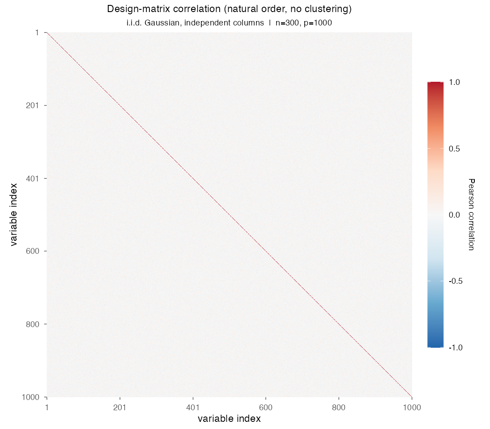
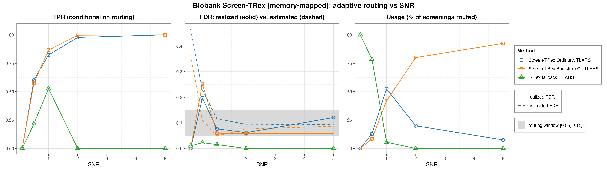
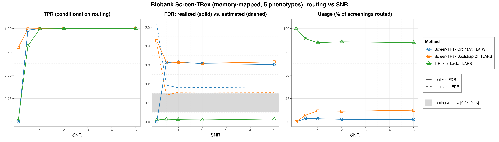

# Demo 05: Biobank Screen-TRex (Algorithm 1), Memory-Mapped

## Purpose

The demo repeats the **Biobank Screen-TRex workflow** ("Algorithm 1") of [[1]](#references), see
[Demo 04](../demo_trex_scr_04_mc_sim_biobank/README.md), with **memory-mapped dummy matrices**
(`use_memory_mapping = TRUE`), the storage mode intended for biobank-scale problems where holding the dummy matrices
in random-access memory (RAM) is infeasible.
For every phenotype the selector derives two estimates of the false discovery rate (FDR) from one Screen-TRex run, one
for the **Screen-TRex Ordinary** majority-vote rule and one for **Screen-TRex Bootstrap-CI**, whose threshold comes from
a bootstrap confidence interval (CI). A screening result is accepted only if its estimated FDR lies in the window
$\lbrack 0.05, 0.15\rbrack$, and if neither estimate does, the phenotype falls back to the **classical Terminating
Random Experiments (T-Rex) selector** at a target FDR of $0.10$.
The algorithm is unchanged, and the point of this demo is that moving the dummy matrices to disk changes the memory
footprint and **not** the statistics.
Screening returns a *candidate set*, and the FDR and the true positive rate (TPR) are evaluated on the individual
selected variables (see
[What is actually measured](../../../../../cpp/trex_selector_methods/ad/trex_screening/README.md#what-is-actually-measured-in-these-demos)
in the C++ suite README).

This is the R port of the C++ demo
[demo_trex_scr_05_mc_sim_biobank_mmap](../../../../../cpp/trex_selector_methods/ad/trex_screening/demo_trex_scr_05_mc_sim_biobank_mmap/README.md),
using the `TRexBiobankScreeningSelector` class of the TRexSelector package. It keeps the data-generating process
(DGP), the control parameters, the signal-to-noise ratio (SNR) grid, the console tables and the result-file naming of
the C++ demo. Indices are 1-based (R convention).

---

## Data Generation Parameters (`dgp_iid_snr`)

We consider the linear model:

```math
\boldsymbol{y} = \boldsymbol{X}\boldsymbol{\beta} + \boldsymbol{\epsilon},
\qquad \boldsymbol{\epsilon} \sim \mathcal{N}(\boldsymbol{0}, \sigma_{\varepsilon}^2 \boldsymbol{I}_n)
```

- $\boldsymbol{y} \in \mathbb{R}^n$ is the response vector.
- $\boldsymbol{X} \in \mathbb{R}^{n \times p}$ is the design matrix.
- $\boldsymbol{\beta} \in \mathbb{R}^p$ is the coefficient vector, with $s$ nonzero entries.
- $\boldsymbol{\epsilon}$ is the noise vector, independent and identically distributed (i.i.d.) normal.
- $\sigma_{\varepsilon}^2$ is the noise variance, calibrated to the target SNR,
  $\sigma_{\varepsilon}^2 = \lVert \boldsymbol{X}\boldsymbol{\beta} \rVert_2^2 / (n \cdot \mathrm{SNR})$, and the
  response is centred.
- $n = 300$, $p = 1{,}000$, with $s = 10$ in Part 1 and $s = 5$ in Part 2 (high-dimensional, $p > n$).

The design matrix has **no correlation structure**:

```math
X_{ij} \sim \mathcal{N}(0,1) \quad \text{i.i.d.}
```

- The active support is drawn uniformly at random *per Monte Carlo (MC) trial* with `sample.int()`, so the results
  are not tied to one support pattern.
- All active coefficients are $\beta_j = 1$. In Part 1 the support comes from a random number stream seeded at the
  trial seed plus `500000`, so it stays apart from the design and noise draws of the trial seed.
- In Part 2 all $q = 5$ phenotypes of a trial share **one design matrix** $\boldsymbol{X}$ (seed `x_seed` per trial),
  while phenotype $k$ draws its **own random support** and its own noise from seed `sup_seed_base + k - 1`. This is
  the biobank setting, where a single genotype matrix is screened against many traits.
- The seeds are those of Demo 04, so both R demos screen the same designs, supports and responses.



Empirical Pearson correlation of an exemplary design drawn from `dgp_iid_snr` ($n=300$, $p=1{,}000$, seed 2026), in
**natural variable order without hierarchical clustering**. The design is identical to Demo 04's, and only the
dummy-matrix storage differs between the two demos. One figure per DGP lives in
[`../dgp_corr_plots/`](../dgp_corr_plots/). Regenerate the whole suite with
[`../generate_corr_plots.sh`](../generate_corr_plots.sh), which drives the shared ggplot2 plotter
[`../../../corr_plt_utils.R`](../../../corr_plt_utils.R).

---

## Control Parameters

```text
K = 20                        # Random experiments per T-loop iteration
lower_bound_FDR = 0.05        # Lower edge of the acceptable estimated-FDR window
upper_bound_FDR = 0.15        # Upper edge of the acceptable estimated-FDR window
tFDR = 0.10                   # Target FDR of the classical T-Rex fallback
R_boot = 1000                 # Bootstrap replicates (Bootstrap-CI rule only)
ci_grid_step = 0.001          # Bootstrap-CI threshold grid granularity (package default)
solver = "TLARS"              # T-Rex solver backend
lloop_strategy = "STANDARD"   # L-loop dummy strategy
max_dummy_multiplier = 10     # Maximum dummy-feature multiplier
use_max_T_stop = TRUE         # Bound the maximum T_stop
use_memory_mapping = TRUE     # Dummy (D) matrices backed by on-disk files, not RAM
num_MC = 200                  # Monte Carlo repetitions per grid point
```

The window $\lbrack 0.05, 0.15\rbrack$ is the routing criterion. In R the window is set by `trex_biobank_control()`,
the screening rule by `trex_screen_control()` and the solver by `trex_control()`, while the fallback target is the
selector's `tFDR` argument. The design matrix `X` stays in RAM, while only the dummy matrices move to disk, into
scratch files that the library manages itself.

---

## Methods Compared

The three routing outcomes of Algorithm 1 [[1]](#references), all with `trex_method = "TREX"`:

- **Screen-TRex Ordinary: TLARS**, the majority-vote rule ($\Phi_j > 0.5$).
- **Screen-TRex Bootstrap-CI: TLARS**, the bootstrap confidence-band rule (`R_boot = 1000` replicates).
- **T-Rex fallback: TLARS**, the classical T-Rex selector at `tFDR = 0.10`, used when neither screening rule
  produces an acceptable estimate.

Both estimates come from the same $K$ random experiments, because the Bootstrap-CI rule is applied to the result of
the Ordinary run. The library then takes the decision step of Algorithm 1 (`applyDecisionLogic()` in
`trex_biobank_screening.cpp`):

- If exactly one estimate lies in the window, that rule is used.
- If both lie in the window, the rule with the larger estimate is used, and a tie goes to Bootstrap-CI.
- If neither lies in the window, the phenotype goes to the T-Rex fallback.

Each Monte Carlo trial of Part 2 builds the selector through the TRexSelector class interface. The only change
against Demo 04 is `use_memory_mapping = TRUE`:

```r
library(TRexSelector)

ctrl <- trex_control(
  solver = "TLARS", K = 20L, max_dummy_multiplier = 10L, use_max_T_stop = TRUE,
  lloop_strategy = "STANDARD", use_memory_mapping = TRUE
)
sel <- TRexBiobankScreeningSelector$new(
  X, Y, tFDR = 0.10, seed = -1L, verbose = FALSE,
  biobank_control = trex_biobank_control(lower_bound_FDR = 0.05, upper_bound_FDR = 0.15),
  screen_control  = trex_screen_control(R_boot = 1000L),
  control         = ctrl
)
res <- sel$select()                   # matrix Y: one record per phenotype
res[[1]]$method_used                  # routing decision of phenotype 1
fdp <- trex_fdp(res[[1]]$selected_indices, true_supports[[1]])
tpp <- trex_tpp(res[[1]]$selected_indices, true_supports[[1]])
```

`.run_biobank_selector()` in [`../trex_scr_sim_utils.R`](../trex_scr_sim_utils.R) sets these fields. A vector `y`
(Part 1) returns one record instead of a list. The selector seed `-1L` draws the dummies from hardware entropy in every
trial, and the routing decision of each phenotype is read back from the `method_used` field of its record.

All reported FDR and TPR values are **conditional on routing**. They average only over the cases in which the
respective method was chosen, and the **Usage %** row states that share of all cases. A row with low usage is
therefore an average over few cases (Usage times 200 in Part 1, times 1,000 in Part 2), and a row with $0\%$ usage is
an average over an empty set that prints as zero, not a performance statement. The **Est. FDR** row of a screening
rule averages that rule's own estimate over *all* cases, because both estimates are computed for every phenotype. For
the fallback it is its target $0.10$.

---

## The Two Parts

- **Part 1, single phenotype.** One response per trial, $s = 10$ active variables, SNR sweep over
  $\lbrace0.1, 0.5, 1, 2, 5\rbrace$, 200 MC trials per grid point. Trial `mc = 0, ..., 199` at grid index `si` uses
  seed `1000 * (si - 1) + mc`, the C++ `1000 * snr_idx + mc`.
- **Part 2, $q = 5$ phenotypes sharing one $\boldsymbol{X}$.** $s = 5$ active variables per phenotype, the same SNR
  grid and 200 MC trials, hence $5 \times 200 = 1{,}000$ phenotype cases per SNR level.

---

## Output Files

Written to `simulation_results/data/`:

- `scr_biobank_mmap_snr_n300_p1000_s10.txt` / `.csv`, Part 1 with Usage %, FDR, TPR and estimated FDR per method and
  SNR level.
- `scr_biobank_mmap_multi_n300_p1000_q5_s5.txt` / `.csv`, Part 2 with the same metrics for the multi-phenotype study.

The file names and the comma-separated values (CSV) schema (`method,metric,snr,value`, with `Usage` as a fraction)
match the C++ and Python demos. Figures in Portable Network Graphics (PNG) and Portable Document Format (PDF) go to
`simulation_results/plots/`, produced by [`generate_plots.sh`](generate_plots.sh).

---

## Running the Demo

```bash
dir=R/trex_selector_methods/ad/trex_screening/demo_trex_scr_05_mc_sim_biobank_mmap
demo="$dir/demo_trex_scr_05_mc_sim_biobank_mmap.R"

Rscript "$demo"      # full run, TREX_NUM_WORKERS workers (default 8)
Rscript "$demo" 8    # 8 worker cores
```

Monte Carlo trials run in parallel on a parallel socket (PSOCK) cluster of spawned R worker processes
([`../../../mc_runtime.R`](../../../mc_runtime.R)). The worker count is the first command-line argument, else
`TREX_NUM_WORKERS`, else 8, and `0` uses every core. Every finished grid cell (one SNR level of one part) is appended
to a cache in `simulation_results/cache/`, so a stopped run resumes where it left off, and a completed run removes the
cache. The script also sources [`../trex_scr_sim_utils.R`](../trex_scr_sim_utils.R). This is the **heaviest** demo of
the suite, because every phenotype runs the bootstrap rule with 1,000 replicates, every phenotype that falls back runs
a second selector, and all of them drive memory-mapped dummy files. The suite runner
[`../run_overnight.sh`](../run_overnight.sh) skips it under `SKIP_HEAVY=1`. The recorded run (library commit
`44cf1ab`, 8 workers) took about 24 minutes, against about 20 minutes for the in-memory Demo 04.

Afterwards, regenerate the figures from the CSV files with [`generate_plots.sh`](generate_plots.sh), which drives the
suite's ggplot2 plotting module [`../trex_scr_plt_utils.R`](../trex_scr_plt_utils.R) through `Rscript` (set `RSCRIPT`
to use another R installation).

---

## Simulation Results

The numbers and figures below are this R run's own results (200 MC trials per grid point). R draws its own random
numbers, so they are not expected to match the
[C++ reference](../../../../../cpp/trex_selector_methods/ad/trex_screening/demo_trex_scr_05_mc_sim_biobank_mmap/README.md#simulation-results)
or the Python run exactly. The routing shares agree with C++ within binomial noise. With 200 cases per SNR level in
Part 1 and 1,000 in Part 2, the largest binomial $z$ of a Usage cell against C++ is $1.44$ in Part 1 and $1.53$ in
Part 2, the latter approximate because the five phenotypes of a trial share one design. The tables carry no standard
errors for the conditional FDR and TPR averages, and these rest on the cases each rule was chosen in, so cells with
low usage are noisy.

### Part 1, Single Phenotype ($s = 10$)

- **Routing behaves as in the in-memory run.** At $\mathrm{SNR} = 0.1$ all phenotypes ($100.0\%$) go to the
  classical T-Rex fallback, with neither screening estimate in the window and both far above it on average ($0.466$
  Ordinary and $0.367$ Bootstrap-CI). At $\mathrm{SNR} = 1$ the split is $52.5\%$ Ordinary, $42.0\%$ Bootstrap-CI
  and $5.5\%$ fallback, and at $\mathrm{SNR} = 5$ Bootstrap-CI handles $92.5\%$ of all cases. From $\mathrm{SNR} = 2$
  on the fallback is never used.
- **Error control on the screening routes is good once signal is present.** For $\mathrm{SNR} \ge 1$ the realized
  FDR is $0.058\text{–}0.060$ for Bootstrap-CI and $0.062\text{–}0.077$ for Ordinary at $\mathrm{SNR} = 1$ and $2$,
  and TPR reaches $1.000$ for both at $\mathrm{SNR} = 5$. The Ordinary FDR of $0.121$ at $\mathrm{SNR} = 5$ rests on
  15 cases (usage $7.5\%$), where C++ reads $0.070$ and Python $0.081$, so the gap is within small-sample noise and
  does not indicate a difference between the ports.
- **The weak point is $\mathrm{SNR} = 0.5$, as in Demo 04.** The accepted cases realize an FDR of $0.197$ (Ordinary,
  26 cases) and $0.252$ (Bootstrap-CI, 17 cases). The Bootstrap-CI cell reads FDR $0.252$ and TPR $0.576$ against
  $0.177$ and $0.650$ in C++ and $0.186$ and $0.605$ in Python, again a small-sample average over 17 cases.
- **The fallback's TPR of $0.000$ at $\mathrm{SNR} = 2$ and $5$ is not a failure.** Its usage is $0.0\%$ at those
  points, so the conditional average is over an empty set and prints as zero. Where it is used it is the conservative
  option. At $\mathrm{SNR} = 0.5$ it takes $78.5\%$ of all cases at an FDR of $0.023$ and a TPR of $0.217$, and at
  $\mathrm{SNR} = 1$ (11 cases) its realized FDR is $0.015$ against a target of $0.10$, with a TPR of $0.527$.
- **The estimates mostly err on the safe side.** The Est. FDR row averages over all cases while the realized FDR
  covers only the routed ones, so the comparison is indicative. For $\mathrm{SNR} \ge 1$ Ordinary's estimate settles
  at $0.094\text{–}0.115$, above the realized FDR at $\mathrm{SNR} = 1$ and $2$ and below the 15-case value at
  $\mathrm{SNR} = 5$. Bootstrap-CI's estimate of $0.049\text{–}0.087$ lies below the realized FDR only at
  $\mathrm{SNR} = 1$ ($0.049$ against $0.060$).

TPR (conditional on routing), FDR (solid = realized, dashed = the rule's own estimate averaged over all cases, with
the fallback's dashed line at its target $0.10$ and the $\lbrack 0.05, 0.15\rbrack$ routing window shaded), and
per-method Usage % vs. SNR.



### Part 2, Five Phenotypes Sharing One Design ($q = 5$, $s = 5$)

- **The fallback dominates, and more signal does not change that.** The classical T-Rex selector handles
  $84.9\%\text{–}99.9\%$ of all cases ($99.9\%$ at $\mathrm{SNR} = 0.1$, $84.9\%$ at $\mathrm{SNR} = 5$), with
  Ordinary at $2.6\%\text{–}3.7\%$ and Bootstrap-CI at $7.3\%\text{–}12.5\%$ for $\mathrm{SNR} \ge 0.5$. On average
  the estimates sit at the upper edge of the window or above it, Ordinary's at $0.179\text{–}0.193$ and
  Bootstrap-CI's at $0.141\text{–}0.157$ for $\mathrm{SNR} \ge 0.5$.
- **The one Bootstrap-CI case at $\mathrm{SNR} = 0.1$.** R chose Bootstrap-CI in 1 of the 1,000 cases there (usage
  $0.1\%$), so its FDR of $0.429$ and TPR of $0.800$ come from one single case, while C++ and Python chose it in
  none. The cell is not an average and says nothing about the rule.
- **The rarely used screening routes are poorly calibrated.** For $\mathrm{SNR} \ge 0.5$ the realized FDR of the
  accepted cases is $0.303\text{–}0.316$ (Ordinary) and $0.310\text{–}0.317$ (Bootstrap-CI), about twice the upper
  edge of the window, although every accepted case had an estimate inside it. TPR is $1.000$ for both rules from
  $\mathrm{SNR} = 1$ on. With all five true variables found, one false selection gives a false discovery proportion
  (FDP) of $1/6 \approx 0.17$, so a realized FDR near $0.31$ cannot come from single false selections alone.
- **The fallback remains reliable on the bulk of the traffic.** Its realized FDR is $0.010\text{–}0.015$ against a
  target of $0.10$, with TPR rising $0.019 \to 1.000$ across the sweep.
- **Memory mapping changes the footprint, not the statistics.** Both R demos screen the same datasets, so they
  differ only in the random experiments, which the selector draws from hardware entropy (`seed = -1`), and in the
  storage mode. The Part 2 Ordinary route here reads Usage $0.0/3.7/3.4/2.7/2.6\%$, FDR
  $0.000/0.314/0.316/0.307/0.303$ and estimate $0.517/0.193/0.180/0.181/0.179$, against Demo 04's
  $0.0/2.3/3.5/3.2/2.6\%$, $0.000/0.327/0.313/0.323/0.313$ and $0.516/0.193/0.180/0.181/0.178$. The estimate rows of
  the two demos differ by at most $0.0034$ in Part 2, and the routing shares by at most $1.4$ percentage points. The
  data are consistent with memory mapping leaving the statistics unchanged.

TPR (conditional on routing), FDR (solid = realized, dashed = the rule's own estimate averaged over all cases, with
the fallback's dashed line at its target $0.10$ and the $\lbrack 0.05, 0.15\rbrack$ routing window shaded), and
per-method Usage % vs. SNR.



---

## References

1. Machkour, J., Muma, M., & Palomar, D. P., "False Discovery Rate Control for Fast Screening of
   Large-Scale Genomics Biobanks.", IEEE Statistical Signal Processing Workshop (SSP), 2023,
    pp. 666–670, IEEE.
    [DOI-Link](https://doi.org/10.1109/SSP53291.2023.10207957)
