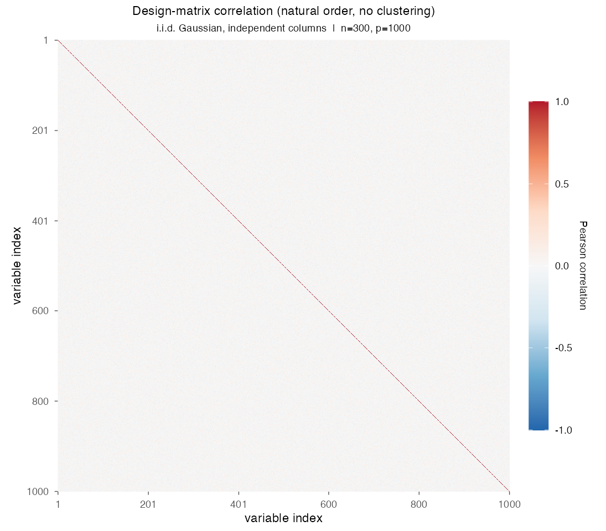
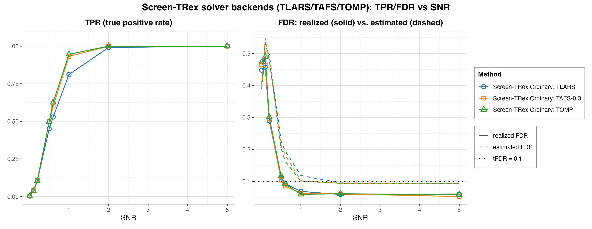
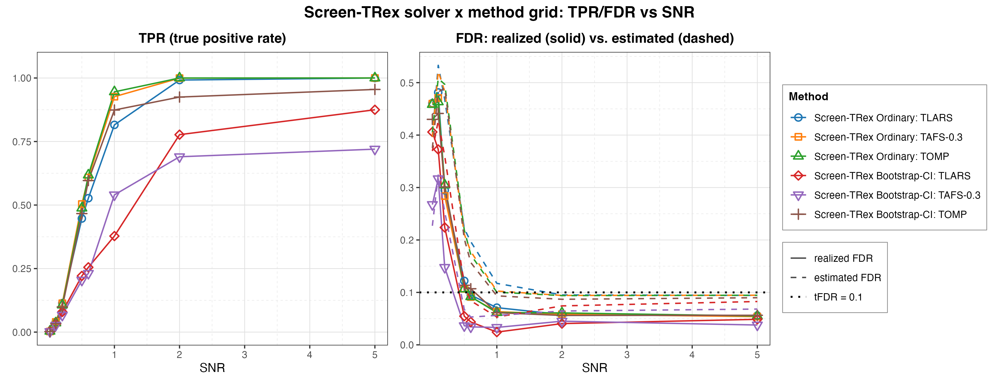

# Demo 06: Solver Backends for Screen-TRex (TLARS, TAFS, TOMP)

## Purpose

The demo asks whether the **choice of Terminating Random Experiments (T-Rex) solver backend** changes screening
performance, or whether it is merely a speed knob.
The same independent and identically distributed (i.i.d.) Gaussian design as
[Demo 01](../demo_trex_scr_01_mc_sim_screen_trex/README.md) is used, so the numbers here are directly comparable to
the baseline established there.
Three backends are swept over the signal-to-noise ratio (SNR). They are **TLARS**, the terminating form of
least-angle regression (LARS), **TAFS** with $\rho = 0.3$ (terminating adaptive forward stepwise) and **TOMP**
(terminating orthogonal matching pursuit), first under the Ordinary thresholding rule alone and then crossed with the
Bootstrap-CI rule, whose threshold comes from a bootstrap confidence interval (CI).
Screening returns a *candidate set*, and the false discovery rate (FDR) and the true positive rate (TPR) are evaluated
on the individual selected variables (see
[What is actually measured](../../../../../cpp/trex_selector_methods/ad/trex_screening/README.md#what-is-actually-measured-in-these-demos)
in the C++ suite README).

This is the R port of the C++ demo
[demo_trex_scr_06_mc_sim_solvers](../../../../../cpp/trex_selector_methods/ad/trex_screening/demo_trex_scr_06_mc_sim_solvers/README.md),
using the `TRexScreeningSelector` class of the TRexSelector package. It keeps the data-generating process (DGP),
the control parameters, the SNR grid, the console tables and the result-file naming of the C++ demo. Indices are
1-based (R convention).

---

## Data Generation Parameters (`dgp_iid_snr`)

We consider the linear model:

```math
\boldsymbol{y} = \boldsymbol{X}\boldsymbol{\beta} + \boldsymbol{\epsilon},
\qquad \boldsymbol{\epsilon} \sim \mathcal{N}(\boldsymbol{0}, \sigma_{\varepsilon}^2 \boldsymbol{I}_n)
```

- $\boldsymbol{y} \in \mathbb{R}^n$ is the response vector.
- $\boldsymbol{X} \in \mathbb{R}^{n \times p}$ is the design matrix.
- $\boldsymbol{\beta} \in \mathbb{R}^p$ is the coefficient vector, with $s$ nonzero entries.
- $\boldsymbol{\epsilon}$ is the noise vector, i.i.d. normal.
- $\sigma_{\varepsilon}^2$ is the noise variance, calibrated to the target SNR,
  $\sigma_{\varepsilon}^2 = \lVert \boldsymbol{X}\boldsymbol{\beta} \rVert_2^2 / (n \cdot \mathrm{SNR})$, and the
  response is centred.
- $n = 300$, $p = 1{,}000$, $s = 10$ (high-dimensional, $p > n$).

The design matrix has **no correlation structure**:

```math
X_{ij} \sim \mathcal{N}(0,1) \quad \text{i.i.d.}
```

- The active support is drawn uniformly at random *per Monte Carlo (MC) trial* with `sample.int()`, so the results
  are not tied to one support pattern.
- All active coefficients are $\beta_j = 1$, and the support comes from a random number stream seeded at the trial
  seed plus `500000`, so it stays apart from the design and noise draws of the trial seed.
- Trial `mc = 0, ..., 199` at grid index `si` uses seed `24 + 1000 * (si - 1) + mc`, the C++
  `base_seed = 24 + snr_idx * 1000`. Demo 01 uses the same seeds, so within R every series of both demos screens the
  **same 200 datasets** at one SNR point. Differences between the series at one SNR point therefore come from the
  solver, the thresholding rule and the random experiments, not from the data.



Empirical Pearson correlation of an exemplary design drawn from this DGP (`dgp_iid_snr`, $n=300$, $p=1{,}000$, seed
2026), in **natural variable order without hierarchical clustering**. One figure per DGP lives in
[`../dgp_corr_plots/`](../dgp_corr_plots/). Regenerate the whole suite with
[`../generate_corr_plots.sh`](../generate_corr_plots.sh), which drives the shared ggplot2 plotter
[`../../../corr_plt_utils.R`](../../../corr_plt_utils.R).

---

## Control Parameters

```text
K = 20                             # Random experiments per T-loop iteration
R_boot = 1000                      # Bootstrap replicates (Bootstrap-CI rule only, package default)
ci_grid_step = 0.001               # Bootstrap-CI threshold grid granularity (package default)
solver = "TLARS" / "TAFS" / "TOMP" # T-Rex solver backends compared
rho_afs = 0.3                      # Adaptive forward stepwise shrinkage step (read by TAFS only)
tloop_stagnation_stop = TRUE       # Stagnation stop enabled for every backend here
tloop_max_stagnant_steps = 5       # Stagnant T-loop steps before the stop
lloop_strategy = "STANDARD"        # L-loop dummy strategy
max_dummy_multiplier = 10          # Maximum dummy-feature multiplier
use_max_T_stop = TRUE              # Bound the maximum T_stop
num_MC = 200                       # Monte Carlo repetitions per grid point
```

Note that Screen-TRex has **no target-FDR parameter**, because unlike the classical T-Rex selector, screening
thresholds the voting statistic instead of calibrating to a user-specified level. The dotted line at $0.1$ in the R
figures, labelled `tFDR = 0.1`, is the plotter's reference level only.

---

## Methods Compared

Three T-Rex solver backends [[1]](#references), all driving `trex_method = "TREX"`:

- **TLARS**, terminating LARS, the default backend, which follows the least-angle regression path until the
  dummy-based stopping criterion fires.
- **TAFS-0.3**, terminating adaptive forward stepwise with shrinkage step $\rho = 0.3$, which moves the fit only a
  fraction $\rho$ toward the least-squares fit on the active set and so lies between forward stepwise ($\rho = 1$) and
  least-angle regression ($\rho \to 0$).
- **TOMP**, terminating orthogonal matching pursuit, the greediest of the three, taking the predictor most correlated
  with the current residual at each step.

Each backend is combined with the Screen-TRex thresholding rules:

- **Ordinary** selects $\lbrace j : \Phi_j > 0.5 \rbrace$, a simple majority vote of the random experiments.
- **Bootstrap-CI** builds a bootstrap confidence band around the estimated FDR curve (`R_boot = 1000` replicates)
  and picks its threshold from that band.

Each Monte Carlo trial builds the selector through the TRexSelector class interface, here for TAFS-0.3 under the
Bootstrap-CI rule:

```r
library(TRexSelector)

ctrl <- trex_control(
  solver = "TAFS", K = 20L, max_dummy_multiplier = 10L, use_max_T_stop = TRUE,
  lloop_strategy = "STANDARD", use_memory_mapping = FALSE, rho_afs = 0.3,
  tloop_stagnation_stop = TRUE, tloop_max_stagnant_steps = 5L
)
sc <- TRexScreeningSelector$new(
  X, y, seed = -1L, verbose = FALSE,
  screen_control = trex_screen_control(trex_method = "TREX", use_bootstrap_CI = TRUE),
  control        = ctrl
)
sc$select()
fdp <- trex_fdp(sc$selected_indices, true_support)
tpp <- trex_tpp(sc$selected_indices, true_support)
est <- sc$estimated_FDR
```

`make_scr_trex_ctrl()` and `run_mc_screen()` in [`../trex_scr_sim_utils.R`](../trex_scr_sim_utils.R) set these
fields. Every series passes `rho_afs = 0.3`, which only TAFS reads, and the selector seed `-1L` draws the dummies from
hardware entropy in every trial.

---

## The Two Parts

- **Part 1, solvers under the Ordinary rule.** Three series (TLARS, TAFS-0.3, TOMP), Ordinary screening only, over
  $\mathrm{SNR} \in \lbrace0.01, 0.1, 0.2, 0.5, 0.6, 1, 2, 5\rbrace$ with 200 MC trials per grid point.
- **Part 2, solvers crossed with both rules.** The same three backends under both Ordinary and Bootstrap-CI
  thresholding, giving six series over the same SNR grid and MC budget. Its three Ordinary series repeat those of
  Part 1 on the same datasets with new random experiments.

---

## Output Files

Written to `simulation_results/data/`:

- `scr_solvers_snr_n300_p1000_s10.txt` / `.csv`, Part 1 with FDR, TPR and estimated FDR per solver and SNR level.
- `scr_solver_method_snr_n300_p1000_s10.txt` / `.csv`, Part 2 with the same metrics for all six solver × rule
  combinations.

The file names and the comma-separated values (CSV) schema (`method,metric,SNR,value`) match the C++ and Python demos.
Figures in Portable Network Graphics (PNG) and Portable Document Format (PDF) go to `simulation_results/plots/`,
produced by [`generate_plots.sh`](generate_plots.sh).

---

## Running the Demo

```bash
demo=R/trex_selector_methods/ad/trex_screening/demo_trex_scr_06_mc_sim_solvers/demo_trex_scr_06_mc_sim_solvers.R

Rscript "$demo"      # full run, TREX_NUM_WORKERS workers (default 8)
Rscript "$demo" 8    # 8 worker cores
```

Monte Carlo trials run in parallel on a parallel socket (PSOCK) cluster of spawned R worker processes
([`../../../mc_runtime.R`](../../../mc_runtime.R)). The worker count is the first command-line argument, else
`TREX_NUM_WORKERS`, else 8, and `0` uses every core. Every finished grid cell (one series at one SNR level) is appended
to a cache in `simulation_results/cache/`, so a stopped run resumes where it left off, and a completed run removes the
cache. The script also sources [`../trex_scr_sim_utils.R`](../trex_scr_sim_utils.R). The recorded run (library commit
`44cf1ab`, 8 workers) took about 8 minutes.

Afterwards, regenerate the figures from the CSV files with [`generate_plots.sh`](generate_plots.sh), which drives the
suite's ggplot2 plotting module [`../trex_scr_plt_utils.R`](../trex_scr_plt_utils.R) through `Rscript` (set `RSCRIPT`
to use another R installation).

---

## Simulation Results

The numbers and figures below are this R run's own results (200 MC trials per grid point). R draws its own random
numbers, so they are not expected to match the
[C++ reference](../../../../../cpp/trex_selector_methods/ad/trex_screening/demo_trex_scr_06_mc_sim_solvers/README.md#simulation-results)
or the Python run exactly. The tables carry no standard errors, so the agreement is described by size. The mean
absolute difference to C++ is $0.023$ for the FDR and $0.006$ for the TPR in Part 1 (Python $0.019$ and $0.006$), and
$0.021$ and $0.010$ in Part 2 (Python $0.012$ and $0.015$). From $\mathrm{SNR} = 0.5$ on the largest difference is the
Bootstrap-CI TAFS-0.3 TPR at $\mathrm{SNR} = 1$ (R $0.540$, C++ $0.635$), a cell where Python ($0.509$) lies even
further from C++.

### Part 1, Three Solvers, Ordinary Screening

- **The solver is not a pure speed knob.** At mid SNR the greedier backends are markedly more powerful than TLARS at
  comparable FDR. At $\mathrm{SNR} = 1$ the TPR is $0.93$ (TAFS-0.3) and $0.95$ (TOMP) against $0.81$ (TLARS), while
  the realized FDR is $0.063$, $0.059$ and $0.069$. The gap already shows at $\mathrm{SNR} = 0.5\text{–}0.6$, where
  TAFS-0.3 and TOMP reach $0.50\text{–}0.63$ against $0.45\text{–}0.53$ for TLARS. All three see the same datasets,
  so the gap is not a data effect.
- **All three converge at high SNR.** At $\mathrm{SNR} = 2$ TAFS-0.3 and TOMP reach TPR $1.000$ and TLARS $0.991$, and
  at $\mathrm{SNR} = 5$ all three recover every active variable at FDR $0.053\text{–}0.061$. The choice of backend
  therefore only matters where the signal is neither absent nor obvious.
- **At very low SNR the backends are indistinguishable, and all uncontrolled.** For $\mathrm{SNR} \le 0.2$ the
  realized FDR runs $0.290\text{–}0.490$ for all three with TPR $\le 0.110$, reproducing the Demo 01 finding that
  screening is not FDR-controlling when there is no recoverable signal. At $\mathrm{SNR} = 0.1$ R's FDR lies
  $0.06\text{–}0.16$ above C++ in every series of both parts (TOMP $0.490$ against $0.335$). Demo 01 traces this to
  the draw of the 200 datasets of that SNR point, because fresh seeds bring its R value close to C++. Every series
  shares these datasets, so the offset repeats in every row and counts as one observation, not many. Repeating the
  Ordinary series on the same datasets with new random experiments (Part 2) moves the FDR at $\mathrm{SNR} \le 0.2$
  by at most $0.027$. Python sits low at $\mathrm{SNR} = 0.2$ in every series in the same way.
- **The internal FDR estimate behaves the same way for every backend.** It peaks at $\mathrm{SNR} = 0.1$
  ($0.508\text{–}0.546$) and then settles at $0.094\text{–}0.095$ for all three at $\mathrm{SNR} = 5$, sitting
  *above* the realized FDR from $\mathrm{SNR} = 0.5$ on.

TPR (left) and FDR (right) vs. SNR, one line per solver backend. On the FDR panel the solid line is the realized FDR
and the dashed line the procedure's own estimated FDR.



### Part 2, Three Solvers × Two Thresholding Rules

- **Under Bootstrap-CI the backend matters far more than under the Ordinary rule.** At $\mathrm{SNR} = 1$ the
  Bootstrap-CI TPR spans $0.378$ (TLARS), $0.540$ (TAFS-0.3) and $0.874$ (TOMP), a spread of $0.496$, against
  $0.82$, $0.93$ and $0.95$ (a spread of $0.130$) for the same three backends under the Ordinary rule.
- **TLARS and TAFS-0.3 are the conservative backends under Bootstrap-CI.** Both keep the FDR at or below $0.055$ from
  $\mathrm{SNR} = 0.5$ on, TAFS-0.3 at or below $0.045$. TLARS gives up the most power around $\mathrm{SNR} = 1$ (TPR
  $0.378$ against $0.540$ for TAFS-0.3) but recovers at high SNR, where its TPR reaches $0.875$ at
  $\mathrm{SNR} = 5$. TOMP under Bootstrap-CI, in contrast, behaves almost like Ordinary screening. At
  $\mathrm{SNR} = 1$ its TPR is $0.874$ against $0.95$ under Ordinary, at FDR $0.061$ and $0.062$.
- **Bootstrap-CI stops short of full power.** From $\mathrm{SNR} = 2$ on TAFS-0.3 levels off at TPR
  $0.690\text{–}0.720$ and TOMP at $0.925\text{–}0.955$, and TLARS reaches $0.777\text{–}0.875$, while every
  Ordinary series reaches $1.000$ at $\mathrm{SNR} = 5$.
- **The low-SNR regime is unaffected by either choice.** For $\mathrm{SNR} \le 0.2$ all six series have TPR
  $\le 0.114$ and FDR between $0.148$ and $0.481$. Neither the backend nor the thresholding rule rescues screening
  when there is nothing to find.
- **Practical takeaway.** Under the Ordinary rule TOMP and TAFS-0.3 buy power over TLARS at mid SNR at a comparable
  FDR. Under Bootstrap-CI the backend moves the TPR at $\mathrm{SNR} = 1$ by $0.496$, about as much as switching
  TLARS from Ordinary to Bootstrap-CI ($0.44$). TAFS-0.3 and TLARS then keep the lowest FDR, while TOMP keeps most of
  the power.

TPR (left) and FDR (right) vs. SNR, one line per solver × rule combination. On the FDR panel the solid line is the
realized FDR and the dashed line the procedure's own estimated FDR.



---

## References

1. Machkour, J., Muma, M., & Palomar, D. P., "False Discovery Rate Control for Fast Screening of
   Large-Scale Genomics Biobanks.", IEEE Statistical Signal Processing Workshop (SSP), 2023,
    pp. 666–670, IEEE.
    [DOI-Link](https://doi.org/10.1109/SSP53291.2023.10207957)
