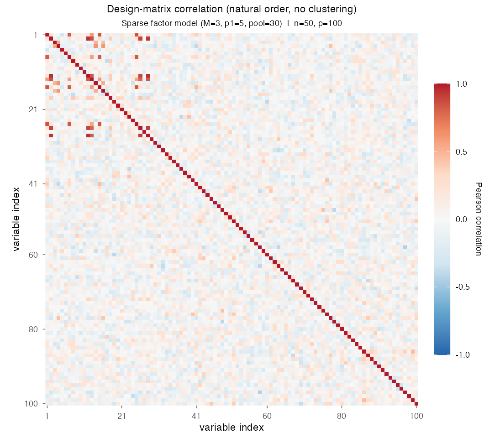
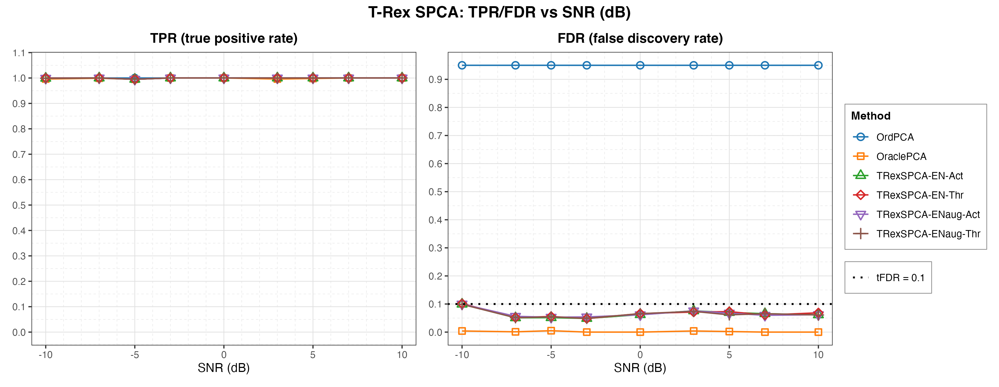
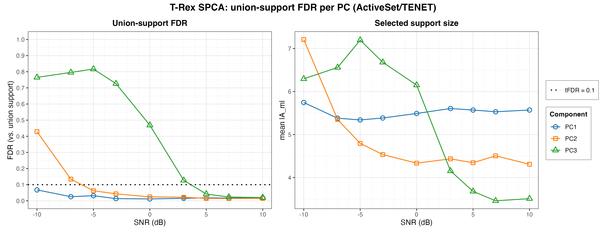
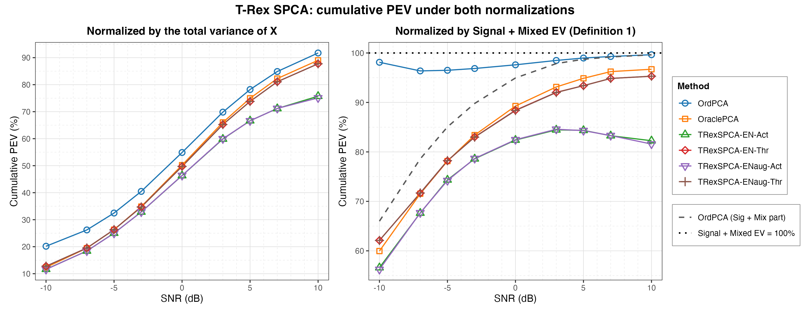

# Demo 01: T-Rex SPCA on a Sparse Factor Model

## Purpose

The demo compares the Terminating Random Experiments (T-Rex) selector for sparse principal component analysis (SPCA),
**T-Rex SPCA** [[1]](#references), against two principal component analysis (PCA) baselines on a synthetic sparse
three-factor model, over a sweep of the signal-to-noise ratio (SNR) in decibels.
 Four solver/mode combinations are run, the elastic net (EN) solvers `TENET` and `TENET_AUG`, each with the
 `ActiveSet` and the `Thresholded` loading-assembly mode. They face **ordinary PCA** (no sparsity) and
 **oracle-thresholded PCA** (told the true support size).
 The question is whether the grouped variable selection (GVS) machinery of T-Rex+GVS controls the false discovery
 rate (FDR) of the estimated loading support, and what that control costs in explained variance. This demo mirrors
 **Fig. 2** of [[1]](#references) and, like it, uses $p_1 = 5$, while the companion
 [demo 02](../demo_trex_spca_02_mc_sim_pev/README.md) mirrors their Fig. 3 at $p_1 = 10$.

FDR and the true positive rate (TPR) are evaluated on the loading support of the first principal component (PC1)
alone, and FDR control is likewise assumed only for PC1.
Because the factor supports are drawn from a shared pool and overlap, the orthogonality constraint of ordinary PCA
mixes the supports of components 2 and 3 across the true factors.
The plug-in principal component (PC) that a later component's selector regresses on is thus already a blend of
overlapping supports, so beyond PC1 there is no unambiguous per-component ground truth and hence no clean notion of a
false discovery to control against.
This mirrors the reference paper, whose Fig. 2 reports FDR and TPR "for the first PC".
 The proportion of explained variance (PEV) does not suffer that ambiguity and is cumulative over all $M$ components.

One framing is worth keeping in mind throughout. T-Rex SPCA supervises each component's selector with the *plug-in*
 ordinary PC $\boldsymbol z_m = \boldsymbol X \boldsymbol v_m$.
 This is a one-shot construction, not the iterative refinement most sparse-PCA methods use.
 **The FDR guarantee is therefore conditional on the plug-in PC being a faithful proxy for its factor.**
 Where that proxy is good, control holds. Where it degrades, the selector still controls the FDR *with respect to
 the regression it was handed*, which is not the same claim.
 The union-FDR section of the results measures where the condition holds.

This is the R port of the
[C++ demo](../../../../../cpp/trex_selector_methods/ad/trex_spca/demo_trex_spca_01_mc_sim/README.md),
using the `TRexSPCASelector` class of the TRexSelector package. It keeps the data-generating process (DGP), the
sweep, the measurement definitions and the result-file naming of the C++ demo and of the
[Python port](../../../../../Python/trex_selector_methods/ad/trex_spca/demo_trex_spca_01_mc_sim/README.md). Support
indices are 1-based (R convention).

---

## Data Generation Parameters (`generate_sparse_factor_model()`)

We consider a sparse $M$-factor model:

```math
\boldsymbol{X} = \boldsymbol{Z}\boldsymbol{V}^\top + \boldsymbol{E}
```

- $\boldsymbol{X} \in \mathbb{R}^{n \times p}$ is the observed data matrix.
- $\boldsymbol{Z} \in \mathbb{R}^{n \times M}$ holds the latent factor scores, column $m$ drawn
   $\mathcal{N}(0, \sigma_m^2)$ with $\sigma_m \in \lbrace5, 3, 1\rbrace$, so the factors are deliberately unequal in
   amplitude.
- $\boldsymbol{V} \in \mathbb{R}^{p \times M}$ is the sparse loading matrix, where each column carries exactly
   $p_1$ nonzero entries of value $0.9$.
- $\boldsymbol{E}$ is independent and identically distributed (i.i.d.) Gaussian noise, scaled to hit the target SNR
   in dB.
- $n = 50$, $p = 100$, $p_1 = 5$, $M = 3$. The data come from R's own generator (`set.seed()`, `rnorm()`,
   `sample.int()`).
- The $p_1$ active indices of each factor are drawn without replacement from a **shared pool** of
   `overlap_pool_size` $= 30$ candidates (columns 1 to 30), so factor supports may partially coincide.

All methods see the same **center-only** $\boldsymbol{X}$ (`center_columns()` in
 [`../trex_spca_sim_utils.R`](../trex_spca_sim_utils.R), mean subtraction without column scaling). That keeps
 ordinary PCA, oracle PCA and T-Rex SPCA on a common covariance-PCA basis.
 The column scales must *not* be normalized here, because the factor amplitudes $\sigma_m$ live in the column
 variances, and z-scoring would destroy exactly the signal the factors are distinguished by.



Empirical Pearson correlation of an exemplary design drawn from this DGP (`generate_sparse_factor_model()`,
 $n=50$, $p=100$, $p_1=5$, $M=3$, `overlap_pool_size = 30`, SNR $=0$ dB, seed 2026), in **natural variable
 order without hierarchical clustering**. There is no block structure to see, because the correlation the factors
 induce is confined to the 30 columns of the shared overlap pool at the top left, where the scattered warm cells mark
 variables that load on a common factor. Past column 30 only sampling noise remains. R draws its own design from the
 seed, so the pattern differs in detail from the C++ and Python figures. One figure per DGP lives in
 [`../dgp_corr_plots/`](../dgp_corr_plots/). Regenerate it with
 [`../generate_corr_plots.sh`](../generate_corr_plots.sh), which drives the shared ggplot2 plotter
 [`../../../corr_plt_utils.R`](../../../corr_plt_utils.R).

---

## Control Parameters

```text
tFDR = 0.10           # Target FDR for the per-component selector
lambda_2 = -1         # < 0 selects the ridge penalty by k-fold CV (lambda2_method = "CV_1SE_CCD")
scaling = L2          # Per-component selector scaling (library default)
num_MC = 200          # Monte Carlo repetitions per grid point
base_seed = 42        # Trial mc (0-based) draws its data from base_seed_offset + mc * 1000,
                      # with base_seed_offset = base_seed + round(snr_db)
```

Each Monte Carlo trial builds the selector through the TRexSelector class interface, here for `ActiveSet` with
`TENET`:

```r
library(TRexSelector)

sel <- TRexSPCASelector$new(
  X + 0, M = 3L, tFDR = 0.10,
  control = trex_spca_control(
    mode = "ActiveSet",            # or "Thresholded"
    gvs_type = "EN",
    en_solver = "TENET",           # or "TENET_AUG"
    lambda_2 = -1,
    lambda2_method = "CV_1SE_CCD"
  ),
  seed = -1L, verbose = FALSE
)
sel$select()
res <- evaluate_spca(X, sel$V, sel$Z, dat$V)
```

The loop lives in `run_mc_trials_trex_spca()` of [`../trex_spca_sim_utils.R`](../trex_spca_sim_utils.R). There `X`
is the centered data, and `X + 0` hands the selector a fresh copy, because the selector maps the matrix zero-copy and
the local `X` must stay intact for the evaluation. The selector returns the sparse loadings `V`, the scores `Z` and
the per-component `active_sets` (1-based). `trex_spca_control()` does not expose the scaling mode of the
per-component selector, so the selector runs with the library default, unit-L2 column scaling, the same setting the
C++ and Python demos pass explicitly. The PCA baselines use base-R `svd()` on the same centered $\boldsymbol{X}$.

Only the **data** is seeded deterministically. Each trial's dummies are drawn from hardware entropy (selector
`seed = -1L`) by design, which is what makes the Monte Carlo FDR estimate valid. The seeds keep the values of the C++
and Python demos, but R's generator draws other data from them, so the three ports agree up to Monte Carlo noise,
and an R rerun reproduces its own numbers only up to that noise as well.

---

## Methods Compared

| Method | Sparsity mechanism | `mode` | `en_solver` |
| --- | --- | --- | --- |
| **OrdPCA** | none, all $p$ loadings retained | — | — |
| **OraclePCA** | $\text{top-}p_1$ by magnitude, true support size known | — | — |
| **TRexSPCA-EN-Act** | T-Rex+GVS selection [[2]](#references) | `"ActiveSet"` | `"TENET"` |
| **TRexSPCA-ENaug-Act** | T-Rex+GVS selection [[2]](#references) | `"ActiveSet"` | `"TENET_AUG"` |
| **TRexSPCA-EN-Thr** | T-Rex+GVS selection [[2]](#references) | `"Thresholded"` | `"TENET"` |
| **TRexSPCA-ENaug-Thr** | T-Rex+GVS selection [[2]](#references) | `"Thresholded"` | `"TENET_AUG"` |

The two modes differ in how the loadings are rebuilt once the support is chosen. `ActiveSet` refits the plug-in
 PC on the selected columns by ridge regression (`lambda2_ridge_loadings`, default $10^{-6}$), while `Thresholded`
 keeps the $|\widehat{\mathcal A_m}|$ largest-magnitude entries of the ordinary PCA loading vector, so it takes only
 the support size from the selector.

---

## Metrics

FDR and TPR are evaluated on PC1's loading support. With $\mathcal S_1$ the true active support of
 factor 1 and $\widehat{\mathcal S_1}$ the estimated (nonzero) support of the first sparse loading vector,

```math
\mathrm{FDR} = \mathbb{E}\left[\frac{|\widehat{\mathcal{S}}_1 \setminus \mathcal{S}_1|}
{\max\{1, |\widehat{\mathcal{S}}_1|\}}\right],
\qquad
\mathrm{TPR} = \mathbb{E}\left[\frac{|\mathcal{S}_1 \cap \widehat{\mathcal{S}}_1|}
{\max\{1, |\mathcal{S}_1|\}}\right],
```

with the expectations estimated as Monte Carlo means over the 200 trials (`evaluate_spca()` in
 [`../trex_spca_sim_utils.R`](../trex_spca_sim_utils.R)). FDR *control* is claimed for PC1 only (see
 [Purpose](#purpose)).
 The union-support variant for the later components is defined in the
 [dedicated results subsection](#union-support-fdr-beyond-pc1).

For the explained variance (EV), the classical metric is
 $\mathrm{EV} = \mathrm{tr}(\widehat{\boldsymbol{Z}}^\top \widehat{\boldsymbol{Z}}) / (n-1)$.
 Sparse PCA drops the orthogonality constraint, so correlated components double-count shared variance
 under this trace.
 Zou, Hastie & Tibshirani [[3]](#references) therefore correct it. With
 $\widehat{\boldsymbol{Z}} = \boldsymbol{Q}\boldsymbol{R}$ the orthogonal-triangular (QR) decomposition of the
 estimated score matrix, the **adjusted EV** keeps only each component's incremental contribution,

```math
\mathrm{EV}_{\mathrm{adj}} = \frac{1}{n-1} \sum_{m=1}^{M} r_{mm}^2 .
```

The **TRex-SPCA** paper [[1]](#references) adopts this corrected EV and builds its **Definition 1** on top
 of it, asking *where* the variance comes from. Variance on the true active variables (Signal + Mixed EV) is
 worth explaining, while variance on null variables (Null EV) is not. Accordingly, the demo reports **three**
 readings.

The first is the share of the **total** variance, bounded by 1,

```math
\mathrm{PEV} = \mathrm{EV}_{\mathrm{adj}} / \mathrm{Var}(\boldsymbol{X}).
```

The second is **Definition 1** of [[1]](#references),

```math
\mathrm{PEV}_{\mathrm{sig}} = \mathrm{EV}_{\mathrm{adj}}
/ \bigl(\lVert \boldsymbol{X}_{\mathcal{A}} \rVert_F^2 / (n-1)\bigr),
```

where the denominator is the **Signal + Mixed EV of the data**, the variance carried by the true active
 variables ($\mathcal{A}$ = union of the factor supports), fixed per dataset and **shared by all methods**.
 Methods that additionally capture null-variable variance push past $100\%$, so this ratio is **not** capped
 at 1. Exceeding $100\%$ is the failure the metric is designed to expose.

The third is the method's *own* Signal + Mixed part over the same shared denominator. It is the raw (unadjusted) EV
 of the loadings minus the Null EV of their null-variable rows, so for correlated sparse components it can exceed the
 Definition 1 reading. Read for OrdPCA, whose components are orthogonal, it is the paper's "Ordinary PCA (Sig + Mix)"
 reference curve, and the gap to the Definition 1 reading is exactly its Null EV.

The comma-separated values (CSV) output tags them `PEV`, `PEVsig` and `PEVsigmix`.

> *Note* The
> [C++ demo-02 README](../../../../../cpp/trex_selector_methods/ad/trex_spca/demo_trex_spca_02_mc_sim_pev/README.md)
> explains the choice of this denominator. It is *not* the method's own Signal + Mixed EV, which is structurally
> $\geq 100\%$ for null-capturing methods and inverts the SNR trend.

---

## The Sweep

An **SNR sweep in decibels** over
 $\mathrm{SNR} \in \lbrace-10, -7, -5, -3, 0, 3, 5, 7, 10\rbrace$ dB, 200 Monte Carlo (MC) trials per point.
 `snr_values` in the script mirrors the C++ grid exactly.
 The axis is plotted and tabulated in dB throughout, and it is never converted back to a linear ratio.

Section 2 reruns the same grid for the **union-support FDR per PC** (`ActiveSet`/`TENET` only), with the same data
 seeds and fresh dummies. The [dedicated section below](#union-support-fdr-beyond-pc1) explains what it measures and
 why the union of the factor supports is the only well-posed per-PC truth beyond PC1.

---

## Output Files

Written to `simulation_results/data/`:

- `demo_trex_spca_01_mc_sim.txt` / `.csv`, the FDR, TPR and the PEV readings per method and SNR level. The CSV
   is tidy long format `method,metric,snr_db,value` with metrics `FDR`, `TPR`, `PEV` (total-variance
   normalization), `PEVsig` (Definition 1) and `PEVsigmix` (the method's Sig + Mix part).
- `demo_trex_spca_01_mc_sim_union_fdr.csv`, Section 2, the union-support FDR and mean support size per PC
   (`pc,metric,snr_db,value`, metrics `FDRunion` / `k`).

The file names and CSV schemas match the C++ and Python demos. Figures in Portable Network Graphics (PNG) and
 Portable Document Format (PDF) go to `simulation_results/plots/`, produced by [`generate_plots.sh`](generate_plots.sh)
 via the suite's ggplot2 plotting module [`../trex_spca_plt_utils.R`](../trex_spca_plt_utils.R):

- `demo_trex_spca_01_mc_sim.png`, TPR and FDR over the sweep (support recovery only).
- `demo_trex_spca_01_mc_sim_union_fdr.png`, Section 2, the union-support FDR and support size per PC.
- `demo_trex_spca_01_mc_sim_pev.png`, the two PEV normalizations side by side (the explained-variance
   story lives entirely in this figure). The plotter renders it from the main CSV.

---

## Running the Demo

```bash
demo=R/trex_selector_methods/ad/trex_spca/demo_trex_spca_01_mc_sim/demo_trex_spca_01_mc_sim.R

Rscript "$demo"                       # full run, TREX_NUM_WORKERS workers (default 8)
Rscript "$demo" 12                    # 12 worker cores
TREX_SPCA_PARTS=2 Rscript "$demo"     # only Section 2 (union FDR)
TREX_SPCA_NUM_MC=10 Rscript "$demo"   # pilot run with 10 MC trials per point
```

`TREX_SPCA_NUM_MC=<k>` overrides the Monte Carlo count for quick pilot runs, and `TREX_SPCA_PARTS` selects the
sections (default `12`, with `1` = method comparison and `2` = union-FDR sweep). These are the same environment
switches as in the C++ and Python demos.

Monte Carlo trials run in parallel on a parallel socket (PSOCK) cluster of spawned R worker processes
([`../../../mc_runtime.R`](../../../mc_runtime.R)), each with single-threaded solvers. The worker count is the first
command-line argument, else `TREX_NUM_WORKERS`, else 8, and `0` uses every core. Every finished cell (one method at
one SNR point, or one SNR point of Section 2) is appended to a cache in `simulation_results/cache/`, so a stopped run
resumes where it left off. A completed run removes the cache, and a change of the configuration or of the run tag
`TREX_RUN_TAG` sets an old cache aside. The script also sources
[`../trex_spca_sim_utils.R`](../trex_spca_sim_utils.R). The recorded run (library commit `44cf1ab`, 8 workers) took
about 9 min for both sections.

Afterwards, regenerate the figures from the CSV files with [`generate_plots.sh`](generate_plots.sh), which drives
[`../trex_spca_plt_utils.R`](../trex_spca_plt_utils.R) through `Rscript` (set `RSCRIPT` to use another R
installation). The demo needs only `TRexSelector`, and the figures additionally need `ggplot2` and `patchwork`.

---

## Simulation Results

The numbers and figures below are this R run's own results (200 MC trials per point). R draws its own random
numbers, so they agree with the
[C++ reference](../../../../../cpp/trex_selector_methods/ad/trex_spca/demo_trex_spca_01_mc_sim/README.md)
and the Python port up to Monte Carlo noise, not exactly. The result files carry no standard deviations, so a
$z$-score per cell cannot be formed. Instead, each R − C++ difference is set against the Python − C++ difference of
the same cell, because the Python port is already accepted as matching C++.

| Table | Cells | R vs. C++, mean absolute difference (max) | Python vs. C++, mean absolute difference (max) |
| --- | --- | --- | --- |
| Main table, FDR and TPR | 108 | 0.0035 (0.021) | 0.0036 (0.022) |
| Main table, three PEV readings | 162 | 0.0029 (0.016) | 0.0024 (0.011) |
| Section 2, union-support FDR | 27 | 0.0098 (0.066) | 0.0115 (0.052) |

R's gaps to C++ are as large as Python's, and the mean signed difference of R stays below $0.003$ in every table, so
the three ports agree up to Monte Carlo noise. As a supporting check, the per-trial false discovery and true positive
proportions lie in $[0, 1]$, so a proportion with mean $m$ has a standard deviation of at most $\sqrt{m(1-m)}$. Under
this loose bound no FDR or TPR cell lies more than three standard errors from C++.

- **All four T-Rex SPCA variants keep the FDR at the $\mathrm{tFDR} = 0.10$ target across the whole sweep**, with
   realized values between $0.048$ and $0.102$. The highest readings sit at the hardest point ($-10$ dB,
   $0.099\text{–}0.102$), and from $-7$ dB upward the FDR stays within $0.048\text{–}0.076$. The one reading above
   target (`TRexSPCA-EN-Thr`, $0.1017$ at $-10$ dB) exceeds it by $0.002$, while the bound above allows a standard
   error of up to $0.021$ for this 200-trial mean.
- **TPR is $1.000$ almost everywhere.** It dips to $0.999$ at $-10$ dB for three of the four variants, and at
   $-5$ dB all four variants and OraclePCA read $0.995$. All methods see the same datasets, so a plausible reading is
   that a few of R's datasets at $-5$ dB are hard for every method.
- **OrdPCA's FDR of $0.95$ is not a defeat, it is arithmetic.** Retaining all $p = 100$ loadings against a
   true support of $p_1 = 5$ makes 95 of every 100 selections false by construction. It is a non-sparse
   reference line, not a competitor.
- **OraclePCA is the near-ideal reference**, with FDR $\leq 0.005$ and TPR $\geq 0.995$, because it is handed the
   true support size. Its FDR gap to the T-Rex variants is the price of *estimating* the support size rather than
   being told it, and on this design that price is small. It is no strict ceiling, because the T-Rex variants
   reach a TPR of $1.000$ where it reads $0.996$ ($+3$ dB), and `Thresholded` passes its Definition 1 reading
   from $-10$ to $-5$ dB.
- **`TENET` and `TENET_AUG` behave alike on this problem.** Their rows differ by at most $0.006$ in FDR in the
   `ActiveSet` mode and $0.012$ in the `Thresholded` mode, by at most $0.007$ in the Definition 1 reading, and the
   sign of the differences flips between SNR points. The dummies come from hardware entropy in every trial, so these
   differences include dummy noise, and the data cannot show whether the two solvers would select identically on
   identical dummies.

TPR (left) and FDR (right, with the $\mathrm{tFDR} = 0.10$ target as a dotted line) vs. SNR in decibels, one
line per method.

**Both panels read on PC1's loading support only, and FDR control is claimed for the first PC
and nothing beyond it.** The overlapping factor supports leave the later components without an unambiguous
per-component ground truth (see [Purpose](#purpose)), so a per-PC FDR is not evaluable there.



### Union-support FDR beyond PC1

What can be said about the later components?
A per-factor FDR cannot be controlled there.
It would brand legitimately selected leaked variables as false discoveries and measure the ambiguity
 of the truth rather than the selector.
The **union of the factor supports** is well-posed for every component, because a variable outside
 the union is null for *every* factor, so selecting it is a false discovery no matter how the components
 mix.
Section 2 of the demo (`TREX_SPCA_PARTS=2`) therefore scores each PC's selected support
 (`ActiveSet`/`TENET`, the selector's own active sets) against that union. This answers the one question the
 overlap leaves answerable. *Does the selector start harvesting pure-noise variables on the later components?*

Formally, with $\mathcal S_{\cup} = \bigcup_{k=1}^{M} \mathcal S_k$ the union of the true factor supports
 and $\widehat{\mathcal A_m}$ the selector's active set for component $m$,

```math
\mathrm{FDR}_{\cup}(m) = \mathbb{E}\left[\frac{|\widehat{\mathcal{A}}_m \setminus \mathcal{S}_{\cup}|}
{\max\{1, |\widehat{\mathcal{A}}_m|\}}\right],
```

again as a Monte Carlo mean, while the right panel of the figure reports the companion support size
 $\mathbb{E}\bigl[|\widehat{\mathcal A_m}|\bigr]$.
 For $m = 1$ this differs from the FDR above only in the more lenient truth
 ($\mathcal S_1 \subseteq \mathcal S_{\cup}$), and PC1's union-FDR indeed sits below the per-factor FDR of
 `TRexSPCA-EN-Act` at every SNR point.

- **PC1 is controlled everywhere** (union-FDR $0.012\text{–}0.068$, highest at $-10$ dB).
- **The second component (PC2) and the third (PC3) are controlled where their factors are strong, and break where
   they drown.** The factors have amplitudes $\sigma = (5, 3, 1)$, so relative to factor 1 the second factor sits
   $\approx 4$ dB and the third $\approx 14$ dB lower in effective SNR. PC2 holds the target from $-5$ dB up
   ($\leq 0.063$) and breaks below it ($0.134$ at $-7$ dB, $0.429$ at $-10$ dB). PC3 holds only from $+5$ dB up
   ($\leq 0.042$), exceeds the target at $+3$ dB ($0.127$) and collapses below ($0.469$ at $0$ dB,
   $0.726\text{–}0.817$ at $\leq -3$ dB). The two crossings lie about 10 dB apart (between $-7$ and $-5$ dB for PC2,
   between $+3$ and $+5$ dB for PC3), in line with the $\approx 9.5$ dB amplitude gap between factors 2 and 3.
- **The support-size panel moves with the breakdown.** PC3's selection is inflated ($6.2\text{–}7.2$ variables)
   from $0$ dB down and drops to $3.5\text{–}4.2$ from $+3$ dB up. PC2 selects $7.2$ variables at $-10$ dB and
   $4.3\text{–}4.8$ from $-5$ dB up, while PC1 stays at $5.3\text{–}5.7$. A plausible reading is that once a factor
   is buried, its plug-in PC is essentially a noise direction, and the selector, asked to explain a noise response,
   selects noise variables.

**Consequences.** The FDR guarantee is **conditional on the plug-in PC being a faithful proxy for its
factor**. Where a factor is buried, the selector still controls the FDR of the noise regression it was
handed, so the nominal guarantee holds and is vacuous. Per-component control is therefore only as good as
the component's effective SNR. The data point to the one-shot plug-in construction rather than the selector as
the source of this caveat, but only demo 02's oracle-response comparison for PC1 tests that directly.



### The two PEV normalizations

The same cumulative explained variance, divided by two different denominators, tells two different stories.
 The two panels plot exactly the pair defined in [Metrics](#metrics),

```math
\text{left:}\quad
\mathrm{PEV} = \frac{\mathrm{EV}_{\mathrm{adj}}}{\mathrm{Var}(\boldsymbol{X})} \; \leq \; 1,
\qquad\qquad
\text{right:}\quad
\mathrm{PEV}_{\mathrm{sig}} = \frac{\mathrm{EV}_{\mathrm{adj}}}
{\lVert \boldsymbol{X}_{\mathcal{A}} \rVert_F^2 \,/\, (n-1)}
\;\; \text{(uncapped)},
```

with the dashed reference in the right panel showing OrdPCA's own Signal + Mixed part
 (`PEVsigmix`) over the same denominator.

- **Under the total-variance normalization (left panel), ordinary PCA wins at every SNR**
   ($20.2\% \to 91.7\%$ across the grid), because it keeps all $p$ loadings. The T-Rex variants trail it, and
   `Thresholded` is the better of the two modes at every SNR point ($87.7\%$ vs. $75.1\text{–}75.7\%$ at $+10$ dB).
   This fits the `Thresholded` mode taking its loadings from ordinary PCA instead of from a ridge refit on the
   selected columns. Read alone, this panel says sparsity is a pure cost.
- **Under Definition 1 (right panel) the picture changes, and at low SNR ordinary PCA's lead is mostly Null EV.**
   The sparse curves now *rise* with SNR, as in the reference paper's Fig. 3(b), because the denominator is the
   variance the true active variables carry, and at low SNR much of that is noise no 3-component method can
   capture. `Thresholded` climbs from $62.1\%$ to $95.3\%$ and OraclePCA from $60.0\%$ to $96.7\%$, while the
   `ActiveSet` pair rises from $56.2\text{–}56.6\%$ to a peak of $84.5\text{–}84.6\%$ at $+3$ dB and eases to
   $81.6\text{–}82.3\%$ at $+10$ dB. Ordinary PCA hugs the $100\%$ line ($96.4\text{–}99.7\%$), and the dashed
   reference curve shows how. At $-10$ dB only $66.0\%$ of its $98.1\%$ are Signal + Mixed EV, and the remaining
   $32.1$ points are variance harvested from null variables. The gap closes with rising SNR ($2.7$ points at
   $0$ dB, below $0.1$ point at $+10$ dB).
- **The sparse methods carry far less of this excess, though not none at low SNR.** From $0$ dB up their
   Definition 1 and Sig + Mix readings lie within $0.025$ of each other for the T-Rex variants and $0.042$ for
   OraclePCA, with the Sig + Mix part the larger one. At $-10$ dB the Definition 1 reading exceeds the Sig + Mix
   part by $0.09\text{–}0.10$ for the T-Rex variants and $0.07$ for OraclePCA, against $0.32$ for ordinary PCA.
   For these correlated sparse components the difference is not a clean Null EV measure (see [Metrics](#metrics)).
   With only $M = 3$ extracted components the ordinary-PCA overshoot past $100\%$ stays latent, and demo 02's PC-count
   sweep is where it reaches $165.2\%$.
- **The two panels together are the actual result.** At low SNR ordinary PCA's lead in the left panel is bought
   largely with the variance the dashed decomposition in the right panel exposes as null, and at high SNR the lead
   shrinks to a few points ($91.7\%$ vs. $87.7\%$ for `Thresholded` and $89.0\%$ for OraclePCA at $+10$ dB). The
   FDR-controlled variants pay a modest, quantified price in captured variance, and in exchange claim much less
   variance that is not theirs.



For a full Fig.-3-style treatment of [[1]](#references) of this metric, swept over the PC count, the
 number of true active loadings and the target FDR, see
 [demo 02](../demo_trex_spca_02_mc_sim_pev/README.md).

---

## References

1. Machkour, J., Breloy, A., Muma, M., Palomar, D. P., & Pascal, F., "Sparse PCA with False Discovery Rate Controlled
   Variable Selection.", IEEE International Conference on Acoustics, Speech and Signal Processing (ICASSP), 2024,
   pp. 9716–9720, IEEE.
   [DOI-Link](https://doi.org/10.1109/ICASSP48485.2024.10448237)
2. Machkour, J., Muma, M., & Palomar, D. P., "False Discovery Rate Control for Grouped Variable Selection
   in High-Dimensional Linear Models using the T-Knock Filter.", European Signal Processing Conference (EUSIPCO), 2022,
    pp. 892–896, European Association for Signal Processing (EURASIP).
    [DOI-Link](https://doi.org/10.23919/EUSIPCO55093.2022.9909883)
3. Zou, H., Hastie, T., & Tibshirani, R., "Sparse Principal Component Analysis.", Journal of Computational
   and Graphical Statistics, vol. 15, no. 2, 2006, pp. 265–286, Taylor & Francis.
   [DOI-Link](https://doi.org/10.1198/106186006X113430)
