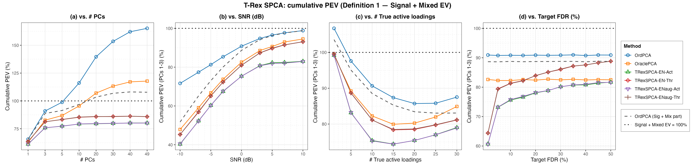
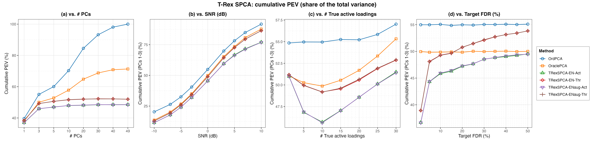
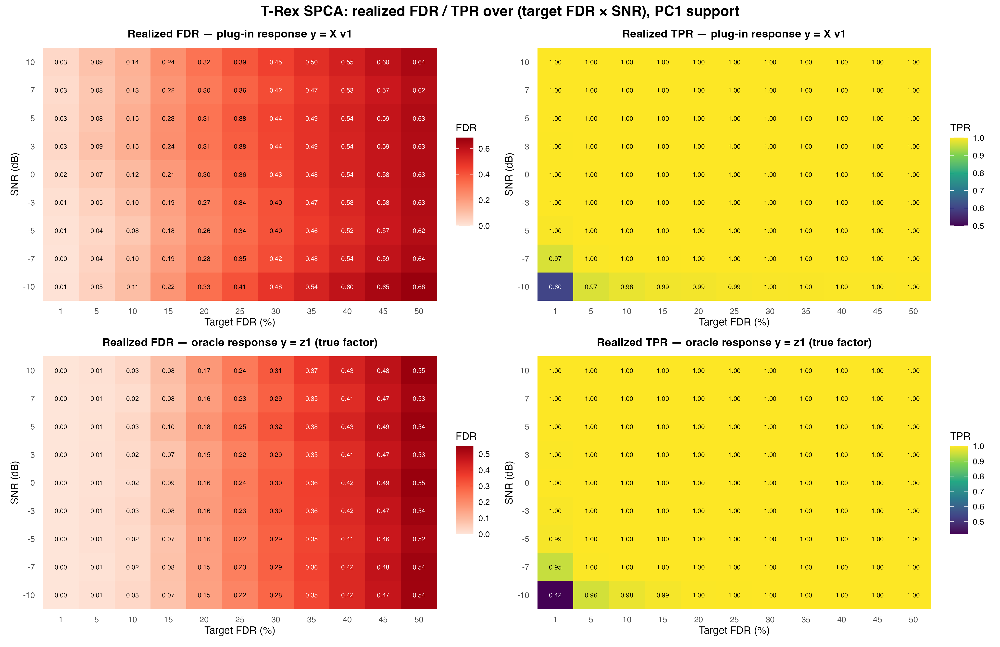

# Demo 02: Cumulative Explained Variance of T-Rex SPCA

## Purpose

While demo 01 asks whether the false discovery rate (FDR) of the loading support is controlled, this demo asks two
other questions. **What proportion of variance does the selected support actually explain, and where does a
non-sparse method's apparent advantage come from?**

It runs all four sweeps of **Fig. 3** of [[1]](#references) for the Terminating Random Experiments (T-Rex) selector
for sparse principal component analysis (SPCA), with the cumulative explained variance under the paper's
Definition 1, and reports the conventional total-variance normalization alongside it so the two can be compared
directly.
The pairing is the point. Under one denominator ordinary principal component analysis (PCA) looks best, under the
 other its overshoot past $100\%$ exposes the variance it takes from null variables, and both readings are computed
 from the very same explained variance.
 A fifth part maps the realized FDR and true positive rate (TPR) of the first principal component (PC1) over the full
 grid of target FDR and signal-to-noise ratio (SNR).

This is the R port of the
[C++ demo](../../../../../cpp/trex_selector_methods/ad/trex_spca/demo_trex_spca_02_mc_sim_pev/README.md),
using the `TRexSPCASelector` and `TRexGVSSelector` classes of the TRexSelector package. It keeps the
data-generating process (DGP), the sweeps, the measurement definitions and the result-file naming of the C++ demo and
of the
[Python port](../../../../../Python/trex_selector_methods/ad/trex_spca/demo_trex_spca_02_mc_sim_pev/README.md).
Support indices are 1-based (R convention).

The Definition-1 denominator is the **Signal + Mixed explained variance (EV) of the data**, the variance carried
 by the true active variables, fixed per dataset and shared by all methods. The R port computes it exactly like the
 C++ and Python demos, in `evaluate_spca()` of [`../trex_spca_sim_utils.R`](../trex_spca_sim_utils.R), as
 $\lVert \boldsymbol X_{\mathcal A} \rVert_F^2 / (n-1)$ over the columns in the union of the true factor supports.
 This convention reproduces the published panels' qualitative behaviour (curves *rising* with the SNR from about
 $40\%$, ordinary PCA overshooting far past $100\%$). An earlier revision of the C++ demo instead normalized each
 method by its **own** Signal + Mixed EV ("Definition 1 as printed"), which is structurally $\geq 100\%$ for
 null-capturing methods and inverts the SNR trend, so the published curves are unreachable under it. Digit-level
 coincidence with the paper's Fig. 3 remains impossible either way, because the paper's exact normalization cannot
 be reconstructed from its text (see [the dedicated section below](#relation-to-the-papers-fig-3)).

---

## Data Generation Parameters (`generate_sparse_factor_model()`)

The sparse $M$-factor model of
 [demo 01](../demo_trex_spca_01_mc_sim/README.md#data-generation-parameters-generate_sparse_factor_model),
 unchanged:

```math
\boldsymbol{X} = \boldsymbol{Z}\boldsymbol{V}^\top + \boldsymbol{E}
```

- $n = 50$, $p = 100$, $M = 3$ true factors, $\sigma_m \in \lbrace5, 3, 1\rbrace$.
- $p_1 = 10$ active loadings of value $0.9$ per factor, drawn without replacement from a **shared pool** of
   `overlap_pool_size` $= 30$ candidates, so factor supports partially coincide. Unlike demo 01 (which
   mirrors Fig. 2 at $p_1 = 5$), this demo mirrors Fig. 3 and therefore defaults to $p_1 = 10$.
- All methods see the same **center-only** $\boldsymbol{X}$ (covariance-PCA footing).

---

## Control Parameters

```text
tFDR = 0.10           # Target FDR (swept in Part 4)
lambda_2 = -1         # < 0 selects the ridge penalty by k-fold CV (lambda2_method = "CV_1SE_CCD")
scaling = L2          # Per-component selector scaling (library default)
num_MC = 200          # Monte Carlo repetitions per grid point
base_seed = 42        # Per-grid-point seed band, derived from the swept value
```

As in demo 01, only the **data** is seeded deterministically, while each trial's dummies come from hardware
 entropy (selector `seed = -1L`), which is what makes the Monte Carlo estimate valid. A rerun therefore
 reproduces the results to within Monte Carlo noise, not exactly. The seed of a grid point is
 `base_seed + round(7 * value) + index` with the 0-based grid index, as in the C++ and Python demos, and trial `mc`
 adds `mc * 1000`. The C++ demo stores this offset in an unsigned integer, which wraps the negative offsets of the
 SNR sweep, and the Python port mirrors that wrap. R accepts negative seeds, so the R port uses the offsets as they
 are. R's generator draws other numbers from the same seeds in any case, so the R data differ from the C++ and Python
 data.

---

## Methods Compared

The methods are those of [demo 01](../demo_trex_spca_01_mc_sim/README.md#methods-compared), namely **OrdPCA**,
 **OraclePCA** and the four T-Rex SPCA variants crossing `TENET`/`TENET_AUG` with `ActiveSet`/`Thresholded`.

The metrics are those of [demo 01](../demo_trex_spca_01_mc_sim/README.md#metrics), the classical EV, corrected
 to the adjusted EV of [[3]](#references), reported as `PEV` (total-variance share), `PEVsig`
 (Definition 1) and `PEVsigmix` (the method's own Sig + Mix part, where OrdPCA's is the paper's
 "Ordinary PCA (Sig + Mix)" reference curve). As in demo 01, realized FDR is evaluated on the support of PC1 only,
 and FDR *control* is assumed for PC1 only, because the overlapping factor supports make later components' ground
 truth ambiguous.

---

## The Sweeps

Each part varies **one** axis and holds the rest at their defaults, namely 3 extracted principal components (PCs),
 SNR $= 0$ dB, $p_1 = 10$ and $\mathrm{tFDR} = 0.10$.

| Part | Axis | Grid |
| --- | --- | --- |
| 1 | Number of **extracted** PCs | $\lbrace1, 3, 5, 10, 20, 30, 40, 49\rbrace$ |
| 2 | SNR (dB) | $\lbrace-10, -7, -5, -3, 0, 3, 5, 7, 10\rbrace$ |
| 3 | Number of true active loadings $p_1$ | $\lbrace1, 5, 10, 15, 20, 25, 30\rbrace$ |
| 4 | Target FDR | $\lbrace0.01, 0.05, 0.10, 0.15, \ldots, 0.50\rbrace$ |
| 5 | Realized FDR / TPR **heatmaps** over target FDR $\times$ SNR | $11 \times 9$ points, PC1, two responses |

Notes on the grids:

- **Part 1 varies only how many components are *extracted*.** The data keeps its $M = 3$ true factors
   throughout, so every component beyond the third is null by construction and can contribute nothing but
   Null EV. That is exactly what makes the panel diagnostic.
- **Part 1 stops at 49, not at 50.** $\boldsymbol{X}$ is centered, so
   $\operatorname{rank}(\boldsymbol{X}) \leq n - 1 = 49$ and a 50th component carries no variance at all.
   Asking the per-component selector to regress on that null direction throws outright, because its response vector
   is constant. 49 is the largest attainable principal component (PC) count on an $n = 50$ design, not a safety margin.
- **Part 3 is bounded above by the overlap pool.** Each factor draws its support from a shared pool of 30
   candidates, so $p_1 \leq 30$.
- **Only the T-Rex variants respond to Part 4.** The two PCA baselines never see `tFDR`, so they are reported
   as flat reference lines.
- **Parts 2–4 are displayed as cumulative proportion of explained variance (PEV) only.** Their extraction is
   held at the $M = 3$ true factors, so what they show is the cumulative PEV of PCs 1–3 under both
   normalizations. Support-recovery metrics belong to demo 01's sweep. Here they remain in the comma-separated values
   (CSV) files as the data record but are not displayed.
- **Part 5 is the support-recovery counterpart of Part 4**, run over the full 2D grid instead of the 0 dB
   slice, and only for PC1. Each trial runs the per-PC selector for grouped variable selection (GVS) with the
   elastic net (EN), T-Rex+GVS(EN) [[2]](#references), twice on the same data. The plug-in run uses the
   **plug-in response** $y = \boldsymbol{X} v_1$ (what T-Rex SPCA actually regresses on), and the oracle run uses
   the **oracle response** $y = z_1$, the centered true factor scores. The pairing isolates the mechanism behind the FDR
   overshoot at loose targets (see the caveat section below). The data seed of a cell depends on the trial and the
   SNR only, so each heatmap row reuses the same datasets across its targets.

Part 5 calls the selector class directly, with the configuration that `TRexSPCASelector` uses internally:

```r
sel <- TRexGVSSelector$new(
  X + 0, y + 0, tFDR = tfdr, seed = -1L, verbose = FALSE,
  gvs_control = trex_gvs_control(gvs_type = "EN", en_solver = "TENET",
                                 lambda_2 = -1, lambda2_method = "CV_1SE_CCD"),
  control = trex_control(solver = "TENET", scaling_mode = "L2",
                         lloop_strategy = "STANDARD")
)
sel$select()
fdr_tpr <- score(sel$selected_indices, which(dat$V[, 1L] != 0))
```

Here `y` is `X` times the first right singular vector from base-R `svd()` for the plug-in response and the centered
first column of the true scores for the oracle response, and `score()` stands for the PC1 FDR and TPR computation in
`.trial_heatmap()` of the demo script. Parts 1–4 build `TRexSPCASelector` exactly as in
[demo 01](../demo_trex_spca_01_mc_sim/README.md#control-parameters).

---

## Output Files

Written to `simulation_results/data/`, one pair per sweep:

- `demo_trex_spca_02_mc_sim_pev_pcs.txt` / `.csv`
- `demo_trex_spca_02_mc_sim_pev_snr.txt` / `.csv`
- `demo_trex_spca_02_mc_sim_pev_loadings.txt` / `.csv`
- `demo_trex_spca_02_mc_sim_pev_tfdr.txt` / `.csv`
- `demo_trex_spca_02_mc_sim_pev_fdr_heatmap.csv`, Part 5 (`response,metric,tfdr,snr_db,value`)

The `pcs` table carries FDR, TPR, `PEV` (total-variance normalization), `PEVsig` (Definition 1) and
 `PEVsigmix` (the method's Sig + Mix part) per method, while the `snr`, `loadings` and `tfdr` **tables are
 restricted to the cumulative-PEV rows** (PCs 1–3). Every CSV still records all five metrics. The file names and CSV
 schemas match the C++ and Python demos.

Figures in Portable Network Graphics (PNG) and Portable Document Format (PDF) go to `simulation_results/plots/`,
 produced by [`generate_plots.sh`](generate_plots.sh) via the suite's ggplot2 plotting module
 [`../trex_spca_plt_utils.R`](../trex_spca_plt_utils.R), which combines all four sweeps into one panel figure
 per normalization:

- `demo_trex_spca_02_mc_sim_pev_signal.png`, the cumulative PEV under Definition 1.
- `demo_trex_spca_02_mc_sim_pev_total.png`, the cumulative PEV as a share of the total variance.
- `demo_trex_spca_02_mc_sim_pev_fdr_heatmap.png`, Part 5, the realized FDR / TPR heatmaps for both responses.

---

## Running the Demo

```bash
demo=R/trex_selector_methods/ad/trex_spca/demo_trex_spca_02_mc_sim_pev/demo_trex_spca_02_mc_sim_pev.R

Rscript "$demo"                       # full run, TREX_NUM_WORKERS workers (default 8)
Rscript "$demo" 12                    # 12 worker cores
TREX_SPCA_PARTS=5 Rscript "$demo"     # only the Part 5 heatmaps
TREX_SPCA_NUM_MC=10 Rscript "$demo"   # pilot run with 10 MC trials per point
```

`TREX_SPCA_NUM_MC=<k>` overrides the Monte Carlo (MC) count for quick pilot runs, and `TREX_SPCA_PARTS` selects which
parts run (default `12345`, while `TREX_SPCA_PARTS=5`, for example, reruns only the FDR/TPR heatmap sweep). These are
the same environment switches as in the C++ and Python demos.

Monte Carlo trials run in parallel on a parallel socket (PSOCK) cluster of spawned R worker processes
([`../../../mc_runtime.R`](../../../mc_runtime.R)), each with single-threaded solvers. The worker count is the first
command-line argument, else `TREX_NUM_WORKERS`, else 8, and `0` uses every core. Every finished cell (one method at
one grid point, or one heatmap cell) is appended to a cache in `simulation_results/cache/`, so a stopped run resumes
where it left off. A completed run removes the cache, and a change of the configuration or of the run tag
`TREX_RUN_TAG` sets an old cache aside. The script also sources
[`../trex_spca_sim_utils.R`](../trex_spca_sim_utils.R).

The PC-count sweep is the most expensive part, because extracting 49 components means 49 independent T-Rex
selections per trial. The recorded run (all five parts, 200 MC trials, library commit `44cf1ab`, 8 workers) took
about 76 min.

Afterwards, regenerate the figures from the CSV files with [`generate_plots.sh`](generate_plots.sh), which drives
[`../trex_spca_plt_utils.R`](../trex_spca_plt_utils.R) through `Rscript` (set `RSCRIPT` to use another R
installation). The figures need `ggplot2` and `patchwork`.

---

## Simulation Results

All five parts, 200 MC trials per grid point. The numbers and figures below are this R run's own results.

### Agreement with the C++ and Python runs

R draws its own random numbers, so its results agree with the
[C++ reference](../../../../../cpp/trex_selector_methods/ad/trex_spca/demo_trex_spca_02_mc_sim_pev/README.md)
and the Python port up to Monte Carlo noise, not exactly. The result files carry no standard deviations, so a
$z$-score per cell cannot be formed. Instead, each R − C++ difference is set against the Python − C++ difference of
the same cell, because the Python port is already accepted as matching C++.

- Over the 816 FDR and TPR cells of the four sweeps and the heatmap, the mean absolute difference to C++ is
   $0.002\text{–}0.004$ per table for R and $0.003\text{–}0.004$ for Python. The largest single gap is $0.063$ for R
   and $0.058$ for Python, both in the same heatmap cell, the oracle TPR at $\mathrm{tFDR} = 0.01$ and $-10$ dB. There
   R ($0.416$) and Python agree with each other and both sit below C++.
- Over the PEV cells the mean absolute difference to C++ is $0.0016\text{–}0.0028$ per table for R and
   $0.0019\text{–}0.0024$ for Python.
- The mean signed difference of R to C++ stays below $0.002$ in every table, so R shows no systematic offset.

R's gaps to C++ are as large as Python's, so the three ports agree up to Monte Carlo noise. As a supporting check, the
per-trial false discovery and true positive proportions lie in $[0, 1]$, so a proportion with mean $m$ has a standard
deviation of at most $\sqrt{m(1-m)}$. Under this loose bound no FDR or TPR cell lies more than three standard errors
from C++.

### Cumulative PEV under Definition 1

- **Panel (a) is the clearest statement in this suite.** The data has three true factors, so every component past
   the third can only add Null EV, and that is exactly what the curves show. Ordinary PCA climbs from $65.6\%$ at
   one PC past the $100\%$ line between five and ten PCs to $165.2\%$ at 49. By the time it has extracted 49
   components it is reporting about two thirds more variance than the true active variables carry. Its dashed
   Sig + Mix decomposition levels off near $108\%$ ($108.1\%$ at 40 PCs, $107.8\%$ at 49), and everything between
   the solid and dashed curves is Null EV.
- **OraclePCA climbs past the line as well**, to $117.8\%$ at 49 PCs, and crosses the dashed OrdPCA reference
   between 10 and 20 PCs. It is an oracle only about the support *size* $p_1$. A plausible reading is that on the
   components beyond the third, which carry no factor, its $\text{top-}p_1$ thresholding keeps mostly null variables
   and the renormalization hands them full weight, so knowing the cardinality does not protect against thresholding
   noise.
- **The four T-Rex variants stay nearly flat.** From 3 to 49 PCs they gain only $4.2\text{–}4.7$ points
   ($75.8\text{–}75.9\% \to 80.1\text{–}80.2\%$ for `ActiveSet`,
   $81.3\% \to 85.8\text{–}85.9\%$ for `Thresholded`),
   while OraclePCA gains $35.1$ points and ordinary PCA $74.2$. They decline to claim variance that is not theirs
   even when handed 46 components they do not need. The data do not record the supports on the extra components,
   so whether the selector returns (near-)empty supports there is not measured.
- **Panel (b) rises with SNR, as in the published Fig. 3(b).** At $-10$ dB the true active columns are
   dominated by noise that no 3-component method can capture, so everything sits low, at $40.3\text{–}45.3\%$ for
   the T-Rex variants, $47.9\%$ for OraclePCA and $71.6\%$ for ordinary PCA. Ordinary PCA's dashed Sig + Mix curve
   sits at $51.7\%$ there, so $19.9$ points of its $23.8$-point lead over OraclePCA are Null EV. With rising SNR the
   `Thresholded` variants and OraclePCA converge toward the line ($93.1\%$ and $94.5\%$ at $+10$ dB), the
   `ActiveSet` variants level off at $81.9\text{–}83.0\%$ from $+5$ dB up, and ordinary PCA's solid and dashed curves
   merge at $98.8\%$. At high SNR there is hardly any null variance left to harvest.
- **Panel (c) is non-monotone.** All methods start near or above $100\%$ at $p_1 = 1$ ($99.2\text{–}99.6\%$ for
   the sparse methods, $106.7\%$ for ordinary PCA, split again by its dashed curve at $103.6\%$). They sag to a
   minimum at $p_1 = 15$ ($74.4\%$ `ActiveSet`, $78.4\text{–}78.5\%$ `Thresholded`, $79.9\%$ OraclePCA) or
   $p_1 = 20$ ($85.7\%$ ordinary PCA) and recover toward $p_1 = 30$ ($78.9\text{–}79.0\%$, $81.1\text{–}81.2\%$,
   $84.9\%$ and $87.5\%$). At $p_1 = 1$ the union of the factor supports holds at most three variables, and at
   $p_1 = 30$ every factor's support is the whole overlap pool, so the three supports coincide. The middle of the
   range is where support selection actually matters.
- **Panel (d) shows the price of a strict target.** The two ordinary-PCA references are `tFDR`-blind and sit flat
   ($90.8\text{–}91.0\%$ solid, $88.6\text{–}88.8\%$ dashed), as does OraclePCA ($82.3\text{–}82.7\%$). The T-Rex
   variants pay most at the strictest target ($60.6\text{–}60.7\%$ `ActiveSet` and $64.4\%$ `Thresholded` at
   $\mathrm{tFDR} = 0.01$). The step to $\mathrm{tFDR} = 0.05$ adds $12.5\text{–}12.6$ and $14.9\text{–}15.0$
   points, and the whole range from $0.05$ to $0.50$ adds only $8.4\text{–}8.6$ and $9.4\text{–}9.5$ more
   ($75.6\text{–}75.8\% \to 81.6\text{–}81.7\%$ and $81.3\% \to 88.8\%$ from $\mathrm{tFDR} = 0.10$ to $0.50$).
   `Thresholded` passes OraclePCA from $\mathrm{tFDR} = 0.20$ on. Loosening the target buys captured variance
   slowly, and it pays for it in realized FDR (see the caveat below).



### The same variance, normalized by the total variance

Read through the conventional denominator, the ranking of the methods stays the same, but nothing marks ordinary
PCA's surplus as Null EV, and the story becomes "sparsity costs variance":

- In panel (a) ordinary PCA rises to exactly $100.0\%$ at 49 PCs. With $n - 1 = 49$ components it spans the
   whole centered row space and reproduces the data completely. The T-Rex variants reach $48.5\text{–}52.0\%$ at
   49 PCs and add only $1.4\text{–}1.5$ points after five components, which is the same flatness as before seen from
   the other side. OraclePCA keeps climbing, from $52.8\%$ at five PCs to $71.3\%$ at 49.
- The gap between the two figures at $p_1 = 10$ and 49 PCs is the whole argument in two numbers. Ordinary PCA
   explains $100.0\%$ of the total variance, and $165.2\%$ of the variance that belongs to the true active
   variables.



### Relation to the paper's Fig. 3

The paper's text does not pin down the normalization behind its plotted curves. The
 [C++ README](../../../../../cpp/trex_selector_methods/ad/trex_spca/demo_trex_spca_02_mc_sim_pev/README.md)
 reports that no constructible denominator reproduces all published anchors, so digit-level agreement with Fig. 3 is
 not attainable from the paper alone. A self-normalized reading of Definition 1 is ruled out entirely, because it is
 $\geq 100\%$ by construction for null-capturing methods and inverts the SNR trend. This demo therefore uses the fixed
 active-column denominator throughout, which reproduces the figure's qualitative content. In the R run the curves
 rise with SNR, ordinary PCA's Null-EV overshoot passes $100\%$, the T-Rex variants stay below $100\%$ in every
 sweep, and the same ranking reads as a cost of sparsity under one normalization and as harvested Null EV under
 the other.

### A caveat on FDR at loose targets

Part 5 maps the realized FDR and TPR of PC1's support over the **full** (target FDR $\times$ SNR) grid,
 200 MC trials per cell, with the same datasets across each row's targets. The FDR panels show the realized FDR on a
 red scale from $0$, and whether a cell is in control is read against its column's target. Each configuration
 is run for two selector responses, and the pairing is a controlled test of the mechanism suspected behind the
 overshoot:

- **plug-in response** $y = \boldsymbol{X} v_1$, the ordinary PC1, exactly what T-Rex SPCA regresses on.
   The regression's own true support is **dense** ($v_1$ is nonzero on every variable), while the scoring truth
   is the sparse factor-model support.
- **oracle response** $y = z_1$, the true factor scores (unobservable in practice). Here the regression
   truth is no longer dense. It lies within the union of the factor supports, so selector-level control and
   factor-model scoring come much closer, though they need not coincide while the supports overlap.



What the grid shows:

- **Under the plug-in response the realized FDR overshoots already at the strict targets, and from
   $\mathrm{tFDR} = 0.15$ at every SNR.** At $\mathrm{tFDR} = 0.05$ the realized FDR is $0.038\text{–}0.094$, above
   target at seven of the nine SNR points. At $0.10$ it is $0.079\text{–}0.149$, above target at $-10$ dB ($0.106$)
   and from $0$ dB up ($0.117\text{–}0.149$). From $0.15$ on, every cell exceeds its target, by $+0.026$ to $+0.087$
   at $0.15$, growing to $+0.119$ to $+0.184$ at $0.50$ (realized $0.619\text{–}0.684$). The excess is present
   at every SNR, so low SNR is not its cause.
- **Under the oracle response most of the overshoot vanishes.** With the true factor as response the realized FDR
   stays at or below target through $\mathrm{tFDR} = 0.25$ at every SNR (for example $0.073\text{–}0.096$ against
   $0.15$ and $0.151\text{–}0.178$ against $0.20$), and at the strict targets it is far below them
   ($0.018\text{–}0.029$ against $0.10$). From $0.30$ on the cells drift above target, four of nine by at most
   $+0.016$ at $0.30$ and all nine by $+0.021$ to $+0.049$ at $0.50$ ($0.521\text{–}0.549$). The two responses
   share the data and the selector, so the comparison attributes the bulk of the plug-in overshoot to the
   response. A plausible reading is the **evaluation mismatch**, a dense-truth regression scored against a sparse
   truth, rather than a failure of the selector. A small overshoot remains at loose targets even under the oracle
   response.
- **TPR is a non-issue except in the strict-target / low-SNR corner.** It is $\geq 0.958$ everywhere outside the
   $\mathrm{tFDR} = 0.01$ column, and inside it dips only at low SNR, where the selector keeps too few variables
   ($0.602$ plug-in and $0.416$ oracle at $-10$ dB, $0.969$ and $0.947$ at $-7$ dB). Panel (d) runs at $0$ dB,
   where the PC1 TPR is $1.000$ even at $\mathrm{tFDR} = 0.01$, so its PEV dip at the strictest target does not
   come from this corner.
- **The sweep CSVs show the same overshoot for the full T-Rex SPCA pipeline.** Their FDR rows (PC1, all four
   variants, $\mathrm{tFDR} = 0.10$ unless swept) read $0.106\text{–}0.136$ over the PC-count sweep at $0$ dB,
   $0.092\text{–}0.107$ up to $-3$ dB and $0.109\text{–}0.167$ from $0$ dB up in the SNR sweep, and
   $0.631\text{–}0.637$ at $\mathrm{tFDR} = 0.50$. The realized FDR also depends on the support size. It is
   $0.010\text{–}0.013$ at $p_1 = 1$, $0.069\text{–}0.075$ at $p_1 = 5$, $0.185\text{–}0.225$ at
   $p_1 = 15\text{–}25$ and $0.111\text{–}0.115$ at $p_1 = 30$. The data do not show what drives the dependence on
   $p_1$.

**Consequences.** At this suite's default $\mathrm{tFDR} = 0.10$ the realized PC1 FDR stays within $0.07$ of the
 target over the whole SNR range, with the excess concentrated at $0$ dB and above. Loosening the target is a poor
 trade under factor-model scoring, because from $0.10$ to $0.50$ it buys about six PEV points (panel (d),
 `ActiveSet`) while the realized factor-model FDR climbs to $0.62\text{–}0.68$.
The general lesson is the conditional nature of the guarantee.
 **T-Rex SPCA controls the FDR of the regression it is handed, and that transfers to the factor model
 only insofar as the plug-in PC is a faithful proxy for the factor** (see also demo 01's union-FDR
 section for the same condition read across components).

---

## References

1. Machkour, J., Breloy, A., Muma, M., Palomar, D. P., & Pascal, F., "Sparse PCA with False Discovery Rate Controlled
   Variable Selection.", IEEE International Conference on Acoustics, Speech and Signal Processing (ICASSP), 2024,
   pp. 9716–9720, IEEE.
   [DOI-Link](https://doi.org/10.1109/ICASSP48485.2024.10448237)
2. Machkour, J., Muma, M., & Palomar, D. P., "False Discovery Rate Control for Grouped Variable Selection
   in High-Dimensional Linear Models using the T-Knock Filter.", European Signal Processing Conference (EUSIPCO), 2022,
    pp. 892–896, European Association for Signal Processing (EURASIP).
    [DOI-Link](https://doi.org/10.23919/EUSIPCO55093.2022.9909883)
3. Zou, H., Hastie, T., & Tibshirani, R., "Sparse Principal Component Analysis.", Journal of Computational
   and Graphical Statistics, vol. 15, no. 2, 2006, pp. 265–286, Taylor & Francis.
   [DOI-Link](https://doi.org/10.1198/106186006X113430)
