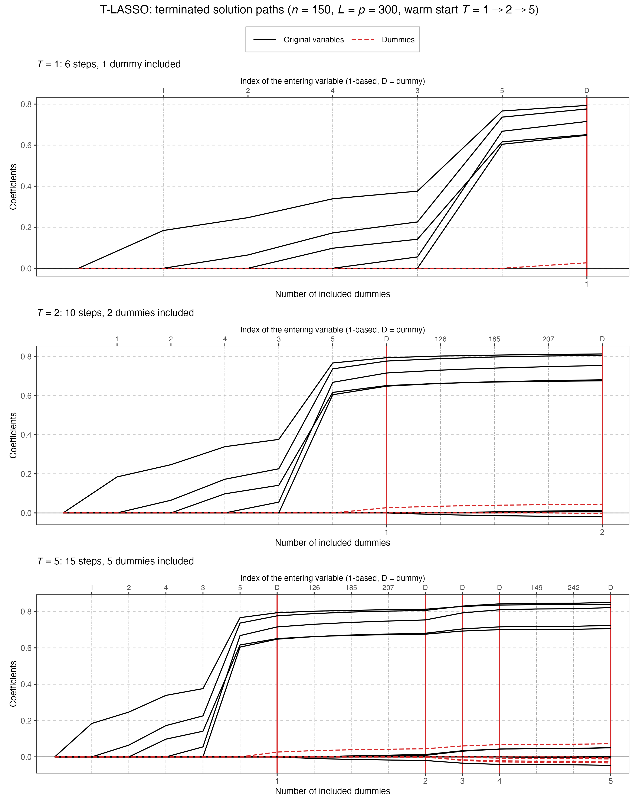

# Demo: T-LASSO Solver (R)

## Purpose

This demo runs the terminating least absolute shrinkage and selection operator (T-LASSO) solver of the TRexSelector R
package on its own, outside the Terminating-Random Experiments (T-Rex) selector, through the R6 class `TLASSO_Solver`.
It mirrors the [C++ demo](../../../../cpp/tsolvers/ad/demo_ts_02_tlasso/README.md) and the [Python
demo](../../../../Python/tsolvers/ad/demo_ts_02_tlasso/README.md) part by part, with the same settings, seed values and
console format, while R's Mersenne-Twister draws the data and all indices are 1-based, so the numbers differ from the
other two runs. It follows the path of terminating least angle regression (T-LARS) and adds the lasso modification,
which removes a variable from the active set when its coefficient crosses zero (a drop), so the path is the exact lasso
path.

The demo has five parts:

1. early stopping with internal normalization, for $p > n$ and $n > p$,
2. the same data normalized outside the solver,
3. a checkpoint saved to disk, reloaded and continued,
4. the predictor matrix memory-mapped from disk,
5. terminated solution paths of one warm-started object, drawn as a figure.

---

## Key idea

A terminating solver does not compute the whole path. It stops once $T$ dummies have entered the active set:

```math
\hat{\boldsymbol{\beta}}^{(T)} = \mathrm{TLASSO}(\mathbf{X}, \mathbf{D}, \mathbf{y}; T).
```

Part 1 of the demo calls

```r
solver <- TLASSO_Solver$new(
  dat$X, dat$D, dat$y,
  options = tsolver_options(normalize = TRUE, intercept = TRUE, verbose = TRUE)
)
solver$execute_step(T_stop, early_stop = TRUE)
```

and the path stops as soon as the number of active dummies reaches `T_stop`. A later call with a larger `T_stop`
continues the stored path, which Part 5 uses for the warm start.

---

## Running the demo

From the repository root, with the TRexSelector R package 2.0.0 installed from library commit b95b984:

```bash
Rscript R/tsolvers/ad/demo_ts_02_tlasso/demo_ts_02_tlasso.R        # Parts 1-5
Rscript R/tsolvers/ad/demo_ts_02_tlasso/demo_ts_02_tlasso.R 1 2 3  # Parts 1 to 3
Rscript R/tsolvers/ad/demo_ts_02_tlasso/demo_ts_02_tlasso.R 5      # Part 5 only
R/tsolvers/ad/demo_ts_02_tlasso/generate_plots.sh                  # path figure from the Part 5 data
```

The optional arguments select the parts to run through `part_selection()` of `ts_demo_utils.R`, and without them all
five parts run. If the package is installed in a separate library, prefix the commands with `R_LIBS=<R library>`.
`generate_plots.sh` draws the figure with `R/tsolvers/ts_plt_utils.R`, the ggplot2 and patchwork port of the plotting
module of the C++ demos, through the `Rscript` on the `PATH` or the one that `RSCRIPT` names. It writes the figure as
Portable Network Graphics (PNG) and Portable Document Format (PDF) files to `simulation_results/plots/`. The PDF is
written with `pdf(timestamp = FALSE)`, so a rerun on the same data gives a byte-identical file.

The output below is a run against library b95b984 (TRexSelector 2.0.0). The demo sets a budget of six Open
Multi-Processing (OpenMP) threads with `trex_set_num_threads(min(6L, trex_get_max_threads()))`, as the C++ demo does,
and confirms it in its first lines:

```text
============================================================
T-LASSO Demo Suite
============================================================
Running with 6 threads
```

The line reads `Running with 6 threads` only when TRexSelector was built with OpenMP, and a build without it compiles
single-threaded, where `trex_get_max_threads()` is 1, so the demo sets a budget of 1 and prints
`Running with 1 threads`. Linux and Windows builds use R's own OpenMP flags, while on macOS, where R from the
Comprehensive R Archive Network (CRAN) has none, the configure script of the package links R's own OpenMP runtime when
an `omp.h` is available (from Homebrew or the OpenMP package of mac.r-project.org), otherwise Homebrew's libomp, and
builds single-threaded without either.

---

## Console walk-through

### Part 1: early stopping

Part 1 draws $n = 1{,}000$ observations of $p = 5{,}000$ variables and then $n = 5{,}000$ observations of $p = 1{,}000$
variables, each time with $L = 10p$ standard normal dummies after `set.seed(42)`. Five true coefficients equal to 1 sit
on the variables 5, 28, 150, 399 and 421, the 1-based positions of the C++ variables 4, 27, 149, 398 and 420, and
`snr = 1` gives a noise standard deviation of about 2.2. T-LASSO centers and scales the data itself
(`normalize = TRUE, intercept = TRUE`) and runs to $T = 10$.

```text
============================================================
Demo 1: Basic T-LASSO with Early Stopping
============================================================
High-dimensional (p > n)
Configuration:
  n = 1000, p = 5000
  num_dummies = 50000
  T_stop = 10
  True support size = 5
  True support: 28 150 399 421 5
  True coefficients: 1 1 1 1 1
  SNR = 1

[Info] TLASSO sequence
  Samples (n): 1000
  Features (p): 55000 (5000 real + 50000 dummies)
  Max steps: 7992


Selection:
  Predictors: {150, 28, 5, 421, 399, 3121}
  Dummies: {42081, 11752, 46149, 49131, 18397, 22913, 13635, 45603, 30087, 38368}
  Path: [+v150, +v28, +v5, +v421, +v399, +D37081, +D6752, +D41149, +v3121, +D44131, +D13397, +D17913, +D8635, +D40603, +D25087, +D33368]

Selection Quality:
  True Positives:  5
  False Positives: 1
  False Negatives: 0
  FDP:             0.166667
  TPP:             1
  Precision:       0.833333
  Recall:          1
  F1 Score:        0.909091

T-LASSO Diagnostics:
  Removals: 0
  Cycling ratio: 0.0000


============================================================
Demo 1: Basic T-LASSO with Early Stopping
============================================================
Low-dimensional (n > p)
Configuration:
  n = 5000, p = 1000
  num_dummies = 10000
  T_stop = 10
  True support size = 5
  True support: 28 150 399 421 5
  True coefficients: 1 1 1 1 1
  SNR = 1

[Info] TLASSO sequence
  Samples (n): 5000
  Features (p): 11000 (1000 real + 10000 dummies)
  Max steps: 39992


Selection:
  Predictors: {5, 399, 28, 421, 150}
  Dummies: {2610, 5859, 3277, 5211, 6902, 4047, 1844, 4296, 4635, 1219}
  Path: [+v5, +v399, +v28, +v421, +v150, +D1610, +D4859, +D2277, +D4211, +D5902, +D3047, +D844, +D3296, +D3635, +D219]

Selection Quality:
  True Positives:  5
  False Positives: 0
  False Negatives: 0
  FDP:             0
  TPP:             1
  Precision:       1
  Recall:          1
  F1 Score:        1

T-LASSO Diagnostics:
  Removals: 0
  Cycling ratio: 0.0000
```

T-LASSO takes the same path as T-LARS in both cases, 16 steps for $p > n$ and 15 for $n > p$, and its diagnostics report
no removal, because no coefficient crosses zero before the tenth dummy. For $p > n$ the selection holds the five true
variables and the null variable `v3121`, which enters after the third dummy, with a false discovery proportion (FDP) of
$1/6 = 0.167$ and a true positive proportion (TPP) of 1. For $n > p$ it is exactly the true support.

The `Predictors` and `Dummies` lines give 1-based columns of the combined matrix $[\mathbf{X}, \mathbf{D}]$, in the
order in which the variables entered, and the dummies take the columns $p + 1$ to $p + L$. The `Path` line numbers the
dummies on their own, so column `42081` is dummy `D37081`, because the $p = 5{,}000$ columns of $\mathbf{X}$ come first.
The step limit `Max steps` is $8 \min(n - 1, p + L)$, because the intercept takes one degree of freedom, which gives
7,992 and 39,992.

### Part 2: external normalization

Part 2 uses the same data but centers and scales $\mathbf{X}$ and $\mathbf{D}$ outside the solver with
`MLLpNormScaler$new(norm_type = 2, center = TRUE)` (unit $L_2$ norm), through `$fit()` and `$transform_inplace()`, and
centers $\mathbf{y}$. T-LASSO then runs without its own normalization and intercept
(`normalize = FALSE, intercept = FALSE`). The part starts with the case $n > p$.

```text
============================================================
=== Demo 2: T-LASSO with External Normalization ===
============================================================
Low-dimensional (n > p)
Configuration:
  n = 5000, p = 1000
  num_dummies = 10000
  T_stop = 10
  True support size = 5
  True support: 5 28 150 399 421
  True coefficients: 1 1 1 1 1
  SNR = 1

Applying external L2 normalization...
[Info] TLASSO sequence
  Samples (n): 5000
  Features (p): 11000 (1000 real + 10000 dummies)
  Max steps: 40000


Selection:
  Predictors: {5, 399, 28, 421, 150}
  Dummies: {2610, 5859, 3277, 5211, 6902, 4047, 1844, 4296, 4635, 1219}
  Path: [+v5, +v399, +v28, +v421, +v150, +D1610, +D4859, +D2277, +D4211, +D5902, +D3047, +D844, +D3296, +D3635, +D219]

Selection Quality:
  True Positives:  5
  False Positives: 0
  False Negatives: 0
  FDP:             0
  TPP:             1
  Precision:       1
  Recall:          1
  F1 Score:        1

T-LASSO Diagnostics:
  Removals: 0
  Cycling ratio: 0.0000
```

The selection and the path equal those of Part 1, and the case $p > n$ that follows repeats the Part 1 path as well. So
the external normalization and the internal one lead to the same solver run. Only the step limit changes to 40,000 and
8,000, because the data are not marked as precentered and the solver takes the rank as $n$ instead of $n - 1$.

### Part 3: checkpoint and warm start

Part 3 uses a small problem with $n = 100$, $p = 50$, $L = 50$ and the three true coefficients 2.5, −1.8 and 3.2 on the
variables 11, 26 and 41 (the C++ variables 10, 25 and 40). It scales $\mathbf{X}$ and $\mathbf{D}$ once in front with
`MLLpNormScaler$fit_transform_inplace()` and centers $\mathbf{y}$, and three readers map the same R matrices without
copies. A reference solver runs to $T = 15$. A second solver runs to $T = 7$ and writes its state with `$save()` to
`tlasso_checkpoint.bin`. A third one is constructed with `$new()` on the same matrices, loads that file with `$load()`
and continues to $T = 15$. The R binding loads into an existing solver, while the C++ demo uses the static factory
`load(filename, X, D)`. At the end the scalers give the data back with `$inverse_transform_inplace()`.

```text
============================================================
=== Demo 3: T-LASSO Serialization & Path Consistency ===
============================================================
Configuration:
  n = 100, p = 50
  num_dummies = 50
  T_stop = 15
  True support size = 3
  True support: 11 26 41
  True coefficients: 2.5 -1.8 3.2
  SNR = 1

✓ Reference completed with 33 steps

Checkpoint at partial stop: 21 steps
✓ Checkpoint saved at 'tlasso_checkpoint.bin'
Loaded from checkpoint: 21 steps

COMPARISON:
Reference steps: 33
Reloaded steps:  33
RSS diff:   0
R2 diff:    0
✓ Paths match

T-LASSO Diagnostics:
  Removals: 0
  Cycling ratio: 0.0000
✓ Checkpoint file removed
```

The checkpoint holds the first 21 steps, up to $T = 7$. The reloaded solver continues to the same 33 steps as the
reference, with differences of exactly 0 in the residual sum of squares (RSS) and in $R^2$, and `identical()` confirms
the same actions. T-LARS needs the same 33 steps on this data, and the diagnostics again report no removal. Writers
would not work here, because each of them centers and scales the matrices in place, and a second writer on a claimed
matrix raises an error under the in-place contract of the library.

### Part 4: memory-mapped data

Part 4 draws the $p > n$ data of Part 1 again ($n = 1{,}000$, $p = 5{,}000$, $L = 50{,}000$), writes $\mathbf{X}$ with
`mem_matrix_from()` to the file `demo_tlasso_X.bin` next to the script, 40 MB of doubles, and drops its in-memory copy.
T-LASSO then runs as a writer on the returned `mmap_matrix` to $T = 10$, so it centers and scales the mapped file in
place. $\mathbf{D}$ (400 MB) and $\mathbf{y}$ stay in R memory, because the R binding accepts a memory-mapped
$\mathbf{X}$ only. The C++ demo maps all three and generates $p = 500{,}000$ directly on disk, about 44 GB, while the R
port keeps the size of Part 1.

```text
============================================================
=== Demo 4: T-LASSO with Memory-Mapped Data ===
============================================================
Configuration:
  n = 1000, p = 5000
  num_dummies = 50000
  T_stop = 10
  True support size = 5
  True support: 5 28 150 399 421
  True coefficients: 1 1 1 1 1
  SNR = 1

Generating memory-mapped data...
✓ Data generated on disk

Running T-LASSO on memory-mapped data...
[Info] TLASSO sequence
  Samples (n): 1000
  Features (p): 55000 (5000 real + 50000 dummies)
  Max steps: 7992

✓ T-LASSO completed


Selection:
  Predictors: {150, 28, 5, 421, 399, 3121}
  Dummies: {42081, 11752, 46149, 49131, 18397, 22913, 13635, 45603, 30087, 38368}
  Path: [+v150, +v28, +v5, +v421, +v399, +D37081, +D6752, +D41149, +v3121, +D44131, +D13397, +D17913, +D8635, +D40603, +D25087, +D33368]

Selection Quality:
  True Positives:  5
  False Positives: 1
  False Negatives: 0
  FDP:             0.166667
  TPP:             1
  Precision:       0.833333
  Recall:          1
  F1 Score:        0.909091

T-LASSO Diagnostics:
  Removals: 0
  Cycling ratio: 0.0000

Cleaning up files...
✓ All files removed
```

The selection and the path equal the $p > n$ run of Part 1, with the step limit 7,992 of the internal normalization. An
`on.exit()` handler removes the file when the part ends, also after an error.

### Part 5: terminated solution paths

Part 5 repeats the quick start of the R tlars vignette. With $n = 150$, $p = 300$, five true coefficients equal to 1 on
the variables 1 to 5 and $L = p = 300$ dummies, one T-LASSO object runs to $T = 1$ and is then warm-started to $T = 2$
and $T = 5$. Each call of `$execute_step()` continues the stored path, and `path_recorder()` writes a snapshot of the
path after each call to `simulation_results/data/`, in the comma-separated values (CSV) format of the C++ demo with
1-based indices. The setting `snr = 5` gives a noise standard deviation of about 1, as in the vignette.

```text
============================================================
=== Demo 5: T-LASSO Terminated Solution Paths ===
============================================================
Configuration:
  n = 150, p = 300
  num_dummies = 300
  T_stop = 5
  True support size = 5
  True support: 1 2 3 4 5
  True coefficients: 1 1 1 1 1
  SNR = 5

T_stop = 1: steps =  6, predictors =  5, dummies = 1, FDP = 0.000, TPP = 1.000
T_stop = 2: steps = 10, predictors =  8, dummies = 2, FDP = 0.375, TPP = 1.000
T_stop = 5: steps = 15, predictors = 10, dummies = 5, FDP = 0.500, TPP = 1.000

Selection:
  Predictors: {1, 2, 4, 3, 5, 126, 185, 207, 149, 242}
  Dummies: {488, 522, 555, 413, 349}
  Path: [+v1, +v2, +v4, +v3, +v5, +D188, +v126, +v185, +v207, +D222, +D255, +D113, +v149, +v242, +D49]

Path data written to:
  .../R/tsolvers/ad/demo_ts_02_tlasso/simulation_results/data/tlasso_terminated_paths_path.csv
  .../R/tsolvers/ad/demo_ts_02_tlasso/simulation_results/data/tlasso_terminated_paths_actions.csv
```

The path equals the T-LARS path, so no coefficient crosses zero before the fifth dummy. The five true variables enter
first, and the run to $T = 1$ ends after six steps with an FDP of 0. The run to $T = 2$ admits the null variables 126,
185 and 207, and the run to $T = 5$ adds 149 and 242, so the FDP is $3/8 = 0.375$ at $T = 2$ and $5/10 = 0.5$ at $T = 5$
while the TPP stays at 1.

The figure shows the three snapshots, and each one continues the previous path. Original variables are black, dummies
red and dashed, a red vertical line marks each included dummy, and the top axis gives the 1-based index of the variable
that enters at each step, with D for a dummy.



---

## Technical notes

- Part 3 writes the checkpoint `tlasso_checkpoint.bin` next to the script, under a path relative to the working
  directory, and removes it after the comparison.
- Part 4 writes $\mathbf{X}$ into the temporary file `demo_tlasso_X.bin` of 40 MB next to the script, and an `on.exit()`
  handler removes it at the end, also when the run fails.
- All indices are 1-based, in the console output, the path files and the figure, while the C++ and Python demos count
  from 0. `set.seed()` takes the C++ seed values, and R's Mersenne-Twister draws other numbers from them, so the paths
  differ from the C++ and Python runs of the same setup.
- The library prints its log lines (`[Info] ...`) through `Rcpp::Rcout`, so they appear in order with the output of
  `cat()`, also when the output goes to a file or a pipe, and the R demos need no line-buffering setup.
- `print_selection()` colours the `Path` line with terminal escape codes (true variables green, null variables red,
  dummies blue), which the log keeps and the console blocks above leave out.
- The path data and figures under `simulation_results/` are committed, so the figure is visible without a run.
